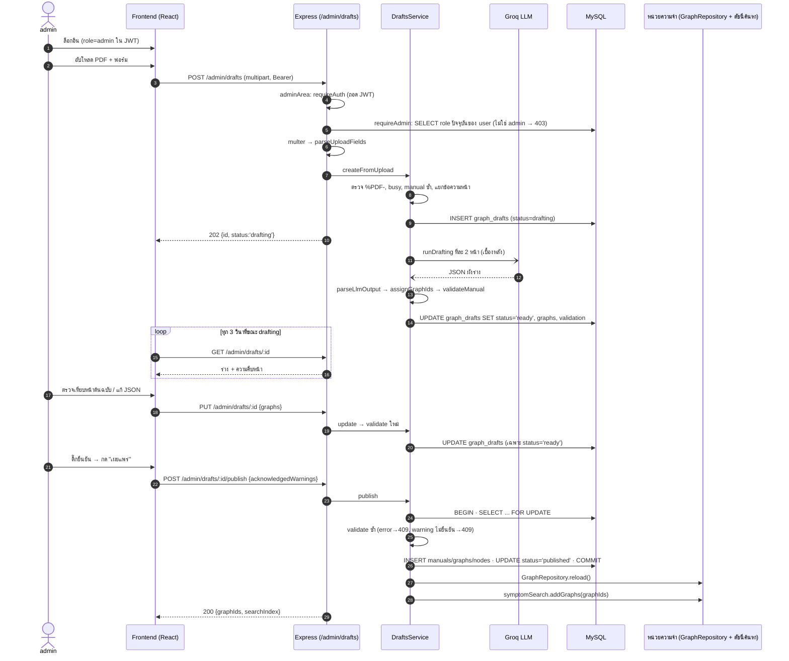
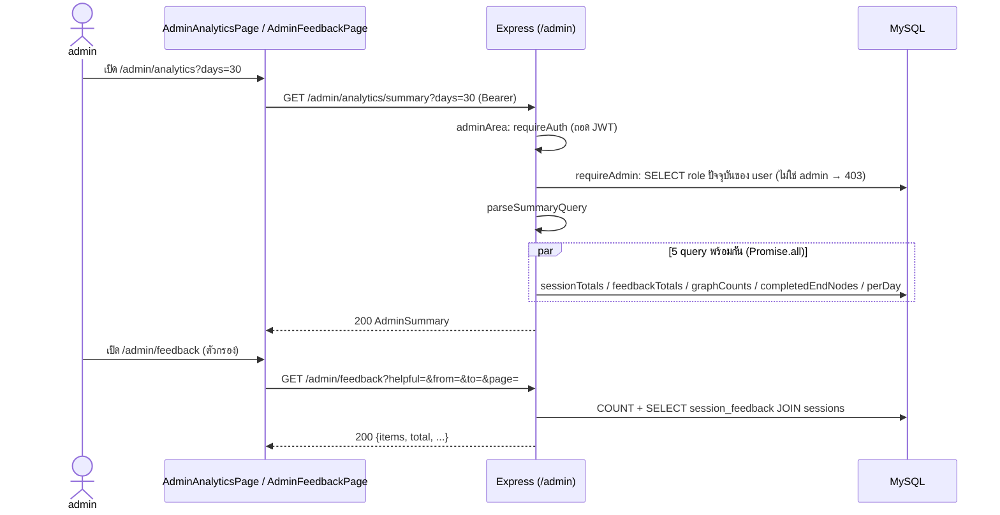

# Walkthrough: 1 รอบการใช้งานฝั่ง admin (เข้าสู่ระบบ → ร่างแผนผังจาก PDF → ตรวจ/เผยแพร่ → ดูความเห็น → แดชบอร์ด)

> เอกสารนี้อ่านอย่างเดียว ไม่ได้แก้โค้ดใดๆ · เขียนจากการอ่านโค้ดเมื่อ 27 ต.ค. 2569 ไม่ได้รันเว็บหรือยิง API จริง
> ศัพท์ โครง และ **ลำดับ middleware ของ request (Express)** ใช้ตามเอกสารคู่กัน [`docs/USER_JOURNEY_WALKTHROUGH.md`](USER_JOURNEY_WALKTHROUGH.md) §2.1 ส่วน auth/JWT อธิบายละเอียดไว้ที่ช่วง 2 ของเอกสารนั้น (และ `docs/study/JOURNEY-ALL-1-9.md` ช่วง 2) เอกสารนี้อ้างข้ามแทนการเขียนซ้ำ
> **เลขบรรทัดทุกจุดตรวจจากไฟล์บนดิสก์ ณ วันที่เขียน** ผู้ใช้ลบคอมเมนต์ในโค้ดเป็นระยะ เลขจึงเลื่อนได้ ก่อนอ้างต่อให้ grep ชื่อ function อีกครั้ง (หมายเหตุ: เลขของ `App.tsx` และ `AppShell.tsx` ในเอกสารชุด USER_JOURNEY/JOURNEY-ALL เลื่อนไปจากตอนนั้นแล้ว)
> ใช้ถ้อยคำในหน้าจอว่า "แผนผังขั้นตอน" ไม่ใช้คำว่า "กราฟ" (ชื่อไฟล์/ตาราง/ตัวแปรในโค้ดยังเป็น `graph` ตามจริง)

---

## 0. สำรวจ: ฟีเจอร์ admin ที่พบ และที่ไม่พบ

### พบ (มีโค้ดจริง)
1. **การแยกสิทธิ์ admin** — role เก็บที่ `users.role`, อยู่ใน JWT, ตรวจด้วย `requireAdmin` (อ่าน role ปัจจุบันจาก DB ทุกคำขอ ไม่เชื่อค่าใน JWT), ฝั่งหน้าจอมี `AdminRoute` และเมนูเฉพาะ admin
2. **ร่างแผนผังจาก PDF ด้วย LLM (authoring)** — อัปโหลด PDF → AI ร่าง → validator ตรวจ → ผู้ดูแลแก้/ปฏิเสธ/เผยแพร่ (6 endpoint ใต้ `/admin/drafts`)
3. **เผยแพร่แล้วผังเข้าระบบทันที** — INSERT ลง `manuals`/`graphs`/`nodes` + reload ผังในหน่วยความจำ + เพิ่มเข้าดัชนีค้นหา (ไม่ต้องรีสตาร์ต)
4. **ดูความเห็นผู้ใช้ (feedback)** — รายการแบ่งหน้า + ตัวกรอง (อ่านอย่างเดียว) `GET /admin/feedback`
5. **แดชบอร์ดสถิติ** — `GET /admin/analytics/summary` (ตัวเลข + กราฟรายวัน + อันดับ)
6. **สร้าง admin คนแรก** — สคริปต์ `backend/scripts/seed-admin.js` (ไม่ใช่หน้าจอ)

### ไม่พบ / ยังไม่ implement (ระบุที่ที่ค้นแล้ว)
- **จัดการผู้ใช้** (ดูรายชื่อ เปลี่ยน role ระงับ): ไม่พบ ค้น `backend/src` ด้วยรูปแบบ `UPDATE users`, `role =` และรายการ `router.(get|post|put|patch|delete)` ทั้งหมด มีเพียง `/auth/register|login|me` และสคริปต์ `seed-admin.js` ที่ยก role เป็น admin (`seed-admin.js:105`)
- **แก้/ลบ/เปลี่ยนสถานะแผนผังที่เผยแพร่แล้ว**: ไม่พบ ค้น `DELETE FROM (graphs|nodes|manuals|users|graph_drafts)` และ `DROP` ใน `backend/src` ไม่เจอ หน้าตรวจร่างเองบอกว่า "ลบได้ด้วย SQL เท่านั้น" (`AdminDraftReviewPage.tsx:72`)
- **จัดการ manual / อุปกรณ์ / ยี่ห้อ / รุ่นผ่านหน้า admin**: ไม่พบ มีทางเดียวคือ publish ร่างใหม่ (เพิ่มได้เฉพาะ manual ใหม่ เขียนทับของเดิมไม่ได้) ข้อมูลอุปกรณ์มาจากสคริปต์ใน `backend/scripts/` (`seed-equipment.js`, `seed-graphs.js` มีไฟล์อยู่ ผมไม่ได้เปิดอ่านเนื้อในรอบนี้)
- **จัดการ error code / อาการ / ข้อมูลความปลอดภัยแยกต่างหาก**: ไม่พบหน้าหรือ endpoint แยก ข้อมูลเหล่านี้เป็นส่วนหนึ่งของโหนดในแผนผัง (`input` ชนิด error_code, ฟิลด์ `safety_critical`/`safety_warning`) แก้ได้เฉพาะผ่านตัวแก้ JSON ของ **ร่าง** ก่อนเผยแพร่
- **ดู Repair History / session ของผู้ใช้ทั้งหมด**: ไม่พบ endpoint ประวัติทุกตัวผูกกับเจ้าของ (`/history/*` ใช้ `optionalAuth` + `ownerWhere`) admin ไม่มีทางเปิดรายการของคนอื่น ได้เฉพาะตัวเลขรวมใน analytics
- **ตอบกลับ/จัดการ feedback**: ไม่พบ หน้าความเห็นอ่านอย่างเดียว ไม่มีปุ่มตอบ/ซ่อน/ลบ
- **embedding ingest แยก**: ไม่มีตาราง/คอลัมน์ vector ดัชนีค้นหาสร้างในหน่วยความจำตอนบูต (`symptomSearch.start()` `app.ts:61`) และเพิ่มทีละผังหลัง publish ด้วย `addGraphs` (`symptom-search.service.ts:112`)

### สรุปช่วงที่ trace ได้
- **trace ครบ:** ช่วง 1 (เข้าสู่ระบบ/แยกสิทธิ์), 3 (authoring), 7 (feedback), 8 (analytics)
- **trace ได้บางส่วน:** ช่วง 2 (ผัง: สร้างได้ผ่าน publish เท่านั้น) และช่วง 4 (manual เกิดตอน publish + reload ในหน่วยความจำ + ดัชนีค้นหา)
- **ไม่พบโค้ด:** ช่วง 5, 6, 9

---

## ช่วงที่ 1: เข้าสู่ระบบของ admin และการแยกสิทธิ์

### 1) ภาพรวม
admin ล็อกอินด้วยหน้าล็อกอินเดียวกับผู้ใช้ทั่วไป (ลำดับขั้นของการล็อกอินดู USER_JOURNEY ช่วง 2) ส่วนที่ต่างคือ **role = admin** ซึ่งถูกกำหนดจากฐานข้อมูล ฝังไว้ใน JWT และใช้ตัดสินสิทธิ์ทั้งฝั่ง backend (บังคับจริง) และฝั่งหน้าจอ (แค่ UX)

### 2) Frontend
- ไม่มีหน้า/ฟอร์มล็อกอินแยกสำหรับ admin ใช้ `LoginPage` เดิม (`pages/LoginPage.tsx`) → `login` ของ `AuthProvider` (`components/auth/AuthProvider.tsx:86-91`) → `api/auth.ts:17-24` (`POST /auth/login`)
- role มาถึงหน้าจอในอ็อบเจ็กต์ `user` ของ response (`toAuthUser` `api/auth.ts:9-11` หยิบ `id`, `displayName`, `role`) แล้วเก็บใน `localStorage['fixstep.auth']` (`lib/authStorage.ts:50-56`)
- เมนูเฉพาะ admin: `AppShell.tsx:20` (`ADMIN_NAV_ITEM = { to: '/admin', ... }`) ต่อเข้ารายการเมนูเมื่อ `user?.role === 'admin'` (`:28`) และมีป้าย "ผู้ดูแลระบบ" ข้างชื่อ (`:60`)
- route ฝั่ง admin ใน `App.tsx`: `/admin` → redirect ไป `/admin/analytics` (`:46`), `/admin/analytics` (`:47`), `/admin/feedback` (`:48`), `/admin/drafts` (`:49`), `/admin/drafts/:id` (`:50`) ทุกอันครอบด้วย `AdminRoute`
- `AdminRoute` (`components/auth/AdminRoute.tsx`):
  - กำลังยืนยัน token → แสดง "กำลังตรวจสอบสิทธิ์" (`:12-`)
  - ยังไม่ล็อกอิน (`guest`) → `Navigate` ไปหน้าล็อกอินพร้อมจำหน้าเดิม `loginUrl('login-required', ...)` (`:22`)
  - ล็อกอินแล้วแต่ `role !== 'admin'` → แสดง `ForbiddenPage` (`:25-26`) ไม่ใช่หน้าว่าง
  - เป็น admin → แสดงหน้า
  - คอมเมนต์ในไฟล์เองบอกว่า **เป็น UX ไม่ใช่การป้องกัน** แก้ localStorage ให้ role เป็น admin ก็เห็นหน้าได้ แต่ข้อมูลจริงมาจาก backend ซึ่งตรวจ token เอง
- ตอนเปิดเว็บ `AuthProvider` เรียก `GET /auth/me` ยืนยันตัวตนและเอา role จากเซิร์ฟเวอร์ทับค่าที่จำไว้ (`AuthProvider.tsx:56-73`) ดูรายละเอียดที่ USER_JOURNEY ช่วง 2

### 3) Backend
- **role เก็บที่ไหน:** ตาราง `users.role` ENUM('user','admin') ค่าเริ่มต้น `user` (`backend/migrations/001_users.sql:17`)
- **สมัครผ่านหน้าเว็บเป็น admin ไม่ได้:** `AuthService.register` ตั้ง `role: Role.User` ตายตัว (`auth/auth.service.ts:43`) และ `parseRegisterBody` ไม่หยิบฟิลด์ `role` (`auth/auth.dto.ts:89-96`)
- **สร้าง admin ได้ทางเดียว:** `backend/scripts/seed-admin.js` (รัน `npm run seed:admin`)
  - อ่านชื่อตัวแปร `ADMIN_EMAIL`, `ADMIN_PASSWORD`, `ADMIN_DISPLAY_NAME` จาก `.env` (ผมอ่านเฉพาะชื่อตัวแปรในสคริปต์ ไม่ได้อ่านค่าใน `.env`)
  - ไม่พบอีเมล → `INSERT INTO users (...) VALUES (?, ?, ?, ?, 'admin')` (`seed-admin.js:90-93`)
  - มีแล้วเป็น user → `UPDATE users SET role = 'admin' WHERE id = ?` (`:105`) โดยไม่เปลี่ยนรหัสผ่าน และพิมพ์เตือนว่า token เก่ายังเป็น role user จนกว่าจะหมดอายุ (`:107`)
  - มีแล้วเป็น admin → ไม่ทำอะไร (`:100-103`) รันซ้ำได้ปลอดภัย
- **JWT มี claim อะไร:** `sub` (user id) และ `role` + `iat`/`exp` ที่ library ใส่ให้ (`auth/token.ts:32-34`, HS256, อายุเริ่มต้น 7 วัน `:5`)
- **middleware ตรวจ role:** `createAuthMiddleware` (`auth/auth.middleware.ts:49-92`; รับ `users: RoleLookup` เพิ่ม `:18-20`)
  - `readUser` ถอดบัตร (`:25-47`) แล้ว `requireAuth` (`:64-73`) ใส่ผลที่ `request.user`
  - `requireAdmin` (`:77-89`) เป็น async: ไม่มี `request.user` → 401 `UNAUTHENTICATED` (`:79`); แล้ว `users.findById(request.user.sub)` อ่าน role **ปัจจุบันจาก DB** (`:80`) ไม่พบ user หรือ `role !== Role.Admin` → **403 `FORBIDDEN`** "ไม่มีสิทธิ์เข้าถึงส่วนนี้" (`:81-83`) · error ของ DB ถูกส่งเข้า `errorHandler` ผ่าน `next(err)` แล้ว `return` (`:84-87`) ไม่เปิดให้ผ่าน (fail-closed)
  - ต้องวางหลัง `requireAuth` เสมอ (ใน `adminArea` เรียงไว้ให้แล้ว)
- **ติดที่ไหน:** ระดับ router ของ `/admin` ครั้งเดียว: `adminArea(requireAuth, requireAdmin, mount)` (`admin/admin.routes.ts:9-14`) เรียก `router.use(requireAuth, requireAdmin)` (`:11`) ก่อน `mount(router)` (`:12`) แล้ว `app.ts:76-79` ใส่ `adminRoutes(admin)` และ `/drafts` (`draftsRoutes(drafts)`) ไว้ข้างใน route ใหม่ที่ mount ใต้ `/admin` จึงถูกป้องกันโดยอัตโนมัติ ไม่มี middleware ทีละ route แล้ว ดูตารางสิทธิ์ท้ายเอกสาร (path ใต้ `/admin` ที่ไม่มีจริงจะได้ 401/403 แทน 404 เมื่อยังไม่ผ่านด่าน)
- ลำดับ middleware ตั้งแต่ `cors` ถึง `errorHandler` ดู USER_JOURNEY §2.1

### 4) Database
- อ่านอย่างเดียว: `users` (ตอนล็อกอินและ `/auth/me`) ส่วน role แก้ได้ทาง SQL/สคริปต์เท่านั้น
- migration: `001_users.sql`

### 5) Response
- ผู้ใช้ไม่ใช่ admin เรียก `/admin/*` → `403 { statusCode: 403, code: 'FORBIDDEN', message: 'ไม่มีสิทธิ์เข้าถึงส่วนนี้' }` (รูปแบบ error ตาม `errorHandler`)
- ไม่มี token → `401 { code: 'UNAUTHENTICATED' }` หน้าจอ (ถ้ามี token แนบมาแล้วเสีย) ล้างล็อกอินแล้วพาไป `/login?reason=expired&next=...` ตาม `unauthorizedHandler` (`AuthProvider.tsx:41-51`, เงื่อนไข `http.ts:70`)

### 6) จุดที่ควรระวัง
- **`requireAdmin` อ่าน role จาก DB ทุกคำขอ:** ถอดสิทธิ์ admin ใน DB แล้วมีผลทันทีกับ `/admin/*` (JWT เก่ายังมี `role: admin` แต่ถูกปฏิเสธ 403) ค่าใช้จ่ายคือ query `users.findById` เพิ่ม 1 ครั้งต่อคำขอ `/admin/*` · ส่วน route อื่นที่ใช้ `optionalAuth`/`requireAuth` ยังใช้ role จากบัตร และยังไม่มี logout/เพิกถอน token ฝั่งเซิร์ฟเวอร์ (token ใช้ได้จนหมดอายุ 7 วัน)
- ไม่มี rate limit กันเดารหัสผ่านบัญชี admin (ดู USER_JOURNEY §2.1 "ไม่พบ ... rate limit")
- `AdminRoute` เป็น UX เท่านั้น อย่านับเป็นด่านป้องกัน
- ไม่มี audit log ของการล็อกอิน/การยก role (ค้นแล้วไม่พบตารางหรือ log ที่เกี่ยวข้อง)

---

## ช่วงที่ 2: จัดการแผนผังขั้นตอน (ดู/สร้าง/แก้/ลบ/สถานะ)

### 1) ภาพรวม
**ไม่มีหน้าจัดการแผนผังที่เผยแพร่แล้ว** สิ่งที่มีคือ "ร่าง" (draft) ซึ่งมีสถานะ `drafting → ready → published` (หรือ `failed`/`rejected`) การสร้างแผนผังใหม่ทำได้ทางเดียวคือ publish ร่าง (ช่วงที่ 3) ส่วนการดู/แก้/ลบแผนผังที่ใช้งานอยู่ **ไม่พบ**

### 2) สิ่งที่พบ
- **ดูรายการร่าง:** `GET /admin/drafts` (`authoring/drafts.routes.ts:83-86`) ล่าสุด 100 รายการ (`drafts.store.ts:131-157`, `LIMIT 100` `:140`) หน้าจอ `AdminDraftsPage.tsx:19-53`
- **สถานะร่าง:** `DRAFT_STATUSES = ['drafting','ready','failed','rejected','published']` (`drafts.dto.ts:10`), คอลัมน์ ENUM ใน `006_graph_drafts.sql:16`
- **ดูแผนผังที่ผู้ใช้เห็นอยู่:** ผู้ใช้เห็นผ่าน `GET /traversal/graphs` และ `/traversal/manuals` ซึ่งเป็น endpoint สาธารณะ (ไม่มี middleware) ไม่ใช่หน้า admin
- **แก้แผนผังที่เผยแพร่แล้ว / ลบ / ยกเลิกการเผยแพร่ (unpublish):** ไม่พบ ค้นแล้วที่ `backend/src` (ไม่มี `DELETE FROM graphs|nodes|manuals`, ไม่มี route PUT/DELETE นอก `/admin/drafts/:id`) ข้อความบนหน้าตรวจร่างยืนยันว่า "ลบได้ด้วย SQL เท่านั้น" (`AdminDraftReviewPage.tsx:72`)
- **ข้อกำหนดกันทับของเดิม:** ผังที่ publish ต้องเป็น manual ใหม่เท่านั้น เช็ค 3 จุด: ตอนอัปโหลด (`drafts.service.ts:58-60`), ตอนตรวจ (`validate` `:234-241` เพิ่ม error `E_ID_CONFLICT`), และตอน INSERT (`drafts.store.ts:247-257` `assertNoConflicts` + จับ `ER_DUP_ENTRY` `:240`)

### 6) จุดที่ควรระวัง
- ผู้ดูแลแก้ข้อผิดพลาดหลังเผยแพร่ผ่านหน้าเว็บไม่ได้ ต้องเข้า DB เอง (ความเสี่ยงเรื่องความปลอดภัยของคำแนะนำ เพราะแผนผังเกี่ยวกับไฟฟ้า/แก๊ส)
- ไม่มีประวัติว่าใครเผยแพร่เมื่อไรนอกจาก `graph_drafts.reviewed_by/reviewed_at/published_at` (`006_graph_drafts.sql:34-36`)

---

## ช่วงที่ 3: Authoring — ร่างแผนผังจาก PDF ด้วย LLM

### 1) ภาพรวม
admin อัปโหลด PDF + กรอกข้อมูลคู่มือ + เลือกช่วงหน้า (ไม่เกิน 10 หน้า) ระบบแยกข้อความ ส่งให้ LLM (Groq) ร่างแผนผังเป็น JSON ทีละ 2 หน้า แล้วให้ validator ตรวจด้วยกฎ จากนั้น admin ตรวจเทียบหน้าต้นฉบับ แก้ JSON ได้ แล้วเผยแพร่หรือปฏิเสธ ไฟล์ PDF **ไม่ถูกเก็บ** เก็บเฉพาะข้อความของช่วงหน้าที่เลือก

### 2) Frontend

**3.1 อัปโหลด** — หน้า `/admin/drafts`
- เมนูแท็บ `AdminTabs` (`components/admin/AdminTabs.tsx:4-8`): สถิติภาพรวม · ความเห็นผู้ใช้ · ร่างแผนผังขั้นตอน
- ฟอร์ม `UploadDraftForm` (`components/admin/drafts/UploadDraftForm.tsx:61`): ฟิลด์ manualId (ค่าเริ่มต้น `demo_` `:14`), ประเภทเครื่อง (`select` `:148`), ยี่ห้อ (`:160`), รุ่น (`:165`), ชื่อที่แสดง (`:170`), ชื่อคู่มือ (`:177`), หน้าเริ่ม/จบ (`:120`, `:125`), ไฟล์ `<input type="file" accept="application/pdf,.pdf">` (`:108-112`)
- กดส่ง → `handleSubmit` (`:71`) ตรวจฟอร์มด้วย `validateUploadForm` (`lib/draftView.ts:180-213`: ชนิดไฟล์ `:184`, ไม่เกิน `MAX_DRAFT_PAGES = 10` `:164`/`:209`) ผิด → แสดงใต้ช่อง ไม่ยิง API
- ผ่าน → `upload.mutate(...)` (`:77`) → `useUploadDraft` (`api/queries.ts:182`) → `uploadDraft` (`api/drafts.ts:7-19`) สร้าง `FormData` (`:8-17`) แล้ว `request('/admin/drafts', { method: 'POST', body: form })` (`:18`) — `http.ts` รู้ว่า body เป็น `FormData` จึงไม่ใส่ `Content-Type` เอง (`http.ts:44-46`) ให้เบราว์เซอร์ใส่ boundary เอง
- สำเร็จ → `navigate('/admin/drafts/<id>')` (`UploadDraftForm.tsx:89`) · ผิดพลาด → `ErrorNotice` (`:181`)
- ตอบแบบ 202 (ร่างยังไม่เสร็จ) หน้ารายการ/หน้าตรวจ **ถามสถานะเองทุก 3 วินาที** ตราบที่ยัง `drafting`: `refetchInterval` ใน `queries.ts:26` (รายการ) และ `:33` (รายละเอียด), `DRAFT_POLL_MS = 3000` (`api/drafts.ts:4`)

**3.2 ตรวจร่าง** — หน้า `/admin/drafts/:id` (`pages/AdminDraftReviewPage.tsx`)
- โหลดด้วย `useAdminDraft(id)` (`:27`; `queries.ts:177`) → `GET /admin/drafts/:id` (`api/drafts.ts:27-29`)
- แสดง: ป้าย "ร่างโดย AI · ยังไม่เผยแพร่" (`:75-78`), ความคืบหน้า (`:81-86`), error ของร่าง (`:88-94`), รายงานการตรวจ `ValidationReportPanel` (`:98`), การ์ดแผนผังพร้อมข้อความหน้าต้นฉบับข้างกัน `DraftGraphCard` (`:102-104`), ตัวแก้ JSON (`:107`), ปุ่มตัดสิน `DraftActions` (`:111`)

**3.3 แก้ JSON** — `DraftJsonEditor.tsx`
- กด "ตรวจใหม่" → `handleCheck` (`:29-44`): `JSON.parse` ผิด → แจ้งทันที (`:35`), ต้องเป็นอาร์เรย์ (`:38`) → `update.mutate(parsed)` (`:43`) → `useUpdateDraft` (`queries.ts:202`) → `updateDraft` (`api/drafts.ts:32-34`) `PUT /admin/drafts/:id` body `{ "graphs": [...] }`
- ผลตรวจใหม่มาจาก backend เท่านั้น แล้วเขียนทับแคชของร่าง (`useDraftCacheUpdate` `queries.ts:193-200`)

**3.4 ปฏิเสธ / เผยแพร่** — `DraftActions.tsx`
- เผยแพร่: ต้องติ๊ก "ตรวจแล้ว" (`:60-63`) และถ้ามีคำเตือนต้องติ๊ก "รับทราบ" (`:64-74`) ปุ่มเปิดตาม `publishGate` (`lib/draftView.ts:148-162`: ต้องสถานะ `ready`, มีรายงาน, error = 0, ติ๊กครบ) → `publish.mutate(gate.acknowledgedWarnings)` (`DraftActions.tsx:76`) → `usePublishDraft` (`queries.ts:220`) → `publishDraft` (`api/drafts.ts:43-45`) `POST /admin/drafts/:id/publish` body `{ "acknowledgedWarnings": true }`
- สำเร็จ: แสดงรายการ graph_id ใหม่และสถานะการเพิ่มเข้าระบบค้นหา (`:31-50`) และล้างแคช `['graphs']`, `['manuals']` (`queries.ts:225-228`) เพื่อให้หน้าเลือกอาการเห็นของใหม่
- ปฏิเสธ: กด "ปฏิเสธร่างนี้" → กล่องเหตุผล (≤300 ตัวอักษร) → "ยืนยันปฏิเสธ" (`:84-115`, `reject.mutate(reason)` `:104`) → `useRejectDraft` → `rejectDraft` (`api/drafts.ts:37-40`) `POST /admin/drafts/:id/reject` body `{}` หรือ `{ "reason": "..." }`
- ปุ่มปิดตอนมี error เป็น UX ล้วน คอมเมนต์ในไฟล์ (`:14-15`) บอกว่า backend ตรวจซ้ำเสมอ

### 3) Backend

**ลำดับที่คำขอผ่านทุก endpoint ของ drafts:** `cors → express.json → router /admin (app.ts:76-79) → `adminArea` ด่านเดียว: requireAuth → requireAdmin (role จาก DB) (`admin.routes.ts:11`) → router /drafts → [multer เฉพาะอัปโหลด] → parse* → DraftsService → DraftsStore` (`drafts.routes.ts` ไม่มี middleware สิทธิ์ของตัวเองแล้ว)

**3.1 อัปโหลด** — `POST /admin/drafts` (`drafts.routes.ts:76-81`)
1. `uploadPdf()` (`:43-71`) ใช้ `multer` เก็บไฟล์ในหน่วยความจำ (`memoryStorage` `:45`) เพดาน: ขนาด `AUTHORING_MAX_PDF_MB` (ค่าเริ่มต้น 10MB `:22-26`), 1 ไฟล์, ฟิลด์ข้อความ ≤12 ฟิลด์ ฟิลด์ละ ≤1KB (`:46`) ไฟล์ใหญ่เกิน → 413 `PDF_TOO_LARGE` (`:56-59`) รูปแบบ multipart ผิด → 400 `INVALID_DRAFT_REQUEST` (`:60-66`)
2. `parseUploadFields(request.body)` (`drafts.dto.ts:51-80`): `manualId` ต้องตรง `^[a-z0-9_]{3,60}$` (`:55`), `deviceCategory` ต้องอยู่ใน `DEVICE_CATEGORIES` (`:58`; ค่าจริงอยู่ที่ `graph-validator.ts:36` = Microwave, Refrigerator, Washing Machine, Television), หน้า 1–4 หลัก, `pageTo ≥ pageFrom`, ไม่เกิน `MAX_RANGE_PAGES` = 10 (`:62-65`), ชื่อ/ยี่ห้อ/รุ่นมีเพดานความยาว
3. `DraftsService.createFromUpload(file, fields, userId)` (`drafts.service.ts:50-82`) ส่ง `userId` จาก `currentUser(request)!.sub` (`drafts.routes.ts:78`):
   - ไม่มีไฟล์/ว่าง → 400 (`:51`); ไม่พบสตริง `%PDF-` ใน 1024 ไบต์แรก → 415 `PDF_UNSUPPORTED_TYPE` (`:52`) (ตรวจแค่หัวไฟล์ ไม่ใช่การตรวจโครงสร้างทั้งไฟล์)
   - **ทีละงานเดียว:** ตัวแปร `busy` ในหน่วยความจำ (`:54`) + นับแถว `status='drafting'` ใน DB (`:57`) ชน → 409 `DRAFT_BUSY`
   - ผัง manual_id ซ้ำกับที่มีอยู่ → 409 `E_ID_CONFLICT` (`draftIdConflict` `:58-60`)
   - แยกข้อความ `UnpdfTextExtractor.extract` (`:62`; `pdf-text.ts:68-109`): PDF เกิน 200 หน้า → 413 (`:80`), ช่วงหน้าไม่ถูก → 400 (`:81-83`), ข้อความหน้าละไม่เกิน 12,000 ตัวอักษร (`:98`), รวมน้อยกว่า 50 ตัวอักษร → 422 `PDF_NO_TEXT` (`:103`, ไม่รองรับไฟล์สแกนภาพ), อ่านไม่ได้/มีรหัสผ่าน → 422 `PDF_UNREADABLE`
   - บันทึกร่าง `store.insert` (`:65-74`)
   - **ตอบ 202 ทันที** แล้ว `void this.runDrafting(id)` ทำต่อเบื้องหลัง (`:76`) → response `{ id, status: 'drafting' }` (`drafts.routes.ts:79`)

```sql
-- drafts.store.ts:117-124
INSERT INTO graph_drafts
  (id, status, manual_id, meta, pages, progress_total, llm_model, prompt_version, created_by)
VALUES (?, 'drafting', ?, ?, ?, ?, ?, ?, ?)
```

**3.2 ร่างเบื้องหลัง** — `runDrafting` (`drafts.service.ts:85-117`)
- ไม่ได้ตั้งค่า LLM (`GROQ_API_KEY` และ `AUTHORING_LLM_MODEL` ไม่ครบ → `createDraftLlmFromEnv` คืน `null` `draft-llm.client.ts:137-140`) → `markFailed('LLM_NOT_CONFIGURED')` (`:88-91`)
- แบ่งหน้าเป็นชุดละ `PAGES_PER_LLM_CALL = 2` (`:19`, `chunkPages` `:23`) วนเรียก `llm.draft(...)` (`:95-99`) แล้ว `parseLlmOutput` (`draft-schema.ts:136`) และ `setProgress` (`drafts.store.ts:173`)
- LLM client (`draft-llm.client.ts`): ยิง `POST https://api.groq.com/openai/v1/chat/completions` (`:6`, `:89`) หัว `authorization: Bearer <key>` (`:92`), `temperature: 0`, `response_format: json_object` (`:95-97`), timeout 60 วินาที / max_tokens 6000 ค่าเริ่มต้น (`:7-8`), `PROMPT_VERSION = 'v1'` (`:4`) เก็บลงตารางไว้ย้อนดู
- prompt (`:33-62`) บังคับ: ใช้เฉพาะข้อมูลในหน้าที่ให้, ระบุ `source_page` ทุกโหนด, ห้ามลดทอนคำเตือน — ถ้าคู่มือเตือนอันตรายต้องใส่ `safety_critical: true` + `safety_warning`, ทุกเส้นทางต้องจบที่ `resolution`/`escalation`
- ผลสำเร็จ: `assignGraphIds` (`draft-schema.ts:204`) ตั้ง `graph_id = <manual_id>_<slug>` ฝั่งเซิร์ฟเวอร์ → `validate` (`drafts.service.ts:230-243`) → `store.markReady` (`:108`)
- ไม่พบเนื้อหา → `NO_GRAPHS_FOUND` (`:101-104`), LLM ล้ม/ตอบผิดรูป → `LLM_TIMEOUT`/`LLM_HTTP`/`LLM_BAD_RESPONSE`/`LLM_PARSE_ERROR` ผ่าน `describeFailure` (`:119-123`) แล้ว `markFailed`
- เซิร์ฟเวอร์รีสตาร์ตระหว่างร่าง → ตอนบูต `failInterruptedDrafts()` (`app.ts:62`; `drafts.service.ts:41-48`) เปลี่ยนแถวที่ค้าง `drafting` เป็น `failed` (`drafts.store.ts:164-171`)

**3.3 validator** — `validateManual(manual, pages)` (`graph-validator.ts:117`)
- ตรวจเป็นกฎล้วน (ไม่ใช้ LLM): รูปทรงข้อมูลและฟิลด์ต้องห้าม (`E_SHAPE`, `E_UNKNOWN_FIELD`, `E_FORBIDDEN_FIELD`), เพดาน (`E_TOO_MANY_NODES` เกิน 60 โหนด `:43`), ลูกศรชี้โหนดที่ไม่มี (`E_EDGE_TARGET_MISSING` `:366`), โหนดเดินไม่ถึง/ไปไม่ถึงจุดจบ (`E_UNREACHABLE`, `E_NO_EXIT` `:392-393`), ไม่มีโหนดสิ้นสุด (`E_NO_TERMINAL` `:372`), ด่านความปลอดภัย (`E_SAFETY_PLACEMENT`, `E_SAFETY_NO_WARNING`, `E_SAFETY_WARNING_WITHOUT_FLAG` `:334-337`), `source_page` ต้องอยู่ในหน้าที่อัปโหลดจริง (`E_SOURCE_PAGE_MISSING`, `E_SOURCE_PAGE_OUTSIDE` `:343-345`), ตัวแปร `{{...}}` ต้องมี input ใดเก็บค่าไว้ (`E_VAR_UNDEFINED`, `E_VAR_NOT_GUARANTEED` `:446-448`), regex ของ input ต้องถูก (`E_BAD_REGEX` `:323`)
- **คำเตือน (warning)** ที่ต้องรับทราบก่อนเผยแพร่: `W_CYCLE` (วนกลับ), `W_NO_ESCALATION`, `W_NO_ON_INVALID`, `W_NODE_RISK` / `W_PAGE_RISK` (ข้อความหรือหน้าต้นฉบับมีคำที่บ่งชี้อันตราย) (`:399-423`)
- เซิร์ฟเวอร์เพิ่ม `E_ID_CONFLICT` เองเมื่อ `graph_id`/`manual_id` ชนของที่ใช้งานอยู่ (`drafts.service.ts:234-241`)
- ผลคือ `{ errors, warnings, stats, validatedAt }` (`graph-validator.ts:129`) เก็บในคอลัมน์ `graph_drafts.validation`
- ไฟล์นี้ใหญ่ ผมระบุรหัสตามที่ grep เจอและเลขบรรทัดที่ผ่านตา ไม่ได้อ่านตรรกะทุกกฎ (ไฟล์ถูก mark ไว้ในแผนอ่านโค้ดว่าต้องอ่านละเอียดแยกต่างหาก)

**3.4 อ่านรายการ/รายละเอียด**
- `GET /admin/drafts` → `DraftsService.list` (`drafts.service.ts:126-149`) → `store.list` (`drafts.store.ts:131-157`):
```sql
SELECT id, status, manual_id, meta, progress_done, progress_total, error_code, error_message,
       JSON_LENGTH(graphs) AS graph_count,
       JSON_LENGTH(JSON_EXTRACT(validation, '$.errors')) AS error_count,
       JSON_LENGTH(JSON_EXTRACT(validation, '$.warnings')) AS warning_count,
       UNIX_TIMESTAMP(created_at) AS created_epoch, UNIX_TIMESTAMP(updated_at) AS updated_epoch
  FROM graph_drafts ORDER BY created_at DESC LIMIT 100
```
- `GET /admin/drafts/:id` → `get` (`:151-153`) → `requireId` (ต้องเป็น UUID ไม่งั้น 404 `DRAFT_NOT_FOUND` `:215-218`) → `findById` (`drafts.store.ts:126-129`: `SELECT_DRAFT ... WHERE id = ?`) → `toDetail` (`:245-269`) ส่งทั้งผังร่าง ข้อความหน้าต้นฉบับ และรายงานตรวจ

**3.5 แก้** — `PUT /admin/drafts/:id` (`drafts.routes.ts:93-96`)
- `parseUpdateBody` (`drafts.dto.ts:83-89`): อนุญาตเฉพาะฟิลด์ `graphs` (ฟิลด์อื่น → 400)
- `DraftsService.update` (`drafts.service.ts:156-172`): ร่างต้องสถานะ `ready` (`:159`) → `parseDraftGraphs` (`draft-schema.ts:176`: ต้องเป็นอาร์เรย์ 1–60 ผัง ฟิลด์ที่ระบบกำหนดเอง เช่น `manual_id`, `source` ถูกปฏิเสธ) → `validate` ใหม่ทั้งหมด (`:169`) → `store.saveEdit` (`drafts.store.ts:193-199`):
```sql
UPDATE graph_drafts SET graphs = ?, validation = ? WHERE id = ? AND status = 'ready'
```
  `affectedRows !== 1` (สถานะเปลี่ยนไประหว่างนั้น) → 409 `DRAFT_NOT_READY`

**3.6 ปฏิเสธ** — `POST /admin/drafts/:id/reject` (`drafts.routes.ts:98-102`)
- `parseRejectBody` (`drafts.dto.ts:102-107`, `reason` ≤300 ตัวอักษร ไม่บังคับ) → `DraftsService.reject` (`:174-179`) → `store.reject` (`drafts.store.ts:201-209`):
```sql
UPDATE graph_drafts
   SET status = 'rejected', reviewed_by = ?, reviewed_at = NOW(), error_code = 'REJECTED', error_message = ?
 WHERE id = ? AND status IN ('ready', 'failed')
```

**3.7 เผยแพร่** — `POST /admin/drafts/:id/publish` (`drafts.routes.ts:104-108`)
- `parsePublishBody` (`drafts.dto.ts:92-99`): ฟิลด์เดียว `acknowledgedWarnings` ต้องเป็น boolean
- `DraftsService.publish` (`drafts.service.ts:183-213`) → `store.publish(id, userId, prepare)` (`drafts.store.ts:210-245`) ทำใน **transaction เดียว**:
  1. `conn.beginTransaction()` (`:213`) แล้ว `SELECT ... WHERE id = ? FOR UPDATE` ล็อกแถวร่าง (`:215`) ไม่พบ → 404, สถานะไม่ใช่ `ready` → 409 (`:216-218`)
  2. เรียก callback `prepare` (`:220`; ใน service `:186-196`): `parseDraftGraphs` ตรวจรูปร่างข้อมูลจาก DB ซ้ำ, `assembleManual` (`draft-manual.ts:18`), `validateManual` ตรวจ **ข้อมูลที่กำลังจะเขียนจริง** อีกรอบ — error ≥ 1 → 409 `DRAFT_INVALID` (`:192`, ไม่มีทางข้าม), warning ≥ 1 และ `acknowledgedWarnings` ไม่ใช่ true → 409 `DRAFT_WARNINGS_UNACKNOWLEDGED` (`:193`)
  3. `assertNoConflicts` (`:221`, `:247-257`): `SELECT manual_id FROM manuals WHERE manual_id = ?` และ `SELECT graph_id FROM graphs WHERE graph_id IN (?)` มีชน → 409 `E_ID_CONFLICT`
  4. INSERT 3 ตารางด้วย `toDbRows` (`draft-manual.ts:71`; รายชื่อคอลัมน์ `:50-58`):
```sql
INSERT INTO manuals (manual_id, device_category, brand, model_pattern, source_manual, graph_count, display_name, model_aliases) VALUES (?)
INSERT INTO graphs  (graph_id, manual_id, entry_symptom, ..., entry_node) VALUES ?
INSERT INTO nodes   (graph_id, node_id, node_type, text_content, on_yes, on_no, next_node, ..., safety_critical, safety_warning, ..., display_order) VALUES ?
UPDATE graph_drafts SET status = 'published', validation = ?, reviewed_by = ?, reviewed_at = NOW(), published_at = NOW(), error_code = NULL, error_message = NULL WHERE id = ?
```
     (`drafts.store.ts:224-234`) ทั้งหมดเป็น INSERT ล้วน **ไม่มี `ON DUPLICATE KEY UPDATE`** ชนของเดิม = ปฏิเสธ ไม่เขียนทับ
  5. `commit` (`:236`) ผิดพลาด → `rollback` (`:239`) และ `ER_DUP_ENTRY` → 409 `E_ID_CONFLICT` (`:240`)
- หลัง commit (นอก transaction):
  - `graphRepository.reload()` (`drafts.service.ts:199`; `graph.repository.ts:179-182`): `loadAll` (`:120`) อ่าน `graphs JOIN manuals` และ `nodes` ใหม่ สร้างผลใน Map ใหม่ให้เสร็จก่อน แล้วค่อยสลับเข้า Map จริงในครั้งเดียวไม่มี await คั่น (`:148-169`) ถ้าข้อมูลเสีย ผังเดิมในหน่วยความจำไม่เปลี่ยน
  - reload ล้ม → log error และตอบ **500 `PUBLISH_RELOAD_FAILED`** "เผยแพร่ลงฐานข้อมูลแล้ว แต่โหลดผังเข้าระบบไม่สำเร็จ" (`drafts.service.ts:200-203`; `drafts.errors.ts:28`)
  - `symptomSearch.addGraphs(graphIds)` (`:205`; `symptom-search.service.ts:112-158`): embed เฉพาะข้อความของผังใหม่ แล้วสลับดัชนีใหม่ครั้งเดียว ไม่โยน error ถ้าล้ม/ปิดอยู่ จะได้ `indexed: false` + เหตุผล (ผังนั้นยังเลือกจากรายการอาการได้ และค้นด้วยข้อความเจอหลังรีสตาร์ต)
  - ตอบ 200 `{ id, status: 'published', graphIds, searchIndex: { indexed, reason? } }` (`drafts.service.ts:207-212`)

### 4) Database
- **`graph_drafts`** (`backend/migrations/006_graph_drafts.sql:14-44`): `id` CHAR(36) PK, `status` ENUM 5 ค่า (`:16`), `manual_id`, `meta` JSON (ข้อมูลที่ admin กรอก — เซิร์ฟเวอร์ใช้ค่านี้ ไม่เชื่อค่าจาก LLM), `pages` JSON (ข้อความช่วงหน้าที่เลือก), `graphs` JSON, `validation` JSON, `progress_done/total`, `error_code/message`, `llm_model`, `prompt_version`, `created_by`, `reviewed_by` (FK ไป `users.id` `ON DELETE SET NULL` `:42-43`), เวลา created/updated/reviewed/published, ดัชนี `idx_drafts_status`, `idx_drafts_manual`
- ผู้ใช้ทั่วไปเข้าถึงตารางนี้ไม่ได้ เพราะมีที่เดียวที่รู้จัก `graph_drafts` คือ `drafts.store.ts` (ตรวจด้วย grep `graph_drafts` ใน `backend/src`: พบเฉพาะ `drafts.store.ts` กับคอมเมนต์/ข้อความ log อีก 2 ไฟล์ในโฟลเดอร์ authoring)
- เขียนตอน publish: `manuals`, `graphs`, `nodes` (migration `002_graphs.sql`, `003_equipment.sql` ตามชื่อไฟล์ ผมไม่ได้เปิดอ่านนิยามตารางของสองไฟล์นี้)

### 5) Response (ตัวอย่างรูปทรง)
```jsonc
// POST /admin/drafts → 202
{ "id": "uuid", "status": "drafting" }
// GET /admin/drafts → 200
{ "items": [ { "id": "...", "status": "ready", "manualId": "demo_xxx", "brand": "...", "modelPattern": "...",
               "sourceManual": "...", "pageFrom": 5, "pageTo": 8, "graphCount": 4,
               "progress": { "done": 2, "total": 2 }, "error": null,
               "validationCounts": { "errors": 0, "warnings": 3 }, "createdAt": "...", "updatedAt": "..." } ] }
// GET /admin/drafts/:id → 200  (DraftDetailDto = สรุปข้างบน + meta, pages, graphs, validation, llm, reviewedAt, publishedAt)
// POST /admin/drafts/:id/publish → 200
{ "id": "uuid", "status": "published", "graphIds": ["demo_xxx_no_power"], "searchIndex": { "indexed": true } }
```
(ชนิดอยู่ที่ `drafts.dto.ts:108-140`) UI: รายการ `AdminDraftsPage.tsx:58-88` (ป้ายสถานะ, ความคืบหน้า, จำนวนผัง/error/warning) · หน้าตรวจ `AdminDraftReviewPage.tsx:53-113`

### 6) จุดที่ควรระวัง
- **สิทธิ์:** ทั้ง 6 route อยู่ใต้ `adminArea` (`requireAuth → requireAdmin` ครั้งเดียวที่ระดับ router `/admin`) ตรวจด้วย grep ทั้ง `backend/src` ว่าไม่มีการเรียก `requireAdmin` ที่อื่น และมีเทสต์ `admin-guard.spec.ts` ทั้งแบบ router ย่อยและ `createApp()` จริง
- **การอัปโหลดไฟล์:** จำกัดขนาด (10MB เริ่มต้น), 1 ไฟล์, เก็บในหน่วยความจำ ไม่เขียนลงดิสก์ จึงไม่มีไฟล์ค้างให้จัดการ · ชนิดไฟล์ตรวจแค่สตริง `%PDF-` ใน 1KB แรก (ไม่ใช่ตรวจ MIME จริง) และ PDF ที่ผิดปกติจะถูก `unpdf` ปฏิเสธเป็น `PDF_UNREADABLE` · ไม่มี rate limit กันอัปโหลดรัวๆ (มีแค่กฎ "ทีละงาน")
- **ข้อมูลออกนอกระบบ:** ข้อความจาก PDF ที่เลือกถูกส่งไปที่ Groq (บุคคลที่สาม) ทุกครั้ง
- **Prompt injection จากเนื้อ PDF:** ข้อความใน PDF เข้า prompt ตรงๆ กันด้วย 3 ชั้น: validator (กฎล้วน), คนตรวจก่อนเผยแพร่, และ `acknowledgedWarnings` สำหรับคำเตือน แต่เนื้อหาที่ "ฟังดูถูกแต่ผิดจริง" validator จับไม่ได้ ต้องพึ่งคนตรวจเทียบหน้าต้นฉบับ (UI บังคับติ๊กยืนยัน แต่ backend ไม่มีทางรู้ว่าคนตรวจจริงหรือไม่)
- **SQL injection:** ทุกคำสั่งใน `drafts.store.ts` ใช้ `?` ค่าเข้าทาง parameter ทั้งหมด ชื่อคอลัมน์ใน INSERT มาจากค่าคงที่ในโค้ด (`MANUAL_COLUMNS` ฯลฯ) ไม่ใช่จากผู้ใช้
- **การลบข้อมูล:** ไม่มีการลบแถวร่าง ร่างที่ล้มเหลว/ปฏิเสธค้างในตารางตลอด (list ตัดที่ 100 ล่าสุด) ไม่มี soft/hard delete และไม่มีการลบผังที่เผยแพร่ (ดูช่วง 2)
- **เผยแพร่แล้ว reload ล้ม:** DB มีผังใหม่แล้วแต่หน่วยความจำไม่รู้ ตอบ 500 และกดเผยแพร่ซ้ำไม่ได้ (สถานะเป็น `published` แล้ว) ต้องรีสตาร์ตเซิร์ฟเวอร์เพื่อโหลดใหม่ (สรุปจากการอ่านโค้ด ไม่ได้ทดสอบ)
- **ขีดจำกัดขนาด body ของ JSON:** `express.json()` ถูกเรียกโดยไม่ระบุ `limit` (`app.ts:68`) จึงใช้ค่าเริ่มต้นของ Express (100kb ตามเอกสารของ library) `PUT /admin/drafts/:id` ส่ง JSON ของผังทั้งหมด ร่างที่ใหญ่มากอาจโดนปฏิเสธ (เป็นข้อสันนิษฐานจากค่าเริ่มต้น ผมไม่ได้ทดสอบ)
- **ความไม่ตรงกันของคอมเมนต์:** `drafts.store.ts:2,4` และข้อความ log ใน `drafts.service.ts:46` พูดถึง "migration 012" และ `seed-admin.js:14` พูดถึง "ถึง 010" แต่ในโฟลเดอร์ `backend/migrations` มีถึง `006` เท่านั้น (ตาราง `graph_drafts` อยู่ที่ `006`) · ข้อความบนหน้าตรวจร่าง (`AdminDraftReviewPage.tsx:72`) ชี้ไป `docs/authoring-step5.md` แต่ไฟล์จริงอยู่ที่ `docs/authoring/authoring-step5.md`

---

## ช่วงที่ 4: manual / อุปกรณ์ / ยี่ห้อ / รุ่น และการอัปเดตข้อมูลในหน่วยความจำ

### 1) ภาพรวม
ไม่มีหน้าจัดการ manual/อุปกรณ์โดยตรง ส่วนที่ admin กระทบได้คือ **ตอนเผยแพร่ร่าง** ที่เพิ่มแถวใน `manuals` และ `graphs` จากข้อมูลที่ admin กรอกตอนอัปโหลด (`meta`) แล้วระบบ reload ข้อมูลในหน่วยความจำ ส่วนข้อมูลอุปกรณ์/รุ่น (`003_equipment.sql`) มาจากสคริปต์ seed

### 2–3) สิ่งที่ trace ได้
- ข้อมูลที่ admin ให้ (ผ่านฟอร์ม): `deviceCategory`, `brand`, `modelPattern`, `sourceManual`, `displayName?` → `meta` (`drafts.dto.ts:68-78`) → `assembleManual` (`draft-manual.ts:18-47`) → แถว `manuals` ผ่าน `toDbRows` (`:74-83`)
- **กลไก reload ในหน่วยความจำ:** `GraphRepository.reload()` (`graph.repository.ts:179`) — เรียกจากที่เดียวคือ `DraftsService.publish` (`drafts.service.ts:199`; ตรวจด้วย grep) โหลดจากฐานข้อมูลใหม่แล้วสลับ Map ครั้งเดียว (ดูช่วง 3 ข้อ 3.7) กลไกนี้ทำให้ผังใหม่ใช้งานได้โดยไม่ต้องรีสตาร์ต
- **ดัชนีค้นหาด้วย embedding:** ไม่มีขั้นตอน ingest แยก ดัชนีสร้างตอนบูต (`symptomSearch.start()` `app.ts:61`) และเพิ่มผังใหม่ทีละชุดด้วย `addGraphs` หลัง publish ถ้าดัชนียังไม่พร้อมจะได้ `indexed: false` พร้อมเหตุผล (`symptom-search.service.ts:113-117`) และผลนี้ถูกส่งกลับให้หน้าจอแสดง (`DraftActions.tsx:42-46`)
- ตาราง `equipment`/รุ่น (`003_equipment.sql`, `EquipmentRepository.load()` `app.ts:60`): โหลดตอนบูตครั้งเดียว ไม่มีกลไก reload และไม่มี endpoint admin แก้ ต้องรีสตาร์ตหลังเปลี่ยนข้อมูล (ผมไม่ได้เปิด `equipment.repository.ts` และ `seed-equipment.js` ในรอบนี้ ข้อนี้อาศัยการดู `app.ts:49-62` และการค้น route ทั้งหมด)

### 6) จุดที่ควรระวัง
- ข้อมูลรุ่น/ยี่ห้อที่ admin พิมพ์ตอนอัปโหลดเป็นข้อความอิสระ (จำกัดความยาว) และเป็นค่าที่ระบบใช้เป็นหลัก ผิดพิมพ์แก้ภายหลังผ่านหน้าเว็บไม่ได้ (ดูช่วง 2)

---

## ช่วงที่ 5: จัดการ error code / อาการ / ข้อมูลความปลอดภัย — ไม่พบ

ไม่พบหน้าจอหรือ endpoint จัดการแยก (ค้นรายการ route ทั้งหมดและชื่อ `error_code`, `safety` ใน `backend/src` และ `frontend/src/pages`) สิ่งที่มีอยู่:
- error code เป็นโหนดชนิด `input` ที่ถามผู้ใช้ (`input_type: "error_code"`, `store_as`) อยู่ในเนื้อแผนผัง
- ข้อมูลความปลอดภัยเป็นฟิลด์ของโหนด `safety_critical` + `safety_warning` ตรวจโดย validator (`E_SAFETY_*`) และเห็น/แก้ได้เฉพาะตอนตรวจร่าง ป้ายด่านความปลอดภัยแสดงในการ์ดแผนผัง (`DraftGraphCard.tsx` ผมไม่ได้เปิดอ่านเนื้อใน)

---

## ช่วงที่ 6: ดู Repair History / session ของผู้ใช้ทั้งหมด — ไม่พบ

- ไม่พบ endpoint `/admin/...` ที่คืนรายการ session หรือประวัติรายบุคคล ค้นแล้วที่ `backend/src/admin/admin.routes.ts` (มี 2 route คือ `/feedback` `:20`, `/analytics/summary` `:26`)
- ประวัติของผู้ใช้ผูกกับเจ้าของใน SQL ทุกคำสั่ง (`ownerWhere` ใน `history.store.ts`) และ admin ไม่มีข้อยกเว้น admin จึงเห็นประวัติของตัวเองเท่านั้น ส่วนภาพรวมของทุกคนเห็นได้เฉพาะตัวเลขรวมในช่วงที่ 8
- ความเป็นส่วนตัว (ผลดี): หน้าความเห็นของ admin ไม่ดึงอีเมล/id ผู้ใช้ ดูช่วง 7

---

## ช่วงที่ 7: ดู Feedback ของผู้ใช้ (อ่านอย่างเดียว)

### 1) ภาพรวม
admin เปิด `/admin/feedback` ดูคะแนน 👍/👎 และข้อความที่ผู้ใช้ให้ไว้ (ที่มาของข้อมูล: หน้ารายละเอียดประวัติฝั่งผู้ใช้ ดู USER_JOURNEY ช่วง 8) กรองตามคะแนนและช่วงวันที่ได้ แบ่งหน้า ไม่มีปุ่มตอบกลับ/ซ่อน/ลบ

### 2) Frontend
- `pages/AdminFeedbackPage.tsx`: อ่านตัวกรองจาก URL (`useSearchParams` `:19`) แล้ว `useAdminFeedback(params)` (`:21`; `api/queries.ts:72` → key `['admin', identity, 'feedback', params]` และ `keepPreviousData`)
- ตัวกรอง: ช่องเลือก 👍/👎 (`:45-51`), ช่วงวันที่ และปุ่มล้างตัวกรอง (`:86` `setSearchParams({})`) เปลี่ยนตัวกรองแล้วเรียก `update(...)` → `setSearchParams(feedbackToSearchParams(patchFeedbackParams(...)))` (`:31`)
- API client: `getAdminFeedback` (`api/admin.ts:9-17`) ประกอบ query ด้วย `URLSearchParams` (`:10-15`) ขนาดหน้า 20 (`ADMIN_PAGE_SIZE` `:4`) → `GET /admin/feedback?helpful=&from=&to=&page=&pageSize=20`
- แสดงแต่ละแถว (ป้าย "👍 เป็นประโยชน์"/"👎 ไม่เป็นประโยชน์" `:135-138`, เวลา, ชนิดเจ้าของ, ข้อความ, ประเภทเครื่อง/ยี่ห้อ)

### 3) Backend
- `admin.routes.ts:20-23`: (ผ่านด่าน `adminArea` `:11` มาแล้ว: `requireAuth → requireAdmin`) → `parseFeedbackQuery(request.query)` → `admin.feedback(...)`
- `parseFeedbackQuery` (`admin.dto.ts:122`): `helpful` เป็น `'true'|'false'`, `from`/`to` เป็น `YYYY-MM-DD` เวลาไทย (`THAI_OFFSET_SECONDS` `:13`), ช่วงไม่เกิน 366 วัน (`MAX_RANGE_DAYS` `:10`, `:81`), `page` ≥ 1 ไม่เกิน 10,000 (`:7`, `:112`), `pageSize` 1–100 ค่าเริ่มต้น 20 (`:5-6`, `:113`) ผิด → 400
- `AdminService.feedback` (`admin.service.ts:30`) → `AdminStore.listFeedback` (`admin.store.ts:52`): ต่อ `WHERE` จากตัวกรองที่ส่งมา (`whereSql` `:71`) เป็นข้อความเงื่อนไขตายตัวในโค้ด ค่าเข้าทาง `?` แล้วยิง `COUNT(*)` และรายการหน้านี้ (`:75`, `:87-91`):
```sql
SELECT f.session_id, f.helpful, f.`comment`,
       UNIX_TIMESTAMP(f.created_at) AS created_epoch, UNIX_TIMESTAMP(f.updated_at) AS updated_epoch,
       s.graph_id, <OWNER_TYPE_SQL: CASE user/guest/none>
  FROM session_feedback f JOIN sessions s ON s.session_id = f.session_id
 [WHERE ...] ORDER BY f.created_at DESC, f.session_id LIMIT ? OFFSET ?
```
  (`OWNER_TYPE_SQL` ที่ `admin.store.ts:5`)

### 4) Database
อ่าน `session_feedback` (`005_session_feedback.sql`) JOIN `sessions` (`004_sessions.sql`) ไม่แตะ `users` ไม่เขียนอะไร

### 5) Response
`{ items: [{ sessionId, helpful, comment|null, createdAt, updatedAt, graph..., ownerType: 'user'|'guest'|'none' }], total, page, pageSize, totalPages }` (รูปทรงโดยประมาณจากที่อ่านไว้ ผมไม่ได้เปิด DTO ซ้ำรอบนี้)

### 6) จุดที่ควรระวัง
- **ความเป็นส่วนตัว:** ไม่ SELECT อีเมล/ชื่อ/`user_id`/`client_id` เห็นแค่ชนิดเจ้าของผ่าน `CASE` แต่ข้อความ `comment` เป็นข้อความอิสระ ผู้ใช้อาจพิมพ์ข้อมูลส่วนตัวเอง (ฟอร์มฝั่งผู้ใช้มีข้อความเตือน)
- แสดงข้อความด้วย React (escape โดยปริยาย) ผมไม่ได้เปิด `FeedbackRow` ตรวจว่ามี `dangerouslySetInnerHTML` หรือไม่ (ค้นไม่ได้ทำ)
- ไม่มีการลบ/ซ่อนความเห็นที่ไม่เหมาะสม

---

## ช่วงที่ 8: Dashboard Analytics ของ admin

### 1) ภาพรวม
`/admin/analytics` แสดงสถิติ N วันล่าสุด (7/30/90) ตามเวลาไทย ทุกตัวเลขมาจาก `GET /admin/analytics/summary` ตัวเดียว (หน้าจอไม่คำนวณเอง) ดูรายละเอียดเต็มและเฉลยคำถามที่ `docs/study/JOURNEY-ALL-1-9.md` ช่วง 9

### 2) Frontend
- `AdminAnalyticsPage.tsx`: ช่วงวันจาก URL `parseSummaryDays` (`:24`; `lib/adminParams.ts`), `useAdminSummary(days)` (`:25`; `queries.ts:81`), ปุ่ม 7/30/90 (`:46` `setSearchParams`)
- `api/admin.ts:20-22`: `GET /admin/analytics/summary?days=N` (`SUMMARY_DAY_OPTIONS = [7,30,90]` `:5`)
- การ์ดตัวเลข (`:76-88`): การตรวจทั้งหมด, จบแล้ว, กำลังเดินอยู่, ค้างจนหมดอายุ, ความเห็น 👍/👎, อัตราความพอใจ (`formatPercent` ค่า `null` แสดง "-"), ความมั่นใจเฉลี่ย · กราฟรายวัน `DailyBars` (`:107`) · `BarList` 3 ชุด (`:110`, `:113`, `:122`): ผลการตรวจ, ประเภทเครื่อง, อาการยอดนิยม

### 3) Backend
- `admin.routes.ts:26-29`: (ผ่านด่าน `adminArea` `:11` มาแล้ว: `requireAuth → requireAdmin`) → `parseSummaryQuery` (`admin.dto.ts:140-143`, `days` 1–90 ค่าเริ่มต้น 30) → `AdminService.summary` (`admin.service.ts:52`)
- `summary` ยิง 5 query พร้อมกัน `Promise.all` (`:57`) ด้วยช่วงเวลา `window` เดียวกัน แล้วประกอบผล: อันดับตัดที่ `TOP_LIMIT = 10` (`admin.dto.ts:11`; `admin.service.ts:82`, `:96`), อัตราความพอใจ `null` เมื่อ `total === 0` (`:123`)
- SQL (`admin.store.ts`) ทุกตัวอ่านอย่างเดียว กรองด้วย `UNIX_TIMESTAMP(created_at) >= ? AND ... < ?`:
  - `sessionTotals` (`:111-138`): `COUNT(*)` + `SUM(status = 'completed')`, `SUM(status = 'in_progress' AND expires_at > NOW())`, `SUM(status = 'in_progress' AND expires_at <= NOW())`, `SUM(user_id IS NOT NULL)`, `SUM(user_id IS NULL AND client_id IS NOT NULL)`, `AVG(confidence)` ฯลฯ
  - `feedbackTotals` (`:140-148`): `COUNT(*)`, `SUM(helpful = 1)` จาก `session_feedback`
  - `graphCounts` (`:150-159`): `SELECT graph_id, COUNT(*) FROM sessions ... GROUP BY graph_id`
  - `completedEndNodes` (`:161-175`): `SELECT graph_id, current_node_id, COUNT(*) ... WHERE status = 'completed' GROUP BY graph_id, current_node_id` แล้ว service แปลงเป็นชนิดผลลัพธ์จากผังปัจจุบัน
  - `perDay` (`:177-192`): `FLOOR((UNIX_TIMESTAMP(created_at) + 25200) / 86400) AS day_idx` (25200 = +7 ชั่วโมงเวลาไทย) `COUNT(*)`, `SUM(status = 'completed')` `GROUP BY day_idx`

### 4) Database
อ่าน `sessions` (`004_sessions.sql`) และ `session_feedback` (`005_session_feedback.sql`) ไม่แตะตารางอื่น

### 5) Response
`{ window: { days, from, to }, sessions: { total, completed, inProgress, expiredUnfinished, byOwner: { user, guest, none } }, feedback: { total, helpful, notHelpful, satisfactionRate|null }, confidence: { average|null, sampleSize }, outcomes: {...}, topGraphs: [...], topDevices: [...], perDay: [{ date, started, completed }] }` (รูปทรงจากที่อ่านไว้รอบก่อน ไม่ได้เปิด DTO ซ้ำรอบนี้)

### 6) จุดที่ควรระวัง
- นับ "ยกเลิก" ไม่ได้ เพราะยกเลิก = ลบแถว (`DELETE FROM sessions` ฝั่งผู้ใช้) มีแต่ "ค้างจนหมดอายุ"
- ตารางผังที่ใช้แปลง "ผลการตรวจ" เป็นผังปัจจุบัน ผังที่ถูกเปลี่ยนภายหลังอาจจัดกลุ่มผิดจากตอนเกิดจริง (สังเกตจากโครงสร้าง ไม่ได้ทดสอบ)
- feedback เข้าตัวเลขแต่ **ไม่ย้อนไปปรับระบบ** (ไม่มีโค้ดอ่าน feedback เพื่อเปลี่ยนพฤติกรรม ตามที่ค้นแล้วรอบก่อน)

---

## ช่วงที่ 9: จัดการผู้ใช้ — ไม่พบ

ไม่พบหน้าจอหรือ endpoint ดูรายชื่อผู้ใช้ เปลี่ยน role หรือระงับบัญชี ค้นที่: รายการ route ทั้งหมดใน `backend/src` (มี `/auth/register|login|me` เท่านั้นที่แตะผู้ใช้), รูปแบบ `UPDATE users` (พบเฉพาะ `backend/scripts/seed-admin.js:105`), และ `frontend/src/api/` (ไม่มีฟังก์ชันเรียก endpoint ผู้ใช้ฝั่ง admin) ไม่มีคอลัมน์สถานะระงับ/`is_active` ใน `001_users.sql` (คอลัมน์ที่มี: `id`, `email`, `password_hash`, `display_name`, `role`, `created_at`, `updated_at`)

---

## Sequence Diagram: flow หลักฝั่ง admin





---

## ตารางสรุป: ปุ่ม/Action ฝั่ง admin → ไฟล์ → Function → API → DB table

| ปุ่ม / Action | ไฟล์:บรรทัด (frontend) | Function | API | DB table (backend) |
|---|---|---|---|---|
| ล็อกอิน | `pages/LoginPage.tsx:35-41` | `handleSubmit` → `login` (`AuthProvider.tsx:86`) | `POST /auth/login` | `users` (อ่าน) |
| เมนู "ผู้ดูแลระบบ" | `AppShell.tsx:20,28` | `ADMIN_NAV_ITEM` | (ไม่มี) | – |
| แท็บ สถิติ/ความเห็น/ร่าง | `AdminTabs.tsx:4-8` | `NavLink` | (ไม่มี) | – |
| ยืนยันสิทธิ์ตอนเปิดเว็บ | `AuthProvider.tsx:56-73` | `getMe` | `GET /auth/me` | `users` (อ่าน) |
| เลือกช่วงวัน 7/30/90 | `AdminAnalyticsPage.tsx:46` | `setSearchParams` → `useAdminSummary` | `GET /admin/analytics/summary?days=` | `sessions`, `session_feedback` (อ่าน) |
| กรอง/ล้างตัวกรอง/เปลี่ยนหน้า ความเห็น | `AdminFeedbackPage.tsx:31,86` | `update` → `useAdminFeedback` | `GET /admin/feedback?...` | `session_feedback`, `sessions` (อ่าน) |
| เปิดหน้า "ร่างทั้งหมด" | `AdminDraftsPage.tsx:20` | `useAdminDrafts` (ถามซ้ำ 3 วินาทีขณะ drafting) | `GET /admin/drafts` | `graph_drafts` (อ่าน) |
| ส่งฟอร์มอัปโหลด PDF | `UploadDraftForm.tsx:71-89,183` | `handleSubmit` → `useUploadDraft` → `uploadDraft` | `POST /admin/drafts` (multipart) | `graph_drafts` (INSERT) |
| คลิกชื่อร่างเข้าหน้าตรวจ | `AdminDraftsPage.tsx:63` | `Link` → `useAdminDraft` | `GET /admin/drafts/:id` | `graph_drafts` (อ่าน) |
| "ตรวจใหม่" (แก้ JSON) | `DraftJsonEditor.tsx:29-44` | `handleCheck` → `useUpdateDraft` | `PUT /admin/drafts/:id` | `graph_drafts` (UPDATE) |
| "ยืนยันปฏิเสธ" | `DraftActions.tsx:84-115` | `reject.mutate` → `useRejectDraft` | `POST /admin/drafts/:id/reject` | `graph_drafts` (UPDATE) |
| "เผยแพร่ให้ผู้ใช้เห็น" | `DraftActions.tsx:76` | `publish.mutate` → `usePublishDraft` | `POST /admin/drafts/:id/publish` | `graph_drafts` (SELECT FOR UPDATE, UPDATE) + `manuals`, `graphs`, `nodes` (INSERT) |
| ออกจากระบบ | `AppShell.tsx` (ปุ่มเรียก `logout`) | `logout` (`AuthProvider.tsx:100-106`) | (ไม่มี) | – |
| ยก role เป็น admin (นอกหน้าเว็บ) | – | `backend/scripts/seed-admin.js` | (สคริปต์) | `users` (INSERT/UPDATE) |

---

## แผนผังไฟล์ที่ถูกแตะ เรียงตามลำดับการเรียก

- **เข้าสู่ระบบ/สิทธิ์:** `frontend/pages/LoginPage.tsx` → `components/auth/AuthProvider.tsx` → `api/auth.ts` → `api/http.ts` → `lib/authStorage.ts` → `components/auth/AdminRoute.tsx` · `backend/app.ts` → `auth/auth.routes.ts` → `auth/auth.dto.ts` → `auth/auth.service.ts` → `auth/users.store.ts` → `auth/token.ts` → `auth/auth.middleware.ts` (`requireAuth`/`requireAdmin`) · `migrations/001_users.sql` · `scripts/seed-admin.js`
- **ร่างผังจาก PDF:** `frontend/pages/AdminDraftsPage.tsx` → `components/admin/drafts/UploadDraftForm.tsx` → `lib/draftView.ts` → `api/queries.ts` → `api/drafts.ts` → `api/http.ts` · `backend/app.ts` → `authoring/drafts.routes.ts` (multer) → `authoring/drafts.dto.ts` → `authoring/drafts.service.ts` → `authoring/pdf-text.ts` → `authoring/draft-llm.client.ts` → `authoring/draft-schema.ts` → `authoring/draft-manual.ts` → `authoring/graph-validator.ts` → `authoring/drafts.store.ts` → `migrations/006_graph_drafts.sql`
- **ตรวจ/แก้/ตัดสิน:** `frontend/pages/AdminDraftReviewPage.tsx` → `components/admin/drafts/{ValidationReportPanel, DraftGraphCard, DraftJsonEditor, DraftActions}.tsx` → `api/drafts.ts` → `backend/authoring/drafts.routes.ts` → `drafts.service.ts` → `drafts.store.ts`
- **เผยแพร่เข้าระบบ:** `authoring/drafts.store.ts` (INSERT `manuals`/`graphs`/`nodes`) → `traversal/graph.repository.ts` (`reload`) → `symptom-search/symptom-search.service.ts` (`addGraphs`) → `embedding/` (ผมไม่ได้เปิดอ่านในรอบนี้)
- **ความเห็น:** `frontend/pages/AdminFeedbackPage.tsx` → `api/admin.ts` → `backend/admin/admin.routes.ts` → `admin.dto.ts` → `admin.service.ts` → `admin.store.ts` → `migrations/004_sessions.sql`, `005_session_feedback.sql`
- **สถิติ:** `frontend/pages/AdminAnalyticsPage.tsx` → `components/admin/{StatCard, BarList, DailyBars}.tsx` → `api/admin.ts` → `backend/admin/admin.routes.ts` → `admin.dto.ts` → `admin.service.ts` → `admin.store.ts`

---

## ตารางเปรียบเทียบสิทธิ์: endpoint ทุกตัว (ตรวจจาก `router.(get|post|put|patch|delete)` ทั้งหมดใน `backend/src` และ `app.ts:71-79`)

| Method + Path | middleware ที่ติด | ควรเป็น admin? | มี admin guard? | ผล |
|---|---|---|---|---|
| `GET /health` | ไม่มี | ไม่ | – | ✔ (สาธารณะ; ตอบ `environment`, และข้อความ error ของ DB ถ้าเชื่อมไม่ได้ `health.routes.ts:18-25` ดูข้อสังเกตข้อ 3) |
| `POST /auth/register` | ไม่มี | ไม่ | – | ✔ |
| `POST /auth/login` | ไม่มี | ไม่ | – | ✔ |
| `GET /auth/me` | `requireAuth` | ไม่ | – | ✔ |
| `POST /symptom-search`, `GET /symptom-search/status` | ไม่มี | ไม่ | – | ✔ (สาธารณะ; `/status` คืนสถานะดัชนี) |
| `GET /traversal/graphs`, `GET /traversal/manuals` | ไม่มี | ไม่ | – | ✔ (รายการที่เผยแพร่แล้ว ร่างไม่อยู่ในนี้) |
| `POST /traversal/sessions`, `GET|DELETE /traversal/sessions/:id`, `POST .../actions`, `POST .../outcome` | `optionalAuth` | ไม่ | – | ✔ (มีข้อสังเกตเรื่องเจ้าของ session แบบ guest ดู USER_JOURNEY) |
| `GET /history`, `GET|DELETE /history/:id`, `POST /history/:id/feedback` | `optionalAuth` + ตรวจเจ้าของใน SQL | ไม่ | – | ✔ |
| `GET /admin/feedback` | `adminArea`: `requireAuth`, `requireAdmin` (role จาก DB) | **ใช่** | ✔ | ✔ (`admin.routes.ts:20`; ด่าน `:11`) |
| `GET /admin/analytics/summary` | `adminArea`: `requireAuth`, `requireAdmin` (role จาก DB) | **ใช่** | ✔ | ✔ (`admin.routes.ts:26`; ด่าน `:11`) |
| `POST /admin/drafts` | `adminArea` + `multer` | **ใช่** | ✔ | ✔ (`drafts.routes.ts:76`) |
| `GET /admin/drafts` | `adminArea` | **ใช่** | ✔ | ✔ (`:83`) |
| `GET /admin/drafts/:id` | `adminArea` | **ใช่** | ✔ | ✔ (`:88`) |
| `PUT /admin/drafts/:id` | `adminArea` | **ใช่** | ✔ | ✔ (`:93`) |
| `POST /admin/drafts/:id/reject` | `adminArea` | **ใช่** | ✔ | ✔ (`:98`) |
| `POST /admin/drafts/:id/publish` | `adminArea` | **ใช่** | ✔ | ✔ (`:104`) |

**ผลสรุป:** ไม่พบ endpoint ที่ควรเป็น admin แต่ไม่มี middleware ตรวจ (✘ = 0 รายการ) ทั้ง 8 endpoint ใต้ `/admin` อยู่หลังด่าน `adminArea` (`requireAuth` + `requireAdmin` ที่อ่าน role จาก DB) ซึ่งใส่ครั้งเดียวที่ระดับ router และ route ใหม่ที่ mount ใต้ `/admin` ได้รับการป้องกันโดยอัตโนมัติ (ยืนยันด้วยเทสต์ `admin-guard.spec.ts` และ mutation check)
**ข้อจำกัดของการตรวจ:** ตรวจจากการ grep รูปแบบ `router.<method>(` ใน `backend/src` และการอ่านไฟล์ routes โดยตรง ถ้ามีการลงทะเบียน route แบบอื่น (เช่น `app.get(...)` ตรงๆ) ที่ grep รูปแบบนี้ไม่เจอ จะไม่อยู่ในตาราง `app.ts` ตรวจแล้วว่าใช้เฉพาะ `app.use(...)` สำหรับ router (`:67-82`)

---

## Gap Analysis: สิ่งที่ควรมีฝั่ง admin เทียบกับที่โค้ดทำจริง

| # | ที่ควรมี | สถานะในโค้ด | หลักฐาน / หมายเหตุ |
|---|---|---|---|
| 1 | ตรวจสิทธิ์ทุก endpoint admin | ✔ มี | ตารางสิทธิ์ด้านบน (8/8) |
| 2 | ด่านตรวจสิทธิ์แบบครอบทั้ง `/admin` (กันลืมเมื่อเพิ่ม route ใหม่) | ✔ มี | `adminArea` (`admin.routes.ts:9-14`) ใส่ `router.use(requireAuth, requireAdmin)` ครั้งเดียว และ `app.ts:76-79` mount ทุกอย่างของ `/admin` ไว้ข้างใน ครอบด้วยเทสต์ `admin-guard.spec.ts` (route ใหม่ไม่มี token → 401) · ผลข้างเคียง: path ใต้ `/admin` ที่ไม่มีจริงได้ 401/403 แทน 404 |
| 3 | audit log (ใครทำอะไรเมื่อไร) | ✘ ไม่มีตาราง/log เฉพาะ | มีเพียง `created_by`, `reviewed_by`, `reviewed_at`, `published_at` ใน `graph_drafts` (`006_graph_drafts.sql:31-36`) ไม่มี log การล็อกอิน/ยก role/การดูข้อมูล |
| 4 | ยืนยันก่อนทำสิ่งที่ย้อนไม่ได้ | ◐ บางส่วน | เผยแพร่ต้องติ๊กยืนยัน (UI) และ backend บังคับ `acknowledgedWarnings`; ปฏิเสธมีขั้น "ยืนยันปฏิเสธ" แต่ผู้ตรวจเทียบหน้าต้นฉบับจริงหรือไม่ backend ตรวจไม่ได้ |
| 5 | ยกเลิกการเผยแพร่ / ลบ / แก้ผังที่เผยแพร่แล้ว | ✘ ไม่มี | ต้องใช้ SQL เอง (`AdminDraftReviewPage.tsx:72`) |
| 6 | จัดการผู้ใช้ (ดู/เปลี่ยน role/ระงับ) | ✘ ไม่มี | ช่วงที่ 9 |
| 7 | เพิกถอนสิทธิ์ทันที (logout/ถอด admin มีผลทันที) | ◐ บางส่วน | ถอด admin มีผลทันทีกับ `/admin/*` เพราะ `requireAdmin` อ่าน role จาก DB ทุกคำขอ (`auth.middleware.ts:77-89`) · แต่ยังไม่มี logout/เพิกถอน token ฝั่งเซิร์ฟเวอร์ (token ใช้ได้กับ route ที่ไม่ใช่ admin จนหมดอายุ 7 วัน) |
| 8 | ผลของ feedback ต่อ analytics | ✔ มี (แสดงผลเท่านั้น) | `feedbackTotals` → การ์ด 👍/👎/อัตราพอใจ; ไม่มีการนำ feedback ไปปรับระบบ |
| 9 | ตอบกลับ/ซ่อน/ลบความเห็น | ✘ ไม่มี | ช่วงที่ 7 |
| 10 | ดู session/ประวัติของผู้ใช้ (กรณีช่วยแก้ปัญหา) | ✘ ไม่มี (ตั้งใจให้ความเป็นส่วนตัว) | ช่วงที่ 6 |
| 11 | rate limit บัญชี admin / การอัปโหลด | ✘ ไม่มี | USER_JOURNEY §2.1 + ไม่มีใน `drafts.routes.ts` |
| 12 | ขีดจำกัดขนาด JSON body ที่ชัดเจน | ◐ ใช้ค่าเริ่มต้น | `express.json()` ไม่มี `limit` (`app.ts:68`) กระทบ `PUT /admin/drafts/:id` ที่ส่งผังทั้งชุด (ข้อสันนิษฐาน ไม่ได้ทดสอบ) |
| 13 | ตรวจไฟล์ PDF แน่นกว่า "หัวไฟล์" | ◐ บางส่วน | ตรวจ `%PDF-` + ให้ `unpdf` เปิดอ่านจริง (ไม่ผ่าน → 422) แต่ไม่มีสแกนมัลแวร์ |
| 14 | ลบ/เก็บถาวรร่างเก่า | ✘ ไม่มี | ร่างค้างในตาราง แสดงล่าสุด 100 รายการ (`drafts.store.ts:140`) |
| 15 | สถานะการเผยแพร่ที่สอดคล้องเมื่อ reload ล้ม | ◐ บางส่วน | DB commit แล้วแต่ตอบ 500 `PUBLISH_RELOAD_FAILED` ต้องรีสตาร์ต (`drafts.service.ts:200-203`) |
| 16 | คอมเมนต์/ข้อความ log ตรงกับเลข migration จริง | ✘ ไม่ตรง | "migration 012" (`drafts.store.ts:2,4`, `drafts.service.ts:46`), "ถึง 010" (`seed-admin.js:14`) แต่มีถึง `006`; ลิงก์เอกสารใน `AdminDraftReviewPage.tsx:72` ผิดพาธ |
| 17 | `/health` ไม่เปิดเผยรายละเอียดภายใน | ◐ เปิดเผยบางส่วน | ตอบ `environment` และข้อความ error ของ DB (`health.routes.ts:15,22,24`) ให้ทุกคน |

---

## ข้อสังเกตด้านสิทธิ์ที่สำคัญที่สุด
1. **(แก้แล้ว) `requireAdmin` อ่าน role จาก DB ทุกคำขอ** admin ที่ถูกถอดสิทธิ์ถูกปฏิเสธ 403 ทันทีที่ `/admin/*` ส่วนที่ยังเหลือคือไม่มี logout/เพิกถอน token ฝั่งเซิร์ฟเวอร์ (token ใช้ได้กับ route ที่ไม่ใช่ admin จนหมดอายุ 7 วัน)
2. **(ด่านครอบ `/admin` แก้แล้ว) ยังไม่มี audit log** route ใหม่ใต้ `/admin` ถูกป้องกันอัตโนมัติผ่าน `adminArea` แต่ยังไม่มีบันทึกว่าใครเผยแพร่/ปฏิเสธนอกจาก `reviewed_by` ใน `graph_drafts`
3. **การเผยแพร่แผนผังเป็นสิทธิ์ที่ย้อนไม่ได้ผ่านหน้าเว็บ** (ไม่มี unpublish/แก้/ลบ) และแผนผังเกี่ยวกับความปลอดภัยทางไฟฟ้า/แก๊ส ด่านกันความผิดพลาดคือ validator + คนตรวจ ซึ่ง backend บังคับได้แค่ "ติ๊กรับทราบคำเตือน" ไม่ได้บังคับว่ามีการตรวจเนื้อหาจริง
