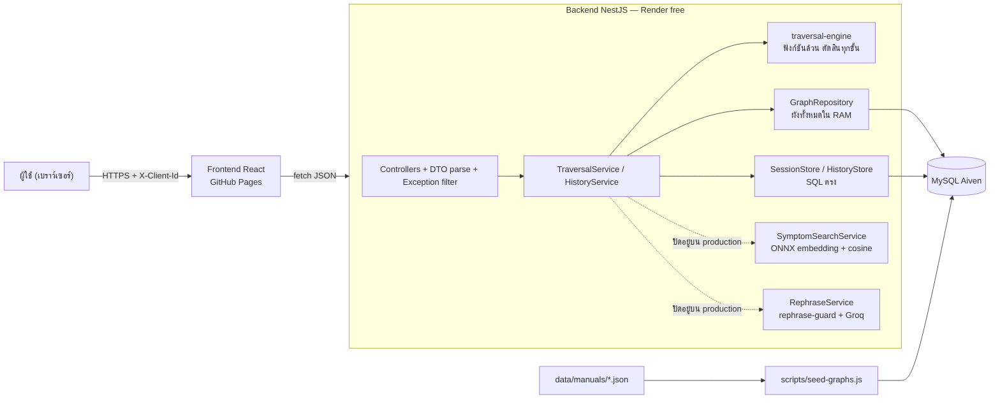
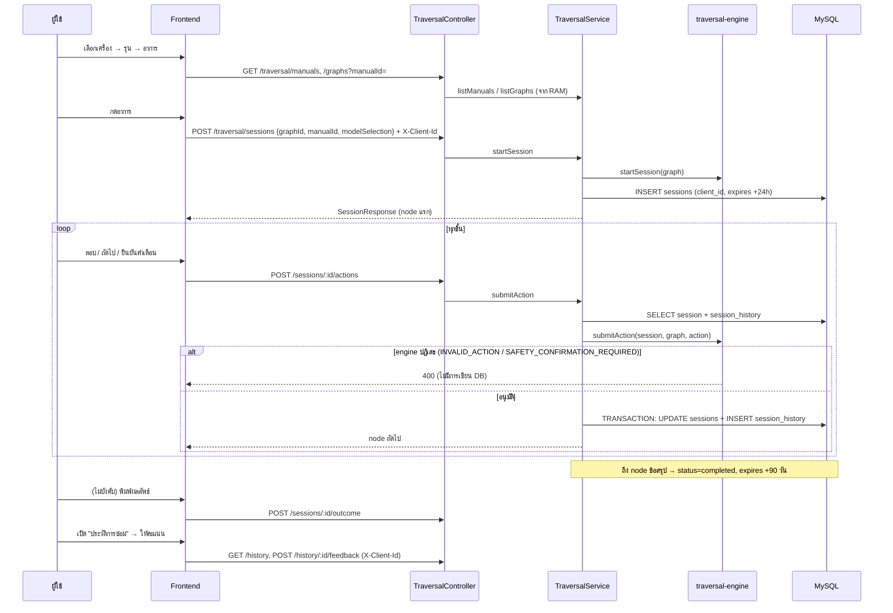
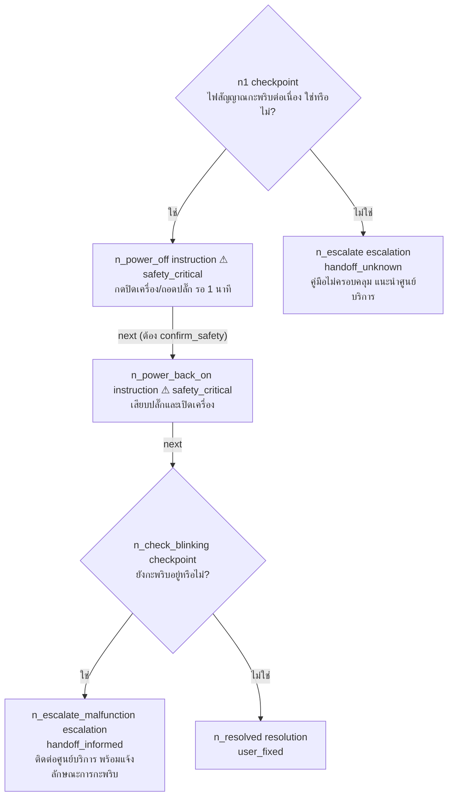
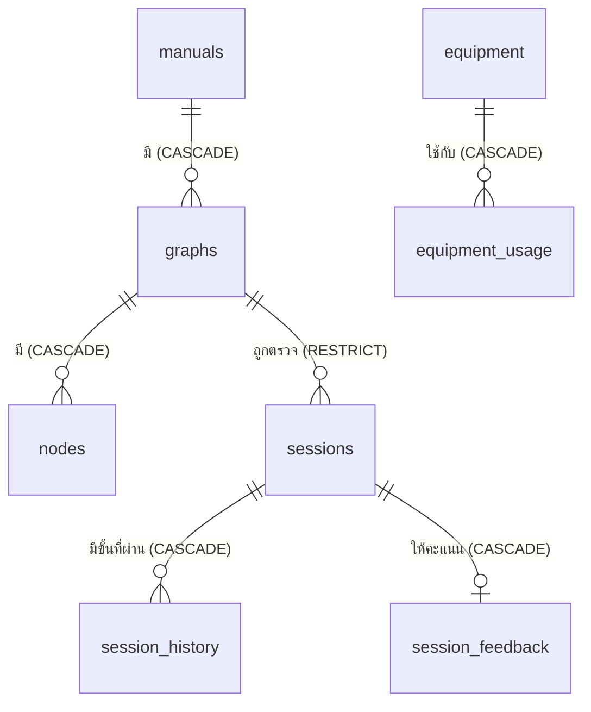

# READING_ROADMAP — แผนที่อ่านโค้ด appliance-repair-assistant

> สำรวจเมื่อ 15 ต.ค. 2569 จากโค้ดจริงใน repo (commit ล่าสุด `1d1fe17 add history page`)
> เขียนสำหรับคนที่ยังไม่เข้าใจโค้ด ศัพท์เทคนิคใช้อังกฤษได้ · ทุกข้อความที่อ้างโค้ดมี `ไฟล์:บรรทัด` ให้ไปเปิดดูได้
>
> **วิธีทำ:** อ่านอย่างเดียว · ไม่ได้รัน migration/seed · ไม่ได้เปิดไฟล์ `.env` (บอกแค่ว่าอ้างถึงที่ไหน) · ไม่ได้ deploy
> นับข้อมูล (ผัง/node/chunk) ด้วยสคริปต์ชั่วคราวที่อ่านไฟล์ `data/` อย่างเดียว
> **สิ่งที่ไม่ได้ตรวจ (เขียนว่า "ไม่แน่ใจ" ไว้ในที่ที่เกี่ยว):** ค่า env จริงบน Render, เทสต์ใน `draft/` ว่ายังผ่านกับโค้ดปัจจุบันไหม, หน่วยความจำจริงบน Render

---

## 0. อ่านย่อ 1 นาที

- แอปนี้ **ให้เซิร์ฟเวอร์เป็นคนตัดสินทุกขั้น** ด้วย state machine ที่เป็นฟังก์ชันล้วน (`traversal-engine.ts`) ผังขั้นตอนมาจากคู่มือที่คนแปลงเป็น JSON (`data/manuals/*.json`) LLM ไม่มีสิทธิ์ตัดสิน และปิดอยู่บน production
- **ไฟล์แรกที่ควรอ่าน:** `backend/src/traversal-engine/types.ts` (170 บรรทัด) แล้วต่อด้วย `traversal-engine.ts` (193 บรรทัด) — สองไฟล์นี้คือแกนของงาน ที่เหลือเป็นท่อต่อรอบๆ
- ข้อมูลจริงตอนนี้: **22 คู่มือ · 644 ผัง (อาการ) · 4,834 node** · ด่านความปลอดภัย 371 node
- เทสต์ที่รันได้จริงใน `backend/src`: **74 ข้อ แต่เป็นของหน้าประวัติการซ่อมทั้งหมด** — engine/ด่านความปลอดภัย/seed **ไม่มีเทสต์ในโค้ดที่ใช้งานจริง** (มี 183 ข้อรออยู่ใน `draft/` แต่ยังไม่ถูกนำเข้า) ← ช่องว่างใหญ่สุด
- ข้อมูลผังไม่ผ่านการตรวจด้วย JSON Schema ก่อนเข้าฐานข้อมูล (ตัวตรวจอยู่ใน `draft/`) และตรวจเจอข้อมูลที่ผิดกฎของ schema จริงแล้ว (หัวข้อ 10)

---

## 1. Stack ที่ใช้จริง

### 1.1 ตารางสรุป

| ชั้น | เทคโนโลยี (เวอร์ชันจาก package.json) | หลักฐาน |
|---|---|---|
| Frontend UI | React `^19.2.8` + TypeScript `~6.0.2` | `frontend/package.json` |
| Build | Vite `^8.2.2` + `@vitejs/plugin-react` | `frontend/vite.config.ts:10` (`base` = `/appliance-repair-assistant/` ตอน production) |
| Style | Tailwind CSS `^3.4.19` | `frontend/tailwind.config.js` (สีกำหนดที่ `colors`) |
| Routing | React Router `^7.18.3` แบบ **HashRouter** | `frontend/src/App.tsx:2` และ routes ที่ `App.tsx:28-35` |
| Data fetching | TanStack Query `^5.102.8` ผ่านไฟล์เดียว `api/queries.ts` | `frontend/src/api/queries.ts:1-3, 37` (queryKeys) |
| HTTP | `fetch` ผ่านฟังก์ชัน `request()` — **ไม่มี axios** | `frontend/src/api/http.ts:36` · ไม่มี axios ใน `frontend/package.json` |
| State ใน URL | `useSearchParams` (รุ่นที่เลือก, ตัวกรองประวัติ) | `lib/modelSelection.ts:9`, `lib/historyParams.ts:32` |
| Test (frontend) | Vitest `^4.1.11` (render ฝั่ง server ด้วย `StaticRouter` ไม่มี jsdom) | 10 ไฟล์ · **111 ข้อ** |
| Lint | ESLint `^10.9.0` + typescript-eslint + react-hooks | `frontend/eslint.config.js` |
| Deploy frontend | GitHub Pages ผ่าน `gh-pages` (`npm run deploy`) | `frontend/package.json` scripts · `docs/DEPLOY.md` ขั้นที่ 2 |
| Backend framework | NestJS `^10.4.0` + TypeScript `^5.6.0` (Node `>=20`) | `backend/package.json` (`engines`) |
| ฐานข้อมูล | MySQL ผ่าน `mysql2 ^3.24.3` **เขียน SQL ตรง ไม่มี ORM** | ทุก `.query(` ใช้ `?` placeholder (หัวข้อ 10) |
| Embedding (ค้นหาอาการ) | `@huggingface/transformers 4.3.0` (ONNX บน CPU, q8, 384 มิติ) | `embedding/embedding.service.ts:5-6, 38-41` |
| ความคล้าย | cosine similarity เขียนเอง | `symptom-search/symptom-matcher.ts:20-41` |
| Rephrase (ทางเลือก) | Groq API (`fetch` ตรง ไม่มี SDK) + `rephrase-guard` | `rephrase/groq-llm.client.ts:3-52`, `rephrase-guard.ts:26-61` |
| Test (backend) | Jest `^29.7.0` + ts-jest · **74 ข้อ** (3 ไฟล์ ทั้งหมดอยู่ใน `src/history/`) | `backend/jest.config.js` |
| Deploy backend | Render (plan free) ผ่าน Blueprint | `render.yaml:4-12` |
| DB host | Aiven MySQL (SSL ด้วย CA) ใช้ร่วมกับโปรเจกต์เก่า | `docs/DEPLOY.md:3` · `database/database.module.ts:57-59` |
| Migration | ไฟล์ `.sql` 001–009 + ตาราง `schema_migrations` | `backend/scripts/run-migrations.js:34-41, 88-96` |
| เครื่องมือข้อมูล | Python + `pdftotext` ตรวจ chunk เทียบ PDF | `scripts/verify_chunks_against_pdf.py` |

ไม่ได้ใช้: ORM, class-validator, passport/JWT, helmet, rate limiter, Redis, WebSocket (ค้นแล้วไม่พบใน `backend/src` และ `backend/package.json`)

### 1.2 จุดที่ไม่ตรงกับเอกสารต้นทาง

| # | เอกสารต้นทางบอกว่า | ของจริง | หลักฐาน | ผลที่ตามมา |
|---|---|---|---|---|
| 1 | โฟลเดอร์ `data/chunk` | ชื่อจริงคือ **`data/chuck`** (สะกดนี้) 23 ไฟล์ | `ls data/` · `scripts/verify_chunks_against_pdf.py` ใช้ชื่อนี้ | ถ้าพิมพ์ `chunk` ในสคริปต์/เอกสาร จะหาไม่เจอ |
| 2 | ตารางหลัก: manuals / graphs / nodes / sessions / session_history / session_feedback / equipment | มีเพิ่ม **`equipment_usage`** และ **`schema_migrations`** | `migrations/003_create_equipment_tables.sql:16`, `scripts/run-migrations.js:34-41` | ตารางที่ผูกอุปกรณ์กับประเภทเครื่องคือ `equipment_usage` ไม่ใช่ `equipment` |
| 3 | (ตัวเลขเทสต์ที่แจ้งต่อๆ กัน: backend 74 / frontend 111) | จริงตรงกัน แต่ **backend 74 ข้อเป็นของ `history` ทั้งหมด** | `backend/src/history/*.spec.ts` (ไม่มี spec อื่นใน `backend/src`) | engine/safety/seed ไม่มีเทสต์ในโค้ดที่ใช้งาน (ดูหัวข้อ 10) |
| 4 | "การโหลดผังทั้งหมดเข้า RAM" | ถูก แต่ **ผังจริง 644 ผัง** · `docs/DEPLOY.md:15` ยังเขียนว่า `/traversal/graphs` ต้องได้ 13 รายการ | `docs/DEPLOY.md:15` | เอกสาร deploy ล้าสมัย |
| 5 | production: `SYMPTOM_SEARCH_ENABLED=false`, `REPHRASE_ENABLED=false` | ตรงตาม `render.yaml:23-27` และโค้ดก็ **ปิดเป็นค่าเริ่มต้นอยู่แล้ว** (ต้องตั้ง `=true` ถึงเปิด) | `symptom-search.service.ts:64` · `traversal.module.ts:35-42` | ค่าจริงใน Render dashboard **ไม่แน่ใจ** (ไม่ได้ตรวจ) |
| 6 | `render.yaml:22` บอกว่า "ยังไม่ได้คัดลอก model-slim/" | `backend/model-slim/…/model_quantized.onnx` และอีก 3 ไฟล์ **ถูก track ใน git แล้ว** | `git ls-files backend/model-slim` | คอมเมนต์ใน render.yaml อาจล้าสมัย · **ไม่แน่ใจ**ว่าบน Render ขึ้นโมเดลได้ไหม (ดู `/symptom-search/status`) |
| 7 | device_category รองรับตาม JSON Schema | schema อนุญาต 10 ชนิด (มี Printer/Dishwasher/**Dryer**/Smartphone/Laptop) แต่ DB และ TypeScript มี **5 ชนิด** | `data/schemas/troubleshooting-graph.v2.schema.json:30-43` · `migrations/003:2-4` · `types.ts:65-70` | มีไฟล์ chunk ของ Dryer แต่ใส่ผังเข้า DB ไม่ได้ (ENUM ไม่รับ) |
| 8 | ผังตรวจด้วย `validate_graph.py` | **ไม่มีไฟล์นี้อยู่จริง** — ข้อความ error อ้างถึงมัน | `types.ts:151` · `find . -name "validate_graph*"` ไม่พบ | ตัวตรวจจริงเป็น JS อยู่ใน `draft/code/backend/scripts/validate-graphs.js` (ยังไม่อยู่ใน pipeline) |
| 9 | ชื่อแอป | แอปชื่อ **FixStep** (`AppShell.tsx` `APP_NAME`) แต่ `docs/` เรียกโปรเจกต์ต้นแบบว่า "FixStep" ด้วย และ schema ยังเป็น "FixBot" | `AppShell.tsx` · `schema.json:3-4` · `docs/DEPLOY.md:3` | อ่านเอกสารแล้วสับสนว่าหมายถึงตัวไหน |

### 1.3 ของตกค้าง / ไม่ได้ใช้แล้ว

| รายการ | สถานะ | หมายเหตุ |
|---|---|---|
| `draft/` (63 ไฟล์ที่ track) | งานร่าง **ไม่ถูก build/test** (`draft/README.md:4`) | ส่วนหนึ่งถูกนำเข้าแล้ว (rephrase, Microwave) ส่วนที่ยังไม่นำเข้า: เทสต์ 183+56, `validate-graphs.js`, patch `0002` (health) |
| `draft/frontend-phase3/` | ล้าสมัย (ถ้อยคำเก่า) | `docs/HANDOFF.md` ระบุไว้ |
| `data/chuck/…RF_service_manual_user_level (1).json` | ไฟล์สำเนา chunk_id ซ้ำกับต้นฉบับ | verify script รายงานซ้ำ |
| `data/pdf/` | 25 PDF = **415 MB และถูก track ใน git** (`.git` ราว 267 MB) | ทำให้ clone/build ช้า |
| `backend/dist`, `frontend/dist`, `scripts/__pycache__` | ผล build/แคช (dist ถูก ignore) | ข้ามได้ |
| `backend/scripts/try-rephrase.js` | เครื่องมือเรียก Groq ด้วยมือ | ไม่ได้อยู่ใน flow ของแอป |
| `session.store.ts:239` | คอมเมนต์ค้าง `//Need to read this again later` | ควรลบหรือทำให้เสร็จ |

---

## 2. ภาพรวมระบบ

ผู้ใช้เลือกเครื่อง → รุ่น → อาการ → ระบบถามทีละข้อตามผังจนถึงข้อสรุป (แก้ได้ / ส่งช่าง / เครื่องปกติ / คู่มือไม่ครอบคลุม) แล้วบันทึกลง "ประวัติการซ่อม"



เส้นประ = เส้นทางเสริม (ปิดอยู่) · เส้นทึบ = เส้นทางหลักที่ใช้จริง

หลักการที่โค้ดยึด (พบซ้ำในคอมเมนต์หลายไฟล์):

1. **ขั้นถัดไปมาจาก engine เท่านั้น** (`traversal.service.ts:1-13`) service/controller/frontend ไม่มีตรรกะเปลี่ยนสถานะ
2. **ด่านความปลอดภัยอยู่ที่เซิร์ฟเวอร์** ถ้า engine ปฏิเสธ จะไม่มีการเขียนฐานข้อมูล (`traversal.service.ts:170-177`)
3. **ตัวเลขความมั่นใจ (confidence) แสดงผลอย่างเดียว** ไม่มีโค้ดอ่านไปตัดสินขั้นตอน (`traversal.service.ts:288-304`)
4. LLM แตะได้เฉพาะ "ถ้อยคำ" ของ node ที่ไม่ใช่ safety/ข้อสรุป และถ้าล้มเหลวใช้ข้อความเดิม (`rephrase.service.ts:38-61`)

---

## 3. แผนที่โฟลเดอร์

```
appliance-repair-assistant/
├─ backend/                    NestJS API
│  ├─ src/
│  │  ├─ main.ts               จุดเริ่ม: เปิด CORS + listen
│  │  ├─ app.module.ts         ประกอบโมดูลทั้งหมด
│  │  ├─ traversal-engine/     ★ แกนของระบบ (ฟังก์ชันล้วน ไม่แตะ DB/เครือข่าย)
│  │  ├─ traversal/            ท่อต่อ engine เข้ากับ DB + HTTP (controller/service/store/repository/dto/filter)
│  │  ├─ history/              หน้าประวัติการซ่อม (store/service/controller/dto/filter + เทสต์ 3 ไฟล์)
│  │  ├─ symptom-search/       ค้นหาอาการด้วย embedding (ปิดอยู่บน production)
│  │  ├─ embedding/            โหลดโมเดล ONNX + แปลงข้อความเป็นเวกเตอร์
│  │  ├─ rephrase/             เรียบเรียงถ้อยคำด้วย Groq + ด่านตรวจ (ปิดอยู่)
│  │  ├─ database/             MySQL connection pool (@Global)
│  │  └─ health/               GET /health
│  ├─ migrations/              001–009 (.sql)
│  ├─ scripts/                 run-migrations.js, seed-graphs.js, seed-equipment.js, try-rephrase.js
│  └─ model-slim/              โมเดล ONNX ที่ย่อแล้ว (57 MB)
├─ frontend/                   React SPA
│  └─ src/
│     ├─ api/                  http.ts (request), traversal.ts, history.ts, queries.ts (hooks), types.ts
│     ├─ pages/                หน้าจอ (Home, Devices, Symptoms, AllSymptoms, Session, History, HistoryDetail)
│     ├─ components/           step/ (ขั้นตอน), history/, layout/, ui/ และคอมโพเนนต์เฉพาะหน้า
│     └─ lib/                  ฟังก์ชันล้วน (errors, labels, modelSelection, historyParams, clientId, …)
├─ data/
│  ├─ manuals/                 ★ ผังขั้นตอน (22 ไฟล์ JSON = 22 คู่มือ) ← ต้นทางของ seed
│  ├─ chuck/                   chunk ที่สกัดจากคู่มือ (23 ไฟล์) — ชื่อโฟลเดอร์สะกดแบบนี้จริง
│  ├─ equipment/               อุปกรณ์ที่ใช้ตรวจตามประเภทเครื่อง
│  ├─ pdf/                     PDF ต้นฉบับ (415 MB)
│  └─ schemas/                 JSON Schema ของผัง v2
├─ scripts/                    verify_chunks_against_pdf.py (ตรวจ chunk เทียบ PDF)
├─ docs/                       เอกสาร (HANDOFF.md = บันทึกงานยาวมาก, history-page.md, DEPLOY.md, …)
├─ draft/                      งานร่างที่ยังไม่นำเข้า (เทสต์/เครื่องมือ/patch/เอกสารรายงาน)
└─ render.yaml                 Blueprint ของ backend บน Render
```

---

## 4. ลำดับการอ่านโค้ดที่แนะนำ

### 4.1 อ่านสายไหนก่อน

**อ่านสาย backend ก่อน** เพราะ: (1) แกนของโปรเจกต์ (state machine + ด่านความปลอดภัย) อยู่ฝั่งนี้ทั้งหมด (2) frontend เป็นแค่ตัวแสดงผลของสิ่งที่เซิร์ฟเวอร์ตัดสิน ถ้าไม่เข้าใจ backend จะไม่รู้ว่าทำไมหน้าจอทำแบบนั้น (3) คำถามกรรมการส่วนใหญ่ชี้มาที่นี่

### 4.2 เริ่มอ่านไฟล์นี้ก่อนเป็นไฟล์แรก

> **`backend/src/traversal-engine/types.ts`** (170 บรรทัด · ~15 นาที)
> เพราะเป็น "พจนานุกรม" ของทั้งระบบ: node มีกี่ชนิด (`:1-63`), ผังหน้าตาอย่างไร (`:75-93`), session เก็บอะไร (`:102-110`), action ที่ผู้ใช้ทำได้ (`:112-116`), และ error ทุกชนิดของ engine (`:136-171`) ทุกไฟล์อื่น import จากไฟล์นี้ — อ่านก่อนแล้วจะอ่านที่เหลือรู้เรื่อง

### 4.3 สาย Backend (อ่านตามลำดับ)

| ขั้น | ไฟล์ | ทำไมอ่านตอนนี้ | อ่านแล้วควรเข้าใจ | เวลา |
|---|---|---|---|---|
| B1 | `traversal-engine/types.ts` | เป็นพจนานุกรม (ข้างบน) | ชนิด node, session, action, error | 15 นาที |
| B2 | ตัวอย่างผังในหัวข้อ 7 ของเอกสารนี้ แล้วเปิด `data/manuals/samsung_ac_ar70h.json` (ดู graph `indicator_blinking`) | เห็นข้อมูลจริงก่อนอ่านตัวเดิน | หน้าตา node แต่ละชนิด และเส้นเชื่อม `on_yes/on_no/next` | 10 นาที |
| B3 | `traversal-engine/traversal-engine.ts` | **หัวใจ** | `submitAction` เดิน 1 ขั้นอย่างไร, ด่านความปลอดภัย (`:106-118`), `renderNode` (`:142-164`) | 30 นาที |
| B4 | `migrations/001`, `002` (แล้วอ่านผ่าน 004–009) | รู้ว่าข้อมูลเก็บที่ไหน | ตาราง graphs/nodes/sessions/session_history และ FK | 20 นาที |
| B5 | `traversal/graph.repository.ts` | ผังเข้า RAM ที่นี่ | `loadAll` (`:144-190`) ประกอบ node จากแถว DB | 25 นาที |
| B6 | `traversal/session.store.ts` | บันทึกความคืบหน้า | transaction ใน `update` (`:99-153`), TTL 24 ชม./90 วัน | 25 นาที |
| B7 | `traversal/traversal.service.ts` | ผูก engine + DB เข้าด้วยกัน | ลำดับ "อ่าน session → engine → บันทึก" (`:166-180`) | 30 นาที |
| B8 | `traversal/traversal.dto.ts` → `traversal.controller.ts` → `traversal.exception.filter.ts` | ทางเข้า/ออกของ HTTP | parse body (`dto:105-196`), ตาราง error → HTTP (`filter:57`) | 30 นาที |
| B9 | `database/database.module.ts`, `main.ts`, `app.module.ts` | ประกอบระบบ | `@Global()` pool, CORS (`main.ts:8-11`) | 10 นาที |
| B10 | `scripts/seed-graphs.js`, `scripts/run-migrations.js` | ข้อมูลเข้า DB อย่างไร | `validateManual` (`:20-76`) และสิ่งที่มัน **ไม่** ตรวจ | 25 นาที |
| B11 | `history/history.store.ts` → `history.service.ts` → `history.dto.ts` → `history.controller.ts` | ตัวอย่างโมดูลที่ครบชุด (เขียนล่าสุด) | ตรวจเจ้าของด้วย `client_id`, replay ผ่าน engine (`service:309-335`) | 45 นาที |
| B12 | `history/history.service.spec.ts` (+ `dto.spec`, `controller.spec`) | เทสต์ทั้งหมดที่มีจริง | pool ปลอมที่อ่านรายชื่อคอลัมน์จากไฟล์ migration | 25 นาที |
| B13 *(เสริม)* | `symptom-search/symptom-matcher.ts` → `symptom-search.service.ts` → `embedding/embedding.service.ts` | เส้นทางเสริม (ปิดอยู่) | ทำดัชนีตอนบูต, cosine, เกณฑ์ 0.55 (`service:10`) | 30 นาที |
| B14 *(เสริม)* | `rephrase/rephrase-guard.ts` → `rephrase.service.ts` → `groq-llm.client.ts` | เส้นทางเสริม (ปิดอยู่) | กฎตรวจข้อความที่ LLM เขียน (`guard:26-61`) | 20 นาที |

รวมสาย backend หลัก (B1–B12) ≈ **5.5 ชั่วโมง** · เสริม B13–B14 ≈ 50 นาที

### 4.4 สาย Frontend (อ่านหลังสาย backend)

| ขั้น | ไฟล์ | ทำไมอ่านตอนนี้ | อ่านแล้วควรเข้าใจ | เวลา |
|---|---|---|---|---|
| F1 | `api/types.ts` | รูปร่างข้อมูลที่คุยกับ backend (re-export type จาก backend) | `SessionResponse`, `HistoryDetail` | 10 นาที |
| F2 | `api/http.ts` + `api/traversal.ts` + `api/history.ts` | ทางออกทางเดียวสู่เครือข่าย | `request()` (`http.ts:36`) แปลง error เป็น `ApiError` | 15 นาที |
| F3 | `api/queries.ts` | **หน้าจอทุกหน้าเรียกผ่านที่นี่** | queryKeys (`:37`), cache หลังเริ่ม/เดิน session (`:147-198`) | 20 นาที |
| F4 | `App.tsx` + `components/layout/AppShell.tsx` | แผนที่หน้า/เมนู | routes `:28-35` | 10 นาที |
| F5 | `pages/DevicesPage.tsx` → `lib/modelSelection.ts` → `pages/SymptomsPage.tsx` / `AllSymptomsPage.tsx` | ผู้ใช้เลือกรุ่นอย่างไร | รุ่นอยู่ใน URL (`?manual=&unknown=1`) | 35 นาที |
| F6 | `pages/SessionPage.tsx` → `components/step/StepView.tsx` → `SafetyGateStep.tsx` | **หน้าตรวจอาการ** | เลือกการ์ดตามชนิด node (`StepView:17-33`), checkbox ก่อนยืนยัน | 35 นาที |
| F7 | `lib/errors.ts` + `lib/trail.ts` + `lib/labels.ts` | แปลง code → ข้อความไทย | `describeError` (`errors.ts:39`) | 15 นาที |
| F8 | `lib/clientId.ts` → `lib/historyParams.ts` → `pages/HistoryPage.tsx` → `pages/HistoryDetailPage.tsx` → `components/history/*` | หน้าประวัติ | UUID ใน localStorage, URL เป็นแหล่งความจริงของตัวกรอง | 40 นาที |
| F9 | `lib/modelSelection.test.ts`, `pages/*.test.tsx` | เทสต์เป็นเอกสาร | ทำไมบางค่า "ต้องเป็น NULL ห้ามเป็น selected" | 20 นาที |

รวมสาย frontend ≈ **3.3 ชั่วโมง**

### 4.5 ข้ามก่อนได้

| ไฟล์/โฟลเดอร์ | เหตุผล |
|---|---|
| `frontend/src/main.tsx`, `env.d.ts`, `components/ui/Icon.tsx`, `ui/Button.tsx` | boilerplate / ไอคอนวาดเอง |
| `tailwind.config.js`, `postcss.config.js`, `vite.config.ts`, `tsconfig*.json`, `nest-cli.json`, `jest.config.js` | config ทั่วไป |
| `backend/src/database/database.constants.ts`, `health/health.module.ts`, `embedding/embedding.module.ts` | 1–9 บรรทัด |
| `docs/HANDOFF.md` | บันทึกงานยาวมาก (อ่านเฉพาะตอนค้นประวัติการตัดสินใจ) |
| `draft/` | งานร่าง/รายงาน ไม่ใช่โค้ดที่รัน (อ่านทีหลังตอนเตรียมส่ง) |
| `backend/dist`, `frontend/dist`, `scripts/__pycache__` | ผล build |
| `data/pdf/` | PDF ต้นฉบับ (ไม่ใช่โค้ด) |

---

## 5. อธิบายไฟล์สำคัญ

### Backend — แกน

**`traversal-engine/types.ts`** — กำหนดชนิดข้อมูลทั้งหมดของ engine: 5 ชนิด node, ผัง, session, action, ผลที่ส่งออก (`RenderedNode`) และ error 5 ตัวที่ extends `TraversalError` ไม่มีโค้ดทำงาน นอกจากคลาส error · ถูก import โดยทุกโมดูล รวมถึง frontend (type เท่านั้น)

**`traversal-engine/traversal-engine.ts`** — ฟังก์ชันล้วน 3 ตัวที่ export:
- `startSession(graph, confidence)` (`:20-42`) สร้าง session เริ่มที่ `entry_node`
- `getCurrentNode(session, graph)` (`:44-53`) แปลง node ปัจจุบันเป็น `RenderedNode`
- `submitAction(session, graph, action)` (`:55-88`) ตัดสินใจขั้นถัดไป คืน session ใหม่ (ไม่แก้ของเดิม)
ข้างใน `resolveNextNode` (`:90-141`) เป็น `switch` ตามชนิด node · import แค่ `./types` (`:1-18`) · ถูกเรียกโดย `traversal.service.ts` และ `history.service.ts` เท่านั้น

**`traversal/traversal.service.ts`** — "ผู้ประสานงาน": ดึง session จาก DB → ส่งให้ engine → ถ้า engine อนุมัติจึงบันทึก → ประกอบ response (`toResponse :250-269`) เรียกใช้: `GraphRepository`, `EquipmentRepository`, `SessionStore`, `SymptomSearchService` (คิดคะแนน), `RephraseService` · ถูกเรียกโดย `TraversalController`

**`traversal/session.store.ts`** — SQL ของ session: `create` (`:50`), `find` (`:69`, กรอง `expires_at > NOW()`), `update` (`:99`, ใน transaction: UPDATE sessions + INSERT session_history), `delete`, `saveOutcome`, `findOutcome` · ถูกใช้โดย `TraversalService` (และ `history.store.ts` ยืม `rowToHistoryEntry`/`parseVariables`)

**`traversal/graph.repository.ts`** — ตอนบูต (`onModuleInit :101`) อ่านตาราง `graphs`+`nodes` ทั้งหมดมาประกอบเป็นออบเจ็กต์ผังไว้ใน `Map` (`:95`) ตอบ `findById`, `listAll`, `listManuals` จากหน่วยความจำ · **โหลดครั้งเดียว ไม่มี reload** · ถูกใช้โดย traversal, symptom-search, history

**`traversal/traversal.dto.ts` / `traversal.controller.ts` / `traversal.exception.filter.ts`** — ทางเข้าออก HTTP: `parse*` ตรวจรูปร่าง body แล้วโยน error ที่รู้จัก, controller "โง่" (ส่งต่อ), filter แปลงคลาส error → `{statusCode, code, message}` (`toErrorBody :57`) ไม่ใช้ class-validator

### Backend — โมดูลที่เหลือ

**`history/*`** — หน้าประวัติการซ่อม: `history.store.ts` (SQL ทุกคำสั่งมี `client_id`), `history.service.ts` (กรอง/เรียง/แบ่งหน้าในหน่วยความจำ `:71-122`; รายละเอียดอ่านขั้นที่ผ่านมาแล้ว **replay ผ่าน engine** `:309-335` ถ้าผังเปลี่ยนจะตอบ `available:false`), `history.controller.ts` (4 endpoint) · ดูรายละเอียดเต็มที่ `docs/history-page.md`

**`symptom-search/*`** — ตอนบูตถ้าเปิดใช้ (`service:63-72`) จะโหลดโมเดล แล้วแปลงข้อความอาการ (ไทย/อังกฤษ/คำพ้อง) ทุกผังเป็นเวกเตอร์เก็บใน RAM (`:80-128`); ผู้ใช้พิมพ์ → เวกเตอร์ → cosine กับทุกข้อความ → เอาผังที่ผ่าน 0.55 สูงสุด 3 (`:136-169`) · **เป็นตัวช่วยเลือกอาการเท่านั้น**

**`rephrase/*`** — `RephraseService.rephrase` (`:35-62`): ข้ามถ้าปิด/ว่าง/safety/ข้อสรุป → เช็กแคช → เรียก Groq (timeout 3 วิ) → `checkRephrase` → ผ่านจึงใช้ ไม่ผ่าน/ล้ม = ข้อความเดิม

**`database/database.module.ts`** — สร้าง `mysql2` pool หนึ่งก้อน (`connectionLimit: 5` ที่ `:55`) ประกาศ `@Global()` ให้ทุกโมดูลขอยืมด้วยโทเค็น `MYSQL_POOL` · ทดสอบ ping ตอนบูต (`:78`) ถ้าต่อไม่ได้แอปไม่ขึ้น (fail-fast)

**`scripts/seed-graphs.js`** — อ่าน JSON คู่มือ → `validateManual` → ใน transaction เดียว: upsert manuals/graphs, **ลบ nodes ของผังนั้นแล้ว insert ใหม่** (`:186-199`) → รายงาน · ใช้ `execute` (prepared statement)

### Frontend

**`api/queries.ts`** — ทุกหน้าเรียกข้อมูลผ่านที่นี่ ไม่เรียก `fetch` ตรง: `useGraphs/useManuals` (cache ไม่หมดอายุ), `useStartSession/useSubmitAction` (ใส่ผลลง cache ทันที หน้าจอเปลี่ยนโดยไม่ต้องขอซ้ำ), `useHistory*`

**`pages/SessionPage.tsx`** — หน้าตรวจอาการ: อ่าน session (`useSession`) → แสดงผ่าน `StepView` → ส่ง action → เก็บ "รอยทาง" (trail) ไว้ในเครื่องเพื่อแสดง · ไม่ตัดสินอะไรเอง

**`components/step/StepView.tsx`** — ตัวเลือกการ์ดตามผลของเซิร์ฟเวอร์: ข้อสรุป → `OutcomeStep`; ต้องยืนยันความปลอดภัย → `SafetyGateStep`; ที่เหลือตามชนิด (`:17-33`)

**`lib/errors.ts`** — `describeError(error)` แปลง `code` จากเซิร์ฟเวอร์เป็นหัวข้อ/คำอธิบาย/ทางแก้ (ตัดสินจาก `code` ไม่ใช้ `message`)

**`lib/clientId.ts`** — สร้าง UUID ครั้งเดียวเก็บ localStorage (ใน try/catch) แนบเป็นหัวข้อ `X-Client-Id` กับคำขอเริ่ม session และทุกคำขอของ `/history`

---

## 6. Data flow ทีละขั้น

### 6.1 Boot และข้อมูล

| # | ขั้น | ไฟล์ : บรรทัด | เกิดอะไรขึ้น |
|---|---|---|---|
| 1 | แปลงคู่มือเป็นผัง (ทำด้วยมือนอกโค้ด) | `data/manuals/*.json` | JSON ต่อคู่มือ: `manual_id`, `graphs[]` (แต่ละผัง = 1 อาการ + `nodes[]`) · ผังชี้กลับ chunk ด้วย `source_chunk_id` + `page_range` |
| 2 | ตรวจก่อนเข้า | `scripts/seed-graphs.js:20-76` | ตรวจ 4 อย่าง: `schema_version===2`, ปลาย `on_yes/on_no/next/on_invalid` มีอยู่จริง, `entry_node` มีจริง, `safety_critical` อยู่บน `instruction` และมี `safety_warning` — **ไม่ใช้ JSON Schema** |
| 3 | นำเข้า (ทำเมื่อสั่ง) | `scripts/seed-graphs.js:122-205, 267-281` | transaction เดียวต่อคู่มือ · ผังที่หายไปจาก JSON **ไม่ถูกลบ** (upsert อย่างเดียว) |
| 4 | Backend บูต | `main.ts:6-14` → `app.module.ts` | `DatabaseModule` (`@Global`) สร้าง pool + ping |
| 5 | โหลดผังเข้า RAM | `graph.repository.ts:101-103, 144-190` | อ่าน `graphs`+`nodes` ทั้งหมด 2 query → `buildGraph` (`:192-231`) ตรวจ schema_version, ไม่มี node, `entry_node` หาย → `GraphDataIntegrityError` (แอปไม่ขึ้น) |
| 6 | โหลดอุปกรณ์ | `equipment.repository.ts:25-60` | อ่าน `equipment_usage` JOIN `equipment` เก็บเป็น `Map` ตามประเภทเครื่อง |
| 7 | (ถ้าเปิด) ทำดัชนีค้นหา | `symptom-search.service.ts:63-128` | โหลดโมเดล แล้ว embed ข้อความอาการทีละอัน (ไม่ขนาน) · **ไม่รอ** ระหว่างบูต (void ไม่ใช่ Promise `:55-62`) |

> หลัง seed ใหม่ **ต้อง restart backend** ผังใน RAM ถึงจะเปลี่ยน (ไม่มี endpoint reload)

### 6.2 เซสชันตรวจอาการ: ผู้ใช้ → ... → feedback



ขั้นต่อขั้นพร้อมไฟล์:

| # | ขั้น | ไฟล์ : บรรทัด |
|---|---|---|
| 1 | เลือกเครื่อง (ประเภท → รุ่น) | `pages/DevicesPage.tsx` · `useManuals` (`queries.ts:75`) |
| 2 | จำรุ่นใน URL | `lib/modelSelection.ts:9-21` (`?manual=…&unknown=1`) |
| 3 | เลือกอาการ (รายการ หรือพิมพ์ค้นหา) | `pages/AllSymptomsPage.tsx`, `pages/SymptomsPage.tsx:43-46` |
| 4 | เริ่ม session | `lib/useStartSymptom.ts:18-34` → `api/traversal.ts:44-52` (แนบ `X-Client-Id`) |
| 5 | แยก header + body | `traversal.controller.ts:59-70` → `traversal.dto.ts:105-130` (body), `:38-47` (client id) |
| 6 | ตรวจผังตรงรุ่น | `traversal.service.ts:131-133` (`GRAPH_MANUAL_MISMATCH`) |
| 7 | engine สร้าง session | `traversal.service.ts:138` → `traversal-engine.ts:20-42` |
| 8 | บันทึก | `session.store.ts:50-67` (expires +24 ชม.) |
| 9 | ตอบกลับ + หน้าจอแสดง | `traversal.service.ts:255-274` → `SessionPage.tsx` → `StepView` |
| 10 | ผู้ใช้ตอบ | `SessionPage.tsx:50` `handleAction` → `useSubmitAction` (`queries.ts:166`) |
| 11 | อ่านสถานะล่าสุด | `traversal.service.ts:167` → `session.store.ts:69-97` |
| 12 | engine เดิน 1 ขั้น | `traversal.service.ts:170` → `traversal-engine.ts:55-88` |
| 13 | บันทึกเมื่ออนุมัติ | `traversal.service.ts:174` → `session.store.ts:99-153` (`status=completed` → +90 วัน `:110-111`) |
| 14 | ถึง node ข้อสรุป | `traversal-engine.ts:77` (`isTerminalNode` → `completed`) |
| 15 | ผู้ใช้บันทึกผลลัพธ์ (ไม่บังคับ) | `traversal.service.ts:216-231` → `session.store.ts:172-183` (ได้ครั้งเดียว) |
| 16 | ดูประวัติ/ให้คะแนน | `history.controller.ts:41-82` → `history.service.ts:71-160` → `history.store.ts` |

### 6.3 เส้นทางเสริม (ปิดอยู่บน production)

**Symptom-search**

| # | ขั้น | ไฟล์ : บรรทัด |
|---|---|---|
| 1 | เปิดด้วย env | `symptom-search.service.ts:63-72` (`SYMPTOM_SEARCH_ENABLED==='true'` ถึงโหลด) |
| 2 | โหลดโมเดลจาก `backend/model-slim` ห้ามดึงจากเน็ต | `embedding.service.ts:34-35` (`allowRemoteModels=false`) |
| 3 | สร้างดัชนี | `symptom-search.service.ts:107-114` ← `symptom-matcher.ts:43-62` (`buildSymptomTexts`: ไทย, อังกฤษ, คำพ้อง) |
| 4 | ค้นหา | `POST /symptom-search` → `service:136-169` → `rankGraphs` (`matcher:64-88`) → `selectMatches` (กรอง ≥ 0.55 เอา 3 อันดับ `:90-96`) |
| 5 | คะแนนความมั่นใจของ session | ถ้ามี `query` ตอนเริ่ม → `traversal.service.ts:297-304` → `scoreGraph` (`:178-184`) · ไม่พร้อม = `null` |
| 6 | ปิดอยู่ → ผู้ใช้เห็นอะไร | `SEARCH_UNAVAILABLE` 503 → หน้า `SymptomsPage` ขึ้นกล่องสีฟ้าให้เลือกจาก "อาการทั้งหมด" (`SymptomsPage.tsx:31`) |

**Rephrase + guard**

| # | ขั้น | ไฟล์ : บรรทัด |
|---|---|---|
| 1 | สร้าง client เมื่อ `REPHRASE_ENABLED==='true'` และมี key/model | `groq-llm.client.ts:47-52` · `traversal.module.ts:33-45` |
| 2 | ถูกเรียกทุกครั้งที่ประกอบ response | `traversal.service.ts:272, 276-286` (`displayTextOf`, ล้มเหลว = `null`) |
| 3 | ข้ามเมื่อ | ปิด/ไม่มี client/ข้อความว่าง/`safetyCritical`/`resolution`/`escalation` (`rephrase.service.ts:38-40`) |
| 4 | เรียก LLM มี timeout 3 วิ | `rephrase.service.ts:45-48` · system prompt `groq-llm.client.ts:5-11` |
| 5 | ด่านตรวจ | `rephrase-guard.ts:26-61` (ดูหัวข้อ 10) |
| 6 | ไม่ผ่าน/ล้ม | คืนข้อความต้นฉบับ (`rephrase.service.ts:50-52, 56-58`) |
| 7 | หน้าจอ | `SessionPage.tsx:125-127` แสดง `displayText` เฉพาะ node ที่ไม่ใช่ safety/ข้อสรุป · `RephraseNote.tsx` มีปุ่ม "ดูข้อความต้นฉบับ" |

---

## 7. โครงสร้างผัง (graph schema v2)

### 7.1 ผังหนึ่งผัง = หนึ่งอาการ

JSON Schema: `data/schemas/troubleshooting-graph.v2.schema.json` · ชนิดใน TypeScript: `types.ts:75-93`

| ฟิลด์ | ความหมาย |
|---|---|
| `graph_id` | รหัสผัง (ซ้ำกันไม่ได้) |
| `manual_id` / `brand` / `model_pattern` / `device_category` | คู่มือ/ยี่ห้อ/รุ่น (มี `*` เป็นตัวแทน) |
| `entry_symptom` (+`_th`, `_aliases`) | ข้อความอาการ ใช้แสดงและใช้ค้นหา |
| `source` / `page_range` / `source_chunk_id` | อ้างอิงกลับคู่มือ/หน้า/chunk |
| `severity`, `difficulty` | ไม่บังคับ |
| `entry_node` | node แรก |
| `nodes[]` | node ทั้งหมด |

### 7.2 ชนิดของ node (5 ชนิด)

| ชนิด | ฟิลด์ที่ต้องมี | ผู้ใช้ทำอะไร (action) | ไปต่อที่ไหน | พบในข้อมูลจริง |
|---|---|---|---|---|
| `checkpoint` | `question`, `on_yes`, `on_no` | `answer` yes/no | `on_yes` หรือ `on_no` | 2,187 |
| `instruction` | `content`, `next` | `continue` (ปกติ) หรือ `confirm_safety` (ถ้า `safety_critical`) | `next` | 1,131 (371 อันมี `safety_critical` — ตรวจแล้วว่าธงนี้อยู่บน `instruction` ทั้งหมด) |
| `input` | `prompt`, `input_type`, `store_as`, `next` (+`pattern`, `on_invalid`) | `input` ข้อความ | `next` ถ้าผ่าน pattern · `on_invalid` (หรือ node เดิม) ถ้าไม่ผ่าน | **1** |
| `resolution` | `content`, `outcome_kind` | — (จบ) | — | 718 |
| `escalation` | `content`, `outcome_kind` | — (จบ) | — | 797 |

`outcome_kind` ของ node ที่จบ: `user_fixed` (520) · `normal_behavior` (198) · `handoff_informed` (155) · `handoff_unknown` (642)

ฟิลด์เสริมของทุก node: `safety_critical`, `safety_warning`, `author_note` (ระบุว่าข้อความนี้ผู้พัฒนาเพิ่มเอง ไม่ได้มาจากคู่มือ — 1,270 node), `has_image`, `image_url`, `external_reference`

### 7.3 ตัวอย่างจริง: `samsung_ac_ar70h_indicator_blinking`

(จาก `data/manuals/samsung_ac_ar70h.json` · แอร์ Samsung AR70H · คู่มือหน้า 43 · 6 node)



ผู้ใช้เดินจริงตัวอย่าง: `n1` ตอบ "ใช่" → `n_power_off` (ต้องติ๊กรับคำเตือน ถึงกด "ยืนยันและทำขั้นตอนนี้" ได้) → `n_power_back_on` (ติ๊กอีกครั้ง) → `n_check_blinking` ตอบ "ไม่ใช่" → `n_resolved` (จบ `user_fixed`)

สิ่งที่ควรสังเกตจากตัวอย่าง:
- `n_power_off` มี `author_note`: *"safety_warning เพิ่มเติมโดยผู้พัฒนา คู่มือต้นฉบับระบุเพียง 'disconnect the power plug'"* — คำเตือนนี้ผู้พัฒนาเขียนเพิ่ม ไม่ได้มาจากคู่มือ แต่ `RenderedNode` ไม่ส่ง `author_note` ออกไป (`types.ts:123-134`) หน้าจอจึงไม่ได้บอกผู้ใช้ว่านี่คือข้อความที่เพิ่มเอง (เทียบ: อุปกรณ์ทำป้าย "ผู้พัฒนาแนะนำเพิ่ม" ที่ `EquipmentPanel.tsx:20`)
- ทุกเส้นทางจบที่ node ข้อสรุปเสมอ (ผังทั้ง 644 ผัง: entry เดินถึง terminal ได้ทุกผัง)

### 7.4 กติกาการเดินใน engine

| กติกา | ที่ไหน |
|---|---|
| session ที่ `completed` แล้วส่ง action ไม่ได้ → `SESSION_COMPLETED` | `traversal-engine.ts:62-64` |
| `checkpoint` รับเฉพาะ `answer`; อื่น → `INVALID_ACTION` | `:96-104` |
| `instruction` ปกติรับเฉพาะ `continue` | `:114-116` |
| `instruction` ที่ `safety_critical`: `continue` → `SAFETY_CONFIRMATION_REQUIRED`; ต้องส่ง `confirm_safety` | `:107-113` |
| `input`: ตรวจ `pattern` (regex) → ผ่านเก็บค่าใน `variables[store_as]` · ไม่ผ่านไป `on_invalid` หรืออยู่ node เดิม | `:120-135` |
| node ข้อสรุปรับ action ไม่ได้ | `:137-139` |
| แทนค่า `{{ตัวแปร}}` ในข้อความด้วยค่าที่ผู้ใช้กรอก | `interpolate :184-188` |
| ขั้นถัดไปไม่พบ → `NodeNotFoundError` → HTTP 500 `GRAPH_NODE_MISSING` | `:72-75` · `traversal.exception.filter.ts` |

### 7.5 ผังเก็บใน DB อย่างไร

`graphs` 1 แถว/ผัง (`entry_symptom_aliases`, `config` เป็น JSON) · `nodes` 1 แถว/node: ข้อความของทุกชนิดเก็บในคอลัมน์เดียว `text_content` (`seed-graphs.js:83-96` เลือกจาก question/content/prompt) · `on_yes/on_no/next_node/on_invalid` เป็นสตริง id · `GraphRepository.buildNode` (`:233-298`) แปลงกลับเป็นชนิด TypeScript และบังคับว่าชนิดนั้นต้องมีคอลัมน์ไหน (`required :301-309`)

---

## 8. Database schema

### 8.1 ตารางและความสัมพันธ์



| ตาราง | เก็บอะไร (ภาษาคน) | คอลัมน์สำคัญ |
|---|---|---|
| `manuals` | คู่มือ 1 เล่ม = 1 รุ่น | `manual_id`, `device_category`, `brand`, `model_pattern`, `display_name`, `model_aliases` |
| `graphs` | อาการ 1 อาการ (ผัง) | `graph_id`, `manual_id`, `entry_symptom(_th/_aliases)`, `page_start/end`, `source_chunk_id`, `entry_node` |
| `nodes` | node ในผัง | PK `(graph_id, node_id)`, `node_type`, `text_content`, `on_yes/on_no/next_node/on_invalid`, `outcome_kind`, `safety_critical/warning`, `display_order` |
| `sessions` | การตรวจ 1 ครั้ง | `session_id`, `graph_id`, `current_node_id`, `status`, `variables` (JSON), `confidence`, `outcome_text`, `model_selection`, `client_id`, `expires_at` |
| `session_history` | ขั้นที่ผ่าน (ตามลำดับ) | `session_id`, `step_order`, `node_id`, `action_type`, `action_value` — มี `UNIQUE (session_id, step_order)` (`002:36`) |
| `session_feedback` | คะแนน 👍/👎 + ข้อความ (1 session = 1 แถว) | `helpful`, `comment` (TEXT NULL ≤ 500) |
| `equipment` / `equipment_usage` | อุปกรณ์ + ใช้ทำอะไรกับเครื่องประเภทไหน | `equipment_usage.purpose_th`, `source_page` หรือ `author_note` (บังคับอย่างใดอย่างหนึ่ง `003:32-33`) |
| `schema_migrations` | migration ที่รันแล้ว (สร้างโดย runner) | `filename` |

> FK `sessions.graph_id → graphs` เป็น **RESTRICT** (`002:13-15`): ลบผังที่มี session ไม่ได้ · แต่ seed ลบแค่ `nodes` ของผังแล้ว insert ใหม่ จึงทำได้ → ประวัติเก่าอาจชี้ node ที่ไม่เหมือนเดิม (ที่มาของ `available:false` ในหน้าประวัติ)

### 8.2 ประวัติ migration

| ไฟล์ | เพิ่มอะไร | หมายเหตุ |
|---|---|---|
| `001_create_graph_tables.sql` | ตาราง `manuals`, `graphs`, `nodes` | โครงเริ่มต้นของผัง |
| `002_create_session_tables.sql` | ตาราง `sessions`, `session_history` | `status` ENUM, FK, `UNIQUE (session_id, step_order)` |
| `003_create_equipment_tables.sql` | `equipment`, `equipment_usage` + จำกัด `manuals.device_category` เป็น ENUM 5 ชนิด | มี CHECK ว่าต้องมีแหล่งที่มาหรือหมายเหตุผู้พัฒนา |
| `004_add_session_confidence.sql` | `sessions.confidence` DECIMAL(4,3) NULL | คะแนนความคล้าย (ไม่ใช่ความน่าจะเป็น) |
| `005_add_session_outcome.sql` | `sessions.outcome_text`, `outcome_at` | ข้อความผลลัพธ์ที่ผู้ใช้บันทึก |
| `006_add_manual_display_name.sql` | `manuals.display_name`, `model_aliases` | ชื่อรุ่นที่ผู้ใช้รู้จัก (NULL = แสดง `model_pattern`) |
| `007_add_session_model_selection.sql` | `sessions.model_selection` ENUM('selected','unknown') NULL | NULL = ไม่ได้ผ่านหน้าเลือกรุ่น |
| `008_add_session_client_id.sql` | `sessions.client_id` CHAR(36) NULL + index | ผูกประวัติกับเบราว์เซอร์ |
| `009_create_session_feedback.sql` | ตาราง `session_feedback` | 👍/👎 + `comment TEXT NULL` |

**additive migration** = เพิ่มอย่างเดียว (คอลัมน์ที่ NULL ได้ หรือตารางใหม่) ไม่แก้/ลบของเดิม เพราะฐานข้อมูลนี้ใช้ร่วมกับโปรเจกต์เก่า · ข้อควรระวัง: runner ไม่ใช้ transaction (`run-migrations.js:92-93`) จึงเขียน 1 DDL ต่อไฟล์ และต้องรัน migration **ก่อน** deploy โค้ดที่ใช้คอลัมน์ใหม่

---

## 9. สถานะและช่องว่าง

| ความสามารถ | สถานะ | หลักฐาน / หมายเหตุ |
|---|---|---|
| เดินผังด้วย state machine ฝั่งเซิร์ฟเวอร์ | ✅ ทำแล้ว | `traversal-engine.ts` |
| ด่านความปลอดภัยฝั่งเซิร์ฟเวอร์ | ✅ ทำแล้ว (ไม่มีเทสต์ในโค้ดที่ใช้งาน) | `traversal-engine.ts:106-118` |
| เลือกเครื่อง → รุ่น → อาการ | ✅ ทำแล้ว | `DevicesPage`, `lib/modelSelection.ts` |
| อาการทั้งหมด (เลือกจากรายการ) | ✅ ทำแล้ว | `AllSymptomsPage.tsx` |
| บันทึกผลลัพธ์ที่ผู้ใช้พิมพ์ | ✅ ทำแล้ว | `traversal.service.ts:216-231` |
| ประวัติการซ่อม + feedback | ✅ ทำแล้ว (ยังไม่ได้ดูด้วยตาตามบันทึกล่าสุด) | `history/*`, `docs/history-page.md` |
| ค้นหาอาการด้วย embedding | ⏸ ปิดอยู่บน production | `render.yaml:23-24` · **ไม่แน่ใจ** ว่าโมเดลขึ้นบน Render ได้ไหม |
| LLM เรียบเรียงถ้อยคำ | ⏸ ปิดอยู่ ยังไม่เคยเรียก Groq จริง (ตามที่ `draft/README.md:28` ระบุ) | `render.yaml:26-27` |
| ตรวจผังด้วย JSON Schema ก่อน seed | ❌ ยังไม่ทำ | schema ไม่ถูกใช้ใน `backend/` (`grep` พบเฉพาะ draft/docs) |
| เครื่องมือตรวจผัง (`validate-graphs.js`) | 🟡 มีใน `draft/` ยังไม่อยู่ใน backend | `draft/code/backend/scripts/validate-graphs.js` |
| เทสต์ engine / ด่านความปลอดภัย / seed / symptom-search / rephrase | 🟡 เขียนแล้วใน `draft/` (183 ข้อ) ยังไม่นำเข้า · **ไม่แน่ใจ** ว่ายังผ่านกับโค้ดปัจจุบัน | `draft/README.md:22` |
| ตรวจ chunk เทียบ PDF | ✅ ทำแล้ว (เครื่องมือ + รายงาน) | `scripts/verify_chunks_against_pdf.py` |
| chunk ของคู่มือแอร์ (13 ผัง) | ❌ ไม่มีไฟล์ chunk | หัวข้อ 10 ข้อ 2 |
| ผังเครื่องอบผ้า (Dryer) | ❌ ยังไม่มีผัง (มี chunk แต่ DB ไม่รับชนิดนี้) | หัวข้อ 1.2 ข้อ 7 |
| ล็อกอิน/ยืนยันตัวตนผู้ใช้ | ❌ ตั้งใจไม่ทำ | ใช้ `client_id` แทน (ไม่ใช่การยืนยันตัวตน) |
| งานล้างแถวหมดอายุ | ❌ ยังไม่ทำ | ไม่มี cron/DELETE นอกจาก `session.store.ts:163-170` (ตอนผู้ใช้ยกเลิก) |
| Rate limit / helmet | ❌ ยังไม่ทำ | ค้นไม่พบใน `backend/src` |
| แสดงว่าข้อความไหนผู้พัฒนาเพิ่มเอง (`author_note`) ให้ผู้ใช้เห็น | ❌ ข้อมูลมี แต่ไม่ถูกส่งออก API | `types.ts:123-134` |
| Reload ผังโดยไม่ restart | ❌ ยังไม่ทำ | `graph.repository.ts:101-103` |
| Dashboard/ประเมินผลค้นหา | 🟡 สคริปต์อยู่ใน `draft/` | `draft/code/backend/scripts/eval-symptom-search.js` |

---

## 10. จุดเสี่ยงและโค้ดที่ควรระวัง (เรียงตามความรุนแรง)

คำตอบข้อ 4 ของโจทย์ (ตรวจประเด็นสำคัญ) อยู่ในหัวข้อ 10.1 · รายการความเสี่ยงที่ควรแก้อยู่ใน 10.2

### 10.1 ผลตรวจตามประเด็นที่ตั้งไว้

| ประเด็น | ผล | หลักฐาน |
|---|---|---|
| engine เป็นฟังก์ชันล้วนจริงไหม | **ใช่ เกือบทั้งหมด** — ไม่มี I/O ไม่เรียก LLM ไม่แก้ input (สร้างออบเจ็กต์ใหม่) · ข้อยกเว้นเดียว: `startSession` เรียก `globalThis.crypto.randomUUID()` (ผลไม่คงที่แต่ไม่มี I/O) และ `new RegExp(node.pattern)` | import แค่ `./types` (`traversal-engine.ts:1-18`) · `:32` · `:124` · session ใหม่ด้วย spread `:79-85` |
| ด่านความปลอดภัยอยู่ที่ไหน บังคับอย่างไร | **ฝั่งเซิร์ฟเวอร์ใน engine** ที่ `resolveNextNode` เคส `instruction`: ถ้า `safety_critical` แล้วส่ง `continue` → `SAFETY_CONFIRMATION_REQUIRED` (HTTP 400) ต้องส่ง `confirm_safety` · `traversal.service.ts:170-177` เรียก engine ก่อนบันทึกเสมอ ถ้าโยน error บรรทัด `update()` ไม่ถูกรัน | `traversal-engine.ts:106-118` · `traversal.service.ts:166-180` · `traversal.exception.filter.ts` (map → 400) |
| ฝั่ง frontend ข้ามด่านได้ไหม | **ข้ามด่านเซิร์ฟเวอร์ไม่ได้** (ส่ง `continue` ไปจะถูกปฏิเสธ) แต่ **เซิร์ฟเวอร์ตรวจไม่ได้ว่าผู้ใช้อ่านจริง** — client ใดก็ได้ส่ง `confirm_safety` ตรงๆ ด่านนี้พิสูจน์ได้แค่ "มีคำขอยืนยัน" ไม่ใช่ "คนอ่านแล้ว" · UI บังคับติ๊กก่อนปุ่มกดได้ (`SafetyGateStep.tsx`) | `traversal-engine.ts:107-113` · `SafetyGateStep.tsx:9-35` · `StepView.tsx:21-23` |
| ด่านครอบคลุมแค่ `instruction` | **ใช่** — `requiresSafetyConfirmation` เป็นจริงเฉพาะ `instruction` ที่ `safety_critical` · ส่วนที่กัน `safety_critical` บนชนิดอื่นคือ seed เท่านั้น ตอนโหลดจาก DB ไม่ตรวจซ้ำ | `traversal-engine.ts:158` · `seed-graphs.js:64-67` |
| rephrase-guard ป้องกันอะไร | ปฏิเสธเมื่อ: ว่าง · มีลิงก์ · มี markdown/HTML ที่ต้นฉบับไม่มี · หลายย่อหน้า · ความยาวนอก 0.5–1.6 เท่า · **ตัวเลขชุดต่างจากต้นฉบับ** · ขาด/เกินชื่อเฉพาะ-รหัสภาษาอังกฤษ · **จำนวนคำว่า "ไม่" ต่างจากต้นฉบับ** | `rephrase-guard.ts:26-61` |
| guard ไม่ครอบคลุมอะไร | การเปลี่ยนความหมายด้วยคำที่ไม่ใช่ตัวเลข/ภาษาอังกฤษ/"ไม่" เช่น "เปิด"↔"ปิด", "ก่อน"↔"หลัง", "ถอด"↔"เสียบ" · ข้อนี้ลดความเสี่ยงเพราะ safety/ข้อสรุปถูกข้ามอยู่แล้ว และ UI มีปุ่มดูต้นฉบับ | `rephrase.service.ts:40` · `RephraseNote.tsx` |
| LLM ล้มหรือตอบผิดรูปแบบ | ใช้ข้อความเดิม ไม่ throw (timeout 3 วิ, HTTP ไม่ ok, รูปแบบ JSON ผิด, guard ไม่ผ่าน) และ `displayTextOf` ห่อ try/catch อีกชั้น | `rephrase.service.ts:45-61` · `groq-llm.client.ts:36-43` · `traversal.service.ts:276-286` |
| ผังตรวจ schema ตอน seed/โหลดไหม | **ตรวจบางส่วน ไม่ใช้ JSON Schema** — seed ตรวจ 4 อย่าง (หัวข้อ 6.1) · ตอนโหลด `buildGraph` ตรวจ schema_version/มี node/entry_node และ `buildNode` ตรวจฟิลด์ที่ชนิดนั้นต้องมี · **ไม่ตรวจ:** ข้อความว่าง, regex ใช้ได้ไหม, node_id ซ้ำ (PK ชนเอง), pattern ของ id, enum `device_category` ใน JSON | `seed-graphs.js:20-76` · `graph.repository.ts:192-231, 301-309` |
| chunk เชื่อมกับผัง/คู่มือ/หน้า PDF อย่างไร | `graph.source_chunk_id` ชี้ `chunk_id` ใน `data/chuck/*.json` · `graph.page_range` = หน้าในคู่มือ · `graph.source` = ชื่อคู่มือ → ถูกส่งเป็น `reference` ของทุก node (`types.ts:118-121`; `traversal-engine.ts:147-150`) · **ไม่มีการบังคับ FK/ตรวจในโค้ดที่รัน** (ตรวจได้ด้วย `scripts/verify_chunks_against_pdf.py` ที่ต้องรันเอง) · ผลสำรวจนี้: 631/644 ผังหา chunk เจอและหน้าอยู่ในช่วง; **13 ผังที่หาไม่เจอคือแอร์ AR70H ทั้งคู่มือ** (ไม่มีไฟล์ chunk ของแอร์) | `seed-graphs.js:154,178` · ผลนับข้อมูล |
| client_id เป็นตัวระบุเดียว เดา/แอบดูได้ไหม | เดาไม่ได้ในทางปฏิบัติ (UUID v4 จาก `crypto.randomUUID` 122 บิต, เซิร์ฟเวอร์ปฏิเสธรูปแบบอื่น) · **แต่เป็น "ความลับพกพา" (bearer):** ใครได้ id ก็อ่าน/ลบ/ให้คะแนนประวัติได้ · ถ้ารู้ id ของคนอื่นสามารถ **เพิ่ม session เข้าประวัติเขา** ได้ด้วย (เริ่ม session พร้อม header นั้น) · session UUID เปิด/เดินขั้นตอน/บันทึกผลลัพธ์ได้โดยไม่ต้องมี client_id (การ **ลบ** ต้องส่ง `X-Client-Id` ที่เป็นเจ้าของแล้ว — ปิดที่ `traversal.service.ts:193-196`; ที่เหลือจดไว้ในหัวข้อ 11 "งานรอบหน้า") | `traversal.dto.ts:38-56` · `history.store.ts` (ทุก SQL มี `client_id`) · `traversal.service.ts:193-196` |
| SQL ตรง: parameterized ทุกที่ไหม | **ใช่ทุกจุดที่ตรวจ** — ทุก `.query(`/`.execute(` ใน `backend/src` และ `backend/scripts` ใช้ `?` และไม่มี `${…}` ต่อสตริงเข้า SQL · ค่าตัวเลขอย่าง `INTERVAL ? HOUR`, `LIMIT ?` ก็เป็นพารามิเตอร์ · ฝั่งรันสคริปต์: `conn.query(sql)` ใน run-migrations รันเนื้อไฟล์ migration ตามที่เขียน (เป็นโค้ดของเรา ไม่ใช่ input ผู้ใช้) | `session.store.ts:50-180`, `history.store.ts`, `graph.repository.ts:145-165`, `equipment.repository.ts:33-39`, `run-migrations.js:92-93` |
| error code ของ session/history ครบไหม | map ครบทุกคลาสที่มี: `SESSION_NOT_FOUND` 404, `SESSION_COMPLETED`/`SESSION_NOT_COMPLETED`/`OUTCOME_ALREADY_SUBMITTED` 409, `GRAPH_*`, `INVALID_*` 400, `HISTORY_NOT_FOUND` 404 · frontend มีข้อความรองรับทุกโค้ด (ที่ไม่รู้จักเป็น `UNKNOWN_ERROR`) · **ช่องว่าง:** error ที่ไม่ใช่คลาสของเรา (เช่น `ER_DUP_ENTRY` จากการส่ง action พร้อมกัน, `SyntaxError` จาก regex เสีย) ตกเป็น `500 INTERNAL_ERROR` และ JSON ผิดไวยากรณ์ไม่ผ่าน filter (บันทึกไว้เองที่ `traversal.exception.filter.ts:15-18`) | `traversal.exception.filter.ts:57-103` · `history.exception.filter.ts:17-32` · `symptom-search.exception.filter.ts:32-42` · `lib/errors.ts:39-` |
| ความเสี่ยง RAM จากการโหลดผังทั้งหมด | **เล็กมาก:** วัดจริง JSON ทั้ง 22 ไฟล์ (3.4 MB) เป็นออบเจ็กต์ในหน่วยความจำ ≈ **3.3 MB heap** · ความเสี่ยงจริงของ RAM คือ **โมเดล ONNX + runtime** ถ้าเปิด symptom-search บน Render free (512 MB ตามแผน free) — **ไม่แน่ใจ** ว่าพอ (ไม่ได้วัดบน Render; ใช้ `GET /symptom-search/status` ฟิลด์ `memoryRssMb` ดู `symptom-search.service.ts:197`) · เพราะเหตุนี้โค้ดจึงปิดไว้เป็นค่าเริ่มต้น (`:60-61`) | ผลวัดด้วยสคริปต์ชั่วคราว · `render.yaml:22` |
| ความครอบคลุมของเทสต์ | ดูหัวข้อ 10.3 | — |

### 10.2 รายการความเสี่ยง

**สูง**

| # | ความเสี่ยง | หลักฐาน | ผลกระทบ | ทางแก้ (ภายใต้สถาปัตยกรรมเดิม) |
|---|---|---|---|---|
| 1 | **แกนของระบบ (engine, ด่านความปลอดภัย, seed validation) ไม่มีเทสต์ใน `backend/src`** — เทสต์ที่มีทั้ง 86 ข้อเป็นของหน้าประวัติ 74 ข้อ และของ `DELETE /traversal/sessions/:id` 12 ข้อ (ไม่มีข้อไหนแตะ engine) | `find backend/src -name "*.spec.ts"` ได้เฉพาะ `src/history/` · เทสต์ engine อยู่ `draft/code/backend/tests/traversal-engine/` | แก้ engine แล้วไม่รู้ว่าด่านความปลอดภัยยังทำงาน | นำเข้า/รันเทสต์ใน `draft/` กับโค้ดปัจจุบัน (ตามขั้นตอนใน `draft/README.md:47-50`) |
| 2 | **ข้อมูลผังไม่ถูกบังคับด้วย schema ก่อนเข้า DB** และมีข้อมูลที่ผิดกฎแล้วจริง: (ก) 13 node_id ไม่ตรง pattern `^n[a-z0-9_]+$` (เช่น `g1`,`f1` ใน `samsung_rs5000fc_um_filter_icon`) (ข) ผังแอร์ทั้ง 13 ผังอ้าง chunk ที่ไม่มีไฟล์ (ค) schema กับ DB ไม่ตรงเรื่อง `device_category` | `seed-graphs.js:20-76` · `schema.json:177` · ผลนับข้อมูล | ผังผิด/อ้างอิงขาดเข้า production ได้เงียบๆ | ย้าย `validate-graphs.js` เข้า `backend/scripts` และเรียกก่อน `seed` ทุกครั้ง; แก้ข้อมูล 3 จุดนี้ |
| 3 | **ด่านความปลอดภัยพึ่งธง `safety_critical` ในข้อมูล** — ถ้าผู้เขียนผังลืมตั้งธงที่ขั้นอันตราย (ถอดปลั๊ก/เปิดฝา) จะไม่มีด่าน และไม่มีเครื่องมืออัตโนมัติตรวจเรื่องนี้ (371 จาก 1,131 instruction มีธง) | `traversal-engine.ts:107` · `seed-graphs.js:64-71` (ตรวจแค่ "ถ้ามีธงต้องมีคำเตือน") | ขั้นที่ควรเตือนไม่ถูกเตือน | เพิ่มกฎตรวจในตัวตรวจผัง (เช่น คำสำคัญ "ถอดปลั๊ก/ไฟฟ้า/เปิดฝา" บน instruction ที่ไม่มีธง → เตือนให้คนทบทวน) + ให้คนอื่นทบทวนผัง |

**กลาง**

| # | ความเสี่ยง | หลักฐาน | ผลกระทบ | ทางแก้ |
|---|---|---|---|---|
| 4 | ส่ง action พร้อมกันสองคำขอ (กดซ้ำ/สองแท็บ) → **500** แทนที่จะเป็น 409 เพราะไม่มี optimistic lock: `update()` เขียน `step_order` เท่ากัน ชน `UNIQUE (session_id, step_order)` | `session.store.ts:69-153` (SELECT ไม่ล็อก) · `002:36` | ผู้ใช้เห็น error ทั่วไป; ข้อมูลไม่เสีย (rollback) | `UPDATE … WHERE current_node_id = ?` + แปลง `ER_DUP_ENTRY` เป็น 409 |
| 5 | **`DELETE /traversal/sessions/:id` — แก้แล้ว:** ต้องส่ง `X-Client-Id` และลบได้เฉพาะ session ของ id นั้น (ไม่ใช่เจ้าของ / ไม่มีเจ้าของ / หมดอายุ → 404 `SESSION_NOT_FOUND`; ไม่ส่งหัวข้อ → 400 `INVALID_CLIENT_ID`) · **ที่ยังค้าง:** `GET /sessions/:id`, `POST …/actions`, `POST …/outcome` ยังไม่ตรวจเจ้าของ — session UUID ยังเป็น bearer สำหรับอ่าน/เดินขั้นตอน/บันทึกผลลัพธ์ | `traversal.controller.ts:106-123` · `traversal.service.ts:193-196` · `session.store.ts:163-170` · เทสต์ `traversal.abandon.spec.ts` (12 ข้อ) · ส่วนที่ค้าง `traversal.controller.ts:72-104` | ที่ค้าง: คนที่รู้ session UUID เดินขั้นตอนต่อหรือเขียนผลลัพธ์แทนเจ้าของได้ (ลบไม่ได้แล้ว) | จดไว้ที่หัวข้อ 11 "งานรอบหน้า" — ต้องให้ frontend ส่งหัวข้อก่อน และต้องตัดสินใจเรื่องลิงก์ session ที่เปิดข้ามเบราว์เซอร์ |
| 6 | **ไม่มี rate limit** → สร้าง session ไม่จำกัด และ **ไม่มีงานล้างแถวหมดอายุ** ตาราง `sessions` โตเรื่อยๆ (หมดอายุแค่ถูกซ่อน) · ฐานข้อมูลใช้ร่วมกับโปรเจกต์เก่า | ไม่พบ throttler ใน `backend/src` · `session.store.ts:73` (กรอง ไม่ลบ) | ทรัพยากร DB/พื้นที่ | throttle ที่ `POST /traversal/sessions` + งานลบแถวหมดอายุตอนบูต/ตามเวลา (ต้องตัดสินใจเรื่องข้อมูลที่ผู้ใช้สั่งเก็บ 90 วัน) |
| 7 | `GET /health` ส่งข้อความ error ของ MySQL ออกสาธารณะ (อาจมีชื่อโฮสต์/พอร์ต) · มี patch แก้ไว้แล้วแต่ **ยังไม่ได้ใช้** | `health.controller.ts:34` · `draft/code/patches/0002-health-hide-database-error.patch` | เปิดเผยข้อมูลโครงสร้างพื้นฐาน | `git apply` patch 0002 |
| 8 | `GET /symptom-search/status` เปิดสาธารณะ (เห็นข้อความ error ภายในและ RAM) | `symptom-search.controller.ts:38-41` · `symptom-search.service.ts:187-198` | เปิดเผยรายละเอียดภายใน | ตัด `error`/`memoryRssMb` ออกจาก response สาธารณะ หรือจำกัดเฉพาะ dev |
| 9 | regex `pattern` ของ node `input` มาจากข้อมูล ไม่ถูกตรวจตอน seed → pattern เสียทำให้ `SyntaxError` กลางการตรวจ = 500 · ReDoS ถูกจำกัดด้วยความยาว input 255 | `traversal-engine.ts:124` · `traversal.dto.ts:3, 159` · ข้อมูลจริงมี pattern 1 อัน ใช้ได้ | ผังใหม่ที่ใช้ input อาจพังตอนใช้งาน | เพิ่ม `new RegExp(pattern)` ในตัวตรวจผัง |
| 10 | **ผังโหลดครั้งเดียว ไม่มี reload** — seed ตอนเซิร์ฟเวอร์รันทำให้ DB กับ RAM ไม่ตรงกันจน restart · session เก่าที่ชี้ node ที่เปลี่ยนจะได้ 500 `GRAPH_NODE_MISSING` (ฝั่งประวัติจัดการแล้ว ฝั่งเดินขั้นตอนยังไม่) | `graph.repository.ts:101-103` · `traversal.service.ts:149` | หลัง seed ผู้ใช้ที่กำลังตรวจอยู่เจอ error | แจ้ง/จัดลำดับ seed → restart; พิจารณา reload endpoint |
| 11 | `author_note` (ข้อความที่ผู้พัฒนาเพิ่มเอง 1,270 node รวมคำเตือนความปลอดภัย) **ไม่ถูกส่งถึงผู้ใช้** ผู้ใช้ไม่รู้ว่าข้อความนั้นไม่ได้มาจากคู่มือ ทั้งที่คอลัมน์ถูกออกแบบมาเพื่อระบุเรื่องนี้ | `types.ts:123-134` · `migrations/001_create_graph_tables.sql:62` (คอมเมนต์ "ระบุข้อความที่ผู้พัฒนาเพิ่มเอง ไม่ได้มาจากคู่มือ") | ความโปร่งใสของแหล่งที่มา (เกี่ยวกับ reference ที่ระบบอ้าง) | ส่งเป็นธง `authorAdded` ใน `RenderedNode` + ป้ายบนหน้าจอ (ต้องตัดสินใจถ้อยคำ) |

**ต่ำ**

| # | ความเสี่ยง | หลักฐาน | ทางแก้ |
|---|---|---|---|
| 12 | เมื่อเปิด rephrase ข้อความ node ที่มีค่าที่ผู้ใช้กรอก (`{{…}}` แทนค่าแล้ว) จะถูกส่งไป Groq | `traversal-engine.ts:155,184-188` → `traversal.service.ts:276-281` | ปิดอยู่; ถ้าจะเปิดให้เรียบเรียงก่อนแทนค่า หรือข้าม node ที่มี `{{}}` |
| 13 | repo หนัก: PDF 25 ไฟล์ (415 MB) ถูก track → `.git` ~267 MB; Render clone ทั้ง repo | `git ls-files data/pdf` · `git count-objects -vH` | ย้าย PDF ออก/Git LFS (ระวัง: การลบออกจากประวัติ git เป็นงานทำลายข้อมูล ต้องตัดสินใจ) |
| 14 | เอกสารล้าสมัย: `DEPLOY.md:15` (13 ผัง), `render.yaml:22` (model-slim) | อ้างแล้วด้านบน | อัปเดต |
| 15 | ชื่อ/คอมเมนต์ค้าง: `FixBot` ใน schema, `validate_graph.py` ที่ไม่มี, `//Need to read this again later` | `schema.json:3-4` · `types.ts:151` · `session.store.ts:239` | ทำความสะอาด |
| 16 | `connectionLimit: 5` และ `queueLimit: 0` (คิวไม่จำกัด) บน DB ที่ใช้ร่วมกับโปรเจกต์อื่น | `database.module.ts:55-56` | ปรับให้เหมาะกับเพดานการเชื่อมต่อของ Aiven (**ไม่แน่ใจ** ค่าจริงของแผนที่ใช้) |

### 10.3 ความครอบคลุมของเทสต์

| ส่วน | มีเทสต์ใน repo ที่รันได้ | หมายเหตุ |
|---|---|---|
| `history/*` (backend) | ✅ 74 ข้อ (service 35, dto 31, controller HTTP 8) | pool ปลอมอ่านชื่อคอลัมน์จากไฟล์ migration จริง |
| `traversal-engine` | ❌ ไม่มีใน `backend/src` | `draft/…/traversal-engine.spec.ts` (37) + `path-coverage.spec.ts` (17) + `…confidence.spec.ts` (4) |
| `traversal` (service/dto/filter/store) | 🟡 เฉพาะ `DELETE /traversal/sessions/:id` (12 ข้อ ผ่าน HTTP + pool ปลอม: `traversal.abandon.spec.ts`) | draft มี service 30, dto 15, filter 5 · ส่วนอื่นของ `session.store.ts` (find/update/saveOutcome) ไม่มีเทสต์แม้ใน draft |
| `symptom-search`, `embedding` | ❌ | draft: matcher 19, dto 10, filter 4, service 13 |
| `rephrase` | ❌ | draft: `tests-llm/` 28 + 8 |
| seed/migration scripts | ❌ | ตัวตรวจผังใน draft มี self-test 17 ข้อ (ตามที่ README ระบุ) |
| frontend `lib/` (modelSelection, models, clientId, historyParams, feedback) | ✅ | `*.test.ts` 5 ไฟล์ |
| frontend pages (Devices, AllSymptoms, Session, History, HistoryDetail) | ✅ แบบ render ฝั่ง server | **ไม่มีเทสต์การกด/โต้ตอบ** (ไม่มี jsdom) |
| frontend `errors.ts`, `trail.ts`, `outcome.ts`, `reference.ts`, `search.ts`, `symptoms.ts`, `api/http.ts` | 🟡 ไม่มีใน `frontend/src` (draft มี 56 ข้อ) | `draft/code/frontend/tests/` |
| การรันกับ DB จริง / end-to-end | ❌ | ทุกเทสต์ใช้ pool ปลอม |

---

## 11. Roadmap ต่อจากนี้

ทุกงานอยู่ภายใต้สถาปัตยกรรมเดิม (state machine ตัดสิน, LLM เรียบเรียงเท่านั้น, ไม่เปลี่ยนเป็น RAG)

### เฟส 1 — ทำความเข้าใจ (ประมาณ 1–2 วัน)

| งาน | ความสำคัญ | ความยาก | เหตุผล |
|---|---|---|---|
| อ่านตามหัวข้อ 4 (B1–B12 แล้ว F1–F9) | สูง | ง่าย | ต้องอธิบายระบบเองได้ก่อนแก้ |
| ซ้อมเล่าเส้นทาง 6.2 ด้วยปากเปล่า โดยชี้ไฟล์ให้ได้ทุกขั้น | สูง | ง่าย | กรรมการมักถามเส้นทางนี้ |
| ใช้ `draft/code/backend/scripts/validate-graphs.js` ตรวจ `data/manuals` (อ่านอย่างเดียว) ดูผลเทียบกับหัวข้อ 10 ข้อ 2 | กลาง | ง่าย | เห็นปัญหาข้อมูลด้วยตัวเอง |
| รันเทสต์ที่มี (`cd backend; npx jest` · `cd frontend; npm test`) | กลาง | ง่าย | ยืนยันฐานเริ่มต้น |

### เฟส 2 — แก้ช่องว่างสำคัญ

| งาน | ความสำคัญ | ความยาก | เหตุผล |
|---|---|---|---|
| นำเข้าเทสต์ engine/traversal/symptom-search จาก `draft/` แล้วรันกับโค้ดปัจจุบัน แก้ที่ล้ม | **สูง** | กลาง | ปิดช่องว่าง 10.2 ข้อ 1 · แกนของระบบต้องมีเทสต์ |
| ย้ายตัวตรวจผังเข้า `backend/scripts` + เรียกก่อน seed + ใช้ JSON Schema (ajv) + ตรวจ regex/ซ้ำ/ชนิด category | **สูง** | กลาง | ข้อ 2 · กันข้อมูลผิดเข้า production |
| แก้ข้อมูล: node id 13 จุด, chunk ของแอร์, ตัดสินใจเรื่อง Dryer (เพิ่ม ENUM หรือถอดออกจาก schema) | สูง | ง่าย–กลาง | ข้อ 2 |
| กฎตรวจ "ขั้นอันตรายที่ไม่มีธง safety" ในตัวตรวจผัง + ให้ผู้อื่นทบทวนผัง | สูง | กลาง | ข้อ 3 · เกี่ยวกับความปลอดภัยโดยตรง |
| optimistic check ใน `update()` + แปลง `ER_DUP_ENTRY` → 409 | กลาง | ง่าย | ข้อ 4 |
| ~~ตรวจเจ้าของใน `DELETE /traversal/sessions/:id`~~ — **ทำแล้ว** (ส่วน GET/actions/outcome ดู "งานรอบหน้า" ท้ายหัวข้อนี้) | กลาง | ง่าย | ข้อ 5 |
| ใช้ patch 0002 (ซ่อน error ของ DB ใน `/health`) และจำกัด `/symptom-search/status` | กลาง | ง่าย | ข้อ 7–8 |
| throttle `POST /traversal/sessions` + งานล้างแถวหมดอายุ | กลาง | กลาง | ข้อ 6 (ต้องตัดสินใจนโยบายข้อมูล) |
| เพิ่มเทสต์ให้ `session.store.ts` และ seed | กลาง | กลาง | ไม่มีเทสต์เลยแม้ใน draft |

### เฟส 3 — ปรับปรุงและเตรียมส่งโปรเจกต์

| งาน | ความสำคัญ | ความยาก | เหตุผล |
|---|---|---|---|
| ดูหน้าจอจริงทุกหน้าบนเครื่อง/มือถือ (เช็กลิสต์ท้าย `docs/history-page.md` และ `docs/CHANGES-PHASE3-FRONTEND.md` §6) | สูง | ง่าย | หลายงานยัง "ผ่านเครื่องตรวจแต่ยังไม่ได้ดูด้วยตา" |
| ตัดสินใจเรื่อง symptom-search: วัด RAM บน Render แล้วเปิด หรือเตรียมสาธิตแบบรันในเครื่อง | สูง | กลาง | ข้อกำหนดหลักของโครงงาน (ค้นหาอาการ) ปิดอยู่บน production |
| ชุดประเมินการค้นหา (`draft/data/eval`, `eval-symptom-search.js`) + รวมผลลงรายงาน | กลาง | กลาง | หลักฐานเชิงปริมาณ |
| อัปเดตเอกสาร: `DEPLOY.md:15`, `FILES-*.md`, `render.yaml:22`, ชื่อ FixBot ใน schema | กลาง | ง่าย | กันกรรมการสับสน |
| จัดการ `draft/` (นำเข้าที่ใช้ แล้วเก็บ/ลบที่เหลือ) และ PDF ใน git | ต่ำ–กลาง | ง่าย–กลาง | repo เล็กลง · การเขียนประวัติ git ใหม่ต้องตัดสินใจ |
| เขียนรายงานตาม `draft/docs/REPORT-OUTLINE.md` + ซ้อมตอบตามหัวข้อ 13 | สูง | กลาง | งานส่ง |

### งานที่จดไว้สำหรับรอบหน้า (ยังไม่ได้ทำ)

ที่มา: ตอนปิดข้อ 5 ของหัวข้อ 10.2 (`DELETE /traversal/sessions/:id` ตรวจเจ้าของแล้ว) พบว่า endpoint อื่นของ session ยังไม่ตรวจเจ้าของ

| # | งาน | ทำไม / หลักฐาน | ต้องตัดสินใจหรือระวังก่อนทำ |
|---|---|---|---|
| N1 | ตรวจเจ้าของใน `GET /traversal/sessions/:id`, `POST …/actions`, `POST …/outcome` ด้วยแนวเดียวกับ DELETE (บังคับ `X-Client-Id` → SQL มี `client_id = ?` → ไม่ใช่เจ้าของ = 404 `SESSION_NOT_FOUND`) | ตอนนี้ session UUID เป็น bearer: คนที่รู้ id อ่านขั้นตอนได้, เดินต่อได้ (รวมถึงกด `confirm_safety` แทนเจ้าของ) และบันทึกผลลัพธ์ได้ (ครั้งเดียว ไม่เกิน 1,000 ตัวอักษร) · `traversal.controller.ts:72-104` · `traversal.service.ts:145-157, 166-180, 216-231` | (1) frontend ยังไม่ส่ง `X-Client-Id` ในสามเส้นทางนี้ (`frontend/src/api/traversal.ts:61-80`) ต้องแก้และ deploy ก่อน backend (2) session ที่ `client_id` เป็น NULL (เริ่มก่อน migration 008 หรือเรียก API ตรงๆ) จะเปิดต่อกลางการตรวจไม่ได้ ต้องเลือกว่าจะปล่อย 404 หรือยกเว้นช่วง 24 ชั่วโมงแรก (3) **ลิงก์ `/#/session/:id` ที่เปิดข้ามเบราว์เซอร์/เครื่องจะใช้ไม่ได้** เพราะ client_id อยู่ใน localStorage ของแต่ละเบราว์เซอร์ เป็นการตัดสินใจเชิงผลิตภัณฑ์ ไม่ใช่แค่โค้ด (4) `SessionStore.find` ไม่ SELECT `client_id` และ `SessionState` เป็นชนิดของ engine (`types.ts`) — ให้เพิ่มพารามิเตอร์ที่ store ไม่ใส่ฟิลด์ลง engine |
| N2 | เทสต์ของ N1: เจ้าของเปิด/เดิน/บันทึกได้, คนอื่นได้ 404 และแถวไม่เปลี่ยน, ไม่ส่งหัวข้อ 400 | ใช้รูปแบบเดียวกับ `traversal.abandon.spec.ts` (HTTP + pool ปลอม ไม่ต่อ DB; ดึงเงื่อนไข WHERE จาก SQL จริง) | ก่อนรันต้องตรวจ `backend/jest.config.js` อีกครั้งว่ายังไม่ต่อ DB |
| N3 | อัปเดตเอกสารที่ยังไม่บอกว่า DELETE ต้องมี `X-Client-Id` | `docs/FILES-BACKEND.md:43` · `docs/FILES-FRONTEND.md:118` | ยังไม่ได้ตรวจเนื้อหาทั้งไฟล์เทียบโค้ด (รอบนี้แก้เฉพาะ history-page.md กับไฟล์นี้) |
| N4 | แก้เทสต์ใน `draft/` ที่เรียก `abandonSession(sessionId)` ด้วยอาร์กิวเมนต์เดียว | `draft/code/backend/tests/traversal/traversal.service.spec.ts:328` | ทำตอนนำเข้าเทสต์จาก `draft/` (ข้อ 1 ของเฟส 2) |
| N5 | ทดสอบ preflight `DELETE` + `X-Client-Id` กับ Render จริงจากหน้า GitHub Pages | เทสต์ในเครื่องพิสูจน์ได้เฉพาะ `enableCors` ที่ตั้งค่าเหมือน `main.ts:8-11` ไม่ได้ทดสอบกับ Render | ทำหลัง deploy (frontend ก่อน backend) |

---

## 12. คำศัพท์สำคัญ

| คำ | ความหมายในโปรเจกต์นี้ |
|---|---|
| **state machine** | ระบบที่อยู่ใน "สถานะ" หนึ่งเสมอ (ที่นี่ = node ปัจจุบัน) และเปลี่ยนสถานะตามกติกาที่เขียนไว้เมื่อได้รับ "เหตุการณ์" (ที่นี่ = action ของผู้ใช้) |
| **graph traversal** | การเดินไปตามเส้นเชื่อมของกราฟ (node → node) ทีละขั้น |
| **node** | จุดหนึ่งในผัง: คำถาม / คำสั่ง / ช่องกรอก / ข้อสรุป |
| **checkpoint / instruction / input / resolution / escalation** | ชนิดของ node ตามหัวข้อ 7.2 (resolution = จบแบบแก้ได้/ปกติ, escalation = จบแบบส่งต่อ) |
| **session** | การตรวจ 1 ครั้งของผู้ใช้ (เก็บใน `sessions` + `session_history`) |
| **action** | สิ่งที่ผู้ใช้ทำที่ node: `answer`, `continue`, `confirm_safety`, `input` |
| **safety gate (ด่านความปลอดภัย)** | บังคับให้ส่ง `confirm_safety` ก่อนผ่านขั้นที่มี `safety_critical` (ดู 10.1) |
| **outcome_kind** | ชนิดข้อสรุปของ node ที่จบ (4 แบบ) |
| **confidence** | คะแนน cosine ระหว่างคำที่ผู้ใช้พิมพ์กับอาการของผัง **แสดงผลอย่างเดียว** ไม่ใช่ความน่าจะเป็น ไม่ใช้ตัดสินขั้นตอน |
| **embedding** | การแปลงข้อความเป็นเวกเตอร์ตัวเลข (ที่นี่ 384 มิติ) ให้ข้อความที่ความหมายใกล้กันได้เวกเตอร์ใกล้กัน |
| **cosine similarity** | ค่าวัดความใกล้ของสองเวกเตอร์ (มุมระหว่างกัน) ช่วง −1 ถึง 1 |
| **ONNX** | รูปแบบไฟล์โมเดล ML ที่รันบน CPU ได้ด้วย `onnxruntime` (โมเดลที่ใช้เป็นแบบ quantized q8 ให้เล็กลง) |
| **rephrase / rephrase-guard** | ให้ LLM เรียบเรียงถ้อยคำเดิมให้อ่านง่าย / ด่านตรวจว่าข้อความที่ได้ไม่เพิ่ม-ลดสาระ (ตัวเลข ชื่อเฉพาะ คำปฏิเสธ) |
| **DTO** | Data Transfer Object — รูปร่างข้อมูลที่ส่งเข้า/ออก API (ที่นี่เป็น interface + ฟังก์ชัน `parse*` ที่ตรวจ) |
| **Guard (NestJS)** | ตัวดักคำขอก่อนถึง controller (เช่น ตรวจสิทธิ์) — **โปรเจกต์นี้ไม่ได้ใช้ Guard** ใช้ `parse*` ใน controller แทน |
| **exception filter** | ตัวจับ error แล้วแปลงเป็น HTTP response (`toErrorBody`) |
| **repository / store** | คลาสที่ห่อการอ่าน/เขียนข้อมูล (`GraphRepository` เก็บใน RAM, `SessionStore` คุยกับ MySQL) |
| **`@Global()` module** | โมดูลที่ทุกโมดูลใช้ได้โดยไม่ต้อง import (ใช้กับ `DatabaseModule`) |
| **migration / additive migration** | สคริปต์เปลี่ยนโครงสร้างฐานข้อมูลเป็นลำดับ / แบบเพิ่มอย่างเดียว ไม่กระทบของเดิม |
| **seed** | นำข้อมูลตั้งต้น (ผัง/อุปกรณ์) จากไฟล์เข้าฐานข้อมูล |
| **chunk** | ชิ้นข้อความที่สกัดจากคู่มือ (ใช้เป็นแหล่งอ้างอิงของผัง) |
| **HashRouter** | router ที่เก็บเส้นทางหลัง `#` (เช่น `/#/history`) ทำให้ใช้บน GitHub Pages ได้โดยไม่ต้องตั้งค่าเซิร์ฟเวอร์ |
| **client_id** | UUID ที่เบราว์เซอร์สุ่มสร้างเอง ใช้ผูกประวัติ **ไม่ใช่การยืนยันตัวตน** |
| **TTL** | อายุของข้อมูลก่อนหมดอายุ (session ที่ยังไม่จบ 24 ชม., ที่จบแล้ว 90 วัน) |
| **idempotent / optimistic lock** | (ใช้ในข้อ 4 ของ 10.2) การป้องกันสองคำขอเขียนทับกันโดยตรวจว่าสถานะยังเป็นค่าที่อ่านมา |

---

## 13. คำถามที่ควรเตรียมตอบกรรมการ

**1. ทำไมไม่ให้ LLM ตัดสินขั้นตอนถัดไป?**
ความปลอดภัยและความตรวจสอบได้: เรื่องเครื่องใช้ไฟฟ้ามีความเสี่ยง ต้องบอกได้ว่าทุกขั้นมาจากคู่มือหน้าไหน และผลต้องซ้ำได้ ผังเป็นข้อมูลที่ตรวจเทียบคู่มือได้ ส่วน LLM ให้ทำได้อย่างมากแค่เปลี่ยนถ้อยคำ โดยมี guard และใช้ข้อความเดิมเมื่อผิดพลาด
ไฟล์: `traversal.service.ts:1-13`, `traversal-engine.ts:90-141`, `rephrase.service.ts:38-61`, `rephrase-guard.ts:26-61`

**2. ด่านความปลอดภัยทำงานอย่างไร และข้ามได้ไหม?**
เซิร์ฟเวอร์บังคับใน engine: ขั้นที่มี `safety_critical` ต้องได้ `confirm_safety` ไม่ใช่ `continue` ถ้าไม่ตรงจะ 400 และไม่เขียน DB (ตอบตรงๆ ว่าเซิร์ฟเวอร์พิสูจน์ไม่ได้ว่าผู้ใช้อ่านจริง แค่บังคับขั้นตอน)
ไฟล์: `traversal-engine.ts:106-118`, `traversal.service.ts:166-180`, `SafetyGateStep.tsx`

**3. ทำไมไม่ใช้ ORM?**
โครงสร้างข้อมูลเล็กและคงที่ (9 ตาราง) การเขียน SQL ตรงด้วย `?` ทุกจุดทำให้เห็นคำสั่งจริงและตรวจ SQL injection ได้ง่าย · ข้อแลกเปลี่ยน: ต้องดูแลชื่อคอลัมน์ให้ตรง migration เอง (เทสต์ประวัติเทียบชื่อคอลัมน์กับไฟล์ migration เพื่อกันพลาดข้อนี้)
ไฟล์: `session.store.ts:50-180`, `history.store.ts`, `history.service.spec.ts` (บล็อก `migrationColumns`)

**4. ทำไมไม่มีระบบล็อกอิน แล้วประวัติปลอดภัยไหม?**
ขอบเขตโครงงานและข้อมูลไม่ใช่ข้อมูลส่วนตัวสำคัญ จึงใช้ `client_id` (UUID สุ่มในเบราว์เซอร์) ผูกประวัติ · ต้องตอบข้อจำกัดตรงๆ: ใครได้ id ก็เห็นประวัติของ id นั้น, ล้างข้อมูลเบราว์เซอร์ = ประวัติหาย, session UUID ยังเปิด/ลบได้โดยไม่ต้องมี client_id
ไฟล์: `docs/history-page.md` หัวข้อ 8, `traversal.dto.ts:38-56`, `history.store.ts`

**5. ทำไมปิด symptom-search บน production?**
Render free มีหน่วยความจำจำกัด การโหลดโมเดล ONNX อาจทำให้เซิร์ฟเวอร์ล่มทั้งตัว จึงปิดเป็นค่าเริ่มต้นและให้ผู้ใช้เลือกอาการจากรายการ (ได้ผลเท่ากัน เพราะค้นหาเป็นแค่ตัวช่วยเลือก) เปิดได้ด้วย env เดียวและมี `/symptom-search/status` ให้ดูหน่วยความจำ
ไฟล์: `symptom-search.service.ts:52-72`, `render.yaml:22-24`, `SymptomsPage.tsx:17-31`

**6. ความถูกต้องของผังรับประกันได้อย่างไร?**
ตอบตรงๆ: ผังมาจากการแปลงคู่มือโดยผู้พัฒนา มีเครื่องมือตรวจโครงสร้าง (edge/ด่านความปลอดภัย) และสคริปต์ตรวจ chunk เทียบ PDF แต่ **ยังไม่มีการตรวจ JSON Schema ใน pipeline** และเนื้อหาต้องให้คนตรวจกับคู่มือ ผลสำรวจนี้พบข้อมูลที่ยังไม่ตรงกฎ (หัวข้อ 10.2 ข้อ 2) — ควรแก้ก่อนส่ง
ไฟล์: `seed-graphs.js:20-76`, `scripts/verify_chunks_against_pdf.py`, `docs/VERIFY-CHUNKS-AGAINST-PDF.md`

**7. ถ้าผังถูกแก้หลังมีคนตรวจไปแล้ว ประวัติจะเป็นอย่างไร?**
หน้ารายละเอียดเดินขั้นที่บันทึกไว้ซ้ำผ่าน engine ในผังปัจจุบัน ถ้าไปไม่ถึงข้อสรุปเดิมหรือ node หาย จะตอบ "ข้อมูลผังเปลี่ยนไปแล้ว ดูรายละเอียดไม่ได้" แทนการแสดงขั้นตอนที่ไม่ตรงกัน (ไม่ใช่ 500)
ไฟล์: `history.service.ts:203-262, 309-335`, `history.service.spec.ts` (กลุ่ม `HistoryService.detail`)

**8. เทสต์ครอบคลุมแค่ไหน และพิสูจน์อย่างไรว่าทำงานถูก?**
ตอบตรงๆ: เทสต์ที่รันได้ใน repo ครอบคลุมหน้าประวัติเป็นหลัก (74 ข้อ backend, 111 ข้อ frontend) engine มีเทสต์รออยู่ใน `draft/` (183 ข้อ) ยังไม่นำเข้า — เตรียมนำเข้าและรันก่อนส่ง (เฟส 2) มีการทดลองเดินผังจริงทั้ง 644 ผังผ่าน engine เพื่อดูว่าหน้าประวัติอ่านย้อนหลังได้ทุกผัง (3,864 เส้นทางสุ่ม ผ่านทั้งหมด) แต่สคริปต์นั้นเป็นชั่วคราว ไม่ได้เก็บใน repo
ไฟล์: `backend/src/history/*.spec.ts`, `draft/README.md:22-23`

---

## ภาคผนวก — ข้อมูลที่ใช้เป็นหลักฐาน

| ตัวเลข | ค่า | ได้มาอย่างไร |
|---|---|---|
| คู่มือ / ผัง / node | 22 / 644 / 4,834 | อ่าน `data/manuals/*.json` |
| node ตามชนิด | checkpoint 2,187 · instruction 1,131 · input 1 · resolution 718 · escalation 797 | เหมือนข้างบน |
| `safety_critical` | 371 node (ไม่มี node ที่มี `safety_warning` แต่ไม่ใช่ safety_critical) | เหมือนข้างบน |
| ผังต่อประเภท | แอร์ 13 · ไมโครเวฟ 105 · ตู้เย็น 100 · ทีวี 288 · เครื่องซักผ้า 138 | เหมือนข้างบน |
| node/ผัง สูงสุด | 24 | เหมือนข้างบน |
| ผังที่ entry เดินถึงข้อสรุปได้ / มี node เข้าไม่ถึง | 644 / 0 ผังที่มี node เข้าไม่ถึง | ไล่กราฟด้วยสคริปต์ |
| ผังที่หา chunk เจอ / หาไม่เจอ | 631 / 13 (แอร์ทั้งหมด) | เทียบ `source_chunk_id` กับ `chunk_id` ใน `data/chuck` |
| node_id ผิด pattern | 13 | เทียบ regex ของ schema |
| ไฟล์ chunk / chunk_id ไม่ซ้ำ | 23 / 655 | อ่าน `data/chuck/*.json` |
| heap ของผังทั้งหมด | ≈ 3.3 MB | โหลด JSON ทั้ง 22 ไฟล์ แล้ววัด `heapUsed` ก่อน/หลัง (ไม่ใช่ RSS บน Render) |
| เทสต์ | backend 74 (3 ไฟล์) · frontend 111 (10 ไฟล์) | `npx jest` / `npx vitest run` (ไม่เขียนฐานข้อมูล) |
| ขนาด repo | `data/pdf` 415 MB (25 ไฟล์ track) · `.git` ~267 MB | `du`, `git ls-files`, `git count-objects` |
