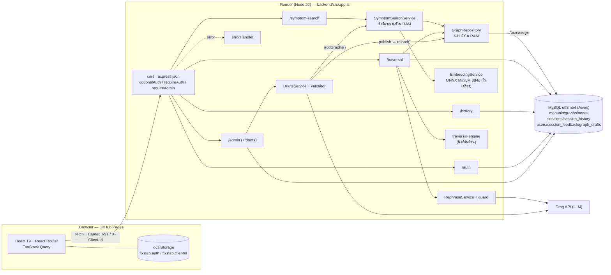
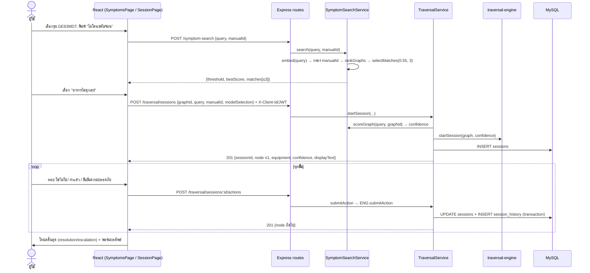
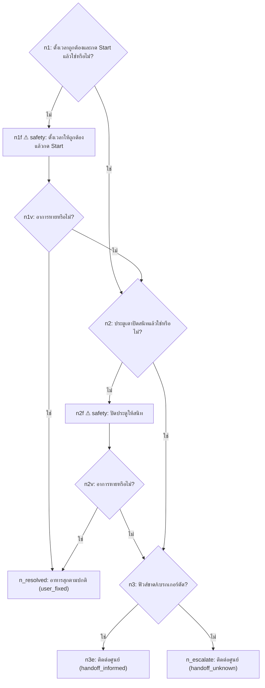

# 01 — ภาพรวมและสถาปัตยกรรม

## 1. ปัญหาที่แก้

### อธิบายแบบง่าย (30 วินาที)
เครื่องใช้ไฟฟ้าเสียเล็กน้อยหลายอย่างแก้เองได้ตามคู่มือ เช่น ไมโครเวฟไม่ร้อนเพราะประตูปิดไม่สนิท แต่คู่มือหนาหลายสิบหน้า เป็นภาษาอังกฤษ และคนไม่รู้ว่าจะเปิดหน้าไหน ถ้าไปถาม AI แชตทั่วไป มันตอบลื่นแต่อาจแต่งขั้นตอนที่คู่มือไม่ได้พูด และไม่บอกว่าขั้นไหนอันตราย ระบบนี้จึงพาผู้ใช้ "เดินตามคู่มือ" ทีละข้อ พร้อมบอกหน้าที่มา

### เชิงเทคนิค
ระบบนี้คือ **retrieval-guided troubleshooting state machine** แบ่งเป็น 2 ส่วนที่แยกจากกันชัดเจน

| ส่วน | หน้าที่ | ใช้อะไร | โค้ด |
|---|---|---|---|
| Retrieval (หา) | แปลงข้อความที่ผู้ใช้พิมพ์ → หา "ผังอาการ" ที่ใกล้ที่สุด ≤ 3 ผัง | embedding 384 มิติ + cosine similarity, threshold 0.55 | `backend/src/symptom-search/symptom-search.service.ts:160-191` |
| State machine (ตอบ) | พาเดินผังทีละโหนด: ถาม yes/no, สั่งทำ, ขอรหัส error, จบด้วยแก้ได้/ส่งช่าง | ฟังก์ชันล้วน deterministic | `backend/src/traversal-engine/traversal-engine.ts:4-124` |

LLM **ไม่ได้อยู่บนเส้นทางที่สร้างคำแนะนำ** มีแค่ 2 บทบาทเสริม
1. เรียบเรียงถ้อยคำของโหนดที่ไม่อันตราย ปิดได้ และถ้าไม่ผ่านด่านตรวจจะใช้ข้อความเดิม (`backend/src/rephrase/rephrase.service.ts:35-63`)
2. ช่วย admin ร่างผังจาก PDF ซึ่งต้องผ่าน validator และให้คนตรวจก่อน publish (`backend/src/authoring/drafts.service.ts:85-117`)

## 2. ทำไมไม่ถาม LLM ตรงๆ และทำไมไม่ใช้ RAG แบบสร้างคำตอบ

### อธิบายแบบง่าย
ถ้าให้ AI แต่งคำตอบสด เราตรวจล่วงหน้าไม่ได้ว่ามันจะพูดอะไร แต่ถ้าคำตอบทุกขั้นเป็นข้อความที่เตรียมจากคู่มือไว้แล้ว เราตรวจได้ก่อนเผยแพร่ บอกหน้าที่มาได้ และบังคับขั้นอันตรายได้ด้วยโค้ด

### เชิงเทคนิค (เทียบ 3 แบบ)

| ประเด็น | ถาม LLM ตรงๆ | RAG (ค้น chunk → LLM เขียนคำตอบ) | Retrieval-guided state machine (ระบบนี้) |
|---|---|---|---|
| Hallucination | สูง ไม่มีแหล่งอ้าง | ลดลง แต่ LLM ยังแต่งเชื่อม/สรุปผิดได้ | คำแนะนำมาจากผังที่บันทึกไว้แล้ว ไม่ได้สร้างตอนถาม |
| ความปลอดภัย | ขึ้นกับ prompt | ขึ้นกับ prompt | engine ปฏิเสธการข้ามด่าน `safety_critical` (`traversal-engine.ts:90-96`) |
| ตรวจย้อนกลับ | ไม่ได้ | ได้ระดับ chunk | ทุก session มี `session_history` ทุกขั้น (`backend/migrations/004_sessions.sql:59-77`) |
| การอ้างอิง | อาจแต่ง | อาจอ้าง chunk ไม่ตรงที่พูด | ชื่อคู่มือ + หน้าแสดงทุกขั้น (`frontend/src/components/step/ReferenceLine.tsx:15-18`) — ระดับผัง ดูข้อจำกัดในไฟล์ 12 |
| พฤติกรรมเมื่อไม่รู้ | มักตอบอยู่ดี | ขึ้นกับ prompt | ไม่ถึง 0.55 → `matches: []` หน้าจอบอก "ระบบไม่เดาอาการให้" (`frontend/src/components/SymptomSearchResults.tsx:13-18`) · ในผัง ถ้าคู่มือไม่บอกทางต่อ → โหนด escalation |
| ข้อแลก | — | — | ตอบได้เฉพาะอาการที่มีในผัง (631 ผัง) ยืดหยุ่นน้อยกว่า |

## 3. Architecture diagram

ลำดับตอนบูต (`backend/src/app.ts:45-62`): ตรวจ `JWT_SECRET` → ต่อ MySQL → `graphs.load()` โหลดผังทั้งหมดเข้าหน่วยความจำ → `equipment.load()` → `symptomSearch.start()` โหลดโมเดลเบื้องหลังโดยไม่รอ → `drafts.failInterruptedDrafts()` → เปิดรับคำขอ

## 4. ไล่คำขอจริง 1 ครั้ง: "ไมโครเวฟไม่ร้อน" (รุ่น GE83MDT)

### อธิบายแบบง่าย
ผู้ใช้เลือกรุ่น → พิมพ์ "ไมโครเวฟไม่ร้อน" → ระบบเสนออาการที่ใกล้ที่สุด ≤ 3 อัน → ผู้ใช้กด "อาหารไม่สุกเลย" → ระบบถาม "ตั้งเวลาและกด Start แล้วใช่ไหม?" → ตอบทีละข้อจนจบ → ผลถูกบันทึกเป็นประวัติ

### เชิงเทคนิค (ทุกขั้นพร้อมไฟล์และฟังก์ชัน)

| # | เกิดอะไร | ไฟล์ : บรรทัด / ฟังก์ชัน |
|---|---|---|
| 1 | หน้าเลือกเครื่อง กดรุ่น → ไปหน้าอาการพร้อม `manualId` และ `selected/unknown` | `frontend/src/pages/DevicesPage.tsx:91` |
| 2 | กดค้นหา: ตรวจความยาวก่อน แล้ว `search.mutate({query, manualId})` | `frontend/src/pages/SymptomsPage.tsx:28-31` |
| 3 | mutation → `searchSymptoms()` → `request()` (ใส่ JSON, Bearer ถ้ามี) | `frontend/src/api/queries.ts:90-94` · `frontend/src/api/traversal.ts:43-48` · `frontend/src/api/http.ts:39-86` |
| 4 | Express ส่งไป router ค้นหา | `backend/src/app.ts:73` · `backend/src/symptom-search/symptom-search.routes.ts:9-13` |
| 5 | ตรวจ body: query เป็น string, ตัดช่องว่าง, ไม่ว่าง, ≤ 200 · manualId ≤ 80 | `backend/src/symptom-search/symptom-search.dto.ts:14-46` |
| 6 | สถานะต้อง `ready` (ไม่งั้น 503 `SEARCH_NOT_READY`/`SEARCH_UNAVAILABLE`) | `symptom-search.service.ts:161-162` |
| 7 | แปลงคำค้นเป็นเวกเตอร์ 384 มิติ (mean pooling + normalize) | `backend/src/embedding/embedding.service.ts:46-55` |
| 8 | **Metadata filter**: เหลือเฉพาะข้อความของผังที่ `manualId` ตรงรุ่น | `symptom-search.service.ts:165-168` |
| 9 | **Cosine** กับทุกข้อความที่เหลือ เก็บคะแนนสูงสุดต่อผัง เรียงมากไปน้อย (เท่ากัน → เรียงตาม graphId) | `symptom-matcher.ts:64-88` (สูตร `:20-41`) |
| 10 | ตัดที่ `score >= 0.55` และเอาไม่เกิน 3 | `symptom-matcher.ts:90-96` · `symptom-search.service.ts:172` |
| 11 | ตอบ `{query, threshold, bestScore, matches}` · ปัดทศนิยม 3 ตำแหน่งตอนส่งออกเท่านั้น | `symptom-search.service.ts:171-191` |
| 12 | หน้าจอแสดงรายการ หรือข้อความ "ไม่พบ…ระบบไม่เดาอาการให้" ถ้าว่าง | `frontend/src/components/SymptomSearchResults.tsx:13-31` |
| 13 | ผู้ใช้กดผัง → `start(graphId, {query, manualId, modelSelection})` | `frontend/src/pages/SymptomsPage.tsx:65` · `frontend/src/lib/useStartSymptom.ts:12-18` |
| 14 | POST `/traversal/sessions` พร้อม `X-Client-Id` (เฉพาะ guest) | `frontend/src/api/traversal.ts:34-40` · `frontend/src/lib/clientHeaders.ts:4-6` |
| 15 | route: `optionalAuth` อ่าน JWT (ถ้ามี) → ตรวจ body → หาเจ้าของ (user/guest) | `backend/src/traversal/traversal.routes.ts:20-25` · `backend/src/auth/session-owner.ts:14-23` |
| 16 | service: หา graph (404 ถ้าไม่มี) · ผังต้องเป็นของรุ่นที่ส่งมา (400 `GRAPH_MANUAL_MISMATCH`) | `backend/src/traversal/traversal.service.ts:54-71` |
| 17 | คำนวณ confidence = cosine ของคำค้นกับผังที่เลือก (server คำนวณเอง ไม่รับจากหน้าจอ) | `traversal.service.ts:184-191` · `symptom-search.service.ts:193-199` |
| 18 | engine สร้าง session: UUID, โหนดเริ่ม `entry_node`, status `in_progress` | `backend/src/traversal-engine/traversal-engine.ts:4-24` |
| 19 | บันทึก session ลง DB อายุ 24 ชม. | `backend/src/traversal/session.store.ts:38-57` |
| 20 | ประกอบคำตอบ: โหนด + อุปกรณ์ของประเภทเครื่อง + confidence + `displayText` (rephrase ถ้าเปิด) | `traversal.service.ts:154-182` |
| 21 | frontend เก็บผลลง cache แล้วไปหน้า `/session/:id` (ไม่ต้องโหลดซ้ำ) | `frontend/src/api/queries.ts:96-116` · `useStartSymptom.ts:16` |
| 22 | หน้า session เลือก component ตามชนิดโหนด (checkpoint / instruction / safety / input / outcome) | `frontend/src/components/step/StepView.tsx:22-42` |
| 23 | ผู้ใช้ตอบ → POST `/actions` (กันกดซ้ำด้วย `isSendingRef`) | `frontend/src/pages/SessionPage.tsx:46-57` |
| 24 | service ตรวจสิทธิ์ (ผังของ user คนอื่น → 404) → engine คำนวณโหนดถัดไป | `traversal.service.ts:86-104, 136-141` · `traversal-engine.ts:41-124` |
| 25 | บันทึก UPDATE sessions + INSERT session_history ใน transaction เดียว · จบแล้วต่ออายุเป็น 90 วัน | `session.store.ts:89-142` |
| 26 | ถึงโหนดสิ้นสุด → แสดงผล + ฟอร์มข้อความผลลัพธ์ (บันทึกได้ครั้งเดียว) | `traversal.service.ts:114-134` · `session.store.ts:171-182` |
| 27 | **บันทึกประวัติ**: ไม่มีตารางประวัติแยก — แถว `sessions` ที่ `status='completed'` + `session_history` คือประวัติ แสดงที่ `/history` | `backend/src/history/history.store.ts:48-60` |

ผังที่ผู้ใช้เดินในตัวอย่างนี้ (`samsung_ge83mdt_um_not_cooked_at_all` จาก `data/manuals/samsung_ge83mdt_um_de68_04111e.json`):

ผลค้นหาจริงของคำค้นนี้ (วัดด้วย `backend/scripts/study-measure.js` และบันทึกไว้ใน `docs/STUDY_GUIDE.md:606-617`, ไม่ได้รันใหม่ในงานนี้): `…_not_start` 0.845 อยู่อันดับ 1 ส่วนอาการที่ถูก `…_not_cooked_at_all` ได้ 0.822 อยู่อันดับ 2 **นี่คือเหตุผลที่ระบบเสนอ 3 อันให้ผู้ใช้เลือก แทนการเลือกให้เอง**

## 5. โครงสร้างโฟลเดอร์ที่ต้องรู้

| โฟลเดอร์ | ทำงานตอนไหน | หมายเหตุ |
|---|---|---|
| `backend/src/` | runtime | Express 50 ไฟล์ (`docs/STUDY_GUIDE.md` §5.7) |
| `backend/migrations/` | ตั้ง DB | 001–006 (รวมจาก 001–012 เดิมบน `main`) |
| `backend/scripts/` | เครื่องมือ | migrate, seed ผัง/อุปกรณ์/admin, backup, `study-measure.js` |
| `backend/model/` | runtime | ไฟล์โมเดล ONNX อยู่ใน git |
| `data/manuals/` | ต้นทาง seed | 21 ไฟล์ = 631 ผัง |
| `data/chuck/`, `data/pdf/` | เตรียมข้อมูล | chunk ที่ LLM จัดรูปจาก PDF + PDF ต้นฉบับ |
| `scripts/*.py` | เตรียมข้อมูล | แปลง chunk → ผัง, validate, จำลองเส้นทาง, เทียบ chunk กับ PDF |
| `frontend/src/` | runtime | React |
| `troubleshoot-assistantv2/` (นอก repo นี้) | ไม่ใช้แล้ว | โปรเจกต์เวอร์ชันเก่า (NestJS, คู่มือแอร์ AR70H) มีชุดคำค้นที่ AI ร่าง |
