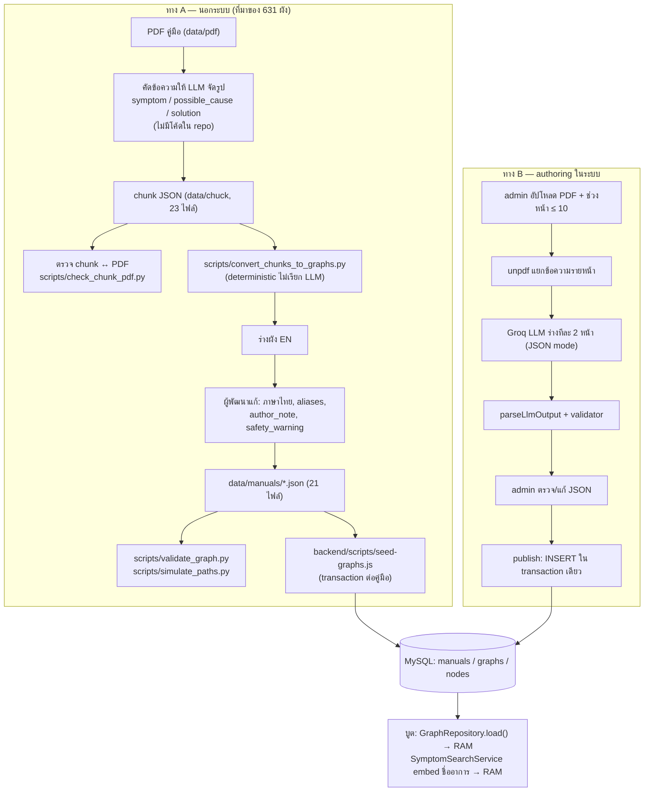
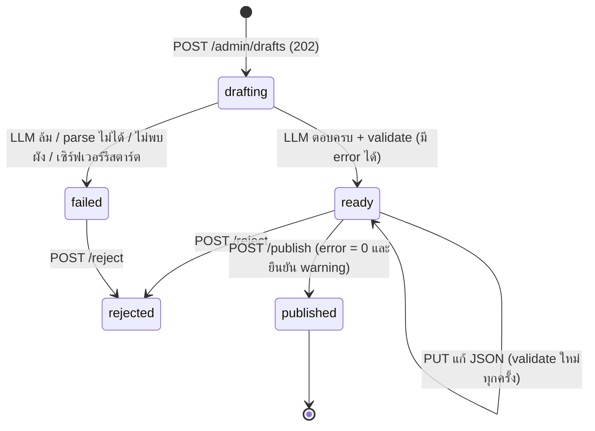

# 02 — Knowledge Base Pipeline: จากคู่มือ PDF สู่ผังในฐานข้อมูล

> สรุปสั้น: ระบบนี้**ไม่ได้เก็บ chunk ข้อความ + embedding ลงฐานข้อมูลแบบ RAG** "ความรู้" ที่ระบบใช้ตอบคือ**ผังขั้นตอน** (ตาราง `manuals → graphs → nodes`) embedding คำนวณจากชื่ออาการของผังตอนบูต แล้วเก็บไว้ใน RAM เท่านั้น
> ผังมาได้ 2 ทาง: (A) pipeline นอกระบบ ซึ่งเป็นที่มาของ 631 ผังทั้งหมด และ (B) authoring flow ในระบบ (admin อัปโหลด PDF)

---

## 1. ภาพรวม 2 เส้นทาง

### อธิบายแบบง่าย
ทาง A: ผู้พัฒนาคัดข้อความส่วน "แก้ปัญหา" ของคู่มือให้ AI จัดเป็นรายการอาการ ตรวจกับ PDF ด้วยสคริปต์ แปลงเป็นผังด้วยสคริปต์ แล้วเขียนภาษาไทยและคำพ้องเพิ่ม ก่อนโหลดเข้าฐานข้อมูล
ทาง B: admin อัปโหลด PDF ในเว็บ AI ร่างผังให้ โปรแกรมตรวจกฎ แล้ว admin แก้และกดเผยแพร่เอง

## 2. ทาง A — ทีละขั้นจากโค้ด/เอกสาร

| ขั้น | ทำอะไร | หลักฐาน | สถานะ |
|---|---|---|---|
| Extract | คัดข้อความจาก PDF ด้วยมือแล้วให้ LLM จัดรูป **ไม่มีโปรแกรมแปลง PDF อัตโนมัติ** | `docs/ops/VERIFY-CHUNKS-AGAINST-PDF.md:7` | ทำนอกระบบ ไม่มีโค้ด |
| Chunk | 1 chunk = 1 อาการในตาราง Troubleshooting (แบ่งตามความหมาย ไม่ได้แบ่งตามจำนวนตัวอักษร) | ตัวอย่าง `data/chuck/manual_samsung_Microwave_user_manual_GE83MDT.json` (chunk `…_p37_normal_conditions`) | **chunk size / overlap: ไม่พบในโค้ด** |
| Metadata ของ chunk | `chunk_id, device_category, brand, model, source, page, content, metadata{symptom, possible_cause, solution, severity, difficulty, safety_warning}` | ไฟล์ใน `data/chuck/` | มีจริง |
| ตรวจ chunk ↔ PDF | นับว่าคำของ chunk อยู่ในหน้าที่อ้างกี่ % และเรียงลำดับตรงกี่ % → PASS/WARN/FAIL | `scripts/check_chunk_pdf.py:1-30` (เกณฑ์ `FAIL_BELOW = 0.90`, `PASS_FROM = 0.97`) | มีสคริปต์ |
| ผลตรวจ chunk (15 ต.ค.) | 644 chunk: PASS 478 · WARN 49 · FAIL 12 · ตรวจไม่ได้ 50 · ไม่รู้ PDF 24 · และจับได้ว่า LLM แต่งคำว่า "blown/tripped" ที่ PDF ไม่มี | `docs/ops/VERIFY-CHUNKS-AGAINST-PDF.md:86-100` | ⚠ สคริปต์ที่ใช้รันชุดนี้ (`scripts/verify_chunks_against_pdf.py`) **ไม่อยู่ใน repo แล้ว** มีแต่ `.pyc` ใน `scripts/__pycache__/` |
| Convert | แยก solution เป็นขั้นตามเลข 1. 2. → สร้าง checkpoint ยืนยันอาการ, instruction ทีละขั้น, โหนดตรวจผล, resolution/escalation · คำว่า "is normal" → `normal_behavior` | `scripts/convert_chunks_to_graphs.py:60-82, 116-128, 147-` | มีสคริปต์ |
| เติมภาษาไทย | สคริปต์ปล่อย `entry_symptom_th` ว่างไว้ "ผู้พัฒนาต้องเติมคำแปลภาษาไทยเอง" | `scripts/convert_chunks_to_graphs.py:305` | ใครแปลและแปลอย่างไร: **ไม่พบในโค้ด** |
| ระบุสิ่งที่ผู้พัฒนาเพิ่มเอง | ฟิลด์ `author_note` เช่น "ระยะเวลาสังเกตผลไม่ระบุในคู่มือ" (720 โหนด), "คู่มือเล่มนี้ไม่มีหัวข้อความปลอดภัยเรื่องปลั๊กไฟ ข้อความเตือนนี้ผู้พัฒนาเพิ่ม…" | นับจาก `data/manuals/*.json`: **1,264 / 4,739 โหนด** | มีในข้อมูลและใน DB (`nodes.author_note`) แต่ **ไม่ได้โหลดขึ้นมาแสดงผู้ใช้** (`backend/src/traversal/graph.repository.ts:133-139` ไม่ SELECT คอลัมน์นี้) |
| Validate | ตรวจ JSON Schema + ไปถึงได้ทุกโหนด, ไม่มีทางตัน, ตำแหน่งด่านความปลอดภัย, ตัวแปร template | `scripts/validate_graph.py:1-12` · schema `data/schemas/troubleshooting-graph.v2.schema.json` | มีสคริปต์ |
| Simulate | ไล่ทุกเส้นทาง ดูความยาวสูงสุด (กัน loop ที่ 40) และว่าด่านความปลอดภัยครอบคลุมไหม | `scripts/simulate_paths.py:1-20` | มีสคริปต์ |
| Seed | ตรวจลิงก์ระหว่างโหนดซ้ำอีกรอบ → ใน transaction: upsert `manuals`, `graphs` (ON DUPLICATE KEY UPDATE) → ลบ nodes ของผังนั้นแล้ว insert ใหม่ | `backend/scripts/seed-graphs.js:20-60, 240-268` · คำสั่งทั้ง 21 เล่มใน `data/runseed.txt` | มีสคริปต์ |

### 631 ผังได้มาอย่างไร และคนตรวจไปแล้วกี่ผัง
- **ที่มา:** ทั้ง 631 ผังมาจาก**ทาง A** (ไฟล์ `data/manuals/*.json` → `seed-graphs.js`) ไม่พบหลักฐานว่าผังใดมาจาก authoring flow ส่วนผังที่ id ขึ้นต้น `draft:` ใน `source_chunk_id` จะมาจากทาง B (`backend/src/authoring/draft-manual.ts:14-16`) แต่ในไฟล์ manuals ไม่มีเลย
- **ตรวจอัตโนมัติ (16 ต.ค. 2569)** ตาม `docs/ops/VERIFY-GRAPHS-AGAINST-SOURCE.md:19-32`
  - ผัง ↔ chunk: ชื่อคู่มือ/ยี่ห้อ/รุ่น/หน้า ตรงทุกผัง
  - ผัง ↔ PDF จาก 644 ผัง (รวมผังแอร์ 13 ผังที่ไม่อยู่ในระบบแล้ว): ผ่าน 559 · ข้อยกเว้นที่ตรวจแล้ว 6 · WARN 18 · FAIL 0 · ตรวจไม่ได้ 61
  - ตรวจตัวเลข 1,448 ตัว และข้อความในเครื่องหมายคำพูด 93 ข้อความ
- **คนตรวจ:** เอกสารเขียนตรงๆ ว่า "ความถูกต้องของคำแปลและลำดับขั้นตอนต้องให้คนสุ่มตรวจ **(ยังไม่ได้ทำ)**" (`VERIFY-GRAPHS-AGAINST-SOURCE.md:15`) → **จำนวนผังที่คนตรวจครบทุกโหนดอย่างเป็นระบบ: 0 ตามเอกสาร** มีการเปิดดูด้วยตาเฉพาะจุดที่สคริปต์เตือน เช่น ตารางปริมาณผ้า WT10J7 (`:39-41`)
- ⚠ เครื่องมือที่ให้ผลข้างบน (`verify_graphs_against_pdf.py`, `graph-vs-chunk.spec.ts`) **ไม่อยู่ใน repo ปัจจุบัน** รันซ้ำตอนสอบไม่ได้ (ไฟล์ 14)
- ข้อค้นพบที่ยังไม่แก้: เบอร์ `02-689-3232` ในผัง WT10J7 อ้าง "คู่มือหน้า 7" แต่ PDF เล่มนั้นไม่มีเบอร์นี้ (`VERIFY-GRAPHS-AGAINST-SOURCE.md:36`)

## 3. Metadata ที่เก็บจริงในฐานข้อมูล

| ระดับ | คอลัมน์ | ใช้ทำอะไร |
|---|---|---|
| `manuals` | `manual_id, device_category, brand, model_pattern, source_manual, display_name, model_aliases` | หน้าเลือกรุ่น · กรองการค้นหา (`backend/migrations/002_graphs.sql:9-23`) |
| `graphs` | `entry_symptom (EN), entry_symptom_th, entry_symptom_aliases (JSON), source, page_start, page_end, source_chunk_id, severity, difficulty, entry_node` | ข้อความที่ embed + อ้างอิงหน้า (`002_graphs.sql:26-51`) |
| `nodes` | `node_type, text_content, on_yes, on_no, next_node, on_invalid, input_type, input_pattern, store_as, outcome_kind, safety_critical, safety_warning, author_note, display_order` | ตัว state machine (`002_graphs.sql:54-84`) |

**ไม่มี** คอลัมน์เลขหน้ารายโหนด และ**ไม่มี** ตาราง embedding

## 4. ทำไมเลือกแบบนี้ (แทน chunk + overlap)

### อธิบายแบบง่าย
ส่วนแก้ปัญหาของคู่มือเป็นตาราง "อาการ → สาเหตุ → วิธีแก้" อยู่แล้ว การตัดทีละ 500 ตัวอักษรจะผ่าอาการกลางคัน การตัด "หนึ่งอาการต่อหนึ่งชิ้น" จึงตรงกับโครงของคู่มือที่สุด

### เชิงเทคนิค
- หน่วยที่ระบบต้องการคือ "อาการ" ไม่ใช่ "ย่อหน้า" เพราะผลค้นหาต้องพาไปผังขั้นตอนหนึ่งผัง → chunk ตามความหมาย (semantic chunking) ไม่ต้องมี overlap เพราะไม่มีข้อความข้ามขอบ
- ทาง B ก็ใช้หลักเดียวกัน: ส่งให้ LLM ทีละ 2 หน้า (`backend/src/authoring/drafts.service.ts:19-27`) และสั่งว่า "อาการที่ถูกตัดที่ขอบหน้า ให้ข้าม" (`backend/src/authoring/draft-llm.client.ts:61`) **ข้อเสีย:** อาการที่คร่อมระหว่างกลุ่มหน้า (เช่น หน้า 2–3) อาจหายไป ต้องให้ admin เลือกช่วงหน้าใหม่

## 5. ภาษาไทยและ utf8mb4

- ทุกตาราง `ENGINE=InnoDB DEFAULT CHARSET=utf8mb4 COLLATE=utf8mb4_unicode_ci` (เช่น `backend/migrations/001_users.sql:23`) — `utf8` เดิมของ MySQL เก็บได้แค่ 3 ไบต์ อีโมจิ (4 ไบต์) จะพัง ส่วน utf8mb4 เก็บได้ครบ
- connection ระบุ `charset: 'utf8mb4'` ทั้งแอป (`backend/src/database/pool.ts:39`) และสคริปต์ seed/migrate (`backend/scripts/seed-graphs.js:15`)
- ข้อความไทยค้นด้วย embedding แบบหลายภาษา จึงไม่ต้องตัดคำไทยเอง
- ด่าน rephrase แปลงเลขไทย ๐–๙ เป็นเลขอารบิกก่อนเทียบตัวเลข (`backend/src/rephrase/rephrase-guard.ts:3-11`)
- รหัสผ่านจำกัด ≤ 72 **ไบต์** เพราะ bcrypt ตัดที่ 72 ไบต์ และอักษรไทยใช้ 3 ไบต์ต่อตัว (`backend/src/auth/auth.dto.ts:72-77`)
- PDF: `normalizePageText` ยุบช่องว่างซ้ำแต่เก็บการขึ้นบรรทัดไว้ (`backend/src/authoring/pdf-text.ts:59-65`) · PDF ไทยบางเล่มดึงตารางไม่ได้ (`VERIFY-GRAPHS-AGAINST-SOURCE.md:41`)

## 6. ทาง B — Authoring flow: admin อัปโหลด PDF → LLM ร่าง → คนตรวจ → publish

### อธิบายแบบง่าย
admin ไม่ต้องเขียน JSON เอง อัปโหลดคู่มือ เลือกหน้าแก้ปัญหา ระบบให้ AI ร่างผัง แต่ AI เป็นแค่ "ผู้ช่วยร่าง" ร่างทุกชิ้นต้องผ่านโปรแกรมตรวจ 29 กฎ และ admin ต้องกดยืนยันเอง ระหว่างนั้นผู้ใช้มองไม่เห็นร่างเลย

### สถานะของร่าง

### เชิงเทคนิคทีละขั้น

| ขั้น | รายละเอียด | โค้ด |
|---|---|---|
| รับไฟล์ | multer `memoryStorage` ไม่เขียนดิสก์ · ไฟล์เดียว · ≤ `AUTHORING_MAX_PDF_MB` (เริ่มต้น 10) | `backend/src/authoring/drafts.routes.ts:22-71` |
| ตรวจชนิด | ต้องมี `%PDF-` ใน 1 KB แรก (ไม่เชื่อนามสกุลไฟล์) | `drafts.service.ts:52` |
| งานเดียวพร้อมกัน | flag `busy` ในหน่วยความจำ + นับร่างที่ `drafting` ใน DB → 409 | `drafts.service.ts:54-57` |
| ห้ามทับของเดิม | `manual_id` ที่มีอยู่แล้ว → ปฏิเสธ | `drafts.service.ts:58-60` |
| แยกข้อความ | unpdf (pdf.js) · PDF ≤ 200 หน้า · ช่วง ≤ 10 หน้า · หน้าละ ≤ 12,000 ตัวอักษร (**ไม่ตัดทิ้งให้** เพราะคำเตือนอาจหาย) · ทั้งช่วง < 50 ตัวอักษร = PDF สแกน → 422 | `backend/src/authoring/pdf-text.ts:2-6, 68-110` |
| บันทึกร่าง | ตาราง `graph_drafts` เก็บข้อความหน้า (ไม่เก็บ PDF), meta ที่ admin กรอก, รุ่นโมเดล, `PROMPT_VERSION` | `backend/migrations/006_graph_drafts.sql` · `drafts.service.ts:62-75` |
| ร่างเบื้องหลัง | `void this.runDrafting(id)` ตอบ 202 ทันที · frontend poll ทุก 3 วินาทีระหว่าง drafting | `drafts.service.ts:76` · `frontend/src/api/queries.ts:22-34` · `frontend/src/api/drafts.ts:4` |
| เรียก LLM | ทีละ 2 หน้า · temperature 0 · `response_format: json_object` · ถ้า `finish_reason === 'length'` ถือว่าล้ม | `draft-llm.client.ts:82-134` |
| Parse | JSON ต้องตรงรูป ฟิลด์ที่ไม่รู้จัก = ผิด · ≤ 12 ผังต่อครั้ง · ตั้ง `graph_id` = `manualId_slug` เอง (ไม่เชื่อ id จาก LLM) | `backend/src/authoring/draft-schema.ts:130-206` |
| Validate | 24 กฎ error (เช่น `E_UNREACHABLE`, `E_NO_EXIT`, `E_SAFETY_NO_WARNING`, `E_SOURCE_PAGE_OUTSIDE`, `E_VAR_NOT_GUARANTEED`) + 5 กฎ warning (`W_CYCLE`, `W_NO_ESCALATION`, `W_NO_ON_INVALID`, `W_NODE_RISK`, `W_PAGE_RISK`) | `backend/src/authoring/graph-validator.ts:85-421` |
| ตรวจคำอันตราย | regex คำเสี่ยง EN+TH (ปลั๊ก, ไฟฟ้า, แก๊ส, น้ำร้อน, ถอดฝา…) ถ้าโหนดมีคำเหล่านี้แต่ไม่ตั้ง safety → W_NODE_RISK · หน้าต้นฉบับมีคำเสี่ยงแต่ผังไม่มีด่านเลย → W_PAGE_RISK | `graph-validator.ts:56, 384-392` |
| ชนกับของจริง | graph_id/manual_id ซ้ำกับที่ใช้อยู่ → `E_ID_CONFLICT` | `drafts.service.ts:230-243` |
| แก้ | PUT ได้เฉพาะสถานะ `ready` แล้ว validate ใหม่ทุกครั้ง | `drafts.service.ts:156-172` |
| Publish | ใน transaction: `SELECT … FOR UPDATE` → parse+validate ซ้ำจากข้อมูลใน DB → error ≥ 1 = 409 · warning ≥ 1 ต้องส่ง `acknowledgedWarnings` → ตรวจชนซ้ำ → INSERT manuals/graphs/nodes → status `published` | `backend/src/authoring/drafts.store.ts:210-245` · `drafts.service.ts:183-213` |
| ใช้งานได้ทันที | `graphRepository.reload()` สร้าง Map ใหม่ให้เสร็จก่อนแล้วค่อยสลับ (ล้มกลางทางของเดิมยังอยู่) → `symptomSearch.addGraphs(ids)` embed เฉพาะข้อความใหม่ | `graph.repository.ts:120-182` · `symptom-search.service.ts:112-158` |
| รีสตาร์ตกลางคัน | ตอนบูต ร่างที่ค้าง `drafting` → `failed` `INTERRUPTED` | `drafts.store.ts:164-171` · `app.ts:62` |

**ข้อสังเกตที่ต้องรู้ (ใช้ตอบกรรมการ):**
- ร่างจาก LLM มี `source_page` **รายโหนด** และ validator บังคับให้อยู่ในหน้าที่อัปโหลด แต่ตอน publish `toDbRows` **ไม่ได้บันทึก `source_page`** (ไม่มีใน `NODE_COLUMNS`) เหลือแค่ `page_start/page_end` ระดับผัง (`backend/src/authoring/draft-manual.ts:26-28, 55-58`)
- `author_note` ของผังที่มาจาก LLM ถูกตั้งเป็น `null` ทุกโหนด (`draft-manual.ts:117`) → ไม่มีป้ายบอกว่าข้อความไหน LLM เรียบเรียง
- authoring flow **ยังไม่ได้ทดสอบกับ PDF จริงหลังย้ายไป Express** (`docs/STUDY_GUIDE.md` §5.7 "ที่ยังไม่ได้ทดสอบ")
