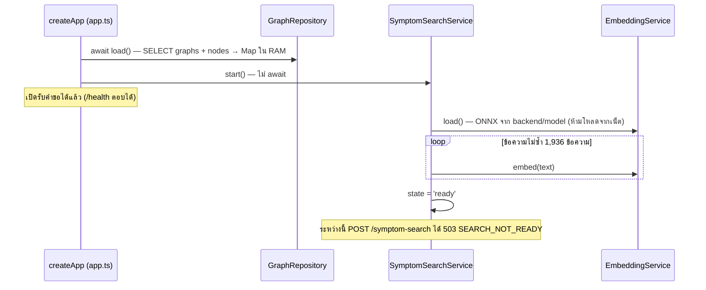

# 03 — Retrieval และ Similarity

> สิ่งที่ถูกค้นคือ **"ข้อความอาการของผัง"** (ชื่ออาการไทย, ชื่ออาการอังกฤษ และคำพ้อง) ไม่ใช่ chunk ของคู่มือ ผลลัพธ์คือ **ผัง ≤ 3 ผังให้ผู้ใช้เลือก** ไม่ได้ส่งต่อให้ LLM

## 1. ดัชนีที่ค้นมีอะไร

### อธิบายแบบง่าย
ผังแต่ละผังมี "ป้ายชื่อ" หลายแบบ เช่น "อาหารไม่สุกเลย", "The food is not cooked at all.", "ไมโครเวฟไม่ทำให้อาหารร้อน" ระบบแปลงป้ายทุกอันเป็นตัวเลข 384 ตัวเก็บไว้ในหน่วยความจำ แล้วเทียบกับสิ่งที่ผู้ใช้พิมพ์

### เชิงเทคนิค
- `buildSymptomTexts` ดึง `entry_symptom_th`, `entry_symptom` และ `entry_symptom_aliases[]` ของทุกผัง ตัดช่องว่าง ข้ามข้อความว่าง (`backend/src/symptom-search/symptom-matcher.ts:43-62`)
- จำนวนจริง: **3,814 รายการ** จาก 631 ผัง (ตรงกับ log "ready (3,814 ข้อความ/631 ผัง)" ใน `docs/STUDY_GUIDE.md` §5.7)
- ข้อความที่ซ้ำกัน เช่น "ทีวีปิดเอง" จากหลายคู่มือ จะ embed ครั้งเดียวแล้วใช้เวกเตอร์ร่วมกัน (`symptom-search.service.ts:78-88`) → ข้อความไม่ซ้ำ **1,936** ข้อความ (นับจาก `data/manuals/*.json`)

## 2. Metadata filter (device / brand / model)

### อธิบายแบบง่าย
ผู้ใช้ต้องเลือกรุ่นก่อนค้น ระบบจึงเทียบเฉพาะอาการของคู่มือรุ่นนั้น ไม่เอาอาการของตู้เย็นมาปนกับไมโครเวฟ

### เชิงเทคนิค
- filter มีมิติเดียวคือ **`manualId`** (คู่มือ 1 เล่ม = ยี่ห้อ + รุ่น + ประเภทเครื่อง) ไม่มี filter แยก device/brand ใน API ค้นหา
  ```ts
  // backend/src/symptom-search/symptom-search.service.ts:165-168
  const candidates = manualId === undefined
      ? this.index
      : this.index.filter((item) => this.graphInfo.get(item.graphId)?.manualId === manualId);
  ```
- ทำ **pre-filter** (กรองก่อนแล้วค่อยคำนวณ cosine) ไม่ใช่ post-filter
- frontend ส่ง `manualId` เสมอ เพราะหน้าค้นหาจะ redirect ไป `/devices` ถ้ายังไม่ได้เลือกรุ่น (`frontend/src/pages/SymptomsPage.tsx:30, 35`)
- ถ้าผู้ใช้ไม่รู้รุ่น เลือก "รุ่นใกล้เคียง" ได้ ระบบบันทึก `model_selection = 'unknown'` และแสดงคำเตือน (`frontend/src/pages/SessionPage.tsx:148-150`, `backend/migrations/004_sessions.sql:29`)
- **ทำไมต้องกรอง:** ผลวัดในเอกสาร "ไมโครเวฟไม่ร้อน" แบบไม่กรองรุ่น มี 120 ผังผ่านเกณฑ์ และ 3 อันดับแรกได้ 1.000 เท่ากัน เพราะมี alias ตรงตัวอักษรในหลายรุ่น (`docs/STUDY_GUIDE.md:627`)
- นอกจากนี้ `POST /traversal/sessions` ตรวจว่าผังที่เลือกเป็นของ `manualId` ที่ส่งมาจริง ไม่งั้น 400 `GRAPH_MANUAL_MISMATCH` (`backend/src/traversal/traversal.service.ts:62-64`)

## 3. Cosine similarity

### อธิบายแบบง่าย
ให้คิดว่าแต่ละข้อความเป็นลูกศรในพื้นที่ 384 มิติ ข้อความที่ความหมายใกล้กันจะชี้ไปทางเดียวกัน cosine วัด "มุม" ระหว่างลูกศร ถ้าชี้ทางเดียวกันได้ 1 ถ้าตั้งฉากกันได้ 0

### สูตร
$$\cos(\mathbf{q},\mathbf{d})=\frac{\mathbf{q}\cdot\mathbf{d}}{\lVert\mathbf{q}\rVert\,\lVert\mathbf{d}\rVert}=\frac{\sum_i q_i d_i}{\sqrt{\sum_i q_i^2}\sqrt{\sum_i d_i^2}}$$

```ts
// backend/src/symptom-search/symptom-matcher.ts:20-41 (ย่อ)
for (let i = 0; i < a.length; i++) { dot += a[i]*b[i]; normA += a[i]*a[i]; normB += b[i]*b[i]; }
if (normA === 0 || normB === 0) return 0;
return dot / (Math.sqrt(normA) * Math.sqrt(normB));
```
- มิติไม่เท่ากัน → throw (`:24-28`) · เวกเตอร์ศูนย์ → 0
- เวกเตอร์ถูก normalize มาแล้วจากโมเดล (`normalize: true`, `backend/src/embedding/embedding.service.ts:52`) ดังนั้นในทางปฏิบัติ cosine = dot product แต่โค้ดคำนวณสูตรเต็มไว้

### ตัวอย่างคำนวณด้วยมือ (เวกเตอร์ 3 มิติ)
สมมติคำค้น q = (1, 2, 2) และป้ายของผัง 3 ผัง

| ผัง | เวกเตอร์ d | q·d | ‖d‖ | cos = q·d / (‖q‖‖d‖) โดย ‖q‖ = √(1+4+4) = 3 |
|---|---|---|---|---|
| A | (2, 1, 2) | 1·2 + 2·1 + 2·2 = **8** | √9 = 3 | 8 / (3·3) = **0.889** ✅ ผ่าน 0.55 |
| B | (0, 0, 1) | 0 + 0 + 2 = **2** | 1 | 2 / (3·1) = **0.667** ✅ ผ่าน 0.55 |
| C | (2, −1, 0) | 2 − 2 + 0 = **0** | √5 | 0 → **0.000** ❌ ตัดทิ้ง |

ผลที่ได้คือ A, B (เรียงมากไปน้อย ไม่เกิน 3)

### "คะแนนต่อผัง = ป้ายที่ใกล้ที่สุด" (max pooling ระดับผัง)
ผังหนึ่งมีหลายป้าย `rankGraphs` เก็บ**คะแนนสูงสุด**ของผังนั้นและจำว่าป้ายไหนชนะ (`matchedText`) แล้วเรียงคะแนนมากไปน้อย ถ้าคะแนนเท่ากันจะเรียงตาม `graphId` เพื่อให้ผลคงที่ (`symptom-matcher.ts:64-88`)

## 4. Threshold 0.55 และ "สูงสุด 3"

- `selectMatches(ranked, 0.55, 3)` = `filter(score >= 0.55).slice(0, 3)` (`symptom-matcher.ts:90-96`, ค่าที่ `symptom-search.service.ts:11-12`)
- เทียบเกณฑ์ด้วยค่าเต็ม แล้วค่อยปัดเป็นทศนิยม 3 ตำแหน่งตอนส่งออก (`symptom-search.service.ts:171-182`)
- response ส่ง `bestScore` มาด้วย แม้จะไม่มีผังผ่านเกณฑ์ (ใช้ debug/อธิบายได้)
- **0.55 มาจากไหน:** เลือกจากชุดตั้งเกณฑ์ 56 ข้อที่ Claude (AI) ร่าง ผู้พัฒนายังไม่ได้ตรวจแก้ และเป็นชุดของ**คู่มือแอร์ AR70H ในโปรเจกต์เก่า** (`troubleshoot-assistantv2/data/eval/review_sheet_tuning.md:3-17`) ในชุดนั้น top-1 = 29/39, top-3 = 37/39, ข้อนอกขอบเขตหลุดผ่านเกณฑ์ 8/17 → **ยังไม่ได้ปรับกับ 4 ประเภทเครื่องปัจจุบัน** (แผนอยู่ในไฟล์ 10)
- **ข้อจำกัดที่เห็นจากผลวัด:** ภายในรุ่นเดียวกัน 0.55 แยก "ตรง/ไม่ตรง" ไม่ได้ เช่น "ไมโครเวฟไม่ร้อน" ใน GE83MDT ผ่านเกณฑ์ 8 จาก 9 ผัง เพราะคำว่า "ไมโครเวฟ" ดึงคะแนนขึ้น (`docs/STUDY_GUIDE.md:613-617`) เกณฑ์จึงทำหน้าที่ตัด "ของที่ไม่เกี่ยวเลย" เช่น "วันนี้ฝนตก" ได้ 0.301 → ไม่พบ (`:626`)
- **ทำไม 3:** ให้ผู้ใช้เป็นคนตัดสินใจขั้นสุดท้าย เพราะอาการที่ถูกอาจไม่ได้อยู่อันดับ 1 (ตัวอย่างที่อาการถูกอยู่อันดับ 2 ใน `docs/STUDY_GUIDE.md:611`) และไม่ให้มากจนอ่านไม่ไหวบนมือถือ (เหตุผลข้อหลังนี้เป็นการตีความ ไม่มีคอมเมนต์ในโค้ด)

## 5. โหลด embedding ตอน startup และ reload หลังเพิ่มผังใหม่



- เปิดด้วย env `SYMPTOM_SEARCH_ENABLED=true` เท่านั้น ค่าอื่น = `disabled` (`symptom-search.service.ts:45-54`)
- สถานะ `disabled → loading → ready | failed` ดูได้ที่ `GET /symptom-search/status` ซึ่งรายงาน `memoryRssMb` ด้วย (`symptom-search.service.ts:200-211`)
- ONNX ตั้ง `intraOpNumThreads: 1` (`embedding.service.ts:39`) เหมาะกับ Render free ที่มี CPU น้อย
- **หลัง publish ผังใหม่** (ทาง B ในไฟล์ 02): `GraphRepository.reload()` สร้าง Map ใหม่ให้เสร็จก่อนแล้วสลับทีเดียว (`backend/src/traversal/graph.repository.ts:148-178`) → `addGraphs(ids)` embed เฉพาะข้อความใหม่ ข้อความที่เคย embed แล้วใช้เวกเตอร์เดิม และสลับดัชนีครั้งเดียวหลัง embed ครบ ผู้ค้นจึงไม่เห็นดัชนีครึ่งๆ กลางๆ (`symptom-search.service.ts:112-158`)
- ถ้าดัชนียังไม่ `ready` ตอน publish → `indexed: false` ผังใหม่**ค้นด้วยข้อความไม่เจอจนรีสตาร์ต** แต่เลือกจาก "อาการทั้งหมด" ได้ทันที (`symptom-search.service.ts:113-117`)
- ผังที่ seed เข้า DB ด้วยสคริปต์ (ทาง A) **ต้องรีสตาร์ต backend** ถึงจะเห็น

## 6. ทำไมไม่ใช้ pgvector หรือ vector DB

### อธิบายแบบง่าย
ข้อมูลมีแค่ประมาณ 2,000 ข้อความ ไล่เทียบทุกตัวใช้เวลาน้อยมาก การเพิ่มฐานข้อมูลเวกเตอร์อีกตัวทำให้ระบบซับซ้อน มีค่าใช้จ่าย และอธิบายยากขึ้น โดยไม่ได้ประโยชน์ที่ขนาดนี้

### เชิงเทคนิค
- โปรเจกต์ใช้ MySQL บน Aiven (ไม่มี pgvector ซึ่งเป็น extension ของ PostgreSQL) ไม่พบ Prisma, Supabase, pgvector หรือ PostgreSQL ใน repo นี้
- ข้อความที่ค้นมาจากผัง ซึ่งโหลดเข้า RAM อยู่แล้วเพื่อให้ engine ใช้ (`graph.repository.ts:79-81`) การ embed ตอนบูตจึงไม่ต้องดูแลตารางเวกเตอร์ให้ตรงกับผังเมื่อผังถูกแก้ ซึ่งตัดปัญหาข้อมูลไม่ตรงกันทิ้งไป
- brute-force ให้ผล **exact** ไม่ใช่ approximate จึงอธิบายและทดสอบได้ตรงไปตรงมา
- ราคาที่จ่าย: บูตช้าขึ้น เพราะต้อง embed ~1,936 ข้อความ (สคริปต์วัดบันทึกไว้ว่า "~1 นาที ส่วนใหญ่คือการแปลง ~2,000 ข้อความ" `backend/scripts/study-measure.js:11`) แต่ไม่บล็อกการเปิดเซิร์ฟเวอร์

## 7. ความซับซ้อน O(N·d)

- ต่อการค้นหา 1 ครั้ง: embed คำค้น 1 ครั้ง (ค่าคงที่ ขึ้นกับโมเดล) + คำนวณ cosine กับทุกรายการที่ผ่าน filter
- N = จำนวนรายการในดัชนี, d = 384 → **O(N·d)** + เรียง O(G log G) โดย G = จำนวนผังที่เหลือ
- ไม่กรองรุ่น: 3,814 × 384 ≈ **1.46 ล้าน** การคูณบวก (×3 ในโค้ดเพราะคำนวณ norm ด้วย)
- กรองรุ่น: เฉลี่ย 3,814 / 21 ≈ 180 รายการ → ≈ 70,000 ครั้ง (การ filter เองก็เป็น O(N))
- `POST /traversal/sessions` เรียก `scoreGraph` ซึ่ง embed คำค้นอีกรอบและเทียบกับ**ทั้งดัชนี** (`symptom-search.service.ts:193-199`) คือทำงานซ้ำ 1 รอบ ยอมรับได้ที่ขนาดนี้

## 8. ประมาณการใช้ RAM

| ส่วน | การคำนวณ | ขนาด |
|---|---|---|
| เวกเตอร์ (Float32Array) | 1,936 ข้อความไม่ซ้ำ × 384 × 4 ไบต์ | ≈ **2.97 MB** |
| object ของดัชนี | 3,814 รายการ (graphId, text, ref เวกเตอร์) | ระดับไม่กี่ MB (ไม่ได้วัด) |
| โมเดล ONNX + runtime | ไฟล์ 55.9 MB + onnxruntime + tokenizer | ส่วนใหญ่ของหน่วยความจำ |
| ทั้ง process (วัดจริงในโปรเจกต์เก่า) | `/symptom-search/status` บน Render | ~271–312 MB จากเพดาน 512 MB (`troubleshoot-assistantv2/README.md:22`) · `.env.example` ประมาณ 250–300 MB |

**สรุป:** ตัวดัชนีเล็กมาก (< 1% ของ RAM) ส่วนที่หนักคือโมเดล ถ้าข้อมูลโตขึ้น 10 เท่า เวกเตอร์ก็ยังแค่ ~30 MB

## 9. ข้อจำกัดเมื่อข้อมูลโตขึ้น และแนวทางแก้

| ปัญหาเมื่อโต | อาการ | แนวทาง |
|---|---|---|
| ค้นช้าเชิงเส้น | N ระดับแสน–ล้าน → หลายสิบ–ร้อย ms ต่อคำขอ | ANN เช่น HNSW (hnswlib-node) หรือ vector DB (Qdrant, Milvus, pgvector) |
| บูตช้า | embed ทุกข้อความทุกครั้งที่บูต | เก็บเวกเตอร์ลง DB/ไฟล์ แล้ว embed เฉพาะข้อความที่เปลี่ยน (cache ตาม hash ของข้อความ + ชื่อโมเดล) |
| RAM ของ instance เดียว | Render free 512 MB | แยก embedding service ออกเป็น process/เครื่องของตัวเอง |
| หลาย instance | ดัชนีแต่ละเครื่องไม่ sync หลัง publish (`addGraphs` อัปเดตเฉพาะเครื่องที่รับคำขอ) | ดัชนีกลาง (vector DB) หรือแจ้ง reload ผ่าน pub/sub |
| คำค้นซ้ำ | embed ซ้ำ | LRU cache ของ query → vector |
| ความแม่นยำ | คำร่วม ("ไมโครเวฟ") ดันคะแนน | hybrid search (BM25 + vector), re-ranker, ตัดคำนามประเภทเครื่องก่อน embed, ปรับ threshold ต่อรุ่น |
