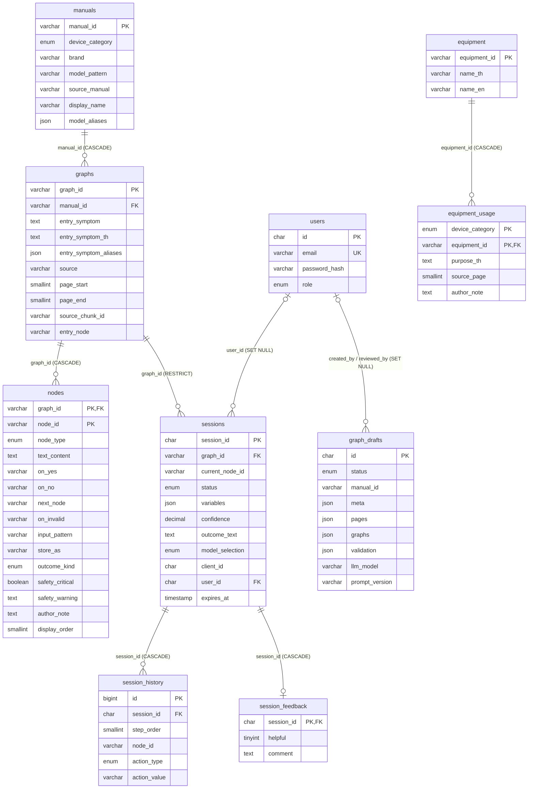

# 06 — ฐานข้อมูล (MySQL, utf8mb4)

## อธิบายแบบง่าย
มี 3 กลุ่มตาราง
1. **ความรู้:** คู่มือ → ผัง → โหนด และอุปกรณ์
2. **การใช้งาน:** ผู้ใช้, การตรวจแต่ละครั้ง (session), ทุกขั้นที่ตอบ และ feedback
3. **งาน admin:** ร่างผังจาก PDF ซึ่งแยกไว้ ผู้ใช้มองไม่เห็นจนกว่าจะเผยแพร่

## ERD

## ตารางทีละตัว (เชิงเทคนิค)

| ตาราง | migration | คอลัมน์สำคัญ / เหตุผล | Index / Constraint |
|---|---|---|---|
| `users` | `001_users.sql` | `id CHAR(36)` = UUID ที่ backend สร้าง (ไม่ใช้ auto-increment เพื่อไม่ให้เดาได้) · `email` เก็บตัวพิมพ์เล็กเสมอ · `password_hash` bcrypt · `role ENUM('user','admin')` | `UNIQUE uq_users_email` (`:22`) |
| `manuals` | `002_graphs.sql:9-23` | 1 แถวต่อคู่มือ · `device_category ENUM` 4 ค่า · `display_name`/`model_aliases` ไว้แสดงชื่อรุ่นที่คนรู้จัก | `idx_manuals_category` |
| `graphs` | `002_graphs.sql:26-51` | 1 แถวต่ออาการ · ข้อความที่ embed (`entry_symptom*`) · ที่มา (`source`, `page_start/end`, `source_chunk_id`) | FK → manuals `ON DELETE CASCADE` · `idx_graphs_manual` |
| `nodes` | `002_graphs.sql:54-84` | ตารางเดียวเก็บทุกชนิดโหนด (single-table) คอลัมน์ที่ไม่ใช้กับชนิดนั้นเป็น NULL · `text_content` = question/content/prompt · `display_order` คงลำดับตาม JSON | PK `(graph_id, node_id)` · `idx_nodes_type`, `idx_nodes_safety` |
| `equipment` / `equipment_usage` | `003_equipment.sql` | อุปกรณ์ที่ต้องใช้ต่อประเภทเครื่อง · **CHECK ต้องมี `source_page` หรือ `author_note`** อย่างน้อยหนึ่งอย่าง (บังคับว่าต้องมีที่มา) | `chk_usage_provenance` (`:35-36`) · `idx_usage_category` |
| `sessions` | `004_sessions.sql:17-55` | การตรวจ 1 ครั้ง · `variables JSON` ค่าที่กรอก · `confidence DECIMAL(4,3)` · `outcome_text` บันทึกครั้งเดียว · เจ้าของ `client_id` (guest) หรือ `user_id` · `expires_at` | FK graph `RESTRICT` (ลบผังที่มีคนใช้ไม่ได้) · FK user `SET NULL` · `idx_sessions_client (client_id, status, expires_at)` · `idx_sessions_user (user_id, status, expires_at)` รองรับ query หน้าประวัติตรงตัว (`:52-54`) |
| `session_history` | `004_sessions.sql:59-77` | 1 แถวต่อ 1 action · `node_id` = โหนดที่อยู่ตอนตอบ | **`UNIQUE (session_id, step_order)`** กันสองคำขอซ้อนกัน (`:58, 74`) |
| `session_feedback` | `005_session_feedback.sql` | PK = session_id → 1 session มีได้ 1 feedback · ส่งซ้ำ = แก้ (`ON DUPLICATE KEY UPDATE` ที่ `backend/src/history/history.store.ts:105-112`) | FK `CASCADE` |
| `graph_drafts` | `006_graph_drafts.sql` | ร่างจาก LLM แยกจากตารางจริง · `pages` เก็บข้อความ (ไม่เก็บ PDF) · `validation` รายงานล่าสุด · `llm_model`, `prompt_version` ไว้ย้อนรอย | `idx_drafts_status (status, created_at)` · `idx_drafts_manual` |
| `schema_migrations` | สร้างโดย `backend/scripts/run-migrations.js:33-40` | จำว่าไฟล์ไหนรันแล้ว (ตามชื่อไฟล์) | PK filename |

ทุกตาราง: `InnoDB`, `utf8mb4`, `utf8mb4_unicode_ci` ต้องตรงกันทุกตาราง ไม่งั้นสร้าง FK ไม่ได้ (`001_users.sql:3`)

## ลำดับ migration

| ไฟล์ (branch ปัจจุบัน) | สร้าง | พึ่ง |
|---|---|---|
| `001_users.sql` | users | — |
| `002_graphs.sql` | manuals, graphs, nodes | — |
| `003_equipment.sql` | equipment, equipment_usage | — |
| `004_sessions.sql` | sessions, session_history | 001, 002 |
| `005_session_feedback.sql` | session_feedback | 004 |
| `006_graph_drafts.sql` | graph_drafts | 001 |

- ⚠ บน `main` (ที่ Render ใช้) migration ยังเป็น**ไฟล์แยก 12 ไฟล์** `001_create_graph_tables.sql` … `012_create_graph_drafts.sql` ซึ่งเป็นชุดที่รันกับ DB จริงไปแล้ว ส่วนบน branch นี้รวมเหลือ 6 ไฟล์**ชื่อใหม่** เพราะ `run-migrations.js` จำตามชื่อไฟล์ ถ้ารัน `npm run migrate` กับ DB จริงหลัง merge มันจะพยายามรันทั้ง 6 ไฟล์ใหม่ (ทุกไฟล์เป็น `CREATE TABLE IF NOT EXISTS` จึงน่าจะไม่ทำลายข้อมูล แต่**ยังไม่ได้ทดสอบ**) → อย่ารันกับ DB จริงก่อนสอบ
- คอมเมนต์ในโค้ดหลายจุดยังอ้าง "migration 007–012" ตามเลขเดิม เช่น `backend/src/traversal/traversal.dto.ts:19, 44` (ไฟล์ 14)

## ทำไม embedding ไม่ได้เก็บเป็น JSON/BLOB

**ไม่ได้เก็บเลย** ในฐานข้อมูลไม่มีตาราง/คอลัมน์ embedding (ตรวจทุก migration แล้ว) เวกเตอร์คำนวณตอนบูตและอยู่ใน RAM เท่านั้น (`backend/src/symptom-search/symptom-search.service.ts:56-101`)

เหตุผล (จากโครงระบบ):
1. ข้อความต้นทางมีน้อย (1,936 ข้อความไม่ซ้ำ) embed ใหม่ทุกครั้งที่บูตทำได้ และไม่บล็อกการเปิดเซิร์ฟเวอร์
2. ไม่ต้องดูแลให้เวกเตอร์ตรงกับข้อความเมื่อผังถูกแก้หรือเปลี่ยนโมเดล → ไม่มีข้อมูลค้าง (stale)
3. MySQL ไม่มีชนิดเวกเตอร์หรือ index ค้นหาเวกเตอร์ใน setup นี้ ถึงเก็บเป็น JSON/BLOB ก็ต้องดึงขึ้นมาคำนวณใน Node อยู่ดี

ถ้าจะเก็บในอนาคต: ใช้ `BLOB` ของ Float32 (384×4 = 1,536 ไบต์ต่อข้อความ) ดีกว่า JSON (ข้อความยาวกว่าราว 3–5 เท่า และต้อง parse) และต้องมีคอลัมน์ `model_id` + hash ของข้อความ เพื่อรู้ว่าเวกเตอร์ไหนต้องคำนวณใหม่

## ข้อควรรู้อื่น
- **ใช้ฐานข้อมูลร่วมกับโปรเจกต์เก่า (FixStep)** (`docs/ops/DEPLOY.md:3, 36`) ตาราง sessions รวม session ของทั้งสองระบบ → ตัวเลข dashboard ปนกัน (`backend/src/admin/admin.service.ts:11-12`)
- ไม่มีตัวกวาด session ที่หมดอายุ แถวยังอยู่ แค่ทุก query กรอง `expires_at > NOW()` — **ไม่พบโค้ดลบอัตโนมัติ**
- ลบบัญชี → `sessions.user_id` เป็น NULL แถวยังอยู่โดยไม่มีเจ้าของ (`004_sessions.sql:14, 45-47`) · ไม่มี endpoint ลบบัญชี — **ไม่พบในโค้ด**
