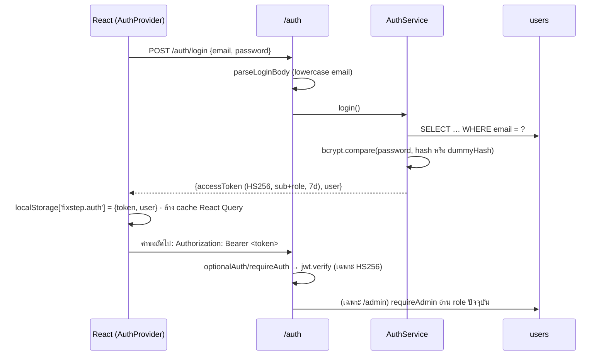

# 07 — Auth, Roles และ Guest

## อธิบายแบบง่าย
ใช้งานหลักได้โดยไม่ต้องสมัคร (guest) ถ้าสมัคร ประวัติจะผูกกับบัญชีและเปิดจากเครื่องไหนก็ได้ ล็อกอินแล้วเซิร์ฟเวอร์ให้ "บัตรผ่าน" (JWT) อายุ 7 วัน เบราว์เซอร์แนบบัตรนี้ไปกับทุกคำขอ ส่วน admin เข้าหน้าจัดการได้ และเซิร์ฟเวอร์จะเช็ก role จากฐานข้อมูลสดทุกครั้ง

## 1. JWT flow: login → token → middleware

| ขั้น | รายละเอียด | โค้ด |
|---|---|---|
| ตั้งค่า | `JWT_SECRET` ต้อง ≥ 32 ตัวอักษร ไม่งั้นบูตไม่ขึ้น · `JWT_EXPIRES_IN` เริ่มต้น `7d` รูป `^\d+(s|m|h|d|w|y)$` | `backend/src/auth/token.ts:4-29` |
| ออก token | payload มีแค่ `{sub: user.id, role}` · `algorithm: 'HS256'` | `token.ts:32-34` · `backend/src/auth/auth.service.ts:74-77` |
| ตรวจ token | `jwt.verify(token, secret, { algorithms: ['HS256'] })` ล็อก algorithm กันการโจมตีแบบ `alg: none`/สลับ algorithm | `token.ts:37-40` |
| อ่าน header | ต้องเป็น `Bearer <token>` เป๊ะ · `sub` ต้องเป็น string และ role ต้องอยู่ใน enum · ผิด = 401 `UNAUTHENTICATED` | `backend/src/auth/auth.middleware.ts:25-47` |
| ส่ง token ผิดมาที่ endpoint ที่ไม่บังคับล็อกอิน | ยังได้ 401 (ไม่ถือเป็น guest เงียบๆ) | `auth.middleware.ts:54-62` |
| `/auth/me` | อ่านผู้ใช้จาก DB · บัญชีถูกลบ → 401 | `auth.service.ts:66-72` |
| Frontend 401 | `http.ts` เรียก handler → ล้าง token + cache → ไปหน้า login พร้อม `expired` (เฉพาะถ้า token ที่ใช้ยังเป็นตัวปัจจุบัน) | `frontend/src/api/http.ts:70-72` · `frontend/src/components/auth/AuthProvider.tsx:25-36` |
| เปิดแอปใหม่ | มี token → สถานะ `verifying` → `GET /auth/me` อัปเดตชื่อ/role | `AuthProvider.tsx:39-56` |

## 2. Hash password

- `bcryptjs` cost 10 (`backend/src/auth/auth.service.ts:10, 34`)
- **กัน timing attack / user enumeration ตอน login:** ถ้าไม่พบอีเมล ก็ยัง `compare` กับ `dummyHash` ที่สร้างไว้ตอนบูต เวลาตอบจึงใกล้เคียงกันทั้งสองกรณี และใช้ข้อความ error เดียวกัน "อีเมลหรือรหัสผ่านไม่ถูกต้อง" (`auth.service.ts:12, 26, 55-63`)
- รหัสผ่าน 8–72 ตัวอักษรและ ≤ 72 ไบต์ เพราะ bcrypt ใช้แค่ 72 ไบต์แรก (`backend/src/auth/auth.dto.ts:65-78`) · ตอน login รับยาวได้ถึง 1000 เพื่อไม่บอกใบ้กฎ (`auth.dto.ts:10, 107-110`)
- `password_hash VARCHAR(255)` เผื่อเปลี่ยนอัลกอริทึม (`backend/migrations/001_users.sql:15`)

## 3. Role user / admin

- `enum Role { User = 'user', Admin = 'admin' }` (`backend/src/auth/role.enum.ts:1-10`)
- สมัครผ่าน API ได้ role `user` เสมอ ส่ง `role` มาใน body ก็ไม่มีผล เพราะ parse ไม่อ่านช่องนี้ (`auth.dto.ts:89-96`, `auth.service.ts:43`)
- admin สร้างได้ทางเดียวคือสคริปต์ `npm run seed:admin` ซึ่งอ่าน `ADMIN_EMAIL/ADMIN_PASSWORD` จาก env และรันซ้ำได้ (`backend/scripts/seed-admin.js`, `backend/migrations/001_users.sql:10-11`)
- `requireAdmin` **ไม่เชื่อ role ใน token** แต่อ่านจาก DB ทุกคำขอ → ถอด admin แล้วมีผลทันที (`auth.middleware.ts:75-87`)
- frontend `AdminRoute`: guest → ไป login · ไม่ใช่ admin → หน้า 403 (`frontend/src/components/auth/AdminRoute.tsx:8-30`) เป็นแค่ UX ตัวป้องกันจริงอยู่ที่ server

## 4. Guest ใช้งานได้แค่ไหน และประวัติของ guest

| ความสามารถ | Guest | User | Admin |
|---|---|---|---|
| ค้นอาการ / เดินผัง / บันทึกผลลัพธ์ | ✅ | ✅ | ✅ |
| ประวัติการซ่อม + feedback + ลบ | ✅ ผูกกับเบราว์เซอร์ | ✅ ผูกกับบัญชี | ✅ |
| หน้า admin (analytics, feedback, drafts) | ❌ | ❌ (403) | ✅ |

- **guest = `X-Client-Id`:** เบราว์เซอร์สุ่ม UUID ครั้งแรกแล้วเก็บใน `localStorage['fixstep.clientId']` (`frontend/src/lib/clientId.ts:1-36`) และส่งไปเฉพาะตอนที่ไม่มี token (`frontend/src/lib/clientHeaders.ts:4-6`)
- server ตรวจว่าเป็น UUID เก็บเป็นตัวพิมพ์เล็ก (`backend/src/traversal/traversal.dto.ts:25-42`)
- แยกเจ้าของในคำสั่ง SQL: guest ใช้ `client_id = ? AND user_id IS NULL` → guest มองไม่เห็นและลบ session ของ user ไม่ได้ (`backend/src/auth/session-owner.ts:25-30`)
- `client_id` **ไม่ใช่การยืนยันตัวตน** ใครรู้ UUID นี้ก็เห็นประวัติของ guest คนนั้น (เขียนไว้ใน `traversal.dto.ts:23`) · ล้าง localStorage / เปลี่ยนเบราว์เซอร์ = ประวัติเดิมหาย (ยังอยู่ใน DB แต่ไม่มีทางเปิด)
- ล็อกอินแล้ว ประวัติที่ทำตอนเป็น guest **ไม่ถูกย้ายเข้าบัญชี** — ไม่พบโค้ดย้าย/รวมประวัติ
- session ที่เริ่มโดยไม่ส่งทั้ง token และ client id → ไม่มีเจ้าของ ไม่ปรากฏในประวัติของใคร (`backend/src/traversal/traversal.service.ts:50-53` · `session-owner.ts:14-23`)
- การเข้าถึง session ที่กำลังเดิน: ถ้า session มี `user_id` ต้องเป็น user คนนั้น ไม่งั้น 404 (ไม่บอกว่ามีอยู่) แต่ session ของ guest **ไม่ตรวจเจ้าของ** ใครมี `sessionId` (UUID) ก็เดินต่อได้ (`traversal.service.ts:136-141`)

## 5. จุดอ่อนด้าน security ที่ควรรู้ตัว (ตรงกับ `docs/SECURITY_AUDIT.md`)

| # | จุดอ่อน | ระดับ | หลักฐาน | วิธีตอบ / แก้ |
|---|---|---|---|---|
| 1 | ไม่มี rate limit ที่ `/auth/login` ทำให้ brute-force ได้ | High | ไม่พบ middleware rate limit ใน `backend/src/app.ts:67-82` | แก้: `express-rate-limit` ต่อ IP + email ราว 1 ชม. (ต้องเพิ่ม dependency) |
| 2 | token อยู่ใน localStorage → ถ้ามี XSS จะถูกขโมย | Medium | `frontend/src/lib/authStorage.ts:3, 46-53` | React escape ข้อความให้อยู่แล้ว ไม่มี `dangerouslySetInnerHTML` (ตาม audit A03-4) · ทางที่ดีกว่าคือ httpOnly cookie + CSRF token |
| 3 | logout = ลบ token ฝั่ง client เท่านั้น token เดิมใช้ได้ถึงหมดอายุ (7 วัน) · ไม่มี refresh token / revoke | Medium | `AuthProvider.tsx:82-88` · ไม่มีตาราง token | ลดอายุ + refresh token หรือ token version ในตาราง users |
| 4 | สมัครซ้ำบอกว่า "อีเมลนี้ถูกใช้สมัครแล้ว" ทำให้รู้ว่าอีเมลนี้มีบัญชี (user enumeration) | Low | `auth.service.ts:12` | ข้อแลกเพื่อ UX · login ไม่รั่วข้อมูลนี้ |
| 5 | error 500 ส่ง message ดิบ (รวม error ของ SQL) ให้ client | Medium | `backend/src/common/error-handler.ts:67-71` | แก้ 15 นาที: 500 ส่งข้อความกลาง + log ภายใน |
| 6 | `/health` เปิดเผย `databaseError` | Low | `backend/src/health/health.routes.ts:15, 22` | ซ่อนใน production |
| 7 | ไม่มี security headers (helmet) | Low | `app.ts` | เพิ่ม `helmet()` |
| 8 | guest ID ทำหน้าที่เหมือนรหัสลับ | Low (รู้อยู่แล้วตอนออกแบบ) | ข้อ 4 ข้างบน | UUID v4 สุ่ม 122 บิต เดายากมาก |
| 9 | ReDoS จาก `pattern` ของโหนด input | Low | `backend/src/traversal-engine/traversal-engine.ts:108` | pattern มาจากผังที่ admin publish ไม่ใช่จากผู้ใช้ทั่วไป · validator จำกัดความยาว 200 |
| 10 | dependency backend มีช่องโหว่ critical 1 / high 2 (ตามที่ audit บันทึกไว้) | High | `docs/SECURITY_AUDIT.md` A06-1 | `npm audit` แล้วอัปเดต (ต้องแตะ package.json) |

**จุดที่ทำดีแล้ว (พูดได้):** parameterized SQL ทุกที่ · bcrypt + dummy hash · ล็อก algorithm ของ JWT · role ของ admin อ่านจาก DB · ด่านสิทธิ์รวมไว้ที่ router แม่ `/admin` · ตรวจไฟล์ PDF จาก magic bytes · CORS จำกัด origin (`app.ts:67`)
