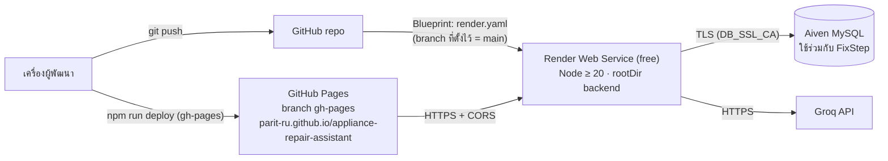

# 11 — Deployment

## อธิบายแบบง่าย
ระบบแยก 3 ส่วน ใช้บริการฟรีทั้งหมด: หน้าเว็บอยู่บน **GitHub Pages**, backend อยู่บน **Render** (free plan หลับเมื่อไม่มีคนใช้ ~15 นาที ปลุกครั้งแรกใช้ ~1 นาที) และฐานข้อมูล **MySQL บน Aiven** ซึ่งใช้ร่วมกับโปรเจกต์เก่า



## 1. Docker
**ไม่พบ Dockerfile หรือ docker-compose ใน repo** (ค้นทั้งโปรเจกต์แล้ว) การ deploy ใช้ native Node runtime ของ Render ที่อ่าน `render.yaml` → ถ้ากรรมการถาม ให้ตอบว่าเลือก PaaS เพื่อลดงาน ops และเสนอ Docker เป็นงานอนาคต (ไฟล์ 12)

## 2. Render (`render.yaml`)

| ค่า | ความหมาย | บรรทัด |
|---|---|---|
| `runtime: node`, `plan: free`, `rootDir: backend` | Node service ฟรี รันในโฟลเดอร์ backend | `render.yaml:1-6` |
| `buildCommand: npm ci --include=dev && npm run build` | ต้องมี dev deps เพื่อใช้ `tsc` · build = ลบ `dist` แล้ว `tsc -p tsconfig.build.json` | `render.yaml:7` · `backend/package.json:7` |
| `startCommand: npm run start:prod` | `node dist/main.js` | `render.yaml:8` · `backend/package.json:11` |
| `healthCheckPath: /health` | Render เรียกเช็ก (ตอบ `status`, `database`) | `render.yaml:9` · `backend/src/health/health.routes.ts` |
| `ONNXRUNTIME_NODE_INSTALL: skip` | ไม่ดาวน์โหลดไฟล์ CUDA ของ onnxruntime (ใช้ CPU) | `render.yaml:13-15` |
| `CORS_ORIGIN: https://parit-ru.github.io` | origin ของหน้าเว็บ | `render.yaml:16-17` |
| `SYMPTOM_SEARCH_ENABLED: "true"`, `REPHRASE_ENABLED: "true"` | เปิดค้นหาและ rephrase | `render.yaml:18-21` |
| `DB_*` `sync: false` | ค่าลับ กรอกใน dashboard | `render.yaml:22-33` |

- โมเดล embedding (~56 MB) **อยู่ใน git** (`backend/model/…`) และโค้ดห้ามโหลดจากเน็ต (`backend/src/embedding/embedding.service.ts:34`) → deploy ได้โดยไม่ต้องดาวน์โหลดโมเดลตอนรัน
- ⚠ `render.yaml` **ไม่มี** `JWT_SECRET`, `JWT_EXPIRES_IN`, `GROQ_API_KEY`, `GROQ_MODEL`, `AUTHORING_LLM_MODEL` → ต้องตั้งใน dashboard เอง ถ้าไม่มี `JWT_SECRET` backend จะบูตไม่ขึ้น (`backend/src/auth/token.ts:14-21`) · ถ้าเปิด `REPHRASE_ENABLED` แต่ไม่มี key → log เตือนแล้วใช้ข้อความต้นฉบับ (`backend/src/app.ts:34-43`)

### สถานะ deploy ปัจจุบัน (ตรวจ 29 ต.ค. 2569)
| ส่วน | สิ่งที่รันอยู่ | โค้ดที่จะเปิดโชว์ | ต่างกันไหม |
|---|---|---|---|
| Backend (Render) | branch **`main`** = `f9b7e09` (19 ต.ค.) **NestJS**, migration 12 ไฟล์ | `express-migration` = `129f256` (25 ต.ค.) **Express** + ไฟล์ที่ยังไม่ commit ~96 ไฟล์ | **ต่าง** (framework, ชื่อไฟล์, เลขบรรทัด) แต่ API ควรตรงกันตามชุดเทียบ 120/120 (`docs/STUDY_GUIDE.md` §5.7) |
| Frontend (GitHub Pages) | build วันที่ **14 ต.ค.** (`7ea6167` บน `gh-pages`) | `frontend/src` ปัจจุบัน | **ต่างมาก** — build เก่าไม่มีหน้าเลือกรุ่น, ประวัติ, login, admin (ไม่พบ `/history`, `/login`, `/admin`, `manuals` ใน bundle) |

→ ขั้นตอนเตรียมก่อนเดโมอยู่ในไฟล์ 15 และลำดับความสำคัญในไฟล์ 14

## 3. Frontend (GitHub Pages)
- `npm run deploy` = `npm run build && gh-pages -d dist` (`frontend/package.json:12`)
- `VITE_API_URL` ใน `frontend/.env.production` (URL สาธารณะ commit ได้ ห้ามใส่ความลับ เพราะ `VITE_*` ถูกฝังใน JS)
- `base: '/appliance-repair-assistant/'` และ copy `404.html` สำหรับ SPA (`frontend/vite.config.ts:10-24`)

## 4. Environment variables (ชื่อเท่านั้น)

| กลุ่ม | ตัวแปร | บังคับ? | ที่อ่าน |
|---|---|---|---|
| DB | `DB_HOST`, `DB_PORT`, `DB_USER`, `DB_PASSWORD`, `DB_NAME`, `DB_SSL_CA` | 4 ตัวแรก + `DB_NAME` บังคับ · SSL ตอนใช้คลาวด์ | `backend/src/database/pool.ts:25-45` |
| Server | `PORT`, `NODE_ENV`, `CORS_ORIGIN` | ไม่ (ค่าเริ่มต้น 3000 / development / `http://localhost:5173`) | `backend/src/main.ts:11` · `app.ts:67` |
| Auth | `JWT_SECRET`, `JWT_EXPIRES_IN` | `JWT_SECRET` บังคับ (≥ 32) | `backend/src/auth/token.ts:14-29` |
| Seed admin | `ADMIN_EMAIL`, `ADMIN_PASSWORD`, `ADMIN_DISPLAY_NAME` | เฉพาะตอน `npm run seed:admin` | `backend/scripts/seed-admin.js` |
| ค้นหา | `SYMPTOM_SEARCH_ENABLED` | ต้องเป็น `true` เป๊ะจึงเปิด | `symptom-search.service.ts:13, 46` |
| Rephrase | `REPHRASE_ENABLED`, `GROQ_API_KEY`, `GROQ_MODEL`, `GROQ_REASONING_EFFORT`, `REPHRASE_TIMEOUT_MS` | ไม่ (ปิดเป็นค่าเริ่มต้น) | `backend/src/rephrase/groq-llm.client.ts:47-52` · `app.ts:41` |
| Authoring | `AUTHORING_LLM_MODEL`, `AUTHORING_LLM_TIMEOUT_MS`, `AUTHORING_LLM_MAX_TOKENS`, `AUTHORING_MAX_PDF_MB` (+ `GROQ_API_KEY`) | ไม่ (ไม่ตั้ง = ร่างล้มด้วย `LLM_NOT_CONFIGURED`) | `backend/src/authoring/draft-llm.client.ts:137-149` · `drafts.routes.ts:23-26` |
| Render | `ONNXRUNTIME_NODE_INSTALL` | ใช้ตอน install | `render.yaml:13-15` |
| Frontend | `VITE_API_URL` | บังคับ | `frontend/src/api/http.ts:16-22` |

ไฟล์ `.env` ทั้งหมดอยู่ใน `.gitignore` (`backend/.gitignore:5`) ตรวจแล้วว่าไม่มีไฟล์ `.env` จริงอยู่ใน git

## 5. รันระบบจากศูนย์ (เครื่อง local)

> ⚠ **ห้ามรัน `migrate`/`seed` กับ DB บน Aiven ที่ใช้อยู่** (ใช้ร่วมกับ FixStep และ migration บน branch นี้ชื่อไฟล์ต่างจาก `main` ไฟล์ 06) ขั้นตอนนี้ใช้กับ MySQL ในเครื่องหรือ DB ใหม่เท่านั้น

```bash
# 0) ต้องมี Node >= 20 และ MySQL 8 ในเครื่อง  สร้าง database เปล่า (utf8mb4)
# 1) backend
cd backend
cp .env.example .env            # กรอก DB_*, JWT_SECRET (สุ่ม 48 ไบต์), SYMPTOM_SEARCH_ENABLED=true
npm ci
npm run migrate                 # 001–006 (จำไฟล์ที่รันแล้วใน schema_migrations)
#    seed ผัง 21 เล่ม (คำสั่งครบอยู่ใน data/runseed.txt) เช่น
node scripts/seed-graphs.js ../data/manuals/samsung_ge83mdt_um_de68_04111e.json
npm run seed:equipment          # data/equipment/equipment.json
npm run seed:admin              # ต้องตั้ง ADMIN_EMAIL / ADMIN_PASSWORD
npm run build && npm start      # หรือ dev: npm run build:watch + npm run start:dev (สองหน้าต่าง)
#    ตรวจ: http://localhost:3000/health  และ /symptom-search/status จน state = ready

# 2) frontend
cd ../frontend
npm ci
npm run dev                     # ใช้ VITE_API_URL จาก .env.development
```

## 6. Rollback (จาก `docs/ops/DEPLOY.md:43-44`)
- backend: Render → Events → Rollback ไปรุ่นก่อน
- frontend: ลบ branch `gh-pages` หรือปิด Pages
