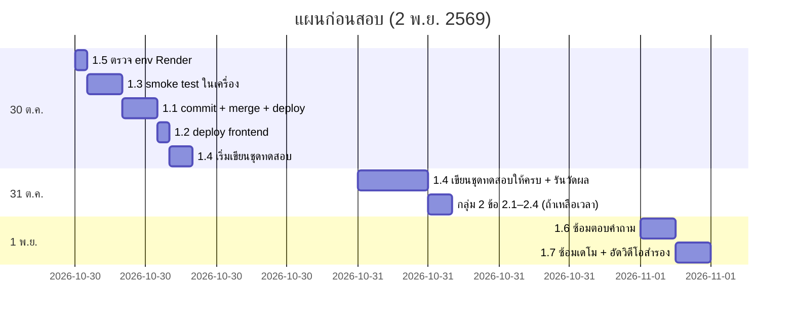

# 14 — จุดอ่อน ความเสี่ยง และสิ่งที่ควรแก้ก่อนสอบ

> **วันสอบ 2 พ.ย. 2569 · วันนี้ 29 ต.ค. → เหลือ 3 วันทำงาน (30, 31 ต.ค., 1 พ.ย.)**
> ไฟล์นี้**เสนอเท่านั้น** ผมไม่ได้แก้โค้ดใดๆ เวลาที่ประเมินรวมเวลาทดสอบแล้ว
> สถานะเล่ม: ยังไม่ได้เขียนว่าเป็น RAG → ใช้คำ "retrieval-guided troubleshooting state machine" ทั้งเล่มและสไลด์

---

## กลุ่ม 1 — ต้องทำก่อนสอบ (รวม ~2–2.5 วัน)

| # | เรื่อง | ทำไมสำคัญ | ต้องทำอะไร | เวลา | ควรเสร็จ |
|---|---|---|---|---|---|
| 1.1 | **Production (Render) ยังเป็น NestJS** — Render deploy จาก `main` = `f9b7e09` ส่วนโค้ดที่จะเปิดโชว์คือ Express (`129f256` + ไฟล์ที่ยังไม่ commit ~96 ไฟล์) | กรรมการเปิดโค้ดแล้วเทียบกับระบบที่รันไม่ได้ · ชื่อไฟล์/เลขบรรทัดใน `docs/STUDY_GUIDE.md` และชุดเอกสารนี้อ้าง Express | เลือก 1 ทาง: **(ก)** commit งานที่ค้างบน `express-migration` → ทดสอบในเครื่อง (ข้อ 1.3) → merge เข้า `main` → Render deploy อัตโนมัติ → เช็ก `/health` และ `/symptom-search/status` **(ข)** ไม่แตะ production และเดโมจากเครื่อง (ไฟล์ 15 แผน B) · **ห้ามรัน `npm run migrate` กับ DB จริง** (ชื่อไฟล์ migration ต่างจาก main ไฟล์ 06) | (ก) 3–4 ชม. รวมทดสอบ · (ข) 0 | 30 ต.ค. |
| 1.2 | **Frontend บน GitHub Pages เป็น build 14 ต.ค.** ไม่มีหน้าเลือกรุ่น / ประวัติ / login / admin | เดโมจาก URL จริงจะไม่เจอฟีเจอร์ครึ่งระบบ | หลังข้อ 1.1(ก) → `cd frontend && npm run deploy` → เปิดเว็บจริงไล่ทุกหน้า · เช็ก CORS | 30–60 นาที | 30 ต.ค. |
| 1.3 | **ฟีเจอร์ที่ยังไม่ทดสอบมือหลังย้าย Express**: register/login/me/logout ผ่านเว็บ, หน้า admin, อัปโหลด PDF จนร่างเสร็จ, publish, rephrase กับ Groq, CORS ข้าม origin (`docs/STUDY_GUIDE.md` §5.7) | เดโมพังหน้ากรรมการ | ไล่ตามสคริปต์เดโม (ไฟล์ 15) บน DB ในเครื่อง · **publish ทดสอบกับ DB ในเครื่องเท่านั้น** เพราะ publish INSERT ลง DB จริงที่ใช้ร่วมกับ FixStep | 2–3 ชม. | 30 ต.ค. |
| 1.4 | **ไม่มีผลประเมิน** | คำถามที่มาแน่นอน (I1, I2) | ทำชุดทดสอบ 80 ข้อ + รันวัด top-1/top-3/การปฏิเสธนอกขอบเขต ตามไฟล์ 10 (ถ้าไม่ทันอย่างน้อย 40 ข้อ) | 1–1.5 วัน | 31 ต.ค. |
| 1.5 | **ตรวจ env บน Render dashboard**: `JWT_SECRET` (≥ 32), `GROQ_API_KEY`, `GROQ_MODEL`, `AUTHORING_LLM_MODEL` ไม่อยู่ใน `render.yaml` | ขาด `JWT_SECRET` = บูตไม่ขึ้น (`backend/src/auth/token.ts:16-21`) · `REPHRASE_ENABLED: "true"` ใน `render.yaml:20-21` ขัดกับบันทึกว่ายังพักไว้ | ดูใน dashboard ว่ามีครบ ตัดสินใจว่าจะเปิด rephrase ตอนเดโมหรือไม่ (แนะนำ: ปิด ถ้ายังไม่ได้ทดสอบกับ Groq จริง) | 15 นาที | 30 ต.ค. |
| 1.6 | **เตรียมคำอธิบายจุดอ่อนที่แก้ไม่ทัน** (กลุ่ม 3) + จำตัวเลขในไฟล์ 00 | — | ซ้อมตอบข้อ ⚠ ในไฟล์ 13 | 2 ชม. | 1 พ.ย. |
| 1.7 | **ซ้อมเดโมครบ 2 รอบ + เตรียมแผนสำรอง** (วิดีโอ/ภาพหน้าจอ) | Render หลับ, เน็ตล่ม | ตามไฟล์ 15 | 2 ชม. | 1 พ.ย. |

## กลุ่ม 2 — แก้ได้ถ้ามีเวลา (เรียงตามคุ้มค่า/ความเสี่ยงต่ำ)

| # | เรื่อง | หลักฐาน | วิธีแก้ที่เสนอ | เวลา | ความเสี่ยงของการแก้ |
|---|---|---|---|---|---|
| 2.1 | error 500 ส่ง message ดิบ (รวม error ของ SQL) กลับให้ client | `backend/src/common/error-handler.ts:67-71` | 500 ส่งข้อความกลาง + log stack ภายใน | 20–30 นาที | ต่ำ |
| 2.2 | `/health` เปิดเผย `databaseError` | `backend/src/health/health.routes.ts:15, 22` | ส่งเฉพาะตอน `NODE_ENV !== 'production'` | 10 นาที | ต่ำ |
| 2.3 | ชื่อแอปยังเป็น "FixStep" | `frontend/index.html:14` · `frontend/src/components/layout/AppShell.tsx:8` | เปลี่ยนข้อความที่แสดง (**ไม่ต้องเปลี่ยน** key `fixstep.*` ใน localStorage ไม่งั้นผู้ใช้หลุด login และประวัติ guest หาย) | 10 นาที | ต่ำ |
| 2.4 | ไม่มีข้อความปฏิเสธความรับผิดชอบ / "ไม่ใช่การวินิจฉัยยืนยัน" บนหน้าจอ | ไม่พบในโค้ด frontend | เพิ่ม Notice บนหน้าแรกและหน้า session | 20 นาที | ต่ำ |
| 2.5 | เครื่องมือตรวจข้อมูลที่ให้ผลในเอกสาร (`verify_chunks_against_pdf.py`, `verify_graphs_against_pdf.py`, `graph-vs-chunk.spec.ts`) ไม่อยู่ใน working tree | ลบใน commit `f9b7e09` · ยังอยู่ใน `76c0911` | กู้ด้วย `git show 76c0911:scripts/verify_chunks_against_pdf.py > …` เพื่อรันโชว์ได้ (spec ต้องปรับให้เข้ากับ Express) | 30–60 นาที | ต่ำ (เป็นสคริปต์นอกระบบ) |
| 2.6 | ประวัติแสดงได้แค่ 50 รายการ และ `total` ผิดเมื่อเกิน | `backend/src/history/history.store.ts:10, 48-60` · `history.service.ts:24-44` | ใช้ `COUNT(*)` + `LIMIT ? OFFSET ?` ใน SQL | 45–60 นาที | ต่ำ–กลาง |
| 2.7 | ไม่มี rate limit ที่ login | `backend/src/app.ts:67-82` | `express-rate-limit` เฉพาะ `/auth/login`, `/auth/register` (ต้องเพิ่ม dependency ใน `package.json`) | 1 ชม. | กลาง (ต้อง deploy ใหม่) |
| 2.8 | แสดงป้าย "ผู้พัฒนาเพิ่มเติม" จาก `author_note` | `backend/src/traversal/graph.repository.ts:132-139` ไม่ SELECT · 1,264 โหนด | SELECT `author_note` → ใส่ใน `RenderedNode` → แสดงใต้ `ReferenceLine` | 2–3 ชม. | กลาง (แตะ engine types, DTO, frontend) |
| 2.9 | คอมเมนต์ในโค้ดอ้างเลข migration เก่า 007–012 | เช่น `backend/src/traversal/traversal.dto.ts:19, 44` · `drafts.service.ts:46` | แก้คอมเมนต์ให้ตรง 001–006 | 30 นาที | ต่ำ |
| 2.10 | `npm audit` backend: critical 1 / high 2 | `docs/SECURITY_AUDIT.md` A06-1 | อัปเดตแพ็กเกจที่เกี่ยวข้องแล้วทดสอบใหม่ | 1–2 ชม. | กลาง |
| 2.11 | นำ test ของ engine / matcher / guard กลับมา | ไฟล์เก่าใน `draft/code/backend/tests/…` (ลบใน `76c0911`) | ปรับให้เข้ากับโครง Express | 2–3 ชม. | ต่ำ |
| 2.12 | ข้อมูล: เบอร์ `02-689-3232` ใน WT10J7 ไม่มีใน PDF เล่มนั้น และ 13 จุดใน `author_note` ที่ใส่เครื่องหมายคำพูดทั้งที่เป็นการสรุป | `docs/ops/VERIFY-GRAPHS-AGAINST-SOURCE.md:36-37` | แก้ JSON แล้ว seed ใหม่ **เฉพาะ DB ในเครื่อง** (ต้องรีสตาร์ต) · DB จริงทำหลังสอบ | 1 ชม. | กลาง (แตะข้อมูลจริง) |

## กลุ่ม 3 — ไม่ต้องแก้ แต่เตรียมตอบว่าเป็นข้อจำกัด

| # | ข้อจำกัด | หลักฐาน | ประโยคตอบ | ถ้าแก้ในอนาคต (ประมาณ) |
|---|---|---|---|---|
| 3.1 | Citation เป็นระดับผัง ไม่ใช่รายโหนด · หน้าที่แสดงอาจไม่ครอบคลุมทุกขั้น · authoring ทิ้ง `source_page` | ไฟล์ 12 §1.3 | "ทุกขั้นแสดงคู่มือและหน้าของผัง ข้อความหลายขั้นระบุหน้าย่อยในตัว รายโหนดแบบมีโครงสร้างเป็นงานต่อไป" | 1 วัน (migration + authoring + seed + UI) |
| 3.2 | ค้นหา brute force ใน RAM, embed ทุกครั้งที่บูต | `symptom-search.service.ts:56-101` | "พอสำหรับ ~2,000 ข้อความ ใช้ RAM ~3 MB ถ้าโตใช้ HNSW/vector DB" | 2–3 วัน |
| 3.3 | threshold 0.55 ไม่ได้ปรับกับข้อมูลปัจจุบัน · ภายในรุ่นแยกได้ไม่ดี | ไฟล์ 03 §4 | ใช้ผลจากข้อ 1.4 มาตอบ | ทำแล้วในข้อ 1.4 |
| 3.4 | คำแปลไทยและลำดับขั้นยังไม่ผ่านการตรวจโดยคน · 48 ผังตรวจอัตโนมัติไม่ได้ | `VERIFY-GRAPHS-AGAINST-SOURCE.md:15, 30` | "ตรวจสิ่งที่ตรวจด้วยโปรแกรมได้ครบแล้ว ส่วนความหมายต้องใช้คน เป็นงานถัดไป" | 2–3 วัน |
| 3.5 | ไม่มีผู้ใช้จริงทดสอบ | ไฟล์ 10 §3 | ใช้คำตอบที่เตรียมไว้ | 1 สัปดาห์ |
| 3.6 | DB ใช้ร่วมกับโปรเจกต์เก่า สถิติปน | `backend/src/admin/admin.service.ts:11-12` | "เป็นการตัดสินใจเรื่องค่าใช้จ่าย ตัวเลข dashboard ใช้ดูกลไก ไม่ใช่ผลวิจัย" | ครึ่งวัน (แยก DB + ย้ายข้อมูล) |
| 3.7 | token ใน localStorage, logout ไม่เพิกถอน, อายุ 7 วัน | `frontend/src/lib/authStorage.ts` · `backend/src/auth/token.ts:5` | "รู้ความเสี่ยง XSS แต่ React escape ให้ แผนคือ httpOnly cookie + refresh token" | 1 วัน |
| 3.8 | session ที่กำลังเดินของ guest ไม่ตรวจเจ้าของ · `X-Client-Id` คือรหัสลับ | `traversal.service.ts:136-141` | "UUID สุ่ม 122 บิต · หน้าประวัติตรวจเจ้าของทุกครั้ง" | ครึ่งวัน |
| 3.9 | ReDoS จาก `pattern` ของโหนด input | `traversal-engine.ts:108` | "pattern มาจาก admin ไม่ใช่ผู้ใช้ทั่วไป และจำกัด 200 ตัว" | 1–2 ชม. (ใช้ RE2/timeout) |
| 3.10 | ยืนยันความปลอดภัย = ติ๊ก checkbox | `SafetyGateStep.tsx:25-32` | "ระบบรู้ไม่ได้ว่าทำจริง แต่บังคับให้อ่านก่อน และบังคับที่ server" | — |
| 3.11 | authoring ทำได้ทีละงาน (flag `busy` ใน process) · อาการที่คร่อมกลุ่ม 2 หน้าอาจหาย | `drafts.service.ts:19, 54-57` | "ออกแบบให้ง่ายสำหรับ admin คนเดียว · LLM ถูกสั่งให้ข้ามอาการที่ถูกตัด" | ครึ่งวัน |
| 3.12 | `scoreGraph` embed คำค้นซ้ำและเทียบทั้งดัชนี | `symptom-search.service.ts:193-199` | "ทำงานซ้ำ ~1 รอบ ยอมรับได้ที่ขนาดนี้" | 30 นาที |
| 3.13 | ไม่มี Docker | ไฟล์ 11 §1 | "เลือก PaaS เพื่อลด ops" | ครึ่งวัน |
| 3.14 | `device_category` เป็น ENUM 4 ค่า | `002_graphs.sql:11` | "เพิ่มประเภทต้องแก้ schema ตั้งใจจำกัดขอบเขต" | 2 ชม. |
| 3.15 | ไม่มีตัวลบ session หมดอายุ · ไม่มี endpoint ลบบัญชี | ไฟล์ 06 | "ทุก query กรอง `expires_at` แล้ว · เป็นงาน PDPA ต่อไป" | 2 ชม. |
| 3.16 | rephrase guard ตรวจรูปผิว ไม่ใช่ความหมาย | `rephrase-guard.ts:26-61` | "จึงปิดเป็นค่าเริ่มต้นและไม่ใช้กับโหนดอันตราย" | — |

## ความไม่สอดคล้องระหว่างเอกสารเดิมกับโค้ด (ใช้ตรวจเล่ม/สไลด์ก่อนส่ง)

| เอกสาร | เขียนว่า | โค้ดจริง |
|---|---|---|
| `docs/reference/FILE-MAP.md:22`, `FILES-BACKEND.md:1` | backend เป็น NestJS 10 | Express 4 (`backend/package.json:5`) |
| `docs/auth/*`, `docs/authoring/*`, `docs/features/*` | ชื่อไฟล์ `*.controller.ts`, guard ของ Nest, "migration 008–012" | มีป้ายเตือนหัวไฟล์แล้ว แต่เนื้อหายังเป็นของเดิม |
| คอมเมนต์ในโค้ด | "migration 006/007/008/010/012" | migration รวมเป็น 001–006 แล้ว |
| `docs/README.md:7` | "เทสต์ทั้งหมดถูกลบ" | ยังเหลือ `backend/src/admin/admin-guard.spec.ts` (ยังไม่ commit) |
| `docs/ops/DEPLOY.md:36` | "migration 001–007 รันแล้ว" | หมายถึงชุดเลขเก่าบน `main` |
| `docs/ops/VERIFY-*.md` | วิธีรัน `python scripts\verify_*.py` | สคริปต์ไม่อยู่ใน working tree (ข้อ 2.5) |
| `docs/SECURITY_AUDIT.md:19` | หัวข้อ "RAG: embedding เก็บใน MySQL" | เอกสารเองก็สรุปว่าคำนวณในหน่วยความจำ (ตรงกับโค้ด) |
| บันทึกเรื่อง rephrase (memory/LLM-INTEGRATION) | "พักไว้ ปิดเป็นค่าเริ่มต้น ยังไม่เปิดบน Render" | `render.yaml:20-21` ตั้ง `REPHRASE_ENABLED: "true"` (ต้องมี key ด้วยถึงจะทำงานจริง) |
| prompt ของผู้ใช้/template | "chunk size, Top-K, Problem/Cause/Solution, NestJS, Docker" | ไม่มีในโค้ด (ไฟล์ 00 ตารางตัวเลข) |

## สรุปแผน 3 วัน

