# READING_ROADMAP v2: แผนที่อ่านโค้ด appliance-repair-assistant

> สำรวจเมื่อ 17 ต.ค. 2569 เทียบกับฉบับเก่า `docs/archive/READING_ROADMAP.md` (เขียน 15 ต.ค. 2569 · commit ล่าสุดของไฟล์คือ `3294452`)
> สถานะ repo ตอนสำรวจ: branch `main` **ahead origin/main 3 commit** (`358ec2d`, `f40061e`, `61c3fb0` ยังไม่ push) และมีไฟล์ที่ยังไม่ commit (ฟีเจอร์ร่างผังจาก PDF ทั้งชุด + การลบไฟล์เทสต์)
>
> **วิธีทำ:** อ่านอย่างเดียว · ไม่ได้รัน migration/seed/เทสต์ · ไม่ได้เปิด `backend/.env` (บอกแค่ชื่อตัวแปรจาก `.env.example`) · นับข้อมูลผังด้วย `node -e` ที่อ่านไฟล์ `data/manuals/*.json` เท่านั้น · ตรวจไฟล์ backup ใน git ด้วยการนับชื่อตาราง ไม่ได้พิมพ์ค่าข้างใน
> **ทุกข้อความที่อ้างโค้ดมี `ไฟล์:บรรทัด`** (path ย่อจาก `backend/src/` และ `frontend/src/` เมื่อไม่กำกวม)
> คำว่า "ไม่แน่ใจ" = ไม่ได้ตรวจจริง พร้อมบอกว่าควรเช็กที่ไหน

---

## 0. อ่านย่อ 1 นาที

- **แกนเดิมไม่เปลี่ยน:** server ตัดสินทุกขั้นด้วย state machine ที่เป็นฟังก์ชันล้วน (`traversal-engine/traversal-engine.ts`) ข้อมูลผัง 22 คู่มือ / 644 ผัง / 4,834 node เท่าเดิม LLM ยังทำได้แค่เรียบเรียงถ้อยคำ
- **ของใหม่ 5 ก้อน (16–17 ต.ค.):** (1) บัญชีผู้ใช้ + JWT + บทบาท user/admin (2) ประวัติการซ่อมผูกกับบัญชีได้ (3) หน้า admin อ่านอย่างเดียว: สถิติ/feedback (4) หน้า login/register/admin ฝั่ง frontend (5) **admin อัปโหลด PDF → Groq ร่างผัง → validator → คนตรวจ → publish** (ยังไม่ commit · ยังไม่เคยทดสอบกับ Groq/MySQL จริง)
- **ไฟล์แรกที่ควรอ่านยังเป็น `backend/src/traversal-engine/types.ts`** (152 บรรทัด) เพราะทุกโมดูลรวมถึงโมดูลใหม่ import จากไฟล์นี้
- **ความเสี่ยงอันดับ 1 ตอนนี้ไม่ใช่โค้ด แต่เป็น git:** ไฟล์ dump ฐานข้อมูลถูก commit ไว้ — `backup_before_010.sql` อยู่บน `origin/main` แล้ว (มีชื่อโฮสต์ Aiven และแถว sessions) และ `backup_before_011.sql` ใน commit `358ec2d` ที่ **ยังไม่ push** มีตาราง `users` (อีเมล + bcrypt hash) — หัวข้อ 12
- **เทสต์อัตโนมัติเหลือ 0** ใน `backend/src` และ `frontend/src` (เจ้าของสั่งลบทั้งหมดเมื่อ 16–17 ต.ค.) ช่องว่างใหญ่สุดของฉบับเก่า ("แกนไม่มีเทสต์") จึงกว้างขึ้น

---

## 1. สิ่งที่เปลี่ยนจากฉบับเก่า

### 1.1 Timeline ของ commit หลังฉบับเก่า

| commit | วันที่ | ข้อความ | สถานะ |
|---|---|---|---|
| `3294452` | 15 ต.ค. | add delete for user (= จุดที่ roadmap เก่าถูก commit) | push แล้ว |
| `60702d2` | 16 ต.ค. | add scritp check chuck — สคริปต์ Python ใน `scripts/`, เปิด `SYMPTOM_SEARCH_ENABLED`/`REPHRASE_ENABLED` ใน `render.yaml` | push แล้ว |
| `2577a91` | 16 ต.ค. | add auth — Step 1 (users, JWT, roles) + `backup_before_010.sql`, `backend.log`, `frontend.log` | push แล้ว (`origin/main`) |
| `358ec2d` | 16 ต.ค. | link repair history to logged-in users — Step 2 + `backup_before_011.sql` | **ยังไม่ push** |
| `f40061e` | 16 ต.ค. | read-only admin endpoints — Step 3 | **ยังไม่ push** |
| `61c3fb0` | 16 ต.ค. | login/register, per-user history and admin pages — Step 4 | **ยังไม่ push** |
| (working tree) | 16–17 ต.ค. | Step 5 ร่างผังจาก PDF + ลบไฟล์เทสต์ทั้งหมด + ย้าย backup/html ไปโฟลเดอร์ `backup/`, `check/` | **ยังไม่ commit** |

ที่มา: `git log --date=short`, `git status -sb` (`## main...origin/main [ahead 3]`)

### 1.2 ฟีเจอร์ / โมดูล / ตาราง / endpoint / หน้าใหม่

| ฟีเจอร์ | Backend | Migration / ตาราง | Endpoint | Frontend | commit |
|---|---|---|---|---|---|
| บัญชีผู้ใช้ + JWT + บทบาท | `auth/*` (11 ไฟล์) · `scripts/seed-admin.js` | `010_create_users.sql` → `users` | `POST /auth/register`, `POST /auth/login`, `GET /auth/me` | `api/auth.ts`, `components/auth/*`, `pages/LoginPage.tsx`, `RegisterPage.tsx`, `ForbiddenPage.tsx`, `lib/auth*.ts` | `2577a91`, `61c3fb0` |
| ประวัติผูกกับบัญชี (เจ้าของแบบเดียว) | `auth/session-owner.ts`, `auth/optional-jwt-auth.guard.ts` · แก้ `traversal/*`, `history/*` | `011_add_session_user_id.sql` → `sessions.user_id` + FK | endpoint เดิมรับ `Authorization: Bearer` เพิ่ม | `lib/clientHeaders.ts`, แก้ `api/history.ts`, `api/traversal.ts`, `HistoryPage.tsx` | `358ec2d`, `61c3fb0` |
| ตรวจเจ้าของตอนเดินขั้นตอน (เฉพาะ session ของ user) | `traversal.service.ts:257-262` (`authorize`) · `session.store.ts:169-177` | — | `GET/POST /traversal/sessions/:id…` | — | `358ec2d` |
| Admin อ่านอย่างเดียว | `admin/*` (6 ไฟล์) | — | `GET /admin/feedback`, `/admin/analytics/summary` (เดิมมี `/admin/sessions` ตัดออก 19 ต.ค.) | `api/admin.ts`, `pages/AdminAnalyticsPage.tsx`, `AdminFeedbackPage.tsx`, `components/admin/*` | `f40061e`, `61c3fb0` |
| ร่างผังจาก PDF (Step 5) | `authoring/*` (12 ไฟล์) · `GraphRepository.reload()` · `SymptomSearchService.addGraphs()` · `scripts/backup-graph-tables.js` | `012_create_graph_drafts.sql` → `graph_drafts` | `POST/GET /admin/drafts`, `GET/PUT /admin/drafts/:id`, `POST …/reject`, `…/publish` | `api/drafts.ts`, `lib/draftView.ts`, `pages/AdminDraftsPage.tsx`, `AdminDraftReviewPage.tsx`, `components/admin/drafts/*` | ยังไม่ commit |
| เครื่องมือข้อมูล (Python) | — | — | — | — | `scripts/validate_graph.py`, `check_chunk_pdf.py`, `convert_chunks_to_graphs.py`, `simulate_paths.py`, `slim_model.py`, `inspect_vocab.py` · ย้ายตัวเก่าไป `scripts/old/` | `60702d2` |
| ลบเทสต์ทั้งหมด | ลบ `*.spec.ts` + `auth/testing/`, `authoring/testing/` | — | — | ลบ `*.test.ts(x)` + `lib/authTestValues.ts`, `lib/draftTestFixtures.ts` | ยังไม่ commit (`git status` แสดง `D`) |

แพ็กเกจใหม่ฝั่ง backend: `@nestjs/jwt ^10.2.0`, `bcryptjs ^3.0.3`, `unpdf ^1.9.0`, dev `@types/multer ^2.3.0` (`backend/package.json`) · ฝั่ง frontend ไม่มีแพ็กเกจใหม่

### 1.3 ความเสี่ยงเก่า: แก้แล้ว / ยังอยู่ / ไม่แน่ใจ

| # (ฉบับเก่า 10.2) | ความเสี่ยงเดิม | สถานะ | หลักฐาน |
|---|---|---|---|
| 1 | engine / ด่านความปลอดภัย / seed ไม่มีเทสต์ | **แย่ลง** — ตอนนี้ไม่มีเทสต์เลยทั้ง repo (ยกเว้นงานร่างใน `draft/`) | `find … -name "*.spec.ts" -o -name "*.test.ts*"` พบเฉพาะใน `draft/code/*` และ `draft/frontend-phase3/` |
| 2 | ผังไม่ถูกตรวจ schema ก่อน seed | **ยังอยู่สำหรับ seed** · **แก้แล้วสำหรับผังที่มาจาก PDF** | `scripts/seed-graphs.js:20-76` ยังเป็นตัวตรวจ 4 ข้อเดิม · `scripts/validate_graph.py` มีแล้วแต่ไม่อยู่ใน pipeline ของ seed · ผังจาก PDF ผ่าน `authoring/graph-validator.ts:161` ทุกครั้ง |
| 2ก | node_id 13 ตัวผิด pattern | ยังอยู่ (ข้อมูลไม่เปลี่ยน) · validator ใหม่ผ่อนให้ข้อมูลเดิม | `graph-validator.ts:296` (บังคับ `^n…` เฉพาะโหมด `draft`) |
| 2ข | ผังแอร์ 13 ผังไม่มีไฟล์ chunk | ยังอยู่ | `ls data/chuck` = 23 ไฟล์ ไม่มีของแอร์ |
| 2ค | `device_category` schema 10 ชนิด vs DB 5 ชนิด | ยังอยู่ | `traversal-engine/types.ts:53-58` · `graph-validator.ts:46` (5 ชนิด) |
| 3 | ด่านความปลอดภัยพึ่งธง `safety_critical` | **ยังอยู่สำหรับผังเดิม** · **มีเครื่องมือเตือนแล้วสำหรับผังจาก PDF** | `traversal-engine.ts:92-104` · คำเตือน `W_NODE_RISK` / `W_PAGE_RISK` (`graph-validator.ts:471-479`, regex `RISK_PATTERN` `:79`) ทำงานเฉพาะโหมด `draft` |
| 4 | ส่ง action พร้อมกัน → 500 (ไม่มี optimistic lock) | ยังอยู่ | `session.store.ts:127-141` (`UPDATE … WHERE session_id = ?` ไม่มีเงื่อนไขสถานะเดิม) |
| 5 | `DELETE /traversal/sessions/:id` ไม่ตรวจเจ้าของ | **แก้แล้ว** (ทั้ง guest และ user) | `traversal.controller.ts:145-155` → `session-owner.ts:31-36` → `session.store.ts:187-195` |
| 5 (ส่วนค้าง N1) | `GET` / `actions` / `outcome` ไม่ตรวจเจ้าของ | **แก้บางส่วน:** session ของ **user** ต้องมี token เจ้าของ · session ของ **guest** ยังใช้ session UUID เป็นกุญแจ (bearer) เหมือนเดิม | `traversal.service.ts:249-262` (คอมเมนต์ `:254` ระบุว่าตั้งใจไม่เปลี่ยนพฤติกรรม guest) |
| 6 | ไม่มี rate limit / ไม่มีงานล้างแถวหมดอายุ | ยังอยู่ และ **ขยายผล**: `/auth/login`, `/auth/register` ก็ไม่มี rate limit | ไม่พบ throttler ใน `backend/src` และ `backend/package.json` |
| 7 | `/health` ส่งข้อความ error ของ MySQL ออกสาธารณะ | **ยังอยู่** | `health/health.controller.ts:27, 34` |
| 8 | `/symptom-search/status` เปิดสาธารณะ | ยังอยู่ | `symptom-search.controller.ts:38` · `symptom-search.service.ts:252-253` (`error`, `memoryRssMb`) |
| 9 | regex `pattern` ของ input ไม่ถูกตรวจตอน seed | ยังอยู่สำหรับ seed · ผังจาก PDF ตรวจแล้ว (`E_BAD_REGEX`) | `traversal-engine.ts:110` · `graph-validator.ts:345` |
| 10 | ผังโหลดครั้งเดียว ไม่มี reload | **แก้บางส่วน:** มี `reload()` แต่ใช้เฉพาะหลัง publish (ไม่มี endpoint ให้เรียกหลัง seed) | `graph.repository.ts:182-185` · ผู้เรียกคนเดียว `drafts.service.ts:272` |
| 11 | `author_note` ไม่ถูกส่งถึงผู้ใช้ | ยังอยู่ และผังจาก PDF ตั้ง `author_note: null` ทุก node (ผู้ใช้ไม่รู้ว่าผังนี้ LLM ร่าง) | `types.ts:105-116` · `authoring/draft-manual.ts:135` |
| 12 | rephrase ส่งข้อความที่แทนค่า `{{…}}` แล้วไป Groq | ยังอยู่ | `traversal-engine.ts:141` (`interpolate`) → `traversal.service.ts:303-313` |
| 13 | PDF 415 MB อยู่ใน git | ยังอยู่ | ไม่ได้ตรวจขนาดใหม่ (โฟลเดอร์ `data/pdf/` ยังอยู่) |
| 14 | เอกสารล้าสมัย `DEPLOY.md:15` (13 ผัง) | ยังอยู่ และ **เพิ่ม**: `DEPLOY.md:16, 34` ยังบอกว่าค้นหาอาการปิด แต่ `render.yaml` ตั้ง `"true"` แล้ว · ไม่มี `JWT_SECRET` ในขั้นตอน deploy | `docs/ops/DEPLOY.md:15-16, 34` · `render.yaml` |
| 15 | ชื่อ/คอมเมนต์ค้าง (`FixBot`, `validate_graph.py`, `//Need to read this again later`) | ยังอยู่บางส่วน: `validate_graph.py` **มีอยู่จริงแล้ว** (`scripts/validate_graph.py`) แต่ docstring ยังเขียน "FixBot" · คอมเมนต์ค้างยังอยู่ | `types.ts:133` · `scripts/validate_graph.py:2` · `session.store.ts:264` |
| 16 | `connectionLimit: 5`, `queueLimit: 0` | ยังอยู่ | `database/database.module.ts:55-56` |

---

## 2. Stack ที่ใช้จริง

### 2.1 ตารางสรุป

| ชั้น | เทคโนโลยี (เวอร์ชันจาก package.json) | หลักฐาน |
|---|---|---|
| Frontend UI | React `^19.2.8` + TypeScript `~6.0.2` | `frontend/package.json` |
| Build / Style | Vite `^8.2.2`, Tailwind `^3.4.19` | `frontend/package.json` |
| Routing | React Router `^7.18.3` แบบ **HashRouter** | `frontend/src/App.tsx:2, 37` |
| Data fetching | TanStack Query `^5.102.8` ผ่าน `api/queries.ts` ไฟล์เดียว (`retry: false`, `refetchOnWindowFocus: false`) | `App.tsx:21-28` · `api/queries.ts:44` (`queryKeys`) |
| HTTP | `fetch` ใน `request()` แนบ `Authorization: Bearer` อัตโนมัติ · ไม่มี axios | `api/http.ts:59-107` |
| Auth ฝั่ง frontend | token เก็บ `localStorage` คีย์ `fixstep.auth` | `lib/authStorage.ts:19, 70-86` |
| Backend | NestJS `^10.4.0` + TypeScript `^5.6.0` · `engines.node >=20.0.0` | `backend/package.json` |
| ฐานข้อมูล | MySQL ผ่าน `mysql2 ^3.24.3` เขียน SQL ตรง ไม่มี ORM | ทุก store ใช้ `pool.query(sql, params)` |
| Auth ฝั่ง backend | `@nestjs/jwt` (HS256) + `bcryptjs` (cost 10) · **ไม่ใช้ passport** | `auth/auth.module.ts:29-44` · `auth/jwt-auth.guard.ts:65` · `auth/auth.service.ts:24` |
| Upload | multer ผ่าน `FileInterceptor` ของ `@nestjs/platform-express` (เก็บในหน่วยความจำ) | `authoring/drafts.controller.ts:58` |
| แยกข้อความ PDF | `unpdf ^1.9.0` (pdf.js) เรียกด้วย `require` · **ต้องการ Node `>=22`** | `authoring/pdf-text.ts:88` · `node_modules/unpdf/package.json` (`engines`) |
| Embedding | `@huggingface/transformers 4.3.0` ONNX q8 · โมเดล `Xenova/paraphrase-multilingual-MiniLM-L12-v2` จาก `backend/model-slim` · `allowRemoteModels = false` | `embedding/embedding.service.ts:5-8, 34-35` |
| LLM | Groq (`fetch` ตรง ไม่มี SDK) 2 จุด: rephrase และร่างผัง | `rephrase/groq-llm.client.ts:3` · `authoring/draft-llm.client.ts:22` |
| Test | `jest`/`ts-jest`/`vitest` ยังอยู่ใน devDependencies และ script `test` · **ไม่มีไฟล์เทสต์แล้ว** | `backend/package.json`, `frontend/package.json` |
| Deploy | backend: Render free (`render.yaml`) · frontend: GitHub Pages (`gh-pages`, branch `origin/gh-pages`) · **อาจารย์ต้องการแค่ demo บน localhost** | `render.yaml` · `frontend/package.json` (`deploy`) |
| Migration | `.sql` 001–012 + ตาราง `schema_migrations` | `backend/scripts/run-migrations.js:35, 92-93` |

ไม่ได้ใช้ (ค้นแล้วไม่พบ): ORM, class-validator, passport, helmet, rate limiter/throttler, Redis, WebSocket, global `ValidationPipe`

### 2.2 จุดที่ไม่ตรงกับบริบท/เอกสารเก่า

| # | บริบทเดิมบอกว่า | ของจริงตอนนี้ | หลักฐาน |
|---|---|---|---|
| 1 | "ไม่มีระบบล็อกอิน ประวัติผูกกับ client_id" | **มีล็อกอินแล้ว** (JWT) · guest ยังใช้ `X-Client-Id` ได้เหมือนเดิม · session มีเจ้าของได้แบบเดียว (user **หรือ** guest) | `auth/session-owner.ts:1-18` · `migrations/011_add_session_user_id.sql:6-12` |
| 2 | "LLM ทำได้อย่างมากแค่เรียบเรียงถ้อยคำ" | ยังจริงสำหรับ **ตอนผู้ใช้ตรวจอาการ** · มีบทบาทที่สองคือ **ร่าง** ผังให้ admin ตรวจ (ไม่ได้ตัดสินขั้นตอนของผู้ใช้ ผังต้องผ่าน validator + คนกด publish) | `authoring/drafts.service.ts:4-9` |
| 3 | production ปิด symptom-search / rephrase | `render.yaml` ตั้ง `SYMPTOM_SEARCH_ENABLED: "true"` และ `REPHRASE_ENABLED: "true"` แล้ว (commit `60702d2`) · rephrase ทำงานจริงต่อเมื่อมี `GROQ_API_KEY` + `GROQ_MODEL` ด้วย ซึ่งไม่อยู่ใน `render.yaml` | `render.yaml` · `rephrase/groq-llm.client.ts:47-52` · **ไม่แน่ใจ**ว่าค่าจริงใน Render dashboard เป็นอะไร |
| 4 | `render.yaml` ใช้ deploy ได้ | **ไม่มี `JWT_SECRET`** ใน `render.yaml` → ถ้า deploy โค้ดปัจจุบันโดยไม่ตั้งใน dashboard แอปจะบูตไม่ขึ้น | `auth/auth.module.ts:29-36` (โยน error ถ้าไม่มี/สั้นกว่า 32) |
| 5 | Node `>=20` | `unpdf` ต้องการ Node `>=22` (เครื่องนี้ v22.17.0) | `backend/package.json` (`engines`) vs `unpdf/package.json` · Render ใช้ Node รุ่นไหน **ไม่แน่ใจ** (ดู build log ของ Render) |
| 6 | "ไม่ใช่ RAG" | โค้ดไม่มี RAG จริง แต่ `backend/package.json` field `description` ยังเขียน "traversal engine + RAG" | `backend/package.json` (`description`) |
| 7 | `validate_graph.py` ไม่มีอยู่จริง (ฉบับเก่า 1.2 ข้อ 8) | **มีแล้ว** ที่ `scripts/validate_graph.py` (Python, ใช้ `jsonschema`) และมี port เป็น TypeScript ที่ `authoring/graph-validator.ts` | `scripts/validate_graph.py:1-12` |
| 8 | Guard ไม่ได้ใช้ (ฉบับเก่า คำศัพท์) | ใช้แล้ว: `JwtAuthGuard`, `OptionalJwtAuthGuard`, `RolesGuard` | `auth/*.guard.ts` |
| 9 | ตัวเลขเทสต์ backend 74 / frontend 111 | **0 / 0** | ดูหัวข้อ 1.3 ข้อ 1 |

### 2.3 ของตกค้าง / ไม่ได้ใช้แล้ว

| รายการ | สถานะ | หมายเหตุ |
|---|---|---|
| `jest.config.js`, `vitest`, `@types/jest`, `ts-jest`, script `test` | ไม่มีเทสต์ให้รัน | `npm test` จะรายงานว่าไม่พบเทสต์ |
| คอมเมนต์อ้างไฟล์เทสต์ที่ลบไปแล้ว | ล้าสมัย (filter สองตัวแรกถูกลบแล้วตอนรวม filter) | ~~`admin/admin.exception.filter.ts:7`~~, ~~`authoring/drafts.exception.filter.ts:5`~~, `authoring/authoring.module.ts:10`, `symptom-search.service.ts:78`, `lib/authStorage.ts:88-91` (`resetAuthStorageForTests`) |
| `backend/tsconfig.build.json` exclude `**/testing/**` | ไม่มีผลแล้ว (โฟลเดอร์ testing ถูกลบ) | ไม่เป็นอันตราย |
| ~~`GET /admin/sessions`~~ | **ตัดออกแล้ว 19 ต.ค. 2569** (ไม่มีหน้าจอเรียก · `docs/SIMPLIFY_REPORT.md` B1) | — |
| `GET /symptom-search/status` | ไม่มีหน้าจอเรียก (ใช้ดูด้วยมือ) | ค้น `frontend/src` ไม่พบ |
| `backup/`, `backend/backup_before_012.sql`, `backend/backups/` | ไฟล์ dump ฐานข้อมูล **มีข้อมูลผู้ใช้** | ดูหัวข้อ 12 ข้อ R1 · `backend/.gitignore` ignore เฉพาะ `backups/` (มี s) ไม่ครอบ `backup/` และ `backup_before_012.sql` |
| `backend.log`, `frontend.log` บน `origin/main` | ไฟล์ log ถูก commit (ลบใน working tree แล้วแต่ยังอยู่ในประวัติ) | มีชื่อฐานข้อมูลและโฮสต์ (`backend.log`) |
| `check/*.html` | ผลตรวจ chunk เทียบ PDF (ย้ายมาจากราก repo) | ไม่ใช่โค้ด |
| `draft/` | งานร่างเดิม รวมเทสต์ 22 ไฟล์ที่ไม่ถูกรัน | `draft/code/backend/tests*`, `draft/code/frontend/tests*` |
| `backend/scripts/try-rephrase.js` | เครื่องมือเรียก Groq ด้วยมือ | ไม่อยู่ใน flow ของแอป |
| `session.store.ts:264` | `//Need to read this again later` | ยังค้าง |

---

## 3. แกนของระบบ (Project Core) — อธิบายแบบคนไม่เขียนโค้ด

### 3.1 ระบบนี้แก้ปัญหาอะไร

คนทั่วไปเจอเครื่องใช้ไฟฟ้ามีอาการ (เช่น ไฟแอร์กะพริบ) แล้วไม่รู้ว่าแก้เองได้ไหม คู่มือก็ยาวและเป็นภาษาอังกฤษ ระบบนี้ **แปลงส่วน "แก้ปัญหาเบื้องต้น" ของคู่มือเป็นผังคำถาม-คำตอบ** แล้วพาผู้ใช้เดินทีละข้อจนได้ข้อสรุป 4 แบบ: แก้เองได้ · เป็นอาการปกติ · ต้องส่งช่าง (คู่มือบอกไว้) · คู่มือไม่ครอบคลุม (แนะนำศูนย์บริการ)

### 3.2 ตัดสินใจอย่างไรโดยไม่ใช้ LLM

เปรียบเหมือน **เกมเลือกทางเดินในหนังสือ**: แต่ละหน้า (node) มีคำถามหรือคำสั่ง และเขียนไว้แล้วว่า "ตอบใช่ไปหน้า X ตอบไม่ใช่ไปหน้า Y" คอมพิวเตอร์แค่เปิดหน้าตามที่เขียนไว้ ไม่ได้คิดเอง

- ผัง (graph) เป็นข้อมูล JSON ที่คนเตรียมจากคู่มือ (`data/manuals/*.json`) แล้วเก็บในฐานข้อมูล
- ตัวเปิดหน้าคือฟังก์ชัน `submitAction` (`traversal-engine.ts:41-74`) รับ "อยู่หน้าไหน + ผู้ใช้ทำอะไร" แล้วคืน "หน้าถัดไป" — เป็นฟังก์ชันล้วน (ไม่แตะฐานข้อมูล ไม่เรียกเครือข่าย import แค่ `./types` ที่ `traversal-engine.ts:1-4`) ใส่ค่าเดิมได้ผลเดิมทุกครั้ง จึงตรวจสอบย้อนหลังได้
- service ที่ห่อ engine ถูกเขียนกฎไว้ว่า "ห้ามมีตรรกะเปลี่ยนสถานะเอง" (`traversal.service.ts:1-13`)

### 3.3 node แต่ละชนิดทำหน้าที่อะไร (`traversal-engine/types.ts:1-51`)

| ชนิด | ภาษาคน | ผู้ใช้ทำอะไร | ไปต่อ |
|---|---|---|---|
| `checkpoint` | คำถามใช่/ไม่ใช่ | ตอบ yes/no | `on_yes` / `on_no` |
| `instruction` | คำสั่งให้ลงมือทำ 1 อย่าง | กด "ทำแล้ว" (`continue`) หรือ **ยืนยันคำเตือน** (`confirm_safety`) ถ้าเป็นขั้นอันตราย | `next` |
| `input` | ช่องกรอก (เช่น รหัส error) | พิมพ์ข้อความ | `next` ถ้าตรงรูปแบบ · `on_invalid` ถ้าไม่ตรง |
| `resolution` | ข้อสรุป "แก้ได้ / ปกติ" | — (จบ) | — |
| `escalation` | ข้อสรุป "ส่งช่าง / คู่มือไม่ครอบคลุม" | — (จบ) | — |

ในข้อมูลจริง: checkpoint 2,187 · instruction 1,131 (มีธงอันตราย 371) · input 1 · resolution 718 · escalation 797

### 3.4 ด่านความปลอดภัย

1. คนเตรียมผังติดธง `safety_critical: true` + ข้อความ `safety_warning` ไว้ที่ขั้นอันตราย (เช่น ถอดปลั๊ก)
2. engine บังคับว่าขั้นที่มีธงต้องได้ action `confirm_safety` เท่านั้น ส่ง `continue` มาจะถูกปฏิเสธด้วย `SAFETY_CONFIRMATION_REQUIRED` (`traversal-engine.ts:92-104`)
3. service เรียก engine **ก่อน** บันทึกเสมอ ถ้า engine ปฏิเสธ บรรทัดบันทึกไม่ถูกรัน ฐานข้อมูลไม่ขยับ (`traversal.service.ts:177-184`)
4. หน้าจอแสดงกล่องคำเตือน ต้องติ๊ก "ฉันอ่านคำเตือนแล้ว" ก่อนปุ่มกดได้ (`components/step/SafetyGateStep.tsx:8-35`) — อันนี้เป็นแค่ UX ด่านจริงอยู่ที่ข้อ 2
5. ข้อจำกัดที่ต้องพูดตรงๆ: เซิร์ฟเวอร์พิสูจน์ได้แค่ว่า "มีคำขอยืนยันมา" ไม่ใช่ "คนอ่านแล้ว" และ **ถ้าคนเตรียมผังลืมติดธง ก็ไม่มีด่าน** (ผังจาก PDF มีตัวเตือน `W_NODE_RISK` ช่วย แต่ผังเดิม 644 ผังไม่ได้ผ่านตัวเตือนนี้)

### 3.5 LLM เข้ามาเกี่ยวตรงไหน และถูกจำกัดอย่างไร

| จุด | LLM ทำอะไร | ถูกจำกัดอย่างไร | ไฟล์ |
|---|---|---|---|
| ① rephrase (ตอนผู้ใช้ตรวจ) | เรียบเรียงข้อความของ node ให้อ่านง่าย | เปิดเมื่อ `REPHRASE_ENABLED=true` + มี key/model · **ข้าม** node อันตราย/ข้อสรุป · timeout 3 วิ · ผ่าน `rephrase-guard` (ตัวเลข/ชื่อเฉพาะ/คำว่า "ไม่" ต้องตรง, ความยาว 0.5–1.6 เท่า, ห้ามลิงก์/markdown) · ล้ม = ใช้ข้อความเดิม · หน้าจอมีปุ่มดูต้นฉบับ · **ไม่เปลี่ยนเส้นทาง** (engine ไม่เห็นข้อความที่เรียบเรียง) | `rephrase/rephrase.service.ts:35-62` · `rephrase-guard.ts:26-61` · `traversal.service.ts:303-313` |
| ② ร่างผังจาก PDF (admin เท่านั้น) | อ่านข้อความ 2 หน้าต่อครั้ง แล้วเสนอผัง JSON | ผลต้องผ่าน parse เข้ม (`draft-schema.ts:145`) → validator โค้ดล้วน (`graph-validator.ts:161`) → admin อ่านเทียบหน้าต้นฉบับ → กด publish ซึ่ง **ตรวจซ้ำในฐานข้อมูลที่ล็อกแล้ว** error ≥ 1 = ปฏิเสธ ไม่มีทางข้าม · ข้อมูลที่ไม่ใช่เนื้อหา (รุ่น/ยี่ห้อ/หน้า/id) เซิร์ฟเวอร์ใส่เอง | `drafts.service.ts:4-9, 256-286` · `draft-manual.ts:29-61` |

ทั้งสองจุด LLM **ไม่มีสิทธิ์ตัดสินว่าผู้ใช้จะไปขั้นไหน** ตัดสินด้วย engine เท่านั้น

### 3.6 ตัวอย่างการตรวจอาการจริง 1 กรณี

ผัง `samsung_ac_ar70h_indicator_blinking` (แอร์ Samsung AR70H · คู่มือหน้า 43 · 7 node · จาก `data/manuals/samsung_ac_ar70h.json`)

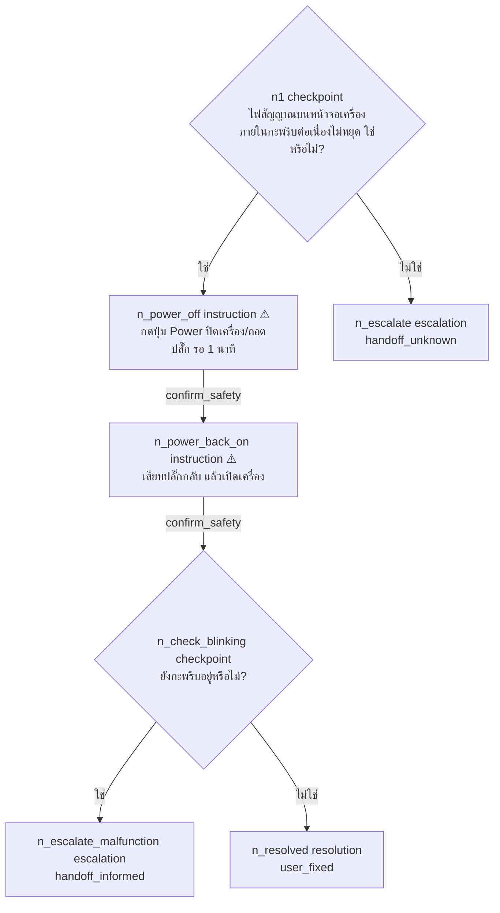

ผู้ใช้คนหนึ่งเดินแบบนี้:

1. เห็นคำถาม `n1` → กด "ใช่" → engine อ่าน `on_yes` = `n_power_off` (`traversal-engine.ts:82-90`)
2. `n_power_off` มีธงอันตราย หน้าจอขึ้นกล่องแดง "ก่อนถอดปลั๊ก: ตรวจสอบว่ามือแห้งสนิท…" → ติ๊กรับทราบ → ส่ง `confirm_safety` (ถ้ามีคนยิง API ส่ง `continue` ตรงๆ จะได้ 400)
3. `n_power_back_on` ยืนยันอีกครั้ง
4. `n_check_blinking` ตอบ "ไม่ใช่" → `n_resolved` เป็น node จบ → session เปลี่ยนเป็น `completed` และเก็บไว้ 90 วัน (`session.store.ts:120-121`)
5. ข้อสังเกต: คำเตือนใน `n_power_off` มี `author_note` ว่า "safety_warning เพิ่มเติมโดยผู้พัฒนา คู่มือต้นฉบับระบุเพียง 'disconnect the power plug'" แต่ข้อความนี้ **ไม่ถูกส่งถึงหน้าจอ** (`RenderedNode` ไม่มีฟิลด์นี้ `types.ts:105-116`)

---

## 4. ภาพรวมระบบ

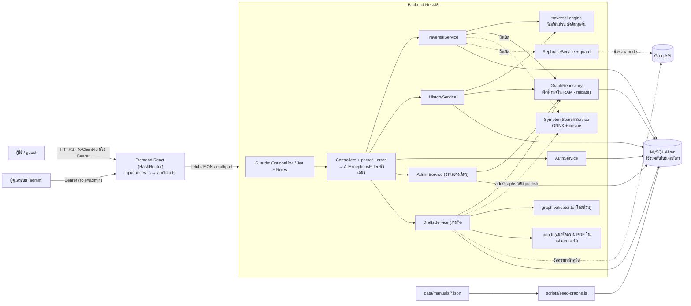

เส้นประ = เปิด/ปิดตาม env หรือเกิดเฉพาะบางเหตุการณ์ · ทุกโมดูลใช้ pool ตัวเดียวจาก `DatabaseModule` ที่เป็น `@Global()` (`database/database.module.ts:62-92`) · ลำดับโมดูลอยู่ที่ `app.module.ts:11-22`

---

## 5. การส่งข้อมูลของระบบ (Data Flow ละเอียด)

### 5.1 Boot และข้อมูล

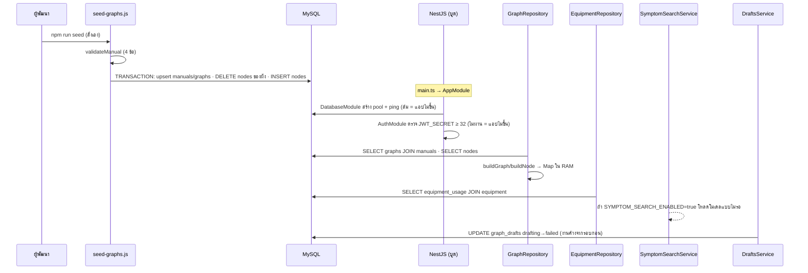

| # | ขั้น | ไฟล์ : บรรทัด |
|---|---|---|
| 1 | คนแปลงคู่มือเป็น JSON (หรือใช้ `scripts/convert_chunks_to_graphs.py`) | `data/manuals/*.json` |
| 2 | seed ตรวจ 4 ข้อ (schema_version, ปลายลูกศรมีจริง, entry_node มีจริง, safety อยู่บน instruction + มีคำเตือน) | `backend/scripts/seed-graphs.js:20-76` |
| 3 | นำเข้าใน transaction · ลบ nodes ของผังแล้ว insert ใหม่ | `seed-graphs.js:182, 264` |
| 4 | env ฐานข้อมูลครบไหม → pool → ping | `database/database.module.ts:32-61, 76-85` |
| 5 | ตรวจ `JWT_SECRET`/`JWT_EXPIRES_IN` | `auth/auth.module.ts:29-44, 47` |
| 6 | โหลดผังเข้า RAM (สร้าง Map ใหม่ก่อนสลับ) | `traversal/graph.repository.ts:82-84, 123-175` |
| 7 | โหลดอุปกรณ์ | `traversal/equipment.repository.ts:25-60` |
| 8 | ดัชนีค้นหา (ถ้าเปิด) ไม่บล็อกการบูต | `symptom-search.service.ts:63-72, 80-128` |
| 9 | ร่างที่ค้าง `drafting` → `failed` (ถ้าตารางยังไม่มี แค่ log) | `authoring/drafts.service.ts:72-80` · `drafts.store.ts:172` |

**ข้อสำคัญใหม่:** ผังที่ publish จาก PDF อยู่ **ในฐานข้อมูลเท่านั้น** ไม่อยู่ใน `data/manuals/` · seed ทับไม่ได้ (upsert ตาม id ของไฟล์ JSON) และไม่ลบ · ถ้าสร้างฐานใหม่จาก `data/` ผังเหล่านี้จะหาย ต้องสำรองด้วย `backend/scripts/backup-graph-tables.js` (อ่านอย่างเดียว `:50`)

### 5.2 เซสชันตรวจอาการ

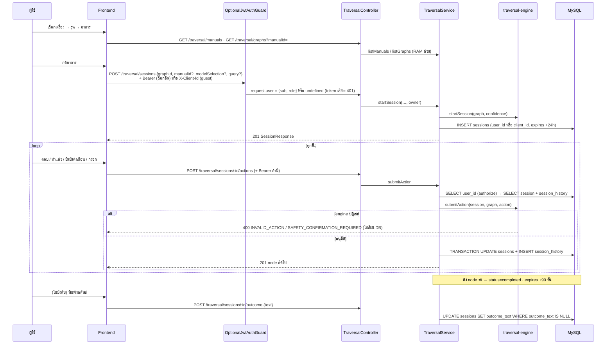

| # | ขั้น | ไฟล์ : บรรทัด |
|---|---|---|
| 1 | หน้าเลือกเครื่อง/รุ่น · รุ่นจำใน URL `?manual=…&unknown=1` | `pages/DevicesPage.tsx` · `lib/modelSelection.ts:11-19` |
| 2 | เลือกอาการ (รายการ / ค้นหา) | `pages/AllSymptomsPage.tsx` · `pages/SymptomsPage.tsx:31-38` |
| 3 | เริ่ม session ใน onClick เท่านั้น | `lib/useStartSymptom.ts:27-33` → `api/traversal.ts:44-51` |
| 4 | เลือกหัวข้อเจ้าของ: มี token = ไม่ส่ง X-Client-Id | `lib/clientHeaders.ts:12-14` · `api/http.ts:63-70` |
| 5 | guard + parse body + หาเจ้าของ | `traversal.controller.ts:79-91` · `auth/optional-jwt-auth.guard.ts:21-29` · `traversal.dto.ts:105-130` · `auth/session-owner.ts:42-51` |
| 6 | ผังตรงรุ่นไหม · คะแนนความมั่นใจ (ถ้ามี query) | `traversal.service.ts:131-135, 324-331` |
| 7 | engine สร้าง session · บันทึก | `traversal.service.ts:139-140` → `session.store.ts:58-77` |
| 8 | ใส่ผลลงแคชทันที แล้วไปหน้า `/session/:id` | `api/queries.ts:191-197` · `lib/useStartSymptom.ts:31` |
| 9 | หน้าตรวจ: อ่าน session → เลือกการ์ดตามชนิด | `pages/SessionPage.tsx:29, 124-150` · `components/step/StepView.tsx:14-34` |
| 10 | ผู้ใช้ตอบ | `SessionPage.tsx:50` (`handleAction`) → `api/queries.ts:211-217` → `api/traversal.ts:65-73` |
| 11 | ด่านเจ้าของ (เฉพาะ session ที่มี user_id) | `traversal.service.ts:173, 257-262` → `session.store.ts:169-177` |
| 12 | engine เดิน 1 ขั้น → บันทึก | `traversal.service.ts:177-184` → `session.store.ts:109-163` |
| 13 | ข้อความที่แสดง (rephrase ถ้าเปิด) | `traversal.service.ts:282-313` |
| 14 | บันทึกผลลัพธ์ (ครั้งเดียว ≤ 1,000 ตัวอักษร) | `traversal.controller.ts:124-134` → `traversal.service.ts:223-243` → `session.store.ts:197-208` |
| 15 | ยกเลิก session (ต้องเป็นเจ้าของ) | `api/traversal.ts:82-88` → `traversal.controller.ts:145-155` → `session.store.ts:187-195` |

### 5.3 ประวัติการซ่อม

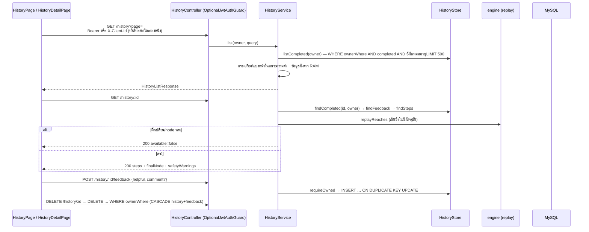

| # | ขั้น | ไฟล์ : บรรทัด |
|---|---|---|
| 1 | กฎเจ้าของ: user → `user_id = ?` · guest → `client_id = ? AND user_id IS NULL` | `auth/session-owner.ts:54-59` |
| 2 | ไม่ล็อกอินและไม่ส่ง X-Client-Id → 400 `INVALID_CLIENT_ID` | `session-owner.ts:31-36` · `traversal.dto.ts:49-55` |
| 3 | รายการ | `history.controller.ts:50-58` → `history.service.ts:72-122` → `history.store.ts:74-86` |
| 4 | รายละเอียด + replay | `history.service.ts:125-132, 204-265, 310-336` |
| 5 | feedback (ส่งซ้ำ = แก้) | `history.service.ts:143-151` → `history.store.ts:139-146` |
| 6 | ลบ | `history.service.ts:135-140` → `history.store.ts:128-136` |
| 7 | frontend: query key มี identity กันข้อมูลคนก่อนค้างในแคช | `api/queries.ts:49-56` · `components/auth/AuthProvider.tsx:80, 103` (`queryClient.clear()`) |

### 5.4 เส้นทางเสริมที่เปิด/ปิดตาม env

**Symptom-search (`SYMPTOM_SEARCH_ENABLED=true`)**

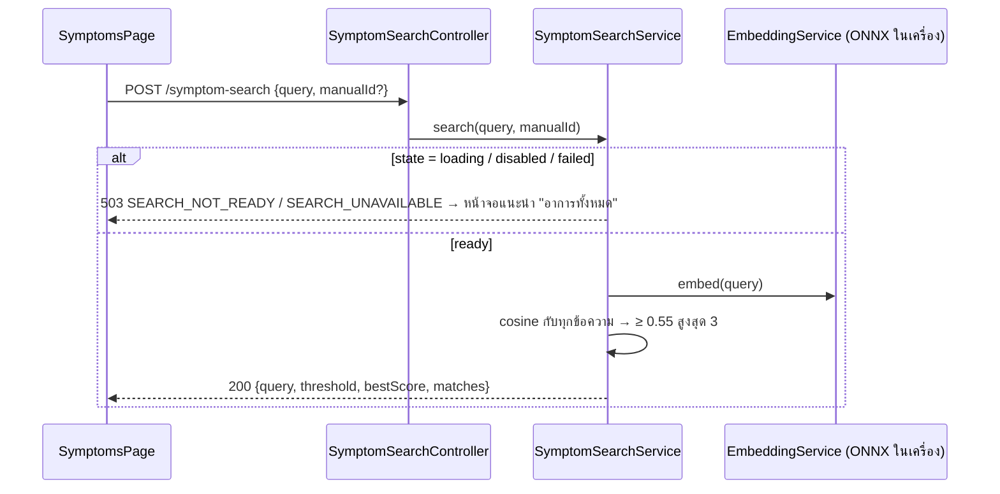

ไฟล์: `symptom-search.controller.ts:30` · `symptom-search.service.ts:10, 192-225` · `embedding/embedding.service.ts:34-35` (ห้ามโหลดโมเดลจากเน็ต) · `pages/SymptomsPage.tsx:31` · ผังใหม่หลัง publish ถูกเพิ่มเข้าดัชนีด้วย `addGraphs` (`symptom-search.service.ts:138-184`)

**Rephrase + guard (`REPHRASE_ENABLED=true` + `GROQ_API_KEY` + `GROQ_MODEL`)**

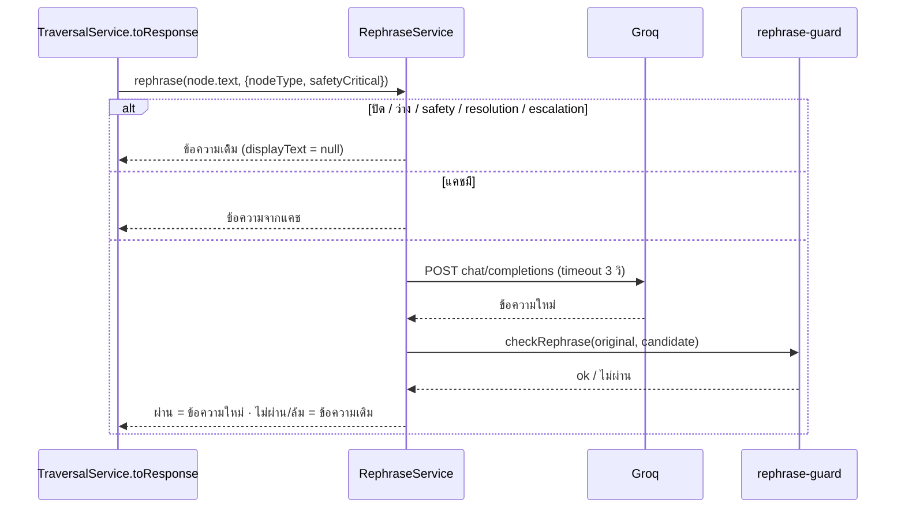

ไฟล์: `traversal.module.ts:35-47` · `rephrase/groq-llm.client.ts:5-11, 20-44, 47-52` · `rephrase.service.ts:35-62` · `rephrase-guard.ts:26-61` · หน้าจอ `SessionPage.tsx:126, 150` + `components/RephraseNote.tsx`

### 5.5 เส้นทางของฟีเจอร์ใหม่

**(ก) สมัคร / เข้าสู่ระบบ / token หมดอายุ**

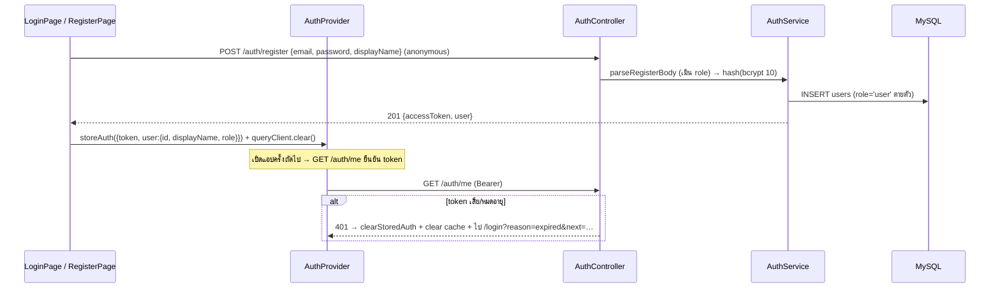

ไฟล์: `auth/auth.controller.ts:26-42` · `auth.dto.ts:117-124` · `auth.service.ts:60-106` (dummy hash กันเดาอีเมลจากเวลา `:53, 86`) · `users.store.ts:81-100` · `api/auth.ts:14-49` · `AuthProvider.tsx:36-72` · `api/http.ts:91-93` · admin คนแรกมาจาก `backend/scripts/seed-admin.js` เท่านั้น (สร้างใหม่ / ยก user เป็น admin โดยไม่เปลี่ยนรหัสผ่าน / ไม่ทำอะไรถ้าเป็น admin แล้ว `seed-admin.js:8-11, 86-107`)

**(ข) Admin ดูสถิติ / feedback**

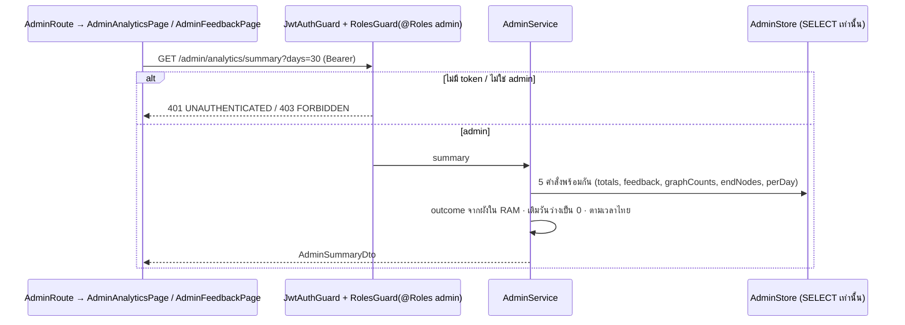

ไฟล์: `admin/admin.controller.ts:27-50` · `admin.service.ts:107-188` · `admin.store.ts:1-14` (ไม่ SELECT email/user_id/client_id) · `admin.dto.ts:137-149` (เวลาไทย) · หน้าจอ `components/auth/AdminRoute.tsx:19-41` (UX เท่านั้น)

**(ค) ร่างผังจาก PDF → publish**

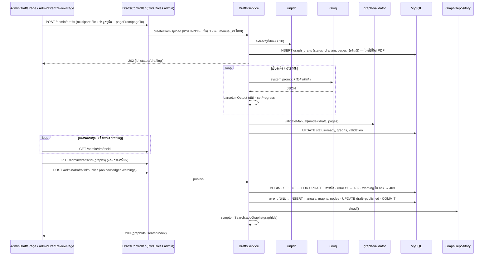

ไฟล์: `authoring/drafts.controller.ts:49-101` · `drafts.service.ts:90-123` (อัปโหลด), `:144-176` (ร่าง), `:218-234` (แก้), `:256-286` (publish) · `drafts.store.ts:246-282` (transaction, `FOR UPDATE :251`, INSERT `:260-262`) · `pdf-text.ts:15-20, 102-` · `draft-llm.client.ts:55-93, 108-160` · `graph-validator.ts:161` · หน้าจอ `api/drafts.ts:13-57` · `api/queries.ts:298-383` (poll `:303, 313`) · `components/admin/drafts/DraftActions.tsx:21-29, 86` · `lib/draftView.ts:181-193` (`publishGate`)

### 5.6 ตาราง endpoint ทั้งหมด

ย่อ: **G** = guest ได้ · **U** = ต้องล็อกอิน · **A** = admin · OptJWT = `OptionalJwtAuthGuard` (ไม่มี token = guest, token เสีย = 401)

| Method / Path | สิทธิ์ / header | Request body (DTO) | Response | Error code ที่เป็นไปได้ | ตารางที่อ่าน / เขียน | RAM | ผู้เรียก frontend |
|---|---|---|---|---|---|---|---|
| `GET /health` | สาธารณะ | — | `{status, service, database, databaseError?, timestamp, environment}` | — (ตอบ 200 เสมอ) | อ่าน `SELECT 1` | — | `api/traversal.ts:21` `getHealth` (ผ่าน `useHealth` `queries.ts:71`) |
| `GET /traversal/graphs?manualId=` | สาธารณะ | — | `GraphSummary[]` (`graph.repository.ts:44-52`) | 400 `INVALID_ACTION` (manualId ผิด) | — | ✅ | `api/traversal.ts:26` `listGraphs` |
| `GET /traversal/manuals` | สาธารณะ | — | `ManualSummary[]` (`graph.repository.ts:55-63`) | — | — | ✅ | `api/traversal.ts:31` `listManuals` |
| `POST /traversal/sessions` | G (`X-Client-Id` ไม่บังคับ) / U (Bearer) · OptJWT | `StartSessionBody` (`traversal.dto.ts:60-65`) | 201 `SessionResponseDto` (`traversal.dto.ts:208-217`) | 400 `INVALID_ACTION`, `INVALID_CLIENT_ID`, `GRAPH_MANUAL_MISMATCH` · 401 `UNAUTHENTICATED` · 404 `GRAPH_NOT_FOUND` · 500 `GRAPH_NODE_MISSING`, `INTERNAL_ERROR` | เขียน `sessions` | ✅ ผัง/อุปกรณ์/ดัชนี | `api/traversal.ts:44` `startSession` |
| `GET /traversal/sessions/:id` | G (UUID ของ session พอ) / U (ต้องเป็นเจ้าของถ้า session มี user_id) · OptJWT | — | `SessionResponseDto` | 401 · 404 `SESSION_NOT_FOUND`, `GRAPH_NOT_FOUND` · 500 | อ่าน `sessions`, `session_history` | ✅ | `api/traversal.ts:61` `getSession` |
| `POST /traversal/sessions/:id/actions` | เหมือนข้างบน | `TraversalAction` (`types.ts:94-98`) | 201 `SessionResponseDto` | 400 `INVALID_ACTION`, `SAFETY_CONFIRMATION_REQUIRED` · 401 · 404 · 409 `SESSION_COMPLETED` · 500 (รวมกรณีกดพร้อมกัน) | อ่าน + เขียน `sessions`, `session_history` (transaction) | ✅ | `api/traversal.ts:65` `submitAction` |
| `POST /traversal/sessions/:id/outcome` | เหมือนข้างบน | `{text}` ≤ 1,000 (`traversal.dto.ts:174-198`) | 200 `SessionResponseDto` | 400 `INVALID_OUTCOME` · 401 · 404 · 409 `SESSION_NOT_COMPLETED`, `OUTCOME_ALREADY_SUBMITTED` | อ่าน + เขียน `sessions` | ✅ | `api/traversal.ts:75` `submitOutcome` |
| `DELETE /traversal/sessions/:id` | G (`X-Client-Id` **บังคับ**) / U · OptJWT | — | 204 | 400 `INVALID_CLIENT_ID` · 401 · 404 | เขียน `sessions` (+CASCADE) | — | `api/traversal.ts:82` `abandonSession` |
| `POST /symptom-search` | สาธารณะ | `{query ≤200, manualId?}` (`symptom-search.dto.ts:12`) | `SymptomSearchResponseDto` (`dto:65`) | 400 `INVALID_QUERY` · 503 `SEARCH_NOT_READY`, `SEARCH_UNAVAILABLE` | — | ✅ ดัชนี + โมเดล | `api/traversal.ts:54` `searchSymptoms` |
| `GET /symptom-search/status` | สาธารณะ | — | `SearchStatusDto` (`dto:75`) | — | — | ✅ | ไม่มี |
| `GET /history` | G (`X-Client-Id` บังคับ) / U · OptJWT | query `page`, `pageSize` (ใหม่สุดก่อน · ตัวกรอง/ค้นหา/เรียงถูกตัด 19 ต.ค. D3) | `HistoryListResponseDto` (`:174`) | 400 `INVALID_HISTORY_QUERY`, `INVALID_CLIENT_ID` · 401 | อ่าน `sessions` | ✅ ผัง | `api/history.ts` `listHistory` |
| `GET /history/:id` | เหมือนข้างบน | — | `HistoryDetailDto` (`:206`) | 400 · 401 · 404 `HISTORY_NOT_FOUND` | อ่าน `sessions`, `session_history`, `session_feedback` | ✅ ผัง + engine | `api/history.ts:28` `getHistory` |
| `POST /history/:id/feedback` | เหมือนข้างบน | `HistoryFeedbackDto` (รอบ 2 รวมจาก `FeedbackBody`) | 200 `HistoryFeedbackDto` (`:201`) | 400 `INVALID_FEEDBACK` · 401 · 404 | อ่าน `sessions` · เขียน `session_feedback` | — | `api/history.ts:41` `submitFeedback` |
| `DELETE /history/:id` | เหมือนข้างบน | — | 204 | 400 · 401 · 404 | เขียน `sessions` (+CASCADE) | — | `api/history.ts:33` `deleteHistory` |
| `POST /auth/register` | สาธารณะ | `{email, password 8–72 (≤72 ไบต์), displayName 1–100}` | 201 `AuthResponseDto` (`auth.dto.ts:57-60`) | 400 `INVALID_AUTH_REQUEST` · 409 `EMAIL_TAKEN` | เขียน `users` | — | `api/auth.ts:30` `register` |
| `POST /auth/login` | สาธารณะ | `{email, password}` | 200 `AuthResponseDto` | 400 · 401 `INVALID_CREDENTIALS` | อ่าน `users` | — | `api/auth.ts:20` `login` |
| `GET /auth/me` | U (`JwtAuthGuard`) | — | `UserDto` (`auth.dto.ts:47-54`) | 401 | อ่าน `users` | — | `api/auth.ts:46` `getMe` |
| `GET /admin/feedback` | A | query `helpful, from, to, page, pageSize` (`admin.dto.ts:167-180`) | `AdminFeedbackPageDto` (รอบ 2 แทน `PagedDto<…>`) | 400 `INVALID_ADMIN_QUERY` · 401 · 403 | อ่าน `session_feedback` JOIN `sessions` | ✅ ผัง | `api/admin.ts:12` `getAdminFeedback` |
| `GET /admin/analytics/summary` | A | query `days 1–90` | `AdminSummaryDto` (`:258-280`) | 400 · 401 · 403 | อ่าน `sessions`, `session_feedback` | ✅ ผัง | `api/admin.ts:23` `getAdminSummary` |
| `POST /admin/drafts` | A · multipart | `file` + `manualId, deviceCategory, brand, modelPattern, sourceManual, displayName?, pageFrom, pageTo` (`drafts.dto.ts:52-87`) | 202 `{id, status:'drafting'}` | 400 `INVALID_DRAFT_REQUEST` · 401 · 403 · 409 `DRAFT_BUSY`, `DRAFT_ID_CONFLICT` · 413 `PDF_TOO_LARGE` · 415 `PDF_UNSUPPORTED_TYPE` · 422 `PDF_NO_TEXT`, `PDF_UNREADABLE`, `PDF_PAGE_TOO_LONG` | เขียน `graph_drafts` | ✅ ผัง (ตรวจ id ชน) | `api/drafts.ts:13` `uploadDraft` |
| `GET /admin/drafts` | A | — | `{items: DraftSummaryDto[]}` (`drafts.dto.ts:119-134`) | 401 · 403 | อ่าน `graph_drafts` | — | `api/drafts.ts:29` `listDrafts` |
| `GET /admin/drafts/:id` | A | — | `DraftDetailDto` (`:136-145`) | 401 · 403 · 404 `DRAFT_NOT_FOUND` | อ่าน `graph_drafts` | — | `api/drafts.ts:34` `getDraft` |
| `PUT /admin/drafts/:id` | A | `{graphs}` | `DraftDetailDto` | 400 · 401 · 403 · 404 · 409 `DRAFT_NOT_READY` | เขียน `graph_drafts` | ✅ ผัง | `api/drafts.ts:39` `updateDraft` |
| `POST /admin/drafts/:id/reject` | A | `{reason?}` | 200 `DraftDetailDto` | 401 · 403 · 404 · 409 | เขียน `graph_drafts` | — | `api/drafts.ts:49` `rejectDraft` |
| `POST /admin/drafts/:id/publish` | A | `{acknowledgedWarnings?: boolean}` | 200 `PublishResultDto` (`:147-153`) | 401 · 403 · 404 · 409 `DRAFT_NOT_READY`, `DRAFT_INVALID`, `DRAFT_WARNINGS_UNACKNOWLEDGED`, `DRAFT_ID_CONFLICT` · 500 `PUBLISH_RELOAD_FAILED` | อ่าน/ล็อก `graph_drafts` · เขียน `manuals`, `graphs`, `nodes`, `graph_drafts` | ✅ reload + ดัชนี | `api/drafts.ts:55` `publishDraft` |

error → HTTP: จุดสร้าง error แต่ละตัวกำหนด status+code เองด้วย `ApiError(status, code, message)` (`common/api-error.ts`) แล้ว `common/all-exceptions.filter.ts` ตัวเดียวแปลงเป็น response (ตาราง engine error `ENGINE_ERRORS` + 401/403 ของ guard อยู่ในไฟล์นั้น) · ข้อความไทยของทุก code ฝั่งหน้าจออยู่ที่ `frontend/src/lib/errors.ts:40` (`describeError`)

### 5.7 ตัวอย่าง request / response ตาม DTO จริง

> ค่า id / วันที่ / อีเมล / ชื่อ / token ในตัวอย่าง **เป็นตัวอย่างสมมติ** · ข้อความของ node มาจากผังจริง `samsung_ac_ar70h_indicator_blinking`

**POST /traversal/sessions** (guest)

```http
POST /traversal/sessions
Content-Type: application/json
X-Client-Id: 3f6c2a1e-8b4d-4c7a-9e21-5d0f7b9a1c22
```
```json
{ "graphId": "samsung_ac_ar70h_indicator_blinking", "manualId": "samsung_ac_ar70h", "modelSelection": "selected" }
```
Response 201 (`SessionResponseDto` · `traversal.dto.ts:208-217`):
```json
{
  "sessionId": "7b1d9c40-2f3e-4a51-8c6d-0e9a4b2f7d13",
  "graphId": "samsung_ac_ar70h_indicator_blinking",
  "status": "in_progress",
  "node": {
    "nodeId": "n1",
    "type": "checkpoint",
    "text": "ไฟสัญญาณบนหน้าจอเครื่องภายในกะพริบต่อเนื่องไม่หยุด ใช่หรือไม่?",
    "safetyCritical": false,
    "requiresSafetyConfirmation": false,
    "isTerminal": false,
    "reference": { "source": "RAC255-00_IB_26Y_AR80H_WindFree_GEO_CB_EN-WEB_251229-D04", "pageRange": [43, 43] }
  },
  "equipment": [],
  "confidence": null,
  "outcome": null,
  "displayText": null
}
```
(`manualId` ของคู่มือนี้และรายการ `equipment` จริง **ไม่แน่ใจ** — ดู `data/manuals/samsung_ac_ar70h.json` field `manual_id` และตาราง `equipment_usage` ของ `Air Conditioner`)

**POST /traversal/sessions/:id/actions** — ส่ง `continue` ที่ node อันตราย
```json
{ "type": "continue" }
```
Response 400:
```json
{ "statusCode": 400, "code": "SAFETY_CONFIRMATION_REQUIRED", "message": "โหนด 'n_power_off' เป็น safety_critical ต้องส่ง action 'confirm_safety' เท่านั้น จะใช้ 'continue' เฉยๆ ไม่ได้" }
```
ส่งใหม่ `{ "type": "confirm_safety" }` → 201 node `n_power_back_on` ที่ `"safetyCritical": true, "requiresSafetyConfirmation": true, "safetyWarning": "ตรวจสอบว่ามือแห้งก่อนเสียบปลั๊ก และเสียบให้แน่นสนิท"`

**POST /traversal/sessions/:id/outcome**
```json
{ "text": "ถอดปลั๊ก 1 นาทีแล้วไฟหยุดกะพริบ" }
```
→ 200 `SessionResponseDto` ที่ `"outcome": "ถอดปลั๊ก 1 นาทีแล้วไฟหยุดกะพริบ"` (ข้อความเป็นตัวอย่างสมมติ)

**GET /history** → `HistoryListResponseDto` (`history.dto.ts:160-188`)
```json
{
  "items": [
    {
      "sessionId": "7b1d9c40-2f3e-4a51-8c6d-0e9a4b2f7d13",
      "graphId": "samsung_ac_ar70h_indicator_blinking",
      "startedAt": "2026-10-16T09:12:00.000Z",
      "outcomeKind": "user_fixed",
      "graph": { "manualId": "samsung_ac_ar70h", "entrySymptom": "The indicator on the indoor unit display blinks continuously", "entrySymptomTh": "ไฟกะพริบที่หน้าจอแอร์ ไฟกระพริบไม่หยุด", "deviceCategory": "Air Conditioner", "brand": "Samsung", "modelPattern": "AR70H**D1***" }
    }
  ],
  "total": 1, "page": 1, "pageSize": 10, "totalPages": 1
}
```

**GET /history/:id** → `HistoryDetailDto` (`history.dto.ts:206-230`) ย่อ:
```json
{
  "sessionId": "7b1d9c40-…", "graphId": "samsung_ac_ar70h_indicator_blinking", "startedAt": "2026-10-16T09:12:00.000Z",
  "modelSelection": "selected", "confidence": null, "graph": { "…": "เหมือนรายการ" },
  "outcomeKind": "user_fixed", "available": true,
  "steps": [ { "node": { "nodeId": "n1", "type": "checkpoint", "…": "RenderedNode" }, "action": { "type": "answer", "value": "yes" } } ],
  "finalNode": { "nodeId": "n_resolved", "type": "resolution", "outcomeKind": "user_fixed", "isTerminal": true, "…": "RenderedNode" },
  "safetyWarnings": ["ก่อนถอดปลั๊ก: ตรวจสอบว่ามือแห้งสนิท…", "ตรวจสอบว่ามือแห้งก่อนเสียบปลั๊ก และเสียบให้แน่นสนิท"],
  "reference": { "source": "RAC255-00_IB_26Y_AR80H_WindFree_GEO_CB_EN-WEB_251229-D04", "pageRange": [43, 43] },
  "outcome": null, "feedback": null
}
```

**POST /history/:id/feedback**
```json
{ "helpful": true, "comment": "ใช้ได้" }
```
→ 200 `{ "helpful": true, "comment": "ใช้ได้" }`

**POST /auth/register** (ตัวอย่างสมมติ)
```json
{ "email": "somchai@example.com", "password": "correct-horse-1", "displayName": "สมชาย", "role": "admin" }
```
→ 201 (field `role` ที่แนบมาถูกเมิน `auth.dto.ts:7-9, 117-124`):
```json
{ "accessToken": "eyJhbGciOiJIUzI1NiIs…", "user": { "id": "c0a8…", "email": "somchai@example.com", "displayName": "สมชาย", "role": "user", "createdAt": "2026-10-16T10:00:00.000Z" } }
```
payload ของ JWT มีแค่ `{ sub, role }` (`auth.service.ts:104`)

**GET /admin/analytics/summary?days=7** → `AdminSummaryDto` (`admin.dto.ts:258-280` · ตัวเลขสมมติ)
```json
{
  "window": { "days": 7, "from": "2026-10-11", "to": "2026-10-17" },
  "sessions": { "total": 12, "completed": 8, "inProgress": 1, "expiredUnfinished": 3, "byOwner": { "user": 4, "guest": 7, "none": 1 } },
  "feedback": { "total": 5, "helpful": 4, "notHelpful": 1, "satisfactionRate": 0.8 },
  "confidence": { "average": null, "sampleSize": 0 },
  "outcomes": { "user_fixed": 5, "normal_behavior": 1, "handoff_informed": 1, "handoff_unknown": 1, "unknown": 0 },
  "topGraphs": [ { "graphId": "samsung_ac_ar70h_indicator_blinking", "entrySymptomTh": "ไฟกะพริบที่หน้าจอแอร์ ไฟกระพริบไม่หยุด", "count": 3 } ],
  "topDevices": [ { "deviceCategory": "Air Conditioner", "count": 3 } ],
  "perDay": [ { "date": "2026-10-11", "started": 0, "completed": 0 } ]
}
```

**POST /admin/drafts** (multipart · ค่าสมมติ)
```
file=<manual.pdf>  manualId=demo_samsung_test  deviceCategory=Microwave  brand=Samsung
modelPattern=MS23K3513  sourceManual=MS23K3513_UM  pageFrom=30  pageTo=31
```
→ 202 `{ "id": "5e2f…", "status": "drafting" }`

**POST /admin/drafts/:id/publish**
```json
{ "acknowledgedWarnings": true }
```
→ 200 `PublishResultDto` (`drafts.dto.ts:147-153`):
```json
{ "id": "5e2f…", "status": "published", "graphIds": ["demo_samsung_test_no_power"], "searchIndex": { "indexed": false, "reason": "ระบบค้นหาปิดอยู่ (SYMPTOM_SEARCH_ENABLED ไม่ใช่ true)" } }
```
ถ้ายังมี error ในผัง → 409:
```json
{ "statusCode": 409, "code": "DRAFT_INVALID", "message": "ร่างผังยังไม่ผ่านการตรวจ (2 error) แก้ให้ผ่านก่อนเผยแพร่ — ไม่มีทางข้ามการตรวจ" }
```
(รูปแบบ `graphIds` มาจาก `assignGraphIds` ที่ `draft-schema.ts:213` — รูปแบบ id จริง**ไม่แน่ใจ** ให้ดูฟังก์ชันนั้น)

### 5.8 ข้อมูลอยู่ที่ไหนบ้าง

| ที่เก็บ | ข้อมูล | อายุ / TTL | ไฟล์ |
|---|---|---|---|
| `localStorage` `fixstep.clientId` | UUID ของเบราว์เซอร์ (guest) | ถาวรจนล้างข้อมูลเว็บ · อ่านไม่ได้ = จำในแท็บ | `lib/clientId.ts:13, 52-70` |
| `localStorage` `fixstep.auth` | `{token, user:{id, displayName, role}}` (ไม่เก็บอีเมล) | จน logout หรือได้ 401 · token หมดอายุตาม `JWT_EXPIRES_IN` (ค่าเริ่มต้น 7d) | `lib/authStorage.ts:19, 70-86` · `api/auth.ts:14-17` · `auth.module.ts:25` |
| URL (hash) | `?manual=&unknown=1` (รุ่น) · `?page=` ของประวัติ · ตัวกรอง admin · `/login?reason=&next=` | ตาม URL | `lib/modelSelection.ts:11-19` · `pages/HistoryPage.tsx` (pageFromUrl) · `lib/adminParams.ts` · `lib/authRedirect.ts` |
| React state | "รอยทาง" (trail) ขั้นที่ผ่านในหน้าตรวจ | หายเมื่อออกจากหน้า | `pages/SessionPage.tsx:45` |
| TanStack Query cache | graphs/manuals (`staleTime: Infinity`), session, ประวัติ, admin, ร่าง | ในหน่วยความจำแท็บ · ล้างทั้งหมดตอน login/logout/401 | `api/queries.ts:83-97` · `AuthProvider.tsx:44, 80, 103` |
| RAM backend: `GraphRepository` | ผังทั้งหมด + ชื่อรุ่น | จนรีสตาร์ต หรือ `reload()` หลัง publish | `graph.repository.ts:76-79, 182-185` |
| RAM backend: `EquipmentRepository` | อุปกรณ์ตามประเภทเครื่อง | จนรีสตาร์ต | `equipment.repository.ts:21` |
| RAM backend: `SymptomSearchService` | เวกเตอร์ของข้อความอาการ | จนรีสตาร์ต · เพิ่มได้ด้วย `addGraphs` | `symptom-search.service.ts:41-45` |
| RAM backend: `RephraseService` | แคช ข้อความเดิม → ข้อความเรียบเรียง (ไม่มีเพดาน แต่จำกัดโดยจำนวนข้อความ node) | จนรีสตาร์ต | `rephrase.service.ts:27` |
| RAM backend: `DraftsService.busy` | กำลังร่างอยู่ไหม (ทีละ 1 งาน) | ในโปรเซส | `drafts.service.ts:62` |
| MySQL `sessions` | สถานะการตรวจ + เจ้าของ (`user_id` หรือ `client_id`) | ยังไม่จบ 24 ชม. นับจากขยับล่าสุด · จบแล้ว 90 วัน · **หมดอายุแค่ถูกซ่อน ไม่ถูกลบ** | `session.store.ts:16, 22-23, 120-121` |
| MySQL `session_history` | ขั้นที่ผ่าน | ตาม session (CASCADE) | `migrations/002…:21-38` |
| MySQL `session_feedback` | 👍/👎 + ความเห็น ≤ 500 | ตาม session (CASCADE) | `migrations/009…` |
| MySQL `users` | อีเมล, bcrypt hash, ชื่อ, role | ถาวร (ไม่มี endpoint ลบบัญชี) | `migrations/010…` |
| MySQL `graph_drafts` | ข้อมูลคู่มือ, **ข้อความหน้า PDF ที่เลือก**, ร่างผัง, รายงานตรวจ, ผู้สร้าง/ผู้ตรวจ (user id) | ถาวร (ไม่มีงานลบ) · ไม่เก็บไฟล์ PDF | `migrations/012…:8-16` |
| MySQL `manuals`/`graphs`/`nodes` | ผังที่ใช้จริง (จาก seed **และ** จาก publish) | ถาวร | `migrations/001…` |
| ไฟล์ `data/manuals/*.json` | ต้นทางของ seed (ไม่รวมผังที่ publish จาก PDF) | ใน git | — |
| ไฟล์ `data/chuck/*.json`, `data/pdf/` | chunk และ PDF ต้นฉบับ (อ้างอิง/ตรวจด้วยสคริปต์) | ใน git | `scripts/check_chunk_pdf.py` |
| ไฟล์ `backend/model-slim/` | โมเดล embedding ที่ย่อแล้ว | ใน git | `embedding.service.ts:8` |
| ไฟล์ dump: `backup/`, `backend/backup_before_012.sql`, `backend/backups/` และประวัติ git | สำเนาตาราง รวม `sessions`, `users` | ถาวรจนลบ · **บางไฟล์อยู่บน GitHub แล้ว** | หัวข้อ 12 R1 |

### 5.9 ข้อมูลที่ออกไปนอกระบบ

| ส่งอะไร | ไปที่ไหน | เงื่อนไขที่ทำให้ส่ง | ข้อมูลส่วนบุคคล / client_id รั่วไหม | ไฟล์ |
|---|---|---|---|---|
| ข้อความ node (หลังแทน `{{ตัวแปร}}` ด้วยค่าที่ผู้ใช้กรอก) + system prompt | Groq `api.groq.com` | `REPHRASE_ENABLED=true` + `GROQ_API_KEY` + `GROQ_MODEL` และ node ไม่ใช่ safety/ข้อสรุป และไม่อยู่ในแคช | ไม่ส่ง client_id / user id / IP ของผู้ใช้ (ส่งจากเซิร์ฟเวอร์) · **ค่าที่ผู้ใช้กรอกใน input node อาจติดไป** (ข้อมูลจริงมี input node 1 อัน) | `rephrase/groq-llm.client.ts:20-35` · `traversal-engine.ts:141, 170-174` |
| ข้อความหน้าคู่มือที่เลือก (≤ 2 หน้าต่อครั้ง) + ชื่อคู่มือ/ยี่ห้อ/รุ่น/ประเภท | Groq | admin อัปโหลด PDF + `GROQ_API_KEY` + `AUTHORING_LLM_MODEL` | ไม่มีข้อมูลผู้ใช้ (เป็นเนื้อหาคู่มือ) · ถ้า admin อัปโหลดเอกสารที่ไม่ใช่คู่มือ เนื้อหานั้นจะถูกส่งไป | `authoring/draft-llm.client.ts:86-93, 115-129` |
| โมเดล embedding | Hugging Face | **ไม่ส่งตอนแอปทำงาน** (`allowRemoteModels = false`) · ตอนเตรียมโมเดลครั้งแรกใช้ `backend/model-cache/` ที่ดาวน์โหลดมาก่อน — วิธีดาวน์โหลด**ไม่แน่ใจ** (ดู `docs/archive/HANDOFF.md`) | ไม่มี | `embedding.service.ts:34-35` · `scripts/slim_model.py:4` |
| ข้อความ error ภายใน (MySQL) | ใครก็ได้ที่เรียก `GET /health` และ response 500 ทุก endpoint | DB ล่ม / error ที่ไม่รู้จัก | อาจมีชื่อโฮสต์/ชื่อตาราง | `health.controller.ts:27, 34` · `traversal.exception.filter.ts:65, 120` |
| ไฟล์ dump + log | GitHub (`origin/main`) | commit `2577a91` (push แล้ว) · commit `358ec2d` (ยังไม่ push) | `origin/main`: ชื่อโฮสต์ Aiven, ชื่อฐาน, แถว `sessions` (มี `client_id`) · `358ec2d`: **`users` (อีเมล + bcrypt hash)** | หัวข้อ 12 R1 |
| JWT / X-Client-Id | ระหว่างเบราว์เซอร์กับ backend (HTTPS บน Render · HTTP บน localhost) | ทุกคำขอ | — | `api/http.ts:63-70` |

### 5.10 ตาม 1 session ตั้งแต่กดเริ่มจนจบ (ผู้ใช้ล็อกอิน)

| ขั้น | Frontend ส่งอะไร | Backend ทำอะไร | DB เปลี่ยนอย่างไร |
|---|---|---|---|
| 0 | `GET /traversal/manuals`, `GET /traversal/graphs?manualId=…` | คืนจาก RAM | ไม่เปลี่ยน |
| 1 | `POST /traversal/sessions` + `Authorization: Bearer …` (ไม่มี X-Client-Id) `{graphId, manualId, modelSelection}` | guard วาง `request.user` → owner = user → ตรวจผังตรงรุ่น → engine สร้าง session ที่ `n1` | `INSERT sessions` (`status=in_progress`, `current_node_id=n1`, `user_id=<id>`, `client_id=NULL`, `expires_at=+24h`) |
| 2 | `POST …/actions {"type":"answer","value":"yes"}` | authorize (user_id ตรง) → อ่าน session → engine → `n_power_off` | transaction: `UPDATE sessions current_node_id=n_power_off, expires_at=+24h` + `INSERT session_history (step_order=0, node_id=n1, answer, yes)` |
| 3 | `POST …/actions {"type":"confirm_safety"}` | engine ยอมรับเพราะ node มีธง | `UPDATE … n_power_back_on` + `INSERT history (1, n_power_off, confirm_safety, NULL)` |
| 4 | `POST …/actions {"type":"confirm_safety"}` | → `n_check_blinking` | `INSERT history (2, …)` |
| 5 | `POST …/actions {"type":"answer","value":"no"}` | → `n_resolved` เป็น node จบ → `status=completed` | `UPDATE status=completed, expires_at=+90 วัน` + `INSERT history (3, …)` |
| 6 | (ไม่บังคับ) `POST …/outcome {"text":"…"}` | ตรวจว่าจบแล้ว → UPDATE เฉพาะถ้ายังไม่มีผลลัพธ์ | `UPDATE outcome_text, outcome_at` |
| 7 | เปิด `/history` → `GET /history` (Bearer) | `WHERE user_id = ? AND completed AND ยังไม่หมดอายุ` | ไม่เปลี่ยน |
| 8 | `POST /history/:id/feedback {"helpful":true}` | requireOwned | `INSERT session_feedback … ON DUPLICATE KEY UPDATE` |
| 9 | (ไม่บังคับ) `DELETE /history/:id` | ลบเฉพาะของเจ้าของ | `DELETE sessions` → CASCADE `session_history`, `session_feedback` |

ถ้าเป็น guest: ขั้น 1 ส่ง `X-Client-Id` แทน Bearer → เก็บ `client_id`, `user_id=NULL` · ขั้น 2–6 **ไม่ต้องส่งหัวข้อใด** (`api/traversal.ts:61-80`) เพราะ session ของ guest ใช้ session UUID เป็นกุญแจ · ขั้น 7–9 ต้องส่ง `X-Client-Id`

---

## 6. แผนที่โฟลเดอร์

```
appliance-repair-assistant/
├─ backend/
│  ├─ src/
│  │  ├─ main.ts, app.module.ts      จุดเริ่ม (CORS) + ประกอบ 8 โมดูล
│  │  ├─ traversal-engine/           ★ แกน: types.ts + traversal-engine.ts (ฟังก์ชันล้วน)
│  │  ├─ traversal/                  API เดินขั้นตอน + GraphRepository (RAM) + SessionStore + EquipmentRepository
│  │  ├─ auth/              (ใหม่)   users, JWT, guards, roles, session-owner
│  │  ├─ history/                    หน้าประวัติ (ตอนนี้รู้จักทั้ง user และ guest)
│  │  ├─ admin/             (ใหม่)   สถิติ/feedback/รายการ session (อ่านอย่างเดียว)
│  │  ├─ authoring/         (ใหม่)   ร่างผังจาก PDF: controller, service, store, validator, LLM client, pdf-text
│  │  ├─ symptom-search/, embedding/ ค้นหาอาการด้วย ONNX
│  │  ├─ rephrase/                   เรียบเรียงถ้อยคำ + guard
│  │  ├─ database/                   pool (@Global)
│  │  └─ health/                     GET /health
│  ├─ migrations/                    001–012 (.sql)
│  ├─ scripts/                       run-migrations, seed-graphs, seed-equipment, seed-admin (ใหม่), backup-graph-tables (ใหม่), try-rephrase
│  ├─ model-slim/                    โมเดล ONNX ที่ย่อแล้ว
│  └─ backups/, backup_before_012.sql   ⚠ dump ฐานข้อมูล (ไม่ควรอยู่ใน repo)
├─ frontend/src/
│  ├─ api/                           http.ts, traversal.ts, history.ts, auth.ts (ใหม่), admin.ts (ใหม่), drafts.ts (ใหม่), queries.ts, types.ts
│  ├─ pages/                         Home, Devices, Symptoms, AllSymptoms, Session, History, HistoryDetail,
│  │                                 Login, Register, Forbidden, AdminAnalytics, AdminFeedback, AdminDrafts, AdminDraftReview (ใหม่ 7 หน้า)
│  ├─ components/                    step/, history/, layout/, ui/, auth/ (ใหม่), admin/ + admin/drafts/ (ใหม่)
│  └─ lib/                           ฟังก์ชันล้วน: errors, labels, modelSelection, clientId,
│                                    authStorage/authContext/authRedirect/authForm, clientHeaders, adminParams/adminView, draftView (ใหม่)
├─ data/                             manuals/ (★ ต้นทาง seed), chuck/, equipment/, pdf/, schemas/
├─ scripts/                          Python: validate_graph.py, check_chunk_pdf.py, convert_chunks_to_graphs.py, simulate_paths.py, slim_model.py, inspect_vocab.py, old/
├─ docs/                             เอกสาร (auth-step1–4.md, authoring-step5.md, PLAN-STEP5-AUTHORING.md ใหม่)
├─ draft/                            งานร่างเก่า (เทสต์ 22 ไฟล์ที่ไม่ถูกรัน)
├─ backup/                           ⚠ dump ฐานข้อมูล (ย้ายมาจากราก repo)
├─ check/                            ผลตรวจ chunk เทียบ PDF (.html)
└─ render.yaml                       Blueprint ของ backend บน Render
```

---

## 7. ลำดับการอ่านโค้ดที่แนะนำ

### 7.1 สายไหนก่อน

**อ่านสาย backend ก่อน** เหตุผล: (1) การตัดสินขั้นตอน ด่านความปลอดภัย และการตรวจสิทธิ์จริงอยู่ฝั่งนี้ทั้งหมด frontend แค่แสดงผล (คอมเมนต์ `AdminRoute.tsx:16-17` บอกเองว่าเป็น UX) (2) ฟีเจอร์ใหม่ทั้ง 5 ก้อนเริ่มที่ backend (3) คำถามกรรมการส่วนใหญ่ชี้มาที่นี่

### 7.2 เริ่มอ่านไฟล์นี้ก่อนเป็นไฟล์แรก

> **`backend/src/traversal-engine/types.ts`** (152 บรรทัด · ~15 นาที)
> เพราะเป็น "พจนานุกรม" ของทั้งระบบและไม่มีโค้ดทำงานให้หลง: ชนิด node (`:1-51`), รูปร่างผัง (`:60-75`), session (`:84-92`), action 4 แบบ (`:94-98`), สิ่งที่ส่งให้หน้าจอ (`:105-116`), error ของ engine (`:118-152`) · ทุกโมดูลรวม `history`, `admin`, `authoring` และ frontend (`frontend/src/api/types.ts:1-8` re-export จากไฟล์นี้) import จากไฟล์นี้

### 7.3 สาย Backend

| ขั้น | ไฟล์ | ทำไมอ่านตอนนี้ | อ่านแล้วควรเข้าใจอะไร | เวลา |
|---|---|---|---|---|
| B1 | `traversal-engine/types.ts` | พจนานุกรม | ชนิด node, session, action, error | 15 นาที |
| B2 | หัวข้อ 3.6 + `data/manuals/samsung_ac_ar70h.json` (graph `…indicator_blinking`) | เห็นข้อมูลจริงก่อนอ่านตัวเดิน | `on_yes/on_no/next`, ธงอันตราย, `author_note` | 10 นาที |
| B3 | `traversal-engine/traversal-engine.ts` | **หัวใจ** | `submitAction` (`:41-74`), ด่านความปลอดภัย (`:92-104`), `renderNode` (`:128-150`) | 30 นาที |
| B4 | `migrations/001`, `002`, `008`–`011` | ข้อมูลอยู่ที่ไหน + เจ้าของ session | FK, TTL, `client_id`/`user_id` | 25 นาที |
| B5 | `traversal/graph.repository.ts` | ผังเข้า RAM + `reload()` | สร้าง Map ใหม่ก่อนสลับ (`:151-172`) | 20 นาที |
| B6 | `traversal/session.store.ts` | บันทึกความคืบหน้า | transaction ใน `update` (`:109-163`), `findUserId` (`:169-177`) | 25 นาที |
| B7 | `traversal/traversal.service.ts` | ผูก engine + DB | ลำดับ authorize → อ่าน → engine → บันทึก (`:168-187`), `authorize` (`:257-262`) | 30 นาที |
| B8 | `traversal.dto.ts` → `traversal.controller.ts` → `common/all-exceptions.filter.ts` | ทางเข้าออก HTTP | `parse*` แทน class-validator · `ApiError` + filter กลาง | 30 นาที |
| B9 | `auth/role.enum.ts` → `jwt-auth.guard.ts` → `optional-jwt-auth.guard.ts` → `roles.guard.ts` → `session-owner.ts` | **ของใหม่ที่ทุกโมดูลพึ่ง** | 401 vs 403, guest vs user, `ownerWhere` (`session-owner.ts:54-59`) | 35 นาที |
| B10 | `auth/auth.dto.ts` → `auth.service.ts` → `auth.module.ts` → `users.store.ts` → `scripts/seed-admin.js` | สมัคร/ล็อกอิน/สร้าง admin | เมิน `role` ใน body, dummy hash, `JWT_SECRET` ≥ 32 | 30 นาที |
| B11 | `history/history.store.ts` → `history.service.ts` → `history.controller.ts` | โมดูลครบชุด + replay | replay ผ่าน engine (`service:310-336`) | 40 นาที |
| B12 | `database/database.module.ts`, `main.ts`, `app.module.ts`, `scripts/seed-graphs.js`, `scripts/run-migrations.js` | ประกอบระบบ + ข้อมูลเข้า DB | `@Global()` pool, `validateManual` ของ seed (`:20-76`) และสิ่งที่ไม่ตรวจ | 30 นาที |
| B13 *(เสริม)* | `symptom-search/*` → `embedding/embedding.service.ts` | เส้นทางเสริม | เกณฑ์ 0.55, `addGraphs` | 30 นาที |
| B14 *(เสริม)* | `rephrase/rephrase-guard.ts` → `rephrase.service.ts` → `groq-llm.client.ts` | เส้นทางเสริม | guard ป้องกัน/ไม่ป้องกันอะไร | 20 นาที |

รวม B1–B12 ≈ **5.3 ชั่วโมง** · B13–B14 ≈ 50 นาที

### 7.4 สาย Frontend (อ่านหลังสาย backend)

| ขั้น | ไฟล์ | ทำไมอ่านตอนนี้ | อ่านแล้วควรเข้าใจอะไร | เวลา |
|---|---|---|---|---|
| F1 | `api/types.ts` | รูปร่างข้อมูล (re-export จาก backend) | `SessionResponse`, `HistoryDetail`, `Draft*` | 15 นาที |
| F2 | `api/http.ts` → `lib/authStorage.ts` → `lib/clientHeaders.ts` | ทางออกเครือข่ายทางเดียว | แนบ Bearer อัตโนมัติ (`http.ts:63-70`), 401 handler (`:91-93`) | 20 นาที |
| F3 | `api/traversal.ts`, `api/history.ts` | endpoint หลัก | ส่ง X-Client-Id ตอนไหน | 10 นาที |
| F4 | `api/queries.ts` | ทุกหน้าเรียกผ่านที่นี่ | query key มี identity (`:49-56`), setQueryData หลัง mutate | 25 นาที |
| F5 | `App.tsx` → `components/auth/AuthProvider.tsx` → `AdminRoute.tsx` → `components/layout/AppShell.tsx` | แผนที่หน้า + สถานะล็อกอิน | routes (`App.tsx:41-83`), ล้างแคช (`AuthProvider.tsx:44, 80, 103`) | 25 นาที |
| F6 | `pages/DevicesPage.tsx` → `lib/modelSelection.ts` → `pages/SymptomsPage.tsx` / `AllSymptomsPage.tsx` → `lib/useStartSymptom.ts` | เลือกรุ่น/อาการ | รุ่นอยู่ใน URL | 30 นาที |
| F7 | `pages/SessionPage.tsx` → `components/step/StepView.tsx` → `SafetyGateStep.tsx` | **หน้าตรวจอาการ** | เลือกการ์ดตามผลเซิร์ฟเวอร์ (`StepView.tsx:14-34`) | 30 นาที |
| F8 | `lib/errors.ts` | แปลง code → ข้อความไทย | `describeError` (`:40`) | 10 นาที |
| F9 | `pages/HistoryPage.tsx` → `HistoryDetailPage.tsx` → `components/history/*` | หน้าประวัติ | guest vs user | 30 นาที |
| F10 | `pages/LoginPage.tsx`, `RegisterPage.tsx`, `lib/authForm.ts`, `lib/authRedirect.ts` | หน้าบัญชี | `?next=` กลับหน้าเดิม | 20 นาที |

รวม ≈ **3.6 ชั่วโมง**

### 7.5 อ่านตามฟีเจอร์ใหม่

| ฟีเจอร์ | ลำดับไฟล์ | เวลา |
|---|---|---|
| บัญชี + บทบาท | `migrations/010` → `auth/role.enum.ts` → `auth.dto.ts` → `auth.service.ts` → `jwt-auth.guard.ts` → `roles.guard.ts` → `auth.module.ts` → `scripts/seed-admin.js` → `docs/auth/auth-step1.md` | 45 นาที |
| ประวัติผูกบัญชี | `migrations/011` → `auth/session-owner.ts` → `optional-jwt-auth.guard.ts` → `history.store.ts` (ทุก `ownerWhere`) → `traversal.service.ts:249-262` → `lib/clientHeaders.ts` → `docs/auth/auth-step2.md` | 40 นาที |
| Admin อ่านอย่างเดียว | `admin/admin.controller.ts` (decorator 3 ตัว) → `admin.store.ts` (ความเป็นส่วนตัว `:1-14`) → `admin.service.ts` → `admin.dto.ts` (เวลาไทย) → `pages/AdminAnalyticsPage.tsx` → `docs/auth/auth-step3.md` | 45 นาที |
| หน้า login/admin | `lib/authStorage.ts` → `AuthProvider.tsx` → `AdminRoute.tsx` → `api/queries.ts:49-56` → `docs/auth/auth-step4.md` | 30 นาที |
| ร่างผังจาก PDF | `docs/authoring/authoring-step5.md` → `migrations/012` → `authoring/drafts.service.ts` (หลักการ `:4-12`) → `drafts.controller.ts` → `pdf-text.ts` → `draft-llm.client.ts` (prompt `:55-84`) → `draft-schema.ts` → `draft-manual.ts` → `graph-validator.ts` → `drafts.store.ts` (`publish :246-282`) → `graph.repository.ts:182-185` → `symptom-search.service.ts:138-184` → `pages/AdminDraftReviewPage.tsx` → `components/admin/drafts/DraftActions.tsx` → `lib/draftView.ts` | 2 ชั่วโมง |

### 7.6 ข้ามก่อนได้

| ไฟล์/โฟลเดอร์ | เหตุผล |
|---|---|
| `frontend/src/main.tsx`, `env.d.ts`, `components/ui/Icon.tsx`, `ui/Button.tsx`, `components/admin/StatCard.tsx`, `BarList.tsx`, `DailyBars.tsx` | boilerplate / UI ล้วน |
| config ทั้งหมด (`vite.config.ts`, `tailwind.config.js`, `tsconfig*.json`, `nest-cli.json`, `jest.config.js`) | config ทั่วไป · jest ไม่มีเทสต์ให้รันแล้ว |
| `database/database.constants.ts`, `health/health.module.ts`, `embedding/embedding.module.ts`, `traversal/graph.module.ts` | 1–9 บรรทัด |
| `docs/archive/HANDOFF.md`, `draft/`, `check/`, `scripts/old/` | ประวัติการทำงาน / งานร่าง |
| `authoring/graph-validator.ts` ส่วนกฎละเอียด (`:120-160`, `:480-583`) | อ่านเฉพาะตอนต้องอธิบายกฎตรวจข้อใดข้อหนึ่ง |
| `data/pdf/`, `backend/model-slim/`, `backend/dist`, `frontend/dist` | ไม่ใช่โค้ด |

---

## 8. อธิบายไฟล์สำคัญ

### Backend — แกน

**`traversal-engine/types.ts`** — ชนิดข้อมูลทั้งหมดของ engine + error 5 ตัว ไม่มีโค้ดทำงาน · ถูก import โดยทุกโมดูลและ frontend

**`traversal-engine/traversal-engine.ts`** — export 3 ฟังก์ชัน: `startSession` (`:6-28`), `getCurrentNode` (`:30-39`), `submitAction` (`:41-74`) · ข้างในมี `resolveNextNode` (`:76-127`) และ `renderNode` (`:128-150`) · ผู้เรียก: `traversal.service.ts`, `history.service.ts` (replay)

**`traversal/traversal.service.ts`** — ผู้ประสานงาน: authorize → อ่าน session → engine → บันทึก → ประกอบ response · เรียก `GraphRepository`, `EquipmentRepository`, `SessionStore`, `SymptomSearchService`, `RephraseService` · ผู้เรียก: `TraversalController`

**`traversal/session.store.ts`** — SQL ของ session: `create`, `find`, `update` (transaction), `findUserId` (ใหม่), `delete` (ตรวจเจ้าของในคำสั่งเดียว), `saveOutcome`, `findOutcome` · `history.store.ts` ยืม `rowToHistoryEntry`/`parseVariables`

**`traversal/graph.repository.ts`** — โหลดผังเข้า `Map` ตอนบูต + `reload()` (ใหม่) · ผู้ใช้: traversal, history, admin, symptom-search, authoring

### Backend — บัญชี

**`auth/session-owner.ts`** — ที่เดียวที่กำหนดว่า "ใครเป็นเจ้าของ session" และคืนเงื่อนไข SQL คงที่ (`ownerWhere :54-59`) · ผู้เรียก: traversal controller/store, history controller/store

**`auth/jwt-auth.guard.ts`** — `verifyBearer` (`:49-75`) ตรวจ token HS256 + payload · `JwtAuthGuard` (`:77-92`) บังคับล็อกอิน · ใช้ร่วมโดย `OptionalJwtAuthGuard`

**`auth/roles.guard.ts`** — อ่าน `@Roles` แล้วตอบ 403 · ไม่มี `request.user` ตอบ 401 (ปฏิเสธไว้ก่อน `:33-36`)

**`auth/auth.service.ts`** — register (role ตายตัว `:71`), login (dummy hash `:53, 86`), me, issue token (`:103-106`)

### Backend — Admin / Authoring

**`admin/admin.store.ts`** — SELECT เท่านั้น ไม่แตะ `users` ไม่ดึง `user_id`/`client_id` ออกมา (`:7-10`, `OWNER_TYPE_SQL :23-27`) · ผู้เรียก: `AdminService`

**`admin/admin.service.ts`** — ประกอบ DTO ทีละช่อง (ไม่ spread แถว) · แปลง `current_node_id` เป็น outcome จากผังใน RAM · หมายเหตุ: ตัวเลขรวม session ของโปรเจกต์เก่าด้วย (`:11-12`)

**`authoring/drafts.service.ts`** — วงจรชีวิตร่าง: อัปโหลด → ร่างเบื้องหลัง → แก้ → ปฏิเสธ/เผยแพร่ · เรียก `DraftsStore`, `GraphRepository`, `SymptomSearchService`, `PdfTextExtractor`, `DraftLlmClient`, `validateManual`

**`authoring/drafts.store.ts`** — SQL ของ `graph_drafts` + `publish` ใน transaction เดียว (`:246-282`) ตรวจ id ชนอีกชั้น (`:284-295`)

**`authoring/graph-validator.ts`** — ตัวตรวจโค้ดล้วน (รอบ 2 ลบโหมด `existing` ที่ไม่มีใครเรียกออกแล้ว เหลือโหมดตรวจร่างอย่างเข้มโหมดเดียว · ผังเดิมตรวจด้วย `scripts/validate_graph.py`) · กฎ error 27 แบบ (รูปร่าง, id, ลูกศรขาด, เดินไม่ถึง, ไม่มีทางจบ, ตัวแปรไม่มีที่มา, safety placement, หน้าอ้างอิง) + warning 5 แบบ (วน, ไม่มี escalation, input ไม่มี on_invalid, ข้อความเสี่ยงแต่ไม่มีธง, หน้าต้นฉบับมีคำเสี่ยงแต่ผังไม่มีด่าน) · ผู้เรียก: `DraftsService` เท่านั้น (seed ไม่ได้ใช้)

**`authoring/draft-llm.client.ts`** — prompt (`:55-84`), เรียก Groq ด้วย JSON mode + temperature 0 (`:115-129`), แปลงความล้มเหลวเป็น code (`LLM_TIMEOUT`/`LLM_HTTP`/`LLM_BAD_RESPONSE`)

**`authoring/pdf-text.ts`** — แยกข้อความด้วย `unpdf` ในหน่วยความจำ · เพดาน 200 หน้า/ไฟล์, 10 หน้า/ร่าง, 12,000 ตัวอักษร/หน้า (`:15-20`)

### Frontend

**`api/http.ts`** — `request()` แนบ token, แปลง error เป็น `ApiError`, เรียก handler เมื่อ 401 ของคำขอที่มี token

**`api/queries.ts`** — hook ทุกตัว · key ที่ขึ้นกับผู้ใช้มี identity · ร่างที่กำลังร่างถาม 3 วิ (`:303, 313`)

**`components/auth/AuthProvider.tsx`** — สถานะ guest/verifying/user · ยืนยัน token ตอนเปิดแอป · ล้างแคชทุกครั้งที่ตัวตนเปลี่ยน

**`components/auth/AdminRoute.tsx`** — UX: verifying → spinner, guest → login, ไม่ใช่ admin → ForbiddenPage

**`pages/AdminDraftReviewPage.tsx`** + **`components/admin/drafts/*`** — แสดงหน้าต้นฉบับเทียบผังร่าง, รายงานตรวจ, แก้ JSON, ปุ่ม publish ที่ต้องติ๊ก "ตรวจแล้ว" + "รับทราบคำเตือน" (`lib/draftView.ts:181-193`)

---

## 9. โครงสร้างผัง (graph schema v2)

JSON Schema: `data/schemas/troubleshooting-graph.v2.schema.json` · TypeScript: `traversal-engine/types.ts:60-75` · ตัวตรวจ: `scripts/validate_graph.py` (Python, ใช้ JSON Schema) และ `authoring/graph-validator.ts` (TypeScript, ใช้กับผังจาก PDF)

| ฟิลด์ของผัง | ความหมาย |
|---|---|
| `schema_version` | ต้องเป็น 2 (engine ตรวจ `traversal-engine.ts:176-180`) |
| `graph_id` | รหัสผัง ห้ามซ้ำ |
| `manual_id`, `device_category`, `brand`, `model_pattern` | คู่มือ/ประเภท (5 ชนิด)/ยี่ห้อ/รุ่น |
| `entry_symptom`, `entry_symptom_th`, `entry_symptom_aliases` | ข้อความอาการ (แสดง + ค้นหา) |
| `source`, `page_range`, `source_chunk_id` | อ้างอิงกลับคู่มือ · ผังจาก PDF ใช้ `draft:<draftId>:<graphId>` (`draft-manual.ts:25-27`) |
| `severity`, `difficulty` | ไม่บังคับ |
| `entry_node`, `nodes[]` | node แรก + node ทั้งหมด |

| ฟิลด์ของ node | ใช้กับ |
|---|---|
| `node_id`, `type` | ทุกชนิด |
| `question`, `on_yes`, `on_no` | checkpoint |
| `content`, `next` | instruction |
| `prompt`, `input_type`, `store_as`, `pattern?`, `next`, `on_invalid?` | input |
| `content`, `outcome_kind` | resolution / escalation (`user_fixed`, `normal_behavior`, `handoff_informed`, `handoff_unknown`) |
| `safety_critical`, `safety_warning` | instruction เท่านั้น (seed และ validator บังคับ) |
| `author_note`, `has_image`, `image_url`, `external_reference` | ไม่บังคับ · ไม่ถูกส่งถึงหน้าจอ |
| `source_page` | **เฉพาะร่างจาก PDF** ใช้ตรวจว่า node อ้างหน้าที่อัปโหลดจริง แล้วถูกยุบเป็น `page_range` ของผังตอน publish (`draft-manual.ts:39-41`) ไม่มีคอลัมน์ใน `nodes` |

ในฐานข้อมูล: ข้อความทุกชนิดเก็บคอลัมน์เดียว `text_content` · ลูกศรเป็นสตริง id (`on_yes/on_no/next_node/on_invalid`) · `GraphRepository.buildNode` (`graph.repository.ts:225-286`) แปลงกลับและบังคับคอลัมน์ที่ชนิดนั้นต้องมี (`required :289-297`)

ตัวอย่างผังจริงหนึ่งอัน (ย่อเฉพาะ 3 node · ค่าทั้งหมดมาจาก `data/manuals/samsung_ac_ar70h.json`):

```json
{
  "schema_version": 2,
  "graph_id": "samsung_ac_ar70h_indicator_blinking",
  "device_category": "Air Conditioner",
  "brand": "Samsung",
  "model_pattern": "AR70H**D1***",
  "entry_symptom": "The indicator on the indoor unit display blinks continuously",
  "entry_symptom_th": "ไฟกะพริบที่หน้าจอแอร์ ไฟกระพริบไม่หยุด",
  "source": "RAC255-00_IB_26Y_AR80H_WindFree_GEO_CB_EN-WEB_251229-D04",
  "page_range": [43, 43],
  "source_chunk_id": "manual_Samsung_AirConditioner_AR70HD1_p43_indicator_blinking",
  "severity": "medium",
  "difficulty": "easy",
  "entry_node": "n1",
  "nodes": [
    { "node_id": "n1", "type": "checkpoint", "question": "ไฟสัญญาณบนหน้าจอเครื่องภายในกะพริบต่อเนื่องไม่หยุด ใช่หรือไม่?", "safety_critical": false, "on_yes": "n_power_off", "on_no": "n_escalate" },
    { "node_id": "n_power_off", "type": "instruction", "content": "กดปุ่ม Power เพื่อปิดเครื่อง หากปิดด้วยปุ่มไม่ได้ ให้ถอดปลั๊กไฟออก แล้วรอประมาณ 1 นาที", "safety_critical": true, "safety_warning": "ก่อนถอดปลั๊ก: ตรวจสอบว่ามือแห้งสนิทและยืนบนพื้นแห้ง จับที่ตัวปลั๊กเท่านั้น ห้ามดึงที่สายไฟ …", "author_note": "safety_warning เพิ่มเติมโดยผู้พัฒนา คู่มือต้นฉบับระบุเพียง 'disconnect the power plug' โดยไม่มีคำเตือน", "next": "n_power_back_on" },
    { "node_id": "n_resolved", "type": "resolution", "content": "ไฟสัญญาณหยุดกะพริบแล้ว เครื่องกลับมาทำงานปกติ — หากอาการกลับมาอีกภายในไม่กี่วัน ควรให้ช่างตรวจสอบ", "outcome_kind": "user_fixed" }
  ]
}
```

(ไฟล์จริงมี 7 node: `n1`, `n_power_off`, `n_power_back_on`, `n_check_blinking`, `n_resolved`, `n_escalate_malfunction`, `n_escalate` · ข้อความ `safety_warning` ตัดท้ายด้วย "…" เพื่อให้สั้น)

---

## 10. Database schema

### 10.1 ตารางและความสัมพันธ์

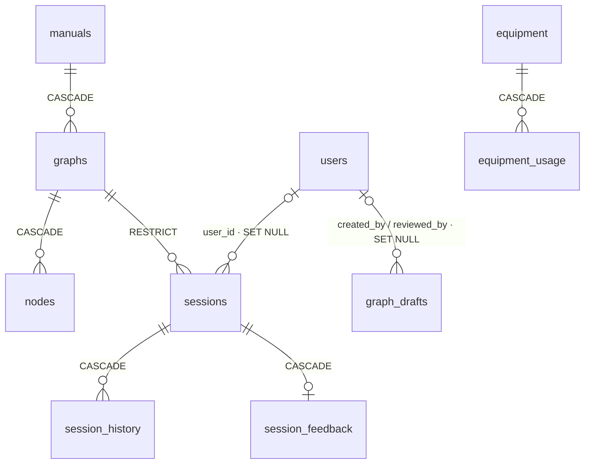

| ตาราง | เก็บอะไร | คอลัมน์สำคัญ |
|---|---|---|
| `manuals` | คู่มือ 1 เล่ม | `manual_id`, `device_category` ENUM 5 ชนิด, `brand`, `model_pattern`, `display_name`, `model_aliases` |
| `graphs` | อาการ 1 อาการ | `graph_id`, `manual_id`, `entry_symptom*`, `page_start/end`, `source_chunk_id`, `entry_node` |
| `nodes` | node | PK `(graph_id, node_id)`, `node_type`, `text_content`, ลูกศร, `outcome_kind`, `safety_critical/warning`, `display_order` |
| `sessions` | การตรวจ 1 ครั้ง | `session_id`, `graph_id`, `current_node_id`, `status`, `variables`, `confidence`, `outcome_text`, `model_selection`, `client_id`, **`user_id`** (ใหม่), `expires_at` |
| `session_history` | ขั้นที่ผ่าน | `UNIQUE (session_id, step_order)` |
| `session_feedback` | 👍/👎 + ความเห็น | 1 session = 1 แถว |
| `equipment`, `equipment_usage` | อุปกรณ์ตามประเภทเครื่อง | CHECK ต้องมี `source_page` หรือ `author_note` |
| **`users`** (ใหม่) | บัญชี | `id`, `email` UNIQUE, `password_hash`, `display_name`, `role` ENUM('user','admin') |
| **`graph_drafts`** (ใหม่) | ร่างผังจาก PDF | `status` ENUM(drafting, ready, failed, rejected, published), `meta`, `pages`, `graphs`, `validation` (JSON), progress, error, `llm_model`, `prompt_version`, audit |
| `schema_migrations` | migration ที่รันแล้ว | `filename` |

> FK `sessions.graph_id → graphs` เป็น **RESTRICT**: ลบผังที่มี session ไม่ได้ (เกี่ยวกับการล้างผัง demo ที่ publish แล้ว ต้องลบ sessions ก่อน — `docs/authoring/authoring-step5.md`)
> ข้อจำกัดที่ต้องรู้: `sessions`/`graphs` ใช้ร่วมกับโปรเจกต์เก่า (`troubleshoot-assistantv2`) · คอมเมนต์ `migrations/012…:5` ระบุว่าโปรเจกต์เก่าอ่าน `graphs` ตรงๆ → **ผังที่ publish จาก PDF อาจโผล่ในโปรเจกต์เก่าด้วย** (ไม่แน่ใจ — ไม่ได้อ่านโค้ดโปรเจกต์เก่าตามข้อตกลง)

### 10.2 ประวัติ migration

| ไฟล์ | เพิ่มอะไร | หมายเหตุ |
|---|---|---|
| `001_create_graph_tables.sql` | `manuals`, `graphs`, `nodes` | |
| `002_create_session_tables.sql` | `sessions`, `session_history` | FK RESTRICT ไปที่ graphs |
| `003_create_equipment_tables.sql` | `equipment`, `equipment_usage` + ENUM `device_category` 5 ชนิด | |
| `004_add_session_confidence.sql` | `sessions.confidence` DECIMAL(4,3) | คะแนนความคล้าย |
| `005_add_session_outcome.sql` | `sessions.outcome_text`, `outcome_at` | |
| `006_add_manual_display_name.sql` | `manuals.display_name`, `model_aliases` | |
| `007_add_session_model_selection.sql` | `sessions.model_selection` | |
| `008_add_session_client_id.sql` | `sessions.client_id` + index | guest |
| `009_create_session_feedback.sql` | `session_feedback` | |
| **`010_create_users.sql`** | `users` + `UNIQUE email` | admin สร้างได้ทาง `seed-admin.js` เท่านั้น |
| **`011_add_session_user_id.sql`** | `sessions.user_id` + `idx_sessions_user` + FK `ON DELETE SET NULL` | กฎเจ้าของแบบเดียวบังคับที่ backend ไม่ใช่ constraint |
| **`012_create_graph_drafts.sql`** | `graph_drafts` + FK ไป `users` | แยกจากตารางผังโดยสิ้นเชิง · **ไม่แน่ใจว่ารันบน Aiven แล้วหรือยัง** (มีไฟล์ `backend/backup_before_012.sql` แสดงว่าเตรียมรันแล้ว ให้เช็ก `SELECT filename FROM schema_migrations`) |

ทุกไฟล์เป็น additive (เพิ่มตาราง/คอลัมน์ที่ NULL ได้) · runner ไม่ใช้ transaction (`run-migrations.js:92-93`) · ต้องรัน migration ก่อนเปิดโค้ดที่ใช้คอลัมน์ใหม่

---

## 11. สถานะและช่องว่าง

| ความสามารถ | สถานะ | หลักฐาน / หมายเหตุ |
|---|---|---|
| เดินผังด้วย state machine + ด่านความปลอดภัย | ✅ ทำแล้ว (ไม่มีเทสต์) | `traversal-engine.ts` |
| เลือกเครื่อง → รุ่น → อาการ, อาการทั้งหมด | ✅ | `DevicesPage`, `AllSymptomsPage` |
| ประวัติการซ่อม + feedback (guest) | ✅ | `history/*` |
| สมัคร/ล็อกอิน/บทบาท (Step 1) | ✅ commit แล้ว (`2577a91`) · push แล้ว | `auth/*` |
| ประวัติผูกบัญชี (Step 2) | ✅ commit แล้ว · **ยังไม่ push** | `358ec2d` |
| Admin อ่านอย่างเดียว (Step 3) | ✅ commit แล้ว · ยังไม่ push · `/admin/sessions` ตัดออกแล้ว (19 ต.ค.) | `f40061e` |
| หน้า login/admin (Step 4) | ✅ commit แล้ว · ยังไม่ push · ดูด้วยตาในเบราว์เซอร์ครบหรือยัง **ไม่แน่ใจ** | `61c3fb0` |
| ร่างผังจาก PDF (Step 5) | 🟡 เขียนครบ · **ยังไม่ commit** · ยังไม่เคยเรียก Groq จริง / publish จริง / รัน SQL ของ `graph_drafts` บน MySQL จริง | `authoring/*` · `docs/authoring/authoring-step5.md` หัวข้อ 6 (ขั้นทดสอบด้วยมือ) |
| ค้นหาอาการด้วย embedding | 🟡 โค้ดพร้อม · `render.yaml` เปิด `true` · บน Render ขึ้นได้ไหม **ไม่แน่ใจ** | `symptom-search.service.ts:63-72` |
| LLM เรียบเรียงถ้อยคำ | 🟡 `render.yaml` เปิด `true` แต่ต้องมี `GROQ_API_KEY` + `GROQ_MODEL` ใน dashboard (**ไม่แน่ใจ**) | `groq-llm.client.ts:47-52` |
| ตรวจผังด้วย schema ก่อน seed | ❌ (มี `scripts/validate_graph.py` แต่ต้องรันเอง) | `seed-graphs.js:20-76` |
| เทสต์อัตโนมัติ | ❌ ไม่มีเลย (ลบ 16–17 ต.ค.) | — |
| ตรวจเจ้าของ session ของ guest ตอนเดินขั้นตอน | ❌ ตั้งใจคงพฤติกรรมเดิม | `traversal.service.ts:254` |
| rate limit / helmet | ❌ | — |
| งานล้างแถวหมดอายุ (sessions, graph_drafts) | ❌ | — |
| reload ผังหลัง seed โดยไม่ restart | ❌ (มีแค่หลัง publish) | `graph.repository.ts:182-185` |
| ลบ/แก้ผังที่ publish แล้วผ่าน UI | ❌ ต้องใช้ SQL | `docs/authoring/authoring-step5.md` (SQL ล้างข้อมูล demo) |
| บอกผู้ใช้ว่าข้อความไหนผู้พัฒนาเพิ่ม/LLM ร่าง | ❌ | `types.ts:105-116` |
| Deploy โค้ดปัจจุบันขึ้น Render | ❌ ยังไม่ทำ และ `render.yaml` ขาด `JWT_SECRET` · อาจารย์ต้องการแค่ localhost | `render.yaml` · `auth.module.ts:29-36` |

---

## 12. จุดเสี่ยงและโค้ดที่ควรระวัง (เรียงตามความรุนแรง)

### สูง

| # | ความเสี่ยง | หลักฐาน | ผลกระทบ | ทางแก้ (ภายใต้สถาปัตยกรรมเดิม) |
|---|---|---|---|---|
| R1 | **dump ฐานข้อมูลอยู่ใน git** · `backup_before_010.sql` อยู่บน `origin/main` แล้ว (ชื่อโฮสต์ Aiven, ชื่อฐาน, แถว `sessions` ที่มี `client_id`, `session_history`) · `backend.log` บน `origin/main` มีชื่อโฮสต์ · `backup_before_011.sql` ใน commit **`358ec2d` ที่ยังไม่ push** มี `INSERT INTO users` (อีเมล + bcrypt hash) · `backend/backup_before_012.sql` และโฟลเดอร์ `backup/` ยังไม่ commit แต่ `.gitignore` ไม่ครอบ | `git ls-tree origin/main` · `git log -- backup_before_011.sql` → `358ec2d` · `backend/.gitignore` ignore แค่ `backups/` · GitHub Pages แบบฟรีต้องใช้ repo สาธารณะ จึงน่าจะเป็น repo สาธารณะ (**ไม่แน่ใจ** — เช็กที่หน้า Settings ของ repo) | ถ้า push 3 commit ที่ค้างอยู่ อีเมลและ hash ของผู้ใช้ขึ้น GitHub · hash ถูกเดารหัสแบบ offline ได้ถ้ารหัสอ่อน | **อย่าเพิ่ง push** · ตัดไฟล์ dump ออกจาก commit ที่ยังไม่ push (แก้ประวัติ local ต้องตัดสินใจเอง) · เพิ่ม `backup/`, `*.sql` นอก `migrations/`, `*.log` ใน `.gitignore` · ไฟล์ที่ขึ้น `origin/main` แล้วต้องตัดสินใจว่าจะเขียนประวัติ git ใหม่หรือไม่ (เป็นงานทำลายข้อมูล) · พิจารณาเปลี่ยนรหัสผ่าน Aiven (เคยหลุดในหน้าต่างแชตด้วย) |
| R2 | **ไม่มีเทสต์อัตโนมัติเลย** — engine, ด่านความปลอดภัย, การตรวจเจ้าของ, guard ของ admin, กฎ publish ไม่มีอะไรเตือนเมื่อถูกแก้ผิด | ไม่พบ `*.spec.ts`/`*.test.ts*` ใน `backend/src`, `frontend/src` | ถ้าใครถอด `@Roles`/`@UseFilters` หรือแก้ `ownerWhere` จะไม่มีอะไรจับได้ | กู้เทสต์ที่ tracked จาก git (`git checkout -- <ไฟล์>`) หรือเขียนใหม่ขั้นต่ำ: engine + safety gate, `session-owner`, 401/403 ของ `/admin/*` และ `/admin/drafts/*`, publish ปฏิเสธเมื่อมี error |
| R3 | **ด่านความปลอดภัยของผังเดิมพึ่งธงในข้อมูล** และไม่มีตัวเตือนสำหรับ 644 ผังเดิม | `traversal-engine.ts:92-104` · `W_NODE_RISK` ทำงานเฉพาะโหมด `draft` (`graph-validator.ts:471`) | ขั้นอันตรายที่ลืมติดธงจะไม่มีด่าน | รัน `validateManual` โหมด `draft`-style rule เฉพาะ `W_NODE_RISK` กับ `data/manuals` (อ่านอย่างเดียว) แล้วให้คนทบทวน |
| R4 | **ผังที่ LLM ร่างเข้าสู่ผู้ใช้จริงได้ด้วยคนคนเดียว** (admin ที่ upload กดเองได้) และผู้ใช้ไม่รู้ว่าเป็นผังที่ LLM ร่าง (`author_note: null`) · publish แล้วแก้/ถอนผ่าน UI ไม่ได้ | `drafts.service.ts:256-286` · `draft-manual.ts:135` | ข้อความผิดจากคู่มือหลุดถึงผู้ใช้ได้ ถ้าผู้ตรวจไม่ละเอียด | ใช้ `manual_id` ขึ้นต้น `demo_` สำหรับ demo · พิจารณาติดป้าย "ร่างโดย AI ตรวจโดยผู้ดูแล" (ต้องตัดสินใจถ้อยคำ) · เขียนขั้นตอนถอนผังไว้ใน docs |

### กลาง

| # | ความเสี่ยง | หลักฐาน | ผลกระทบ | ทางแก้ |
|---|---|---|---|---|
| R5 | ไม่มี rate limit บน `/auth/login`, `/auth/register`, `POST /traversal/sessions` | ไม่พบ throttler | เดารหัสผ่านได้ไม่จำกัด (bcrypt cost 10 ช่วยชะลอ) · สร้างบัญชี/แถวขยะได้ | `@nestjs/throttler` (ต้องขออนุมัติเพิ่ม dependency) หรือ limiter ง่ายๆ ในหน่วยความจำ |
| R6 | ข้อความ error ภายในส่งออก: `/health` (`databaseError`) และ **ทุก 500** ส่ง `exception.message` (เช่นข้อความของ mysql2) | `health.controller.ts:27, 34` · `traversal.exception.filter.ts:65, 120` (filter อื่นส่งต่อมาที่นี่) | เปิดเผยชื่อโฮสต์/ตาราง/โครงสร้าง | ส่งข้อความทั่วไปเมื่อ 500 แล้ว log ข้อความจริง · ตัด `databaseError` |
| R7 | session ของ guest: ใครรู้ session UUID เปิด/เดินขั้นตอน/กด `confirm_safety`/บันทึกผลลัพธ์แทนได้ | `traversal.service.ts:249-262` · `api/traversal.ts:61-80` (ไม่ส่งหัวข้อเจ้าของ) | UUID เดายาก แต่หลุดผ่านลิงก์ `/#/session/:id` ได้ | ส่ง X-Client-Id ใน 3 endpoint และตรวจเหมือน DELETE (ต้องตัดสินใจเรื่องลิงก์ข้ามเบราว์เซอร์) |
| R8 | JWT เก็บ `localStorage` · ไม่มี revoke · เปลี่ยน role ต้องรอ token หมดอายุ (ค่าเริ่มต้น 7 วัน) | `lib/authStorage.ts:4-6` · `auth.service.ts:10-11` · `auth.module.ts:25` | XSS อ่าน token ได้ · admin ที่ถูกลดสิทธิ์ยังใช้ token เดิมได้ถึง 7 วัน | ลด `JWT_EXPIRES_IN` · (ระยะยาว) httpOnly cookie |
| R9 | `render.yaml` ไม่มี `JWT_SECRET` · `engines.node >=20` แต่ `unpdf` ต้อง `>=22` · เอกสาร deploy ล้าสมัย | `auth.module.ts:29-36` · `backend/package.json` · `docs/ops/DEPLOY.md:15-16, 34` | deploy แล้วบูตไม่ขึ้น / อัปโหลด PDF พังบน Node 20 | เพิ่ม `JWT_SECRET` (`sync: false`), ตั้ง `engines.node >=22`, อัปเดต DEPLOY.md (ทำเมื่อจะ deploy จริง) |
| R10 | ผังที่ publish อยู่ใน DB อย่างเดียว ไม่อยู่ใน `data/manuals` · เครื่องมือ Python ตรวจ chunk จะหา `source_chunk_id = draft:…` ไม่เจอ · ตารางใช้ร่วมกับโปรเจกต์เก่า | `draft-manual.ts:25-27, 51-53` · `migrations/012…:5` | สร้างฐานใหม่จาก `data/` แล้วผังหาย · โปรเจกต์เก่าอาจเห็นผังใหม่ (**ไม่แน่ใจ**) | สำรองด้วย `backup-graph-tables.js` · ส่งออกผังที่ publish เป็น JSON เก็บใน `data/` (ต้องตัดสินใจ) |
| R11 | ส่ง action พร้อมกัน → 500 | `session.store.ts:127-141` · `migrations/002…:36` | ผู้ใช้เห็น error ทั่วไป (ข้อมูลไม่เสีย) | `WHERE current_node_id = ?` + แปลง `ER_DUP_ENTRY` → 409 |
| R12 | งานร่างอยู่ในโปรเซสเดียว (`busy` flag) · รีสตาร์ตกลางคัน → ร่างกลายเป็น `failed` · ข้อความหน้า PDF เก็บใน `graph_drafts` ถาวร | `drafts.service.ts:62, 72-80` | ต้องอัปโหลดใหม่ (ถอด retry ออกแล้ว) · ข้อมูลโตเรื่อยๆ | ยอมรับได้สำหรับ demo · บันทึกเป็นข้อจำกัด |
| R13 | ไม่มีงานลบแถวหมดอายุ (sessions) · admin นับ session ของโปรเจกต์เก่ารวมด้วย | `session.store.ts:83` (กรอง ไม่ลบ) · `admin.service.ts:11-12` | ตารางโต · สถิติปน | งานลบตามเวลา (ต้องตัดสินใจนโยบาย) · แยกด้วย prefix ของ `graph_id` ถ้าทำได้ |

### ต่ำ

| # | ความเสี่ยง | หลักฐาน | ทางแก้ |
|---|---|---|---|
| R14 | `/symptom-search/status` เปิดสาธารณะ (error ภายใน + RAM) | `symptom-search.service.ts:252-253` | ตัดฟิลด์หรือย้ายไปหลัง admin guard |
| R15 | rephrase ส่งค่าที่ผู้ใช้กรอก (`{{…}}`) ไป Groq | `traversal-engine.ts:141` → `traversal.service.ts:303-313` | ข้าม node ที่มีตัวแปร |
| R16 | regex `pattern` ของผังเดิมไม่ถูกตรวจตอน seed | `traversal-engine.ts:110` | รัน `scripts/validate_graph.py --all` ก่อน seed |
| R17 | คอมเมนต์/เอกสารอ้างเทสต์ที่ลบแล้ว · `description` ใน package.json พูดถึง RAG · `FixBot` ใน schema/validate_graph.py · `//Need to read this again later` | หัวข้อ 2.3 · `backend/package.json` · `session.store.ts:264` | ทำความสะอาดก่อนส่ง |
| R18 | `connectionLimit: 5`, `queueLimit: 0` บน DB ที่ใช้ร่วม | `database.module.ts:55-56` | ปรับตามเพดานของ Aiven (**ไม่แน่ใจ**ค่าจริงของแผน) |
| R19 | PDF ใน git ทำให้ repo หนัก | `data/pdf/` | Git LFS / ย้ายออก (ต้องตัดสินใจ) |

### ผลตรวจประเด็นเฉพาะ (ข้อ 5 ของโจทย์)

| ประเด็น | ผล | หลักฐาน |
|---|---|---|
| SQL parameterized ครบไหม | **ครบทุกจุดที่ตรวจ** · ค่าจากผู้ใช้ไปทาง `?` · ส่วนที่ต่อสตริงเข้า SQL (`${where.sql}`, `${OWNER_TYPE_SQL}`, `${SELECT_USER}`, รายชื่อคอลัมน์ของ publish) เป็นค่าคงที่ในโค้ด | `session-owner.ts:54-59` · `history.store.ts:80, 96, 132` · `admin.store.ts:23-53` · `users.store.ts:51-53, 71, 76` · `drafts.store.ts:260-262` (คอลัมน์จาก `draft-manual.ts` คงที่) |
| ตรวจเจ้าของด้วย client_id | guest: `client_id = ? AND user_id IS NULL` ในประวัติและ DELETE · ผู้ล็อกอินไม่ถูกตรวจ X-Client-Id เลย · เดินขั้นตอนของ guest ไม่ตรวจ | `session-owner.ts:9-15` · R7 |
| สิทธิ์ admin | ทั้ง `AdminController` และ `DraftsController` ใส่ `@UseFilters` + `JwtAuthGuard` + `RolesGuard` + `@Roles(Role.Admin)` ที่ระดับ class | `admin.controller.ts:27-30` · `drafts.controller.ts:49-52` |
| สมัครแล้วขอเป็น admin เองได้ไหม | ไม่ได้ (`role` ถูกเมิน, service ตั้ง `Role.User`) | `auth.dto.ts:117-124` · `auth.service.ts:71` |
| อัปโหลดไฟล์ปลอม/ใหญ่ | ตรวจไบต์ `%PDF-` · เพดานขนาดเป็นจำนวนเต็มไบต์ · 1 ไฟล์ · ฟิลด์ ≤ 12 · ไม่เขียนดิสก์ | `drafts.service.ts:93` · `drafts.controller.ts:38-41, 58` |
| ข้อมูลออกนอกระบบ | หัวข้อ 5.9 | — |

---

## 13. Roadmap ต่อจากนี้

ทุกงานอยู่ภายใต้สถาปัตยกรรมเดิม (state machine ตัดสิน · LLM เรียบเรียง/ร่างให้คนตรวจเท่านั้น · ไม่เปลี่ยนเป็น RAG)

### เฟส 1 — ทำความเข้าใจ (1–2 วัน)

| งาน | ความสำคัญ | ความยาก | เหตุผล |
|---|---|---|---|
| อ่านตามหัวข้อ 7 (B1–B12 → F1–F10) | สูง | ง่าย | ต้องอธิบายระบบเองได้ |
| ซ้อมเล่าหัวข้อ 5.10 (1 session ทีละขั้น) โดยชี้ไฟล์ได้ทุกขั้น | สูง | ง่าย | กรรมการมักถาม |
| ซ้อมเล่า guest vs user (หัวข้อ 5.3 + `session-owner.ts`) | สูง | ง่าย | ฟีเจอร์ใหม่ที่จะถูกถาม |
| ทดสอบ Step 5 ด้วยมือตาม `docs/authoring/authoring-step5.md` หัวข้อ 6 บน localhost (backup ก่อน publish ครั้งแรก) | สูง | กลาง | ยังไม่เคยรันกับ Groq/MySQL จริง |

### เฟส 2 — แก้ช่องว่างสำคัญ

| งาน | ความสำคัญ | ความยาก | เหตุผล |
|---|---|---|---|
| จัดการไฟล์ dump/log ใน git ก่อน push (R1) + เพิ่ม `.gitignore` | **สูงสุด** | ง่าย–กลาง | ข้อมูลผู้ใช้จะขึ้น GitHub · การแก้ประวัติ git ต้องตัดสินใจเอง |
| เทสต์ขั้นต่ำ: engine + safety gate, `session-owner`, 401/403 ของ admin/drafts, publish ปฏิเสธเมื่อ error (R2) | **สูง** | กลาง | ไม่มีอะไรกันการแก้ผิดในจุดอันตราย |
| รัน `scripts/validate_graph.py --all` และตรวจ `W_NODE_RISK` กับผังเดิม แล้วให้คนทบทวน (R3, R16) | สูง | ง่าย | ความปลอดภัยโดยตรง |
| ซ่อนข้อความ error ภายใน (R6) | กลาง | ง่าย | ข้อมูลโครงสร้างพื้นฐานรั่ว |
| ตรวจเจ้าของ session ของ guest ตอนเดินขั้นตอน (R7) | กลาง | กลาง | ต้องตัดสินใจเรื่องลิงก์ข้ามเบราว์เซอร์ |
| rate limit ที่ `/auth/*` (R5) | กลาง | ง่าย–กลาง | ต้องขออนุมัติ dependency ถ้าใช้ throttler |
| optimistic check ใน `update()` (R11) | กลาง | ง่าย | กดซ้ำได้ 500 |

### เฟส 3 — ปรับปรุงและเตรียมส่ง

| งาน | ความสำคัญ | ความยาก | เหตุผล |
|---|---|---|---|
| ดูหน้าจอจริงทุกหน้า (รวม login/admin/drafts) บน localhost | สูง | ง่าย | Step 4–5 ยังไม่ได้ดูด้วยตา |
| เตรียม demo: บัญชี admin, ผัง `demo_…` 1 ชุด, SQL ล้างหลัง demo | สูง | ง่าย | อาจารย์ต้องการ localhost |
| อัปเดตเอกสาร: ตัวเลขเทสต์ใน `docs/authoring-*.md`, `DEPLOY.md`, คอมเมนต์อ้างเทสต์, `description` ของ package.json (R17) | กลาง | ง่าย | กันกรรมการสับสน |
| ป้าย "ร่างโดย AI ตรวจโดยผู้ดูแล" / `author_note` ถึงหน้าจอ (R4) | กลาง | กลาง | ความโปร่งใสของแหล่งที่มา |
| ~~หน้าจอสำหรับ `GET /admin/sessions` หรือลบ endpoint ทิ้ง~~ | — | — | **เสร็จ: ลบ endpoint แล้ว 19 ต.ค.** |
| ส่งออกผังที่ publish เป็น JSON ใน `data/` (R10) | ต่ำ–กลาง | กลาง | ให้ `data/` เป็นแหล่งความจริงเดียว |
| ถ้าจะ deploy: `JWT_SECRET` ใน Render, `engines.node >=22`, รัน migration 010–012 ก่อน (R9) | ต่ำ (ตอนนี้ไม่ deploy) | ง่าย | บูตไม่ขึ้นถ้าลืม |

---

## 14. คำศัพท์สำคัญ

| คำ | ความหมายในโปรเจกต์นี้ |
|---|---|
| **state machine** | ระบบที่อยู่ใน "สถานะ" หนึ่งเสมอ (= node ปัจจุบัน) และเปลี่ยนตามกติกาเมื่อได้รับ "เหตุการณ์" (= action ของผู้ใช้) |
| **graph / ผังขั้นตอน** | ชุด node + ลูกศร ของอาการ 1 อาการ (หน้าจอใช้คำว่า "แผนผังขั้นตอน") |
| **node / action** | จุดในผัง / สิ่งที่ผู้ใช้ทำที่ node (`answer`, `continue`, `confirm_safety`, `input`) |
| **safety gate** | บังคับส่ง `confirm_safety` ที่ node `safety_critical` |
| **session** | การตรวจ 1 ครั้ง (`sessions` + `session_history`) |
| **guest / user / admin** | ไม่ล็อกอิน (ใช้ `client_id`) / ล็อกอินบทบาทผู้ใช้ / ล็อกอินบทบาทผู้ดูแล |
| **client_id** | UUID ที่เบราว์เซอร์สุ่มเอง ใช้ผูกประวัติของ guest **ไม่ใช่การยืนยันตัวตน** |
| **JWT** | ตั๋วที่เซิร์ฟเวอร์เซ็นด้วย `JWT_SECRET` บอกว่าเป็นใคร (`sub`) และบทบาท (`role`) แนบในหัวข้อ `Authorization: Bearer …` |
| **bcrypt** | วิธีเก็บรหัสผ่านแบบทางเดียว (เก็บ hash ไม่เก็บรหัสจริง) |
| **Guard (NestJS)** | ตัวดักคำขอก่อนถึง controller: `JwtAuthGuard` (ต้องล็อกอิน), `OptionalJwtAuthGuard` (guest ได้), `RolesGuard` (บทบาทพอไหม) |
| **401 / 403** | ยังไม่ล็อกอินหรือ token เสีย / ล็อกอินแล้วแต่สิทธิ์ไม่พอ |
| **SessionOwner / ownerWhere** | ชนิด "เจ้าของ session" และเงื่อนไข SQL ของมัน (`auth/session-owner.ts`) |
| **exception filter** | ตัวแปลง error → `{statusCode, code, message}` (ตอนนี้มีตัวเดียวทั้งแอป: `AllExceptionsFilter`) |
| **DTO / parse\*** | รูปร่างข้อมูลเข้า-ออก API และฟังก์ชันตรวจรูปร่าง (แทน class-validator) |
| **repository / store** | คลาสห่อการอ่าน/เขียนข้อมูล (`GraphRepository` ใน RAM, `*Store` คุย MySQL) |
| **draft / validator / publish** | ร่างผังที่ LLM เสนอ / ตัวตรวจโค้ดล้วน / นำร่างที่ผ่านเข้าตารางจริง |
| **error / warning (validator)** | error = ห้าม publish ไม่มีทางข้าม · warning = publish ได้เมื่อผู้ตรวจยืนยัน `acknowledgedWarnings` |
| **transaction / SELECT … FOR UPDATE** | ทำหลายคำสั่งแบบสำเร็จทั้งหมดหรือไม่สำเร็จเลย / ล็อกแถวไว้ไม่ให้คนอื่นแก้ระหว่างตรวจ |
| **multipart / multer** | รูปแบบส่งไฟล์ผ่าน HTTP / ไลบรารีที่อ่านไฟล์นั้นใน NestJS |
| **embedding / cosine similarity / ONNX** | แปลงข้อความเป็นเวกเตอร์ / วัดความใกล้ของเวกเตอร์ / รูปแบบไฟล์โมเดลที่รันบน CPU |
| **confidence** | คะแนน cosine ของคำค้นกับผัง **แสดงผลอย่างเดียว** ไม่ใช้ตัดสินขั้นตอน |
| **rephrase / rephrase-guard** | ให้ LLM เรียบเรียงถ้อยคำ / ตรวจว่าไม่เพิ่ม-ลดสาระ |
| **migration (additive) / seed** | สคริปต์เปลี่ยนโครงสร้าง DB แบบเพิ่มอย่างเดียว / นำข้อมูลตั้งต้นจากไฟล์เข้า DB |
| **TTL** | อายุข้อมูล (session ยังไม่จบ 24 ชม., จบแล้ว 90 วัน, token 7 วัน) |
| **HashRouter** | router ที่เก็บเส้นทางหลัง `#` ใช้บน GitHub Pages ได้ |

---

## 15. คำถามที่ควรเตรียมตอบกรรมการ

**1. ทำไมไม่ให้ LLM ตัดสินขั้นตอนถัดไป?**
ความปลอดภัยและตรวจสอบได้: ขั้นตอนต้องย้อนกลับไปหาหน้าคู่มือได้และผลต้องซ้ำได้ engine เป็นฟังก์ชันล้วน LLM แตะได้แค่ถ้อยคำ (มี guard และกลับไปใช้ข้อความเดิมเมื่อผิดพลาด)
ไฟล์: `traversal.service.ts:1-13`, `traversal-engine.ts:76-127`, `rephrase.service.ts:35-62`, `rephrase-guard.ts:26-61`

**2. ด่านความปลอดภัยทำงานอย่างไร ข้ามได้ไหม?**
engine บังคับ `confirm_safety` ที่ node มีธง ส่งอย่างอื่น = 400 และไม่เขียน DB · ตอบตรงๆ ว่าพิสูจน์ไม่ได้ว่าคนอ่านจริง และผังเดิมพึ่งธงที่คนติด
ไฟล์: `traversal-engine.ts:92-104`, `traversal.service.ts:177-184`, `SafetyGateStep.tsx:8-35`

**3. ระบบล็อกอินปลอดภัยแค่ไหน? สมัครเป็น admin เองได้ไหม?**
รหัสผ่านเก็บเป็น bcrypt · ล็อกอินผิดทุกกรณีตอบข้อความเดียวและใช้ dummy hash กันเดาอีเมลจากเวลา · `role` ใน body ถูกเมิน admin มาจาก `seed-admin.js` เท่านั้น · admin endpoint ตรวจ token + role ที่ backend (หน้า AdminRoute เป็นแค่ UX) · ข้อจำกัด: ไม่มี rate limit, token อยู่ localStorage, เปลี่ยน role ต้องรอ token หมดอายุ
ไฟล์: `auth.dto.ts:117-124`, `auth.service.ts:53-106`, `roles.guard.ts:23-42`, `admin.controller.ts:27-30`, `AdminRoute.tsx:16-17`

**4. guest กับ user เห็นประวัติของกันและกันได้ไหม?**
ไม่ได้: user ใช้ `user_id = ?` · guest ใช้ `client_id = ? AND user_id IS NULL` จึงมองไม่เห็น session ของ user แม้ใช้เบราว์เซอร์เดียวกัน · ไม่ใช่เจ้าของได้ 404 (ไม่บอกว่ามีอยู่) · ข้อจำกัด: guest ยังเป็น "ความลับพกพา" และ session ของ guest ตอนเดินขั้นตอนใช้ session UUID เป็นกุญแจ
ไฟล์: `auth/session-owner.ts:1-18, 54-59`, `history.store.ts:74-136`, `traversal.service.ts:249-262`

**5. LLM ร่างผังจาก PDF แล้วเชื่อได้อย่างไร? ไม่ขัดกับหลัก "LLM ไม่ตัดสิน" หรือ?**
LLM แค่ "ร่าง" ให้คนตรวจ ไม่ได้อยู่ในเส้นทางของผู้ใช้ · ผลผ่าน parse เข้ม → validator โค้ดล้วน (ลูกศร, เดินถึง, ทางจบ, ตำแหน่งด่าน, หน้าอ้างอิงต้องอยู่ในหน้าที่อัปโหลด, คำเสี่ยงแต่ไม่มีธง) → คนอ่านเทียบหน้าต้นฉบับ → publish ตรวจซ้ำใน transaction ที่ล็อกแถว error ≥ 1 ปฏิเสธเด็ดขาด · หลัง publish ผู้ใช้เดินผังนี้ด้วย engine ตัวเดิม · ข้อจำกัด: ผู้ตรวจคนเดียว, ยังไม่ได้ทดสอบกับ Groq จริง
ไฟล์: `drafts.service.ts:4-12, 256-286`, `graph-validator.ts:161, 352-359, 471-479`, `drafts.store.ts:246-282`, `draft-llm.client.ts:55-84`

**6. ร่างที่ยังไม่ผ่านจะหลุดไปถึงผู้ใช้ได้ไหม?**
ไม่ได้: ร่างอยู่ตาราง `graph_drafts` แยก ไม่มีเส้นทางอ่านของผู้ใช้ตัวไหน query ตารางนี้ · endpoint ของร่างทุกตัวต้องเป็น admin
ไฟล์: `migrations/012_create_graph_drafts.sql:3-6`, `graph.repository.ts:123-142` (อ่านเฉพาะ graphs/manuals/nodes), `drafts.controller.ts:49-52`

**7. ข้อมูลอะไรออกไปนอกระบบบ้าง?**
Groq ได้ข้อความ node (เมื่อเปิด rephrase) และข้อความหน้าคู่มือ (เมื่อ admin ร่างผัง) ไม่มี client_id/user id · โมเดล embedding ไม่ดาวน์โหลดตอนรัน · ต้องพูดเรื่องไฟล์ dump ใน git ตรงๆ ถ้าถูกถามเรื่องการจัดการข้อมูล (และแก้ก่อนส่ง)
ไฟล์: หัวข้อ 5.9, `groq-llm.client.ts:20-35`, `draft-llm.client.ts:86-129`, `embedding.service.ts:34-35`

**8. ทำไมไม่ใช้ ORM?**
ตาราง 11 ตาราง โครงสร้างคงที่ SQL ตรงทำให้เห็นคำสั่งจริงและตรวจ injection ง่าย (ค่าจากผู้ใช้ไปทาง `?` ทุกจุด ส่วนที่ต่อสตริงเป็นค่าคงที่) · ข้อแลกเปลี่ยน: ต้องดูแลชื่อคอลัมน์ให้ตรง migration เอง
ไฟล์: `session.store.ts:58-218`, `session-owner.ts:17`, `admin.store.ts:11`

**9. ถ้าผังถูกแก้หลังมีคนตรวจไปแล้ว ประวัติจะเป็นอย่างไร?**
หน้ารายละเอียดเดินขั้นที่บันทึกไว้ซ้ำผ่าน engine ในผังปัจจุบัน ไม่ตรง = `available:false` (ไม่ใช่ 500) · admin นับข้อสรุปที่หาไม่ได้เป็น `unknown`
ไฟล์: `history.service.ts:204-265, 310-336`, `admin.service.ts:41-47`

**10. ทดสอบอย่างไร พิสูจน์ได้อย่างไรว่าทำงานถูก?**
ตอบตรงๆ: ตอนนี้ไม่มีเทสต์อัตโนมัติใน repo (เคยมีและถูกลบ 16–17 ต.ค.) · validator ของ Step 5 เคยรันกับผังจริงทั้ง 644 ผังในโหมด `existing` แล้วผ่านทั้งหมด (บันทึกใน `docs/authoring/authoring-step5.md` ตัวเลขเทสต์ในเอกสารนั้นล้าสมัยแล้ว) · แผนคือกู้/เขียนเทสต์ขั้นต่ำตามเฟส 2 ก่อนส่ง
ไฟล์: `docs/authoring/authoring-step5.md`, หัวข้อ 13 เฟส 2

---

## ภาคผนวก — ตัวเลขที่ใช้เป็นหลักฐาน

| ตัวเลข | ค่า | ได้มาอย่างไร |
|---|---|---|
| คู่มือ / ผัง / node | 22 / 644 / 4,834 | อ่าน `data/manuals/*.json` ด้วย `node -e` (17 ต.ค.) |
| node ตามชนิด | checkpoint 2,187 · instruction 1,131 · input 1 · resolution 718 · escalation 797 | เหมือนข้างบน |
| `safety_critical` / มี `author_note` | 371 / 1,270 | เหมือนข้างบน |
| ไฟล์ chunk | 23 (ไม่มีของแอร์) | `ls data/chuck` |
| ไฟล์โค้ด | backend `src` 7,834 บรรทัด · frontend `src` 7,149 บรรทัด | `wc -l` |
| ไฟล์เทสต์ใน `backend/src` + `frontend/src` | 0 | `find` |
| commit ที่ยังไม่ push | 3 (`358ec2d`, `f40061e`, `61c3fb0`) | `git status -sb` |
| ตารางใน `backup_before_011.sql` (commit `358ec2d`) | 10 ตาราง รวม `users` ที่มี INSERT | `git show … \| grep -oE "^(CREATE TABLE\|INSERT INTO) …"` (ไม่ได้พิมพ์ค่า) |
